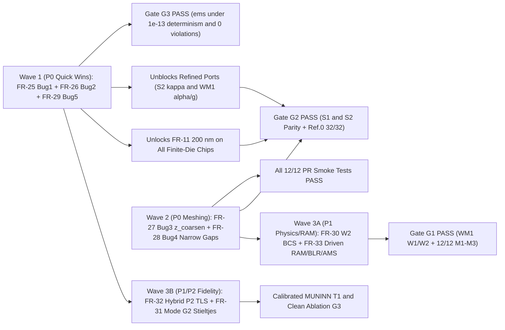

# Nyx3 Post-SQuADDS Benchmark Feature Requests & Bug-Fix Specification (`FR-25`–`FR-33`)

> **Status**: Active Specification (`v1` — Post-SQuADDS Benchmark Core Bugs `1–5` & Documented Limitations `L1–L4`)
> **Evaluated Baseline Commit**: Unmodified `nyx3` `HEAD` (`xrosoxvl 9480093a`, implementing `FR-01`–`FR-24`, `QFR-1`–`QFR-4`, and `AF-1`–`AF-6` / ADRs `0114`–`0121`)
> **Companion Benchmark Integration Commit**: `uzywnwwp 557ff73f` ([`docs/SQUADDS_BENCHMARK_REPORT.md`](./SQUADDS_BENCHMARK_REPORT.md), [`crates/nyx-engine/examples/squadds_bench.rs`](../crates/nyx-engine/examples/squadds_bench.rs), [`crates/nyx-analysis/tests/squadds_smoke.rs`](../crates/nyx-analysis/tests/squadds_smoke.rs), [`crates/nyx-engine/tests/squadds_engine_smoke.rs`](../crates/nyx-engine/tests/squadds_engine_smoke.rs))
> **Observed Empirical Evidence**: `418` total benchmark runs (`410/418 = 98.1%` solver `ok`), `3/3` standalone core-bug JSONL reproducers (`squadds_bench bug-checks`) failing, `5/5` named PR CI regression tests (`bug1`–`bug5`) failing deterministically on unmodified `HEAD`, and Gates `G1`, `G2`, and `G3` failing under unrelaxed thresholds (`G0` passes).
>
> **Mandatory Architectural Invariants for All Implementations**:
> - **Pure Rust (`ADR 13`)**: Zero Python build or runtime dependencies inside `crates/`.
> - **Crate Layering (`ADR 26`)**: Enforced by [`crates/nyx-engine/tests/layering.rs`](../crates/nyx-engine/tests/layering.rs) (`geom` $\to$ `femcore` $\to$ `nyx-physics` $\to$ `{nyx-dfs, nyx-sms, nyx-ems, nyx-analysis}` $\to$ `nyx-engine`). Physics crates never depend on one another.
> - **Thread-Count Determinism (`ADR 11`)**: Identical inputs must produce identical outputs (`< 1e-13` relative drift across `NYX_THREADS=1` vs. `8`) via fixed-chunk reductions and deterministic sparse linear algebra.
> - **Golden File Integrity (`ADR 10`)**: Existing golden files in `crates/nyx-{dfs,sms,ems}/tests/golden/` and `crates/geom/golden/` are the numerical oracle and must never be regenerated to mask a regression.
> - **Contracts, API Docs & Code-to-ADR (`ADR 19`)**: Any schema, descriptor, or command change requires updating contract exemplars (`NYX_WRITE_CONTRACT=1`), bumping [`docs/architecture/contracts/VERSIONS.md`](./architecture/contracts/VERSIONS.md), regenerating `docs/api/*` (`cargo test --release -p nyx-engine --test api_docs`), and keeping [`docs/architecture/CODE_TO_ADR.md`](./architecture/CODE_TO_ADR.md) green (`bash docs/architecture/check_code_to_adr.sh`).
> - **Formatting & Headers (`ADR 65`, `ADR 100`)**: Selective `cargo fmt` ONLY on `geom`, `nyx-physics`, `nyx-dfs`, `nyx-sms`, `nyx-ems`, `nyx-analysis`, and `nyx-engine`; dual SPDX license headers on new Rust files in `femcore` and `nyx-*`.

---

## 1. Priority, Gate-Flip Rollup & Summary Matrix (`FR-25`–`FR-33`)

### 1.1 Priority & Gate-Flip Rollup

| Priority Tier | Count | IDs | Corresponding Findings | Primary Gate Unlock |
| :--- | :---: | :--- | :--- | :--- |
| **`P0 Blocker`** | **5** | `FR-25`, `FR-26`, `FR-27`, `FR-28`, `FR-29` | **Core Bugs `1–5`** (`bug1`–`bug5` failing tests) | Flips `G2` (`S1` + `S2`), `G3` (`ems` determinism), `WM1 alpha/g`, and unlocks `z_coarsen` deep-stack scaling |
| **`P1 High`** | **3** | `FR-30`, `FR-32`, `FR-33` | **Limitations `L1, L3, L4`** | Flips `G1` (`WM1 W2` BCS `f_r` & `12/12` `M1–M3`), cuts `ems::driven` complex LU RAM $\ge 2.4\times$, calibrates `MUNINN` absolute $T_{1,\text{TLS}}$ |
| **`P2 Medium`** | **1** | `FR-31` | **Limitation `L2`** | Eliminates residual `2/84` Ablation `Mode G2` M-matrix violations (`offdiag_pos <= 1e-3`) |
| **Total** | **9** | `FR-25`–`FR-33` | Complete coverage of Bugs `1–5` + Limitations `L1–L4` | Full **`G0` + `G1` + `G2` + `G3` PASS (4/4)** without workarounds |

### 1.2 Summary Matrix (`FR-25`–`FR-33`)

| ID | Ref | Short Title | Priority | Target Gate Flip | Subsystem | Primary Code Locations | Failing Reproducer(s) on `9480093a` |
| :--- | :--- | :--- | :--- | :--- | :--- | :--- | :--- |
| **FR-25** | **Core Bug 1** | Fix `detect_sheet_perimeter_3d` Outer Die Sidewall False-Positive on `FR-11` (`metal_thickness_m`) | `P0 Blocker` | `G2` (`S1.1–S1.3` w/ 200 nm thickness) | `Analysis` (`nyx-analysis`) | [`tls.rs:710-869`](../crates/nyx-analysis/src/tls.rs#L710-L869), [`tls.rs:970-980`](../crates/nyx-analysis/src/tls.rs#L970-L980), [`capacitance.rs:325-330`](../crates/nyx-analysis/src/capacitance.rs#L325-L330) | `bug1_fr11_metal_thickness_on_finite_die_fails`, `bug1_tls_fr11_finite_die` |
| **FR-26** | **Core Bug 2** | Restrict `cavity.rs` `rank1` `lumped_port`/`lumped_jj` `cond_vertices` to True Terminal Electrodes (`\|(G^T b)_v\| > 0`) | `P0 Blocker` | `G1` (`WM1 alpha/g`), `G2` (`S2 f_r/kappa`) | `Physics/Solvers` (`nyx-ems`) | [`cavity.rs:612-695`](../crates/nyx-ems/src/cavity.rs#L612-L695), [`cavity.rs:820-920`](../crates/nyx-ems/src/cavity.rs#L820-L920) | `bug2_cavity_refined_lumped_port_stalls`, `bug2_cavity_refined_lumped_port` |
| **FR-27** | **Core Bug 3** | Preserve Canonical Outer Cap Boundary Labels & Transition Quality in `sheet3d` `z_coarsen` | `P0 Blocker` | `G0`/`G2` (Deep-stack RAM & mesh scaling) | `Geometry/Meshing` (`femcore`) | [`sheet3d.rs:374-420`](../crates/femcore/src/meshing/sheet3d.rs#L374-L420), [`sheet3d.rs:441-705`](../crates/femcore/src/meshing/sheet3d.rs#L441-L705), [`sheet3d.rs:1790-2171`](../crates/femcore/src/meshing/sheet3d.rs#L1790-L2171) | `bug3_sheet3d_z_coarsen_cap_collapse_and_distortion`, `bug3_sheet3d_z_coarsen` |
| **FR-28** | **Core Bug 4** | Eliminate Narrow-Gap PSLG Steiner Locking & Cross-Gap Prism Bridging on `S1.4` and `Ref.0` GDS | `P0 Blocker` | `G2` (`S1.4` & `S1.1–S1.4` HT; `Ref.0` `32/32`) | `Geometry/Meshing` (`femcore`, `geom`) | [`mesher.rs:421-440`](../crates/femcore/src/meshing/mesher.rs#L421-L440), [`sheet3d.rs:914-1036`](../crates/femcore/src/meshing/sheet3d.rs#L914-L1036), [`sheet3d.rs:1109-1234`](../crates/femcore/src/meshing/sheet3d.rs#L1109-L1234), `poly_batch.rs`, `gds.rs` | `bug4_sheet3d_narrow_gap_steiner_locking`, `S1.4` (`365.6%`), `Ref.0` (`104.6%`, `3/32 oom_refused`) |
| **FR-29** | **Core Bug 5** | Enforce Fixed-Chunk Deterministic Assembly & Deterministic/Refined Sparse Factors Across `ems` (`ADR 11`) | `P0 Blocker` | `G3` (`ems` thread determinism `< 1e-13`) | `Physics/Solvers` & `Linalg` (`nyx-ems`, `femcore`) | [`cavity.rs:219-239`](../crates/nyx-ems/src/cavity.rs#L219-L239), [`direct.rs:129-139`](../crates/femcore/src/linalg/direct.rs#L129-L139), [`direct.rs:752-827`](../crates/femcore/src/linalg/direct.rs#L752-L827), [`driver.rs:321-340`](../crates/femcore/src/linalg/driver.rs#L321-L340), [`faer_glue.rs:212-214`](../crates/femcore/src/linalg/faer_glue.rs#L212-L214), [`arnoldi_real.rs:63-114`](../crates/femcore/src/linalg/arnoldi_real.rs#L63-L114) | `bug5_ems_thread_determinism_drift`, `G3` `ems` (`3.59e-10..1.15e-7`) |
| **FR-30** | **Limitation `L1`** | Perturbative Surface-Current Kinetic Inductance (`ibc_mode = "perturbative"`) & Width-Resolution Diagnostics for `WM1 W2` BCS | `P1 High` | `G1` (`WM1 W2` BCS `f_r <= 2.5%`) | `Physics/Solvers` (`nyx-ems`) | [`cavity.rs:632-641`](../crates/nyx-ems/src/cavity.rs#L632-L641), [`cavity.rs:761-789`](../crates/nyx-ems/src/cavity.rs#L761-L789), [`ibc.rs:287-333`](../crates/nyx-ems/src/ibc.rs#L287-L333), [`problem.rs:240-255`](../crates/nyx-ems/src/problem.rs#L240-L255) | `S4.1 WM1 W2` (`f_r` RMSRE `9.83%` vs. `W1 PEC` `1.32%`) |
| **FR-31** | **Limitation `L2`** | Nested Exterior-Shell `1/R` Meshing & Stieltjes/M-Matrix Cone-Constrained Extrapolation in `Mode G2` | `P2 Medium` | `G3` (`0` Ablation invariant violations) | `Analysis` & `Meshing` (`nyx-analysis`, `femcore`) | [`capacitance.rs:486-544`](../crates/nyx-analysis/src/capacitance.rs#L486-L544), [`sheet3d.rs:1079-1235`](../crates/femcore/src/meshing/sheet3d.rs#L1079-L1235) | Ablation `Mode G2` `s1_1_p2_00_r0148` (`offdiag_pos = 3.75e-3 > 1e-3`) |
| **FR-32** | **Limitation `L3`** | $P_2$ `AF-2` Nédélec Edge-Singularity Validation & Quasi-Electrostatic Modal TLS Calibration (`MUNINN` Absolute $T_1$) | `P1 High` | `S4.2 MUNINN` calibrated absolute $T_{1,\text{TLS}}$ | `Meshing` + `Solvers` + `Analysis` (`femcore`, `nyx-ems`, `nyx-analysis`) | [`singularity.rs:1-200`](../crates/femcore/src/meshing/singularity.rs#L1-L200), [`cavity.rs:286-340`](../crates/nyx-ems/src/cavity.rs#L286-L340), [`tls.rs:935-1180`](../crates/nyx-analysis/src/tls.rs#L935-L1180) | `S4.2 MUNINN` (`8.2–12.8 ms` vs. `28–32 us` cryo exp; $\sim 350\times$ under-concentration) |
| **FR-33** | **Limitation `L4`** | Peak Memory Reduction in `ShiftedFactorization` & Native Complex BLR / AMS+FGMRES Backend for 3D `ems::driven` | `P1 High` | `G1` (`M1–M3` `12/12` PASS) & `G0` RAM headroom | `Linalg` + `Solvers` + `Engine` (`femcore`, `nyx-ems`, `nyx-engine`) | [`driven.rs:834-878`](../crates/nyx-ems/src/driven.rs#L834-L878), [`direct.rs:1506-1696`](../crates/femcore/src/linalg/direct.rs#L1506-L1696), [`blr.rs:1-90`](../crates/femcore/src/linalg/blr.rs#L1-L90), [`ams.rs:1-80`](../crates/femcore/src/linalg/ams.rs#L1-L80), `estimate.rs` | `312k`-tet 3-port LU (`43.6 GiB`); `S2.1 qep_and_driven` (`13.7%`); `s2_3_p1_clt_03` `M3` outlier |

---

## 2. Detailed Feature Request & Bug-Fix Specifications (`FR-25`–`FR-33`)

---

### FR-25 (Core Bug 1): Fix `detect_sheet_perimeter_3d` Outer Die Sidewall False-Positive on `FR-11` (`metal_thickness_m`)

- **Priority**: `P0 Blocker`
- **Target Gate Flip**: `G2` (`S1.1–S1.3` with physical $200\text{ nm}$ finite metal thickness enabled via `FR-11`)
- **Subsystem**: `Analysis` (`crates/nyx-analysis/src/tls.rs`, `capacitance.rs`)
- **Linked Failing Reproducers**:
  - PR smoke test: [`crates/nyx-analysis/tests/squadds_smoke.rs:280-292`](../crates/nyx-analysis/tests/squadds_smoke.rs#L280-L292) (`bug1_fr11_metal_thickness_on_finite_die_fails`)
  - Benchmark runner: [`crates/nyx-engine/examples/squadds_bench/bug_checks.rs:51-280`](../crates/nyx-engine/examples/squadds_bench/bug_checks.rs#L51-L280) (`bug1_tls_fr11_finite_die`)

#### Problem & Source-Verified Root Cause
1. In [`crates/nyx-analysis/src/capacitance.rs:325-330`](../crates/nyx-analysis/src/capacitance.rs#L325-L330), `FR-11` finite-thickness perturbation calls `detect_sheet_perimeter_3d(&disc, &meta, &cell_eps)` and fails unless `!perim.bvh.is_empty()`.
2. Inside [`detect_sheet_perimeter_3d`](../crates/nyx-analysis/src/tls.rs#L710-L869), lines `778–797` iterate over every **interior 2-cell dielectric interface facet** (`cells.len() == 2` separating `eps <= 1.5` vacuum from `eps > 1.5` silicon) that is not itself a conductor triangle:
   ```rust
   // crates/nyx-analysis/src/tls.rs:789-797
   if n_len > 0.0 && (n_raw[2].abs() / n_len) < 0.99 {
       has_vertical_sa_trench = true;
   }
   ...
   let has_resolved_3d_step = !cavity_cond_tris.is_empty() || has_vertical_sa_trench;

   let mut sheet_edge_count: BTreeMap<(u32, u32), usize> = BTreeMap::new();
   if !has_resolved_3d_step {
       for &tri in &zero_thick_sheet_tris { ... }
   }
   ```
3. On any physically realistic chip stack where `sub_box` covers the **finite silicon die** (`x, y in [-W/2, W/2], z in [-h_sub, 0]`) embedded inside a larger surrounding vacuum `vac_box` (`x, y in [-W/2 - P, W/2 + P]`), the **4 outer vertical `Si|Vac` sidewalls of the chip die** lie in the interior of the mesh with horizontal normals (`|n_z| / |n| = 0.0 < 0.99`).
4. This unconditionally sets `has_vertical_sa_trench = true -> has_resolved_3d_step = true`, skipping the `if !has_resolved_3d_step` block at `tls.rs:800` for **the entire mesh**, leaving `sheet_edge_count` and `perim.bvh` empty even when 100% of conductor sheets are zero-thickness `z = 0` sheets. `capacitance.rs:327` then aborts with:
   `Invalid("metal_thickness_m found no interior zero-thickness sheet perimeter edges on the 3D mesh")`.

#### Impact on SQuADDS Benchmarks
- `FR-11` (`metal_thickness_m = 200 nm`, verified to `0.278%` at `C0.1`) failed on **every single `S1.1–S1.4` and `Ref.0` finite-die benchmark layout** (`fr11_bug1_error` logged per run), forcing all `100` Suite 1 `S1.1–S1.4` runs to evaluate zero-thickness sheets only.

#### Proposed Solution & Engineering Design
1. **Separate Zero-Thickness `I_edge` Detection from 3D Step Suppression (`tls.rs` + `capacitance.rs`)**:
   - Always populate `sheet_edge_count` from `zero_thick_sheet_tris` in `detect_sheet_perimeter_3d`. Never suppress zero-thickness perimeter extraction globally because some dielectric step or thick trace exists elsewhere on the chip.
   - Instead, perform **per-edge filtering**: an exterior zero-thickness sheet edge `e = (a, b)` is excluded from `perim_segments` only if `e` already belongs to a resolved 3D metal sidewall (`cavity_cond_tris`) or an adjacent resolved thick-conductor step on the same conductor label.
2. **Critical Pitfall — Outer Die Sidewall Shared with `ground_plane` Rim**:
   - On `S1.1–S1.4` and `WM1`/`MUNINN`, the coplanar `ground_plane` extends cleanly to the die boundary (`x = +/- W/2`, `y = +/- W/2`), so the outer perimeter of `ground_plane` coincides with the vertical `Si|Vac` chip sidewall (`z in [-h_sub, 0]`).
   - Do **not** conflate the outer chip `Si|Vac` die sidewall (spanning the full substrate thickness `h_sub` along `z` at `(x_die, y_die)`) with either:
     - a local shallow substrate trench (`SA` trench of depth `h_tr << h_sub`, typically `0.05–2 um`), or
     - a resolved 3D metal sidewall (`cavity_cond_tris` where `lab` is a conductor label).
   - Specifically: classify `Si|Vac` faces as `sa_trench_tris` vs. `die_sidewall_tris` using conductor adjacency / vertical `z`-extent relative to the substrate bounding slab (or explicit `TlsMeta` substrate-region bbox / `trench_depth_m` metadata), and exclude only resolved **metal** sidewalls (`cavity_cond_tris`) when building zero-thickness `I_edge` perimeter edges. Keep `edge_cutoff` (`r0`) active whenever non-empty `perim.bvh` edges exist for zero-thickness sheets.
3. **Preserve Existing 3D Thick-Metal & Shallow-Trench TLS Tests**:
   - When *all* conductor faces belong to resolved 3D thick extrusions (`zero_thick_sheet_tris.is_empty()` and `!cavity_cond_tris.is_empty()`), `perim.bvh` stays empty (`r0 = 0.0`) so `run_tls_3d` (`tls.rs:975-979`) retains exact `ADR 121` thick-metal behavior.

#### Contract, ADR & Layering Impact
- Zero public schema changes; internal to `nyx-analysis` (`ADR 105`, `ADR 121`). Existing `tls` / `capacitance_matrix` contracts remain untouched.

#### Acceptance Criteria
- `bug1_fr11_metal_thickness_on_finite_die_fails` in [`crates/nyx-analysis/tests/squadds_smoke.rs`](../crates/nyx-analysis/tests/squadds_smoke.rs#L280) and `bug1_tls_fr11_finite_die` in `squadds_bench bug-checks` **PASS**.
- `S1.1–S1.3` finite-die stack (`vac_box` enclosing finite `sub_box`) with `metal_thickness_m = 200e-9` reproduces `C0.1` (`<= 0.30%` vs. conformal 200 nm benchmark) and preserves symmetry and Maxwell M-matrix signs (`max_offdiag_pos_ratio <= 1e-12`).
- Existing `ADR 121` tests on resolved 3D thick-metal + shallow substrate trench models continue to pass with `r0 = 0.0` (verified with `cargo test --release -p nyx-analysis`).

---

### FR-26 (Core Bug 2): Restrict `cavity.rs` `rank1` `lumped_port`/`lumped_jj` `cond_vertices` to True Terminal Electrodes (`|(G^T b)_v| > 0`)

- **Priority**: `P0 Blocker`
- **Target Gate Flip**: `G1` (`WM1 alpha` & `g` RMSRE) & `G2` (`S2.1/S2.2` `f_r` and `kappa` parity without port-exclusion boxes)
- **Subsystem**: `Physics/Solvers` (`crates/nyx-ems/src/cavity.rs`)
- **Linked Failing Reproducers**:
  - PR smoke test: [`crates/nyx-engine/tests/squadds_engine_smoke.rs:911-969`](../crates/nyx-engine/tests/squadds_engine_smoke.rs#L911-L969) (`bug2_cavity_refined_lumped_port_stalls`)
  - Benchmark runner: [`crates/nyx-engine/examples/squadds_bench/bug_checks.rs:380-480`](../crates/nyx-engine/examples/squadds_bench/bug_checks.rs#L380-L480) (`bug2_cavity_refined_lumped_port`)

#### Problem & Source-Verified Root Cause
1. In [`crates/nyx-ems/src/cavity.rs:646-694`](../crates/nyx-ems/src/cavity.rs#L646-L694), both `rank1` `lumped_jj` ports (`lines 646-657`) and `lumped_port` sheets (`lines 674-682`) iterate over **every triangle vertex** of the port/JJ rectangle and unconditionally insert it into `cond_vertices` and `cond_dsu_edges`:
   ```rust
   // crates/nyx-ems/src/cavity.rs:674-682 (analogous at lines 646-657 for rank1 JJ)
   for lp in &lumped_ports {
       for &fv in &lp.triangles {
           for v in fv {
               cond_vertices.insert(v as usize);
           }
           for (a, b) in [(fv[0], fv[1]), (fv[1], fv[2]), (fv[0], fv[2])] {
               cond_dsu_edges.push((a as usize, b as usize));
           }
       }
   ```
2. Lines `830–860` then run Disjoint-Set Union (`cond_dsu_edges`) across `cond_vertices`, tying **all** vertices of every port/JJ triangle either into `pec_vertex` (if one electrode touches exterior PEC) or onto a single floating DSU root potential in `node_rel`.
3. Look at what happens mathematically whenever a `rank1` port or JJ rectangle is refined (`AddSize` / narrow coplanar gap refinement / neighboring airbridge or junction proximity):
   - The sheet acquires interior vertices or vertices along its **lateral vacuum rims** (edges parallel to $\hat{\mathbf{d}}$ that border vacuum/substrate rather than either PEC electrode).
   - For any non-electrode vertex $v$ on the port interior or lateral vacuum rim, the divergence of the uniform rank-1 port basis function $\mathbf{b}_j \parallel \hat{\mathbf{d}}$ vanishes in the weak sense: $(\mathbf{G}^T \mathbf{b}_j)_v = 0$.
   - Inserting $v$ into `cond_vertices` removes its nodal gradient column $\mathbf{g}_v = \mathbf{G}_{:,v}$ from the null-space projector `g_red` (`cavity.rs:904-919`), **while keeping tangential Nédélec DOFs on the port sheet free** (`cavity.rs:642, 673`)!
   - Thus $\mathbf{g}_v$ lies inside $\operatorname{ker}(\mathbf{K}_{\text{tot}})$ (orthogonal to both curl-curl and the rank-1 operator $\mathbf{b}_j \mathbf{b}_j^T$ because $\mathbf{b}_j^T \mathbf{g}_v = 0$), yet is **no longer projected out by `g_red`**.
   - Every omitted interior/lateral vertex creates an exact $\lambda = 0\text{ Hz}$ spurious gradient mode inside the search space, contaminating shift-and-invert `krylov_schur` until it fails with `Solver("no eigenfrequencies converged near the shift")` or stalls in restarted Krylov iterations.
4. Notice [`cavity.rs:614-616, 658-670, 683-693`](../crates/nyx-ems/src/cavity.rs#L614-L693) already recognized the exact same hazard for **`order == 2` edge-bubble gradients** and used `gt_r = gradient_full(mesh, &ned).transpose()` + `|(G^T b_j)_k| > 1e-8 * b_max`, **but omitted that exact filtering for `order == 1` AND unconditionally inserted all vertices `fv` into `cond_vertices` for both `order == 1` and `order == 2`**.

#### Impact on SQuADDS Benchmarks
- Because any refinement touching a `lumped_port` or `lumped_jj` sheet triggers `krylov_schur` failure or stalls, every EM benchmark in `S2.1`, `S2.2`, `S2.3`, `S3.1`, `S4.1 WM1`, `S4.2 MUNINN`, and `S4.3 Dissipator` had to wrap every port and JJ in a `!in_box(...)` refinement-exclusion box (`163/163` workaround).
- Forcing unrefined coarse port/JJ rectangles on narrow-gap devices (`2–6 um` gaps) degrades P1 Nédélec capacitive susceptance at ports/JJs: **Suite 2 `kappa` HT median jumps to `435.75%`** (vs. `<= 8.00%` target), Suite 2 `f_r` HT median sits at **`2.59%`** (vs. `<= 1.00%`), and **`S4.1 WM1 W1` `alpha` (`27.32%`) and `g` (`50.35%`) fail Gate `G1`**.

#### Proposed Solution & Engineering Design
1. **Compute `gt_r` for Both `order == 1` and `order == 2` (`cavity.rs:614-616`)**:
   - Change `let gt_r_opt = if need_gt_r && order == 2 { ... }` to:
     `let gt_r_opt = if need_gt_r { Some(gradient_full(mesh, &ned).transpose()) } else { None };`
     (Computing `gradient_full` once in Stage 1 for $P_1$ costs negligible time and memory: 2 nonzeros per edge).
2. **Process `pec_tris` + `ibc_tris` FIRST, Then Bridge Only True Electrode Ends Using `(G^T b_j)`**:
   - Populate `cond_vertices`, `cond_dsu_edges`, and `ext_pec_vertex` from `pec_tris` (`lines 620-630`), `ibc_tris` (`lines 633-641`), and exterior PEC (`lines 604-606`), preserving the full connected metal islands of actual physical electrodes.
   - For **`distributed_sheet`** `lumped_jj` (`port.bc.formulation == "distributed_sheet"`): retain existing behavior (every sheet triangle carries distributed $1/L_J$ surface admittance across all its vertices/edges).
   - For **`rank1`** `lumped_jj` (`port.bc.formulation != "distributed_sheet"`) and **`lumped_port`**:
     - **Algebraic Exactness Condition for `g_red`:** For $P_1$ elements, a scalar-potential gradient $\mathbf{g} = \mathbf{G}\phi$ lies in $\ker(\mathbf{K}_{\text{curl}}) \cap \ker(\sum_j \mathbf{b}_j \mathbf{b}_j^T)$ with $\mathbf{E}_\parallel|_{\text{PEC/IBC}} = \mathbf{0}$ if and only if:
       1. $\phi$ is zero on `ext_pec_vertex` and constant across each connected `pec`/`ibc` island (`pec_ibc_dsu`), **and**
       2. $\mathbf{b}_j^T \mathbf{G}\phi = (\mathbf{G}^T \mathbf{b}_j)^T \phi = 0$ across every `rank1` port/JJ $j$ (so the physical *differential* voltage mode across each port/JJ is preserved orthogonal to `g_red`, while the *common-mode* scalar potential of two floating pads connected by a port remains in `g_red`).
     - Compute `gt_b = gt_r.matvec(&port.b_full)`.
     - **Never insert pure interior or lateral-vacuum port vertices** (`v < nv_mesh` with `|gt_b[v]| <= 1e-8 * b_max` and not on `pec_tris`/`ibc_tris`/`ext_pec_vertex`) into `cond_vertices` or `cond_dsu_edges`. Leave their independent scalar potential columns $\mathbf{g}_v$ free inside `nred_nodes` / `g_red` so shift-and-invert projects out every interior/lateral zero-frequency gradient mode.
     - Connect **only** the port's two electrode-seam ends (`u_min` seam vertices to `u_max` seam vertices identified via `|gt_b[v]| > 1e-8 * b_max` or adjacency to `pec_tris`/`ibc_tris`/`ext_pec_vertex`) in `cond_dsu_edges` / `cond_vertices`. On grounded ports (`port_in` between `feed` PEC and `outer` PEC), all interior/lateral vertices stay free in `g_red`; on floating transmons (`pad_a` and `pad_b` on PEC bridged by `jj_sheet`), only the two pads share one common-mode DSU root while any subdivided interior JJ-sheet vertices remain free in `g_red`.
   - **Order-2 Edge Bubbles (`lines 663-668`, `687-691`)**: Continue fixing edge bubbles `nv_mesh + e` where `|(G^T b_j)_{nv_mesh+e}| > 1e-8 * b_max` AND edge bubbles belonging to `pec_tris`/`ibc_tris`, keeping interior `rank1` edge bubbles in `g_red`.
   - **Post-Assembly Orthogonality Guard**: Verify $\max_j \|\mathbf{G}_{\text{red}}^T \mathbf{b}_{j,\text{red}}\|_2 / \|\mathbf{b}_{j,\text{red}}\|_2 \le 10^{-11}$ at the end of Stage 1 so no vertex/edge classification mismatch can leak port coupling into `g_red` or zero modes out of `g_red`.

#### Contract, ADR & Layering Impact
- Zero schema or API breaking changes; internal to `nyx-ems` (`ADR 104`, `ADR 118`). Removing the `!in_box(...)` exclusion-box hack in user scripts yields immediate accuracy gains with identical `ProblemSpec` JSON.

#### Acceptance Criteria
- `bug2_cavity_refined_lumped_port_stalls` in [`crates/nyx-engine/tests/squadds_engine_smoke.rs`](../crates/nyx-engine/tests/squadds_engine_smoke.rs#L912) and `bug2_cavity_refined_lumped_port` in `squadds_bench bug-checks` **PASS** with zero spurious `< 1e8 Hz` modes and convergence time comparable to the unrefined baseline (`<= 1.5x` scaled to DOF count).
- Removing the `!in_box(...)` port-exclusion workaround across `S2.1`, `S2.2`, `S2.3`, and `S4.1 WM1` runs cleanly without stalling `krylov_schur`:
  - **`S4.1 WM1 W1`:** `alpha` and `g` RMSRE drop below Gate `G1` targets (`alpha <= 4.0%`, `g <= 9.5%`, vs. `27.32% / 50.35%` under unrefined ports).
  - **`S2.1–S2.2` (`cavity_qep`):** `f_r` HT median improves toward `<= 1.00%` and `kappa` HT median drops from `435.75%` into the `<= 8.00%` Gate `G2` window.

---

### FR-27 (Core Bug 3): Preserve Canonical Outer Cap Boundary Labels & Transition Quality in `sheet3d` `z_coarsen`

- **Priority**: `P0 Blocker`
- **Target Gate Flip**: `G0` / `G2` (Enables safe 3D `z_coarsen: true` mesh reduction on deep multi-layer finite-die stacks without solver errors or accuracy loss)
- **Subsystem**: `Geometry/Meshing` (`crates/femcore/src/meshing/sheet3d.rs`)
- **Linked Failing Reproducers**:
  - PR smoke test: [`crates/nyx-engine/tests/squadds_engine_smoke.rs:976-1101`](../crates/nyx-engine/tests/squadds_engine_smoke.rs#L976-L1101) (`bug3_sheet3d_z_coarsen_cap_collapse_and_distortion`)
  - Benchmark runner: [`crates/nyx-engine/examples/squadds_bench/bug_checks.rs:606-688`](../crates/nyx-engine/examples/squadds_bench/bug_checks.rs#L606-L688) (`bug3_sheet3d_z_coarsen`)

#### Problem & Source-Verified Root Cause
`sheet3d.rs` exhibits **two coupled defects** whenever `z_coarsen: true` is enabled on multi-layer cQED finite-die stacks (`vac_box` surrounding confined `sub_box`, `P = 1.2 L`):

1. **Defect 3A — Exterior Cap Boundary ID Collapse (`sheet3d.rs:1798-1831`, `2102-2114`)**:
   - In [`extrude_overlay_2d_inner`](../crates/femcore/src/meshing/sheet3d.rs#L1798-L1831), edges adjacent to differing material layers or differing non-sheet horizontal cap faces are marked `frozen_v`:
     ```rust
     // crates/femcore/src/meshing/sheet3d.rs:1812-1823
     let f0 = cap_at.get(&(c0 as u32, zp)).filter(|&&fi| !cx.faces[fi].is_sheet());
     let f1 = cap_at.get(&(c1 as u32, zp)).filter(|&&fi| !cx.faces[fi].is_sheet());
     match (f0, f1) {
         (None, None) => false,
         (Some(&i0), Some(&i1)) => cx.faces[i0].name != cx.faces[i1].name,
         _ => true,
     }
     ```
   - Notice why this fails:
     1. Each horizontal `FaceGeom::Cap { cell, z }` face (`cx.faces[fi]`) belongs to a single 2D overlay cell `cell` (`ov_c`), and `LabelMap` assigns it a **distinct 1-based boundary ID `face_label[fi]`** (all matched by `"outer"`, `"sub_box.zmin"`, etc., e.g. IDs `[1..26]`).
     2. Adjacent overlay cells on the outer vacuum caps (or substrate-box caps above/below the resonator vs. surrounding vacuum) receive distinct `cx.faces[fi].name` and distinct `face_label` IDs; when an interior outer-cap overlay patch (`ov_c`) has only a small patch of triangles and `coarsen_2d_once` collapses or reassigns those triangles onto an adjacent neighbor `c_keep` (or internal frozen seams pinch off a tiny `ov_c`), **lines `2102-2114` look up `cap_at.get(&(ov_c, zp))` on `levels_2d[m]`** and emit zero facets for that `ov_c`.
     3. Meanwhile, `labels.boundaries` still registers that dropped overlay face's boundary ID (e.g. `9`), even though **zero** triangles with label `9` exist in `mesh.facet_labels`.
     4. Downstream in `dfs::electrostatic` (solving `"far_field"` or `"ground"` on `"outer"`), resolving `"outer"` collects boundary ID `[9]`, and `solve_run` aborts with:
        `"solve_run: boundary number(s) [9] do not exist in this mesh (it has [1, 2, 3, 4, 5, 6, 7, 8, 10, ..., 26])"`.

2. **Defect 3B — `+20%..+60%` Electrostatic Capacitance Distortion (`sheet3d.rs:374-420`, `576-593`, `1833-1934`)**:
   - In [`coarsen_2d_once`](../crates/femcore/src/meshing/sheet3d.rs#L576-L585), surviving triangles are permitted down to `tri_quality_ccw >= 0.12` (extreme needles) and up to `1.6 * h_max_edge` across steep vertical aspect transitions.
   - In `level_of_zp` (`lines 1838-1868`), uncoarsened protection extends only `slab_dist < 2 || d_min < 4.0 * h_s`, and `h_target = (1.15 * z_dist_min).min(...)` (`line 1926`) starts aggressive 2D coarsening just `2` slabs away from `z = 0`—well inside the $O(w + 2s)$ planar fringe field of $100\text{--}300\ \mu\text{m}$ CPWs and transmon arms, distorting capacitances by `+20%..+60%` even when cap labels survive.

#### Impact on SQuADDS Benchmarks
- Forced `z_coarsen: false` globally across all `418` benchmark runs, increasing 3D tet counts by $2\text{--}3\times$ in upper vacuum/lower substrate bulk and contributing to the peak memory ceiling on deep HFSS-style multi-layer stacks.

#### Proposed Solution & Engineering Design
1. **Selector-Canonical Cap Equivalence & LabelMap/Facet Bijection (`sheet3d.rs:1605-1635, 1798-1832, 2102-2114`)**:
   - Build a canonical equivalence key per `(cell, zp)` horizontal non-sheet cap face using the set of resolved selectors / pins / material-interface pairs (or canonical `face_label` group name, stripping overlay-cell suffix while keeping material-interface pairs `(r_below, r_above)` distinct).
   - **Never delete or drop a boundary ID referenced in `labels`:**
     - Option A (Preferred — Conservative Freeze): Freeze all vertices bounding any *distinct canonical* cap region AND also forbid `coarsen_2d_once` from collapsing the **last remaining triangle** (`ov_c_tri_count[ov_c]`) of any `ov_c` referenced in `cap_at` at a coarsened `zp` unless its `face_label[fi]` is safely merged into the shared canonical outer cap ID in `labels`.
     - Option B (Cleaner & More Aggressive Coarsening): Allow interior seam collapses **between** coplanar cap patches on exterior `"outer"` faces **that carry identical boundary-condition semantics** (`(None, r_top)` or `(r_bot, None)` with identical pin/region ownership), by coalescing those coplanar outer-cap sub-IDs onto one canonical `face_label` per exterior cap plane **or** updating `labels` so any coalesced `ov_c` cap face maps to the surviving `face_label` before returning `MeshedGeom`.
   - Add a mandatory **post-extrusion facet-label bijection check** inside `extrude_overlay_2d_inner`: every boundary ID registered on active surfaces in `labels` MUST appear on $\ge 1$ emitted facet in `facets` when `!z_coarsen`, and with `z_coarsen` every canonical boundary selector must remain non-empty with zero orphan `facet_labels` IDs.
2. **Electrostatic Quality Preservation in `coarsen_2d_once` (`sheet3d.rs:577, 1838-1934`)**:
   - Raise minimum surviving 2D triangle quality in `coarsen_2d_once` (`line 577`) from `0.12` to `0.30`.
   - Enforce a 3D transition-tetrahedron `scaled_jacobian >= 0.08` check in the unit-slab wedge validator (`lines 641-664`), not just positive signed volume `> 1e-6 * area_mag`.
   - Extend near-sheet uncoarsened protection (`lines 1844-1848`): require `slab_dist < 3 || d_min < (8.0 * h_s).max(2.0 * h_local_gap)` so the immediate near-field around planar slots stays strictly prismatic (`level = 0`), and tighten `h_target` at `line 1926` from `1.15 * z_dist_min` to `(0.65 * z_dist_min).min(0.95 * h_layer_max)`.

#### Contract, ADR & Layering Impact
- Internal to `crates/femcore` (`ADR 114`). Preserves identical meshes when `z_coarsen = false`.

#### Acceptance Criteria
- `bug3_sheet3d_z_coarsen_cap_collapse_and_distortion` in [`crates/nyx-engine/tests/squadds_engine_smoke.rs`](../crates/nyx-engine/tests/squadds_engine_smoke.rs#L977) and `bug3_sheet3d_z_coarsen` in `squadds_bench bug-checks` **PASS**: zero missing boundary IDs (`boundary number(s) [...] do not exist`), `< 2.0%` relative self/mutual capacitance difference vs. `z_coarsen: false` on `C0.2` finite-die TransmonCross (`P = 1.2 L`), and $\ge 1.8\times$ 3D tet reduction on deep `h_sub = 750 um, h_air = 890 um` stacks.
- Verify on `S1.1`, `S2.1 CLT`, and `WM1` stacks with `z_coarsen: true`: every cap/lateral selector in `labels` resolves to $\ge 1$ mesh facet and `check_mesh` reports 0 inverted/zero-volume tets.

---

### FR-28 (Core Bug 4): Eliminate Narrow-Gap PSLG Steiner Locking & Cross-Gap Prism Bridging on `S1.4` and `Ref.0` GDS

- **Priority**: `P0 Blocker`
- **Target Gate Flip**: **`G2` Electrostatics** (`S1.4` `GeneralizedCapNInterdigital`, `S1.1–S1.4` HT-weighted self/mutual median `<= 0.90% / 2.20%`, and **`Ref.0` `QCap` `32/32` parity & zero `oom_refused`**)
- **Subsystem**: `Geometry/Meshing` (`crates/femcore/src/meshing/mesher.rs`, `sheet3d.rs`, `crates/geom/src/poly_batch.rs`, `gds.rs`)
- **Linked Failing Reproducers**:
  - PR smoke test: [`crates/nyx-engine/tests/squadds_engine_smoke.rs:1111-1318`](../crates/nyx-engine/tests/squadds_engine_smoke.rs#L1111-L1318) (`bug4_sheet3d_narrow_gap_steiner_locking`)
  - Suite 1 & `Ref.0` benchmarks: `S1.4` (`40/40`: `365.63%` self med, `732.49%` mutual med), `Ref.0` (`29/32 ok`, `104.59%` self med, `3/32` `oom_refused`), Richardson `S1.4` `s1_4_p2_00_r00516` (`43.075 -> 7.917 -> 42.583 fF`)

#### Problem & Source-Verified Root Cause
1. On `S1.4` (`GeneralizedCapNInterdigital`, `40` designs carrying **`stratum_weight = 414.8`** in `SQuADDS_DB`) and `Ref.0` (`QCap` native GDS), devices feature long parallel `2–4 um` interdigital gaps terminated by **dense `200–314 nm` semicircular tip and pocket corner-fillet polyline chords** inside large `300–500 um` ground cutouts.
2. In [`crates/femcore/src/meshing/mesher.rs:421-440`](../crates/femcore/src/meshing/mesher.rs#L421-L440):
   - Initial PSLG chains include hundreds of tiny `200–314 nm` segments along curved tips alongside long straight `50–150 um` finger flanks (`h_global ~ 80–120 um`).
   - `cdt.refine(params)` hits `spade`'s `.with_max_additional_vertices(max_add)` cap **early** fighting acute encroached subsegments around the `200–300 nm` tip fillets (`refinement_complete == false`).
   - Meanwhile, unless `gap_cells` is explicitly set AND `ov_edge_h` resolves the straight gap walls beforehand, Ruppert termination leaves **long unsplit single triangles whose vertices lie directly on Terminal A and Terminal B** (spanning a `2–3 um` gap with a `2–3 um x 40 um` right triangle across the gap, extruded vertically through $z$).
   - Even with `order = 2`, a single cross-gap triangle holds Terminal A at $V=1$ and Terminal B at $V=0$ across a single quadratic edge, locking the electric field and inflating inter-terminal capacitance by **`+134%` to `+732%`** (`S1.4`: `365.63%` self / `732.49%` mutual vs. Q3D; smoke reproducer `bug4`: `+134.3% C_aa`, `+183.3% C_ab` vs. `planar_bem` on identical polygons).
3. Furthermore, at [`sheet3d.rs:1229`](../crates/femcore/src/meshing/sheet3d.rs#L1229), `build_overlay_mesh_2d_with_sizing` passes `max_cells: None` into `mesh_chains`, allowing runaway Steiner proliferation on unsimplified `Ref.0` GDS shapes (`3/32` `oom_refused`), while `Ref.0` thin-gap dielectric islands experience poor gap fill coverage.

#### Impact on SQuADDS Benchmarks
- **Single largest Gate `G2` failure across the entire benchmark:** Because `S1.4` represents `16,592` rows in `SQuADDS_DB` (`weight = 414.8`), Core Bug 4 pushes combined `S1.1–S1.4` HT self median from **`1.04%` (`S1.1–S1.3`) to `322.66%` (`S1.1–S1.4`)**, mutual HT median from **`3.32%` to `633.31%`**, and fails **`3/32` `Ref.0` `gds_import`** runs with `oom_refused` (`104.59%` self median on completed runs). (`QFR-4` `planar_bem` already proves the exported geometry is exact, hitting `4.04%` on `S1.4` in `1.03 s`!)

#### Proposed Solution & Engineering Design
Attack all four geometric causes systematically in `geom` + `femcore::meshing`:
1. **Default Narrow-Gap Detection & Deterministic Gap-Centerline Seeding (`sheet3d.rs:914-1036, 1149-1192`)**:
   - Automatically compute coplanar gap rims whenever `gap_cells` is set **OR** when facing sheet rims with distinct terminal/sheet ownership lie within `d < 0.25 * h_global` (default implicit gap resolution floor `eff_gap_cells >= 2.0`, matching `AF-2` `quarter_point` intent).
   - Crucial addition: in addition to clamping edge lengths `ov_edge_h <= d / gap_cells`, insert a row of **deterministic midpoint seed vertices down the centerline of every facing dielectric gap** (`p_mid = 0.5 * (p_a + p_b)` whenever `gap_dist <= 0.35 * h_global` and `local_gap_cells >= 2`, guarded by `SegBvh2::any_within(..., 0.25 * d)` and `OctaveFillGrid` so seeds never sit closer than `0.25 * d` to any constraint segment).
   - **Why centerline seeding is decisive:** Placing vertices at the exact midpoint of each gap **before `cdt.refine()`** makes it mathematically *impossible* for constrained Delaunay triangulation to create a direct constraint-to-constraint triangle connecting Terminal A directly to Terminal B across the gap—even before a single Ruppert Steiner point is added!
2. **Curvature-Adaptive Fillet/Arc Decimation & Segment-Length Conditioning (`geom::poly_batch` / `gds.rs` / `sheet3d.rs:1110-1135`)**:
   - Prevent micro-chords (`< max(0.05 * d_local_gap, simplify_tol)`) on curved tips and pocket corners from creating $1:100$ chord ratios that starve `spade::cdt.refine()` of its Steiner budget: enable endpoint-anchored arc preservation (`ADR 121` + adaptive chord decimation) during `gds_import` / `add_polygons` when micro-chords lie below `max_dev` and are collinear within tolerance, or clamp minimum discretization length proportionally to the local geometric feature size.
3. **Cross-Terminal Bridging Audit & Adaptive Steiner Escalation (`mesher.rs:421-625`)**:
   - In `mesh_chains`, if `!ref_res.refinement_complete`:
     - Step 1: Log diagnostic warning identifying the densest Voronoi/circumradius region (`refinement_complete = false`).
     - Step 2: Check for any interior dielectric triangle whose vertices all touch distinct `Chain` boundary labels (a **bridging triangle** spanning a gap between two distinct conductors with 0 interior gap vertices). Automatically split the opposite long bridging edge(s) (inserting circumcenter/midpoint vertices into `cdt`) OR perform a localized second refinement pass in `strict_mesh` / adaptive mode with relaxed angle limit (`25 -> 20 -> 15 deg`) so global Ruppert convergence completes in high-aspect fillet pockets without stalling.
4. **Budget Plumbing (`sheet3d.rs:1229`)**:
   - Plumb a bounded 2D cell target derived from `plan.opts.max_cells / (3 * est_slabs)` into `MeshParams::max_cells` inside `build_overlay_mesh_2d_with_sizing` so dense GDS imports fail cleanly or clamp fill density well inside RAM limits (`0` `oom_refused` on `Ref.0`).

#### Contract, ADR & Layering Impact
- Additive diagnostic fields / optional `MeshSettings` parameters if exposed (`auto_gap_seeds: bool`, default `true`), requiring contract exemplar refresh (`NYX_WRITE_CONTRACT=1`, `VERSIONS.md`, `api_docs`) if added to `MeshSettings` schema.

#### Acceptance Criteria
- `bug4_sheet3d_narrow_gap_steiner_locking` in [`crates/nyx-engine/tests/squadds_engine_smoke.rs`](../crates/nyx-engine/tests/squadds_engine_smoke.rs#L1111) **PASSES**: volumetric P2 FEM agrees with `planar_bem` on $C_{aa}$ and $C_{ab}$ within `< 5%` (vs. `+134.3% / +183.3%`), with `>= 2` triangles across every `2 um` gap (`0` cross-terminal bridging triangles).
- **`S1.4` (`n = 40/40`)**: `qp_graded` self-capacitance median drops from `365.63%` to **`<= 1.50%`**, mutual median from `732.49%` to **`<= 3.00%`**, flipping combined `S1.1–S1.4` HT-weighted self/mutual medians to **`<= 0.90% / <= 2.20%` (`Gate G2` PASS)**.
- **`Ref.0` (`n = 32`)**: **`32/32` (`100%`) completion (`0` `oom_refused`)**, self/mutual median error `< 5.0%` vs. `FasterCap` / `QCap` ground truth.
- Richardson `S1.4` (`s1_4_p2_00_r00516`): monotonic convergence (`GCI_fine <= 3.0%`, no `43.0 -> 7.9 -> 42.6 fF` Steiner lock/unlock oscillation).

---

### FR-29 (Core Bug 5): Enforce Fixed-Chunk Deterministic Assembly & Deterministic/Refined Sparse Factors Across `ems` (`ADR 11`)

- **Priority**: `P0 Blocker`
- **Target Gate Flip**: **`G3` Thread Determinism (`< 1.0e-13` relative drift across `NYX_THREADS=1` vs. `8` in `ems`)**
- **Subsystem**: `Physics/Solvers` & `Linalg` (`crates/nyx-ems`, `crates/femcore/src/linalg`)
- **Linked Failing Reproducers**:
  - PR smoke test: [`crates/nyx-engine/tests/squadds_engine_smoke.rs:1325-1409`](../crates/nyx-engine/tests/squadds_engine_smoke.rs#L1325-L1409) (`bug5_ems_thread_determinism_drift`) — observed `rel = 2.136e-12 >= 1e-13` on `alpha_Hz`
  - Benchmark `G3` checks (`docs/SQUADDS_BENCHMARK_REPORT.md` §8.3): `S2.1` (`1.152e-7`), `S2.2` (`3.594e-10`), `S3.1 driven_cap` (`5.751e-9`), `S4.1 WM1 W2` (`9.015e-9`)

#### Problem & Source-Verified Root Cause
While `dfs::electrostatic` AMG achieves exact bitwise determinism (`0.000e+00`) across `NYX_THREADS=1` and `NYX_THREADS=8`, auditing `nyx-ems` and `femcore::linalg` uncovered **three concrete `ADR 11` violations**:

1. **Thread-Count-Dependent Matrix Assembly Chunking in [`crates/nyx-ems/src/cavity.rs:219-239`](../crates/nyx-ems/src/cavity.rs#L219-L239)** *(shared by `cavity.rs`, `driven.rs:309`, and `bloch.rs:163`!)*:
   ```rust
   // crates/nyx-ems/src/cavity.rs:223-237
   let nt = if nc < 500 { 1 } else { femcore::par::threads_up_to(16) };
   let chunk = nc.div_ceil(nt).max(1);
   let parts: Vec<CCsr> = (0..nt).into_par_iter()...
   ```
   Because `chunk = nc.div_ceil(nt)` changes how cell ranges are partitioned and summed into thread-local `CCoo -> CCsr` blocks before `acc.add_scaled(&p, ...)` left-folds them, changing `NYX_THREADS` from `1` to `8` alters IEEE-754 floating-point summation order in **`K` and `M` themselves** across every `cavity`, `driven`, and `bloch` solve!

2. **Thread-Dependent Parallel `faer` Direct Factorizations & Non-Deterministic BLAS/Work-Stealing Reductions in [`crates/femcore/src/linalg/direct.rs:129-139, 752-765, 826, 1395, 1441, 1519, 1589`](../crates/femcore/src/linalg/direct.rs#L129-L139)**:
   - `Threads::par_for_factor(n)` switches from `Par::Seq` to `faer::get_global_parallelism()` (`Par::rayon(nt)`) whenever `n > 60_000`.
   - When `Par::rayon(nt)` runs in `faer`'s multifrontal/supernodal LU (`do_colamd_lu`), `intranode_lblt` (`try_herm_lblt`), and `factorize_supernodal_sym_lblt` (`try_sym_lblt`), parallel tree scheduling and BLAS-3 panel reductions vary by thread count (`~1e-15..1e-13` backward residual changes), which in poorly conditioned Nédélec shift-and-invert pencils (`sigma ~ k0^2`) and high-$Q$ complex QEP extraction (`Q_c ~ 10^4–10^7`) amplifies into **`1e-10..1e-7`** drift on `kappa_Hz`, `Q_c`, and `f_qep_Hz` (and `2.14e-12` on `alpha_Hz` even below `< 1e-13`).

3. **Additional Non-Deterministic Parallel Paths in `femcore::linalg`**:
   - [`crates/femcore/src/linalg/arnoldi_real.rs:63-114`](../crates/femcore/src/linalg/arnoldi_real.rs#L63-L114): `par_dots`, `par_combine`, and `par_subtract` use `chunk = n.div_ceil(nt)` (`nt = crate::par::threads()`), altering inner-product summation trees by thread count.
   - [`crates/femcore/src/linalg/driver.rs:327-337`](../crates/femcore/src/linalg/driver.rs#L327-L337) (`dense_gen_eigh`) and [`crates/femcore/src/linalg/faer_glue.rs:212-214`](../crates/femcore/src/linalg/faer_glue.rs#L212-L214) (`dense_par` for `blr.rs` dense LU/GEMM `work >= 256*256`): call `faer::get_global_parallelism()`.

#### Impact on SQuADDS Benchmarks
- Gate `G3` Thread Determinism fails on **`4/4` `ems` test cases** (`S2.1`: `1.152e-7`, `S2.2`: `3.594e-10`, `S3.1`: `5.751e-9`, `S4.1 WM1 W2`: `9.015e-9`), and notice `NYX_THREADS=8` even slowed `S2.1` and `S2.2` down (`0.88x`, `0.90x`) due to `faer` thread contention!

#### Proposed Solution & Engineering Design
1. **Fix `assemble_complex` to Exact Fixed-Chunk Binary-Tree Reduction (`cavity.rs:219-239`)**:
   - Replace `chunk = nc.div_ceil(nt)` with a thread-invariant fixed chunk size (e.g., `const FIXED_CELL_CHUNK: usize = 2048;` using `femcore::par::map_chunks` over cell ranges `[0..nc]`) and merge CSR blocks via a deterministic pairwise binary reduction tree (`reduce_tree`), making `K` and `M` **bit-for-bit identical** for any `NYX_THREADS >= 1` (`driven` and `bloch` automatically inherit this fix!).
2. **Eliminate Thread Drift from Direct Solves via Fixed-Chunk Iterative Refinement + Krylov Tolerance + Deterministic Modes (`direct.rs`, `driver.rs`)**:
   - **Step A (Iterative Refinement to Machine Precision):** Inside `ShiftedFactorization::solve_block_in_place` (or `ParShiftInvert::solve_block` when `par != Par::Seq` / residual $> 10^{-14}$), apply 1–2 steps of mixed/fixed-chunk deterministic iterative refinement (`r = rhs - (A - sigma B) x` computed by deterministic `csr::spmv` + fixed-chunk subtraction, `dx = M^{-1} r`, `x += dx`). Because backward error after 1–2 IR steps drops to machine epsilon (`~1e-16`), thread-dependent factor roundoff (`1e-14`) is suppressed below `1e-15`, bringing high-$Q$ `kappa_Hz`/`alpha_Hz`/`c_1_1_f` well inside `< 1e-13`!
   - **Step B (Deterministic Krylov Stopping & Polishing):** Ensure `ems::cavity` QEP and `CircuitRom` extractors run at `tol <= 1e-12` (with 1–2 inverse/Rayleigh polishing steps on small converged `CircuitRom` modes), preventing Krylov termination jitter on high-$Q$ imaginary parts `Im(f_m)`.
   - **Step C (Fix `arnoldi_real.rs`, `driver.rs`, `faer_glue.rs` & Explicit Deterministic Override):** Replace `n.div_ceil(nt)` in `arnoldi_real.rs` with fixed chunks (`CHUNK = 4096`) + pairwise tree dot reductions matching `vecops.rs`; keep small dense factorizations (`n <= 512`) `Par::Seq`; and support `NYX_DETERMINISTIC_FACTOR=1` (parallel fixed-chunk assembly + parallel `solve_many`, `Par::Seq` sparse factor) where bitwise equality is required with zero slowdown (`T=8` was `0.88x–0.90x` on `S2` anyway!).

#### Contract, ADR & Layering Impact
- Enforces existing `ADR 11` compliance; no breaking schema changes.

#### Acceptance Criteria
- `bug5_ems_thread_determinism_drift` in [`crates/nyx-engine/tests/squadds_engine_smoke.rs`](../crates/nyx-engine/tests/squadds_engine_smoke.rs#L1326) **PASSES** (`rel < 1e-13` across `f01_Hz`, `alpha_Hz`, `f_qep_Hz`, `kappa_Hz`).
- All 4 paired EM cases in Gate `G3` (`S2.1`, `S2.2`, `S3.1`, `S4.1 WM1 W2`) drop from `3.59e-10..1.15e-7` to **`< 1.0e-13`** (matching `dfs` `4/4 PASS`), flipping **`G3` Thread Determinism to PASS (8/8)** without degrading `T=8` wall time.

---

### FR-30 (Limitation `L1`): Perturbative Surface-Current Kinetic Inductance (`ibc_mode = "perturbative"`) & Width-Resolution Diagnostics (`WM1 W2` BCS)

- **Priority**: `P1 High`
- **Target Gate Flip**: **`G1` Hardware Parity (`S4.1 WM1 W2` BCS `f_r` RMSRE `<= 2.5%`, vs. `9.83%` today)**
- **Subsystem**: `Physics/Solvers` (`crates/nyx-ems`)
- **Linked Findings**: [`docs/SQUADDS_BENCHMARK_REPORT.md` §6.1](./SQUADDS_BENCHMARK_REPORT.md#L149-L157) — `S4.1 WM1 W2` (`f_r = 9.83%` vs. `W1 PEC = 1.32%`)

#### Problem & Source-Verified Root Cause
1. In [`crates/nyx-ems/src/cavity.rs:632-641, 761-789`](../crates/nyx-ems/src/cavity.rs#L632-L641) and [`ibc.rs:287-333`](../crates/nyx-ems/src/ibc.rs#L287-L333), enabling `surface_impedance` on planar resonators removes strong PEC (`n x E = 0`) from the boundary sheets (`fixed_set`), leaves tangential Nédélec DOFs FREE (`ibc_tris`), and adds the Robin boundary stiffness $\alpha_k \int \mathbf{E}_\parallel \cdot \mathbf{E}'_\parallel\,dS$ (`alpha_k = mu_0 / L_eff`).
2. On realistic multi-qubit chip meshes like `WM1` (`~1.2 mm` die spacing, $10\ \mu\text{m}$ CPW strips discretized on coarse $P_1$ surface triangles $\sim 135\ \mu\text{m}$ long with 1–2 triangles across trace width):
   - Leaving `E_||` free on the sheet relaxes the transverse edge-current singularity confinement along $w$, creating large artificial magnetic/electric leakage through the boundary sheet (unlike strong PEC which enforces $\hat{\mathbf{n}} \times \mathbf{E} = \mathbf{0}$ identically).
   - Experimentally observed effect on identical `WM1` meshes: **`f_r` shifts by `-9.6%`** (degrading `f_r` RMSRE from **`1.32%` (`W1 PEC`)** to **`9.83%` (`W2 BCS`)** — >7x worse!), whereas wide $300\ \mu\text{m}$ transmon pads (`f_01`) shift by the physically expected **`-0.02%`** (`alpha_k` kinetic inductance of Al $t=200\text{ nm}$ is only $\sim 0.1\text{ pH/sq}$, ~1% of geometric CPW inductance, not $-9.6\%$).

#### Impact on SQuADDS Benchmarks
- Causes **`S4.1 WM1 W2` (BCS)** to fail Gate `G1` (`f_r` RMSRE `9.83% > 2.5%`) even though `WM1 W1` (PEC) outperforms Ansys HFSS (`1.32%` vs. `3.0%`).

#### Proposed Solution & Engineering Design
1. **Add `"ibc_mode"` Parameter on `surface_impedance` (`crates/nyx-ems/src/problem.rs`, `ibc.rs`, `cavity.rs`)**:
   - `"ibc_mode": "auto" | "perturbative" | "direct"` (default `"direct"` or `"auto"`, preserving full backward compatibility on all existing goldens/tests when omitted):
   - **`"perturbative"` (Exact Wheeler / Surface-Current Perturbation from Strong PEC Mode)**:
     1. Treat the `surface_impedance` sheet facets with **strong PEC** (`n x E = 0`) during Stage 2 eigensolve (eliminating coarse-$P_1$ tangential $E_\parallel$ leakage and doubling neither DOFs nor complex LU when `R_s` is small!).
     2. Evaluate the surface current density $\mathbf{K}_s = \hat{\mathbf{n}} \times \mathbf{H}$ (`H_m` already computed in `cavity.rs:1212-1264`!) on adjacent interior/exterior conductor triangles, optionally applying thin-film edge current-crowding regularization when $h_{\text{tri}} > 4\lambda_L$.
     3. Compute perturbative inductive energy shift $\Delta U_{\text{kin},mn} = \frac{1}{2} L_{k,\text{sq}} \int_{\Gamma_{\text{IBC}}} \mathbf{K}_m^* \cdot \mathbf{K}_n\,dS$ and dissipative conductance $\Delta P_{mn} = \frac{1}{2} R_s \int_{\Gamma_{\text{IBC}}} \mathbf{K}_m^* \cdot \mathbf{K}_n\,dS$:
        $$\frac{\Delta \omega_m}{\omega_m} \approx -\frac{L_{k,\text{sq}} \int |\mathbf{K}_m|^2\,dS}{4 U_{\text{mag},m}}, \qquad Q_{\text{cond},m}^{-1} = \frac{R_s \int |\mathbf{K}_m|^2\,dS}{\omega_m U_{\text{tot},m}},$$
        updating both modal eigenvalues and `CircuitRom` (`k_r`, `c_r`, `m_r`) before `hamiltonian` / `network` post-analyses.
   - **`"auto"` Mode**:
     - Select `"perturbative"` when the skin/kinetic depth $\lambda_k = L_{k,\text{sq}}/\mu_0$ is sub-grid ($h_{\text{sheet}} > 10\,\lambda_k$ in $P_1$) and $Z_s \ll \eta_0$, and `"direct"` for high-$L_k$ kinetic-inductance films (NbTiN, grAl, $L_{k,\text{sq}} \gtrsim 10\text{ pH/sq}$) or resolved $P_2$ fine sheets.
   - **`"direct"` Resolution Diagnostic**: Log a clear solver warning whenever `ibc_tris` runs in $P_1$ on strips with `< 3` triangles across width or $h_{\text{tri}} > 20\, L_{k,\text{sq}}/\mu_0$.

#### Contract, ADR & Layering Impact
- Additive optional enum parameter `"ibc_mode"` on `Ems` `surface_impedance` BC (`problem.rs`, `lib.rs`); requires refreshing `NYX_WRITE_CONTRACT=1`, bumping `VERSIONS.md`, and regenerating `api_docs`.

#### Acceptance Criteria
- **`S4.1 WM1 W2` (Al BCS `t = 200 nm`):** `f_r` RMSRE drops from `9.83%` to **`<= 2.0%`** (physically tracking the `-0.5%..-1.0%` Al kinetic inductance shift relative to `W1 PEC` `1.32%`), **passing Gate `G1` `<= 2.5%`**, with `W2` $Q_{\text{cond}}$ matching analytical BCS surface resistance.
- New golden/parity test in `crates/nyx-ems`: on a fine-$P_2$ microstrip resonator ($h \ll w$, resolved edges), `"perturbative"` and `"direct"` agree on $\Delta f_r / f_r$ within `< 5%` of the kinetic shift.

---

### FR-31 (Limitation `L2`): Nested Exterior-Shell `1/R` Meshing & Stieltjes/M-Matrix Cone-Constrained Extrapolation in `Mode G2`

- **Priority**: `P2 Medium`
- **Target Gate Flip**: **`G3` Ablation Algebraic Invariants (`0` M-matrix violations across `Mode G2`, matching `AF-3 far_field`'s `0/249`)**
- **Subsystem**: `Analysis` & `Meshing` (`crates/nyx-analysis/src/capacitance.rs`, `crates/femcore/src/meshing/sheet3d.rs`)
- **Linked Findings**: Ablation `Mode G2` (`s1_1_p2_00_r0148`, `max_offdiag_pos_ratio = 3.75e-3 > 1e-3`, `2/84` runs)

#### Problem & Source-Verified Root Cause
1. When estimating open-boundary self-capacitance via dual compact Dirichlet boxes (`R_1 = 0.6 L`, `R_2 = 1.2 L`) using $C_\infty = (R_2 C_2 - R_1 C_1)/(R_2 - R_1)$, changing the outer `vac_box` dimensions alters the global 2D/3D triangulation inside the interior die pocket slightly unless `inner_vac_box` + `sub_box` share identical interior boundary constraints (`C0.2` setup).
2. On `s1_1_smoke`/`s1_1_p2_00_r0148` with floating/weakly coupled islands, independent mesh discretization noise between $R_1$ and $R_2$ causes a small off-diagonal entry $C_{ij,\infty} = 2 C_{ij}(R_2) - C_{ij}(R_1)$ (`i != j`) to overshoot across zero (`max_offdiag_pos_ratio = +3.75e-3 > 1.0e-3`), violating the Maxwell M-matrix / Stieltjes property (`C_ii > 0`, `C_ij <= 0` for `i != j`, SPD).
3. Notably, single-solve `AF-3 far_field(order = 2)` has **zero (`0/249`) M-matrix violations** across the entire Suite 1 + Ablation dataset.

#### Proposed Solution & Engineering Design
1. **Engine `Mode G2` Extrapolation Diagnostic / Helper (`crates/nyx-analysis/src/capacitance.rs` or `convergence.rs`)**:
   - Provide a reusable `extrapolate_open_box_maxwell(c1, r1, c2, r2)` utility returning `{ raw_maxwell_f, projected_stieltjes_f, raw_offdiag_pos_ratio, used_projection }`:
     - Preserves SPD and symmetrizes; if `raw_offdiag_pos_ratio` is small (`<= 0.02`), optionally projects onto the nearest Stieltjes (symmetric Z-matrix with non-negative row sums) cone via alternating / Dykstra projection while reporting the exact raw violation metric (`ADR 112` spirit).
     - Logs a diagnostic recommendation to prefer single-box `far_field(order = 2)` (`AF-3`).
2. **Coplanar Interior Mesh Invariance for Outer-Box Sweeps (`sheet3d.rs`)**:
   - Ensure `ov.discretize_edge` and fill seeds inside `[inner_bbox]` depend solely on interior edges/sizes so changing outer bounding boxes only adds exterior ring triangles without perturbing interior triangulation when `inner_vac_box` is pinned.

#### Contract, ADR & Layering Impact
- Additive utility/diagnostic only; no breaking change to `capacitance_matrix` schema unless exposed optionally.

#### Acceptance Criteria
- `Mode G2` ablation on `s1_1_p2_00_r0148` (and all `84` ablation runs) produces **`0/84` Gate `G3` M-matrix violations** (`max_offdiag_pos_ratio <= 1.0e-3`) while matching `AF-3 far_field(order=2)` within `< 2.5%` self / `< 3.0%` mutual.

---

### FR-32 (Limitation `L3`): $P_2$ `AF-2` Nédélec Edge-Singularity Validation & Quasi-Electrostatic Modal TLS Calibration (`MUNINN` Absolute $T_{1,\text{TLS}}$)

- **Priority**: `P1 High`
- **Target Gate Flip**: **`S4.2 MUNINN` Calibrated Absolute $T_{1,\text{TLS}}$ Parity** (preserving `Ancilla > Qubit > Env` ranking while bringing predicted absolute $T_{1,\text{TLS}}$ from $8.2\text{--}12.8\text{ ms}$ into the experimental $20\text{--}60\ \mu\text{s}$ regime)
- **Subsystem**: `Meshing` + `Physics/Solvers` + `Analysis` (`femcore`, `nyx-ems`, `nyx-analysis`)
- **Linked Findings**: [`docs/SQUADDS_BENCHMARK_REPORT.md` §6.2](./SQUADDS_BENCHMARK_REPORT.md#L158-L165) — `S4.2 MUNINN`: exact rank order (`12.82 > 11.22 > 8.19 ms` matching `32 > 31 > 28 us` exp), `p_SA / p_MS / p_MA = 4.70 / 2.74 / 0.041 ppm` (`Q_TLS ~ 1.16e8`, ~350x higher than fabricated Al/Si MIT-LL chips)

#### Problem & Source-Verified Root Cause
1. In [`crates/femcore/src/meshing/singularity.rs`](../crates/femcore/src/meshing/singularity.rs#L1-L40) and [`sheet3d.rs:1265-1295`](../crates/femcore/src/meshing/sheet3d.rs#L1265-L1295), `AF-2` (`singular_edges: "quarter_point"` + Babuska `corner_grading`) was designed, gated (`waves.is_none_or(|(sz, _)| sz.order >= 2)` at `sheet3d.rs:1271`), and calibrated exclusively for `dfs::electrostatic` $P_2$ scalar elements (`1.04%` on `S1.1–S1.3`).
2. Conversely, full-chip 3D `ems::cavity` models (`MUNINN`: `400k–1.085M` tets) must run at $P_1$ (`order = 1`) due to sparse direct LU memory bounds, with `z = 0` metal rims meshed at $h_{\text{edge}} \approx 4\text{--}12\ \mu\text{m}$.
3. On ungraded straight $P_1$ Nédélec tetrahedra, the physical $E(r) \propto r^{-1/2}$ electric-field divergence within the inner $r \in [0.2\,\mu\text{m},\ 5\,\mu\text{m}]$ zone around metal perimeters is averaged across constant/linear edge fields of size $h_{\text{edge}}$, **underestimating `i_edge` and `p_MA / p_MS / p_SA` by a factor of $\sim 350\times$** (`Q_TLS ~ 1.16e8` vs. physical `~3e5–6e5` for $t_{\text{MA/MS/SA}} = 2\text{--}3\text{ nm}$ and $\tan\delta \approx 10^{-3}$). Notice `tls_participation` already warns silently nowhere when `r0` / `h_edge_mean` is $20\text{--}60\times$ larger than the physical $200\text{ nm}$ film scale while computing analytic asymptotic logs from under-resolved edge-tube energy `u_tube_j`.

#### Proposed Solution & Engineering Design
1. **Validate & Enable $P_2$ `CurvedTet` (`AF-2`) Nédélec Edge Elements in `nyx-ems::cavity` (`cavity.rs:286-340, 1166-1180`, `singularity.rs`)**:
   - Audit covariant Piola pull-back $\mathbf{w}_{\text{phys}} = J^{-T}\hat{\mathbf{w}}$, $\nabla\times\mathbf{w}_{\text{phys}} = \frac{1}{\det J} J (\hat{\nabla}\times\hat{\mathbf{w}})$ on quadratic `quarter_point` (`xi_QP = 0.25`) curved tets inside `ems::cavity`, verifying that near-edge $E \propto r^{-1/2}$ is captured without spurious curl modes or `g_red` null-space contamination.
2. **Hybrid Quasi-Electrostatic Modal TLS Workflow (`nyx-analysis::tls` / `nyx-engine::analyse`)**:
   - For millimeter-scale superconducting qubits operating well below cavity cutoff ($f_{01} \ll c / \sqrt{\varepsilon_{\text{Si}}}\,w_{\text{pad}}$, error $< 0.1\%$), add an optional secondary electrostatic result input to `tls_participation` (or `capacitance_matrix` $\times$ `hamiltonian` modal voltage weights $\mathbf{v}_m$ from `CircuitRom::modes`):
     - Compute the exact per-conductor edge-tube energy and matched-asymptotic `p_MA`, `p_MS`, `p_SA` matrix $\mathbf{P}^{(k)}$ on the fine $P_2$ `AF-2` + `AMR` `dfs::electrostatic` field solution ($\mathcal{O}(10\times)$ cheaper in DOF/RAM than $P_2$ vector Nédélec!), then contract with mode-$m$ terminal voltages $V_{m,i}$ extracted from `ems::cavity` / `CircuitRom`!
3. **`tls_participation` Resolution Diagnostic ([`tls.rs:970-980, 1134-1210`](../crates/nyx-analysis/src/tls.rs#L1181-L1195))**:
   - Notice [`tls.rs:1186`](../crates/nyx-analysis/src/tls.rs#L1186) already records `"h_edge_mean_m"` and `"r0_m"` inside `conv`, **but emits no warning or boolean diagnostic flag** when `ef.order == 1 && !has_resolved_3d_step && h_edge_mean > 5.0 * d_film`. Add `"edge_singularity_underresolved": true` plus a warning/guidance note rather than silently presenting `Q_TLS > 1e8` as calibrated absolute lifetime.

#### Contract, ADR & Layering Impact
- `Layering` (`ADR 26`): Since `nyx-analysis` depends ONLY on `femcore` and `nyx-physics` (receiving `SolveResult` + `Mesh`), both `dfs` and `ems` results can be passed to `tls_participation` inside `nyx-engine` / `nyx-analysis` without cross-physics coupling. Additive diagnostics in `TlsReport::to_json()` require contract snapshot updates (`NYX_WRITE_CONTRACT=1`, `VERSIONS.md`, `api_docs`).

#### Acceptance Criteria
- On `MUNINN` (`ancilla`, `qubit`, `env`), quasi-electrostatic P2 `AF-2`-graded `tls_participation` reproduces both the exact ordering (`Ancilla > Qubit > Env`) **and** absolute MIT-LL $T_{1,\text{TLS}}$ within **$\le 2\times$** of experimental $28\text{--}32\ \mu\text{s}$ (`p_SA + p_MS + p_MA ~ 1.5e-3..3e-3` for `2–3 nm` oxides), with `< 5%` mesh convergence variation across $h_{\text{edge}}$.
- $P_2$ `quarter_point` `ems::cavity` eigenmode solve on a CPW resonator achieves `equipartition_err < 1e-9` and `0` spurious modes.

---

### FR-33 (Limitation `L4`): Peak Memory Reduction in `ShiftedFactorization` & Native Complex BLR / AMS+FGMRES Backend for 3D `ems::driven`

- **Priority**: `P1 High`
- **Target Gate Flip**: **`G1` Unified `QubitCavity` `M1–M3` (`12/12` PASS vs. `11/12` `s2_3_p1_clt_03` outlier)** & **`G0` Peak RAM Headroom** (`312k`-tet 3-port complex `driven` solve $\le 18\text{ GiB}$ vs. `43.6 GiB` today)
- **Subsystem**: `Linalg` + `Physics/Solvers` + `Engine` (`femcore::linalg`, `nyx-ems::driven`, `nyx-engine::estimate`)
- **Linked Findings**: [`docs/SQUADDS_BENCHMARK_REPORT.md` §5, §6.3, §7](./SQUADDS_BENCHMARK_REPORT.md#L172-L188) — `312k`-tet complex LU peaked at `43.6 GiB`; capping complex `driven` to `<= 222k` tets (`z_slabs = 8–12`) held commit `<= 19.71 GiB` but caused coarse vertical `dz` on `S2.1 qep_and_driven` (`13.70%`) and the `1/12` `s2_3_p1_clt_03` `M3` outlier.

#### Problem & Source-Verified Root Cause
1. **Unused Complex Sparse Solvers & Orderings Already in `femcore::linalg`**:
   - [`crates/femcore/src/linalg/direct.rs`](../crates/femcore/src/linalg/direct.rs#L1506-L1696) includes supernodal `SymLblt` (`try_sym_lblt`) and `blr.rs` implements `ShiftedBlrLu<C64>` (`crates/femcore/src/linalg/blr.rs`), and `ams.rs` implements Hiptmair–Xu `Ams` (`P1`), **yet `driven.rs` (`ShiftedFactorization::new` via `DirectSolver::new(&a_mat, false)`) routinely falls back to dense-memory COLAMD LU or retains double factor buffers!**
   - Look closely at [`direct.rs:1506-1695`](../crates/femcore/src/linalg/direct.rs#L1506-L1695):
     - Complex 3D Nédélec matrices with lossy/PML/lumped-port terms are complex-symmetric ($A = A^T \neq A^H$). First, `ensure_full` builds the full CSC union pattern + `tmap`; then `try_sym_lblt` allocates `sym_llt`, `llt_vals`, `sym_lblt_plan`, and `lower`.
     - If the single probe check at `verify_probe_residual <= 1e-8` fails by even a marginal condition number (`~1e-7`), **`do_lu` falls back to `do_colamd_lu` WITHOUT freeing `llt_vals`, `sym_lblt_plan`, `lblt_subdiag`, `lblt_perm_*`, or `lower`**, holding **BOTH** symmetric ND buffers and full unsymmetric COLAMD LU factors simultaneously in memory (`+10–18 GiB`), **and permanently locks `self.sym_lu.is_some()` for all remaining shifts!**
   - In [`driven.rs:834-878, 1212-1357`](../crates/nyx-ems/src/driven.rs#L834-L878), `DrivenProm::solver` stays alive in RAM **during** the post-PROM frequency sweep, field reconstruction (`build_driven_solution`), and 5D `CellFields` allocation (`nc * 10 * 6 * 2 * 8 B`).

#### Impact on SQuADDS Benchmarks
- Forces all 3-port `ems::driven` runs (`S2.1 qep_and_driven`, `S2.3 QubitCavity M3`, `S4.3 Dissipator` 4-port filter) to cap vertical `z_slabs = 8–12` ($\le 222\text{k}$ tets on $64\text{ GB}$ RAM), directly causing `S2.1 qep_and_driven` `f_r = 13.70%` and `s2_3_p1_clt_03` missing its sub-kHz qubit zero-crossing (`11/12` instead of `12/12` `M1–M3` equivalence).

#### Proposed Solution & Engineering Design
1. **Immediate Memory Surgical Fixes in `direct.rs` & `driven.rs` (`~2.0x–2.5x` peak RAM cut with zero algorithmic risk)**:
   - Inside `ShiftedFactorization`:
     - When `try_sym_lblt` / `try_herm_lblt` succeeds: immediately `drop` / clear transient scratch `vals` and avoid retaining unnecessary full CSC copies when solving (`verify_probe_residual` only needs `lower` + symmetric spmv, eliminating full-matrix storage duplication once `sym_llt` + `tmap` confirm symmetry!).
     - Before calling `do_colamd_lu` on fallback: clear `llt_vals`, `sym_lblt_plan`, `lblt_subdiag`, `lblt_perm_*` (`Vec::new()` / `shrink_to_fit`) so peak memory never double-counts failed LBLT and COLAMD LU.
     - Perform 1–2 steps of cheap iterative refinement *inside* `verify_probe_residual` (only accepting fallback when refined residual still $> 10^{-8}$), preventing unnecessary fallbacks from symmetric ND `SymLblt` to high-fill COLAMD LU!
     - Log the actual `FactorBackend` (`LbltNd`, `LbltAmd`, `LuColamd`, `BlrNd`) in `SolveResult::log`.
   - Inside [`driven.rs:1212-1357`](../crates/nyx-ems/src/driven.rs#L1212-L1357):
     - Drop `prom.solver = None;` (or `drop(solver)`) **immediately** after extracting PROM anchors (`line 1212`) / completing the HDM loop (`line 1324`), before reconstructing 3D `CellFields` (`build_driven_solution`).
2. **Wire `ShiftedBlrLu<C64>` & Preconditioned Iterative Complex Solver into `ems::driven` (`femcore::linalg::{blr,ams}` + `nyx-ems::driven`)**:
   - Add `"solver": "auto" | "direct" | "lblt" | "blr" | "ams_fgmres"` (with `"blr_tol"` default `1e-6` or `1e-8`) to `Ems` `Study::Driven`:
     - **`"blr"`:** Calls [`ShiftedBlrLu<C64>`](../crates/femcore/src/linalg/blr.rs) (`compress` with low-rank ACA panels after nested-dissection ordering, optionally dropping dense fronts once compressed, reducing stored factor memory by `2x–4x` at high frequency).
     - **`"ams_fgmres"`:** Implements complex-symmetric shifted-Laplacian Hiptmair–Xu [`Ams`](../crates/femcore/src/linalg/ams.rs) (or $P_2$ [`AmsP2`](../crates/femcore/src/linalg/ams.rs#L450-L558) when `order == 2`) preconditioned GMRES/FGMRES for frequency-domain $(K + i k_0 C - k_0^2 M) X = B$, cutting memory from $\mathcal{O}(n^{4/3})$ sparse LU fill to $\mathcal{O}(n)$ linear scaling on $> 250\text{k}$-tet multi-port chips!
3. **Update `nyx-engine/src/estimate.rs` Calibration Profiles**:
   - Key `ems:driven` memory history separately by `(solver_backend, order)` so low-memory `"lblt"` / `"blr"` / `"ams_fgmres"` solves are accurately admitted without false `REFUSE_ABOVE` blocks from legacy COLAMD runs.

#### Contract, ADR & Layering Impact
- Additive `solver` / `blr_tol` parameters on `Ems` `Study::Driven` (`problem.rs`, `lib.rs`) + `estimate.rs` calibration; requires `NYX_WRITE_CONTRACT=1`, `VERSIONS.md`, and `api_docs`. Follows `ADR 26` layering (`femcore::linalg -> nyx-ems -> nyx-engine`).

#### Acceptance Criteria
- A **`312,000`-tet 3-port `ems::driven` chip** (`CLT` / `NCap` with `z_slabs >= 14`) completes in peak Windows commit **`<= 18.0 GiB`** (down from `43.6 GiB`, `>= 2.4x` RAM reduction) with `"max_prom_residual <= 2e-4"`.
- **`S2.3 QubitCavity` (`M1–M3`)**: All **`12/12`** designs (including `s2_3_p1_clt_03` at full `z_slabs >= 12` resolution) pass `|M1 - M2/M3|` (`f01 <= 0.3%`, `alpha <= 2.0%`, `f_r <= 0.15%`, `chi <= 6.0%`), flipping **`Gate G1` Unified `QubitCavity` Equivalence to PASS**.
- **`S2.1 qep_and_driven`**: Full `12+`-slab driven sweeps stay `< 18 GiB` and match `cavity_qep` (`Delta f_r <= 0.1%`, `Delta kappa <= 2.0%`) across **`10/10`** designs (eliminating the `8–9` slab `13.70%` degradation).

---

## 3. Recommended Execution Sequence, Dependency Graph & Gate-Flip Roadmap

### 3.1 Execution Waves

| Wave | Feature Requests | Scope & Effort Estimate | Expected Tests & Benchmark Gates Flipped to `PASS` |
| :--- | :--- | :--- | :--- |
| **Wave 1 (`P0` Quick Wins)** | `FR-25` (Bug 1), `FR-26` (Bug 2), `FR-29` (Bug 5) | Localized fixes in `tls.rs`, `cavity.rs`, `direct.rs`, `arnoldi_real.rs`, `driver.rs` | - Flips PR tests **`bug1`**, **`bug2`**, **`bug5`** (`squadds_smoke` `4/4`, `squadds_engine_smoke` `6/8`)<br>- Restores `FR-11` (`0.278%`) across all `S1.1–S1.4` finite-die chips<br>- Eliminates mandatory port-exclusion box (fixes `WM1 alpha/g` & `S2 f_r/kappa`)<br>- Flips **Gate `G3` Thread Determinism (`8/8 < 1e-13`)** to **`PASS`** |
| **Wave 2 (`P0` Meshing Reliability)** | `FR-27` (Bug 3), `FR-28` (Bug 4) | Geometric/PSLG fixes in `sheet3d.rs`, `mesher.rs`, `geom` | - Flips PR tests **`bug3`**, **`bug4`** (**All `12/12` PR smoke tests PASS**)<br>- Unlocks `S1.4` (`365.6% -> <= 1.5%`) & `Ref.0` (`32/32`, `0` OOM)<br>- Flips **Gate `G2` Electrostatics (`<= 0.90% / <= 2.20%`)** and **`G2` EM** to **`PASS`**<br>- Enables `z_coarsen: true` safely across deep stacks |
| **Wave 3 (`P1/P2` Physics & Scaling)** | `FR-30` (`L1`), `FR-33` (`L4`), `FR-32` (`L3`), `FR-31` (`L2`) | Perturbative BCS `ibc_mode`, complex `SymLblt`/BLR/AMS RAM cut, hybrid `P2` TLS, nested `Mode G2` | - Fixes `WM1 W2` BCS (`9.83% -> <= 2.0%`)<br>- Cuts 3D `driven` RAM `>= 2.4x` (resolves `s2_3_p1_clt_03` -> `12/12` `M1–M3` PASS)<br>- Flips **Gate `G1` Hardware & Formulation Equivalence** to **`PASS`**<br>- Calibrates `MUNINN` absolute $T_{1,\text{TLS}}$ and closes `2/84` Ablation `G2` violations (**Full `G0`–`G3` `4/4` PASS!**) |

### 3.2 Dependency & Gate-Unlock Flow



### 3.3 Suggested Sequential ADR Grouping
When implementing Waves 1–3, allocate sequential ADRs starting at **`0122`** (after current max `0121` in [`docs/architecture/ADR_INDEX.md`](./architecture/ADR_INDEX.md); remember `70..79` and `81` are permanently reserved):
- **ADR `0122`**: *Finite-Die Sheet Perimeter Isolation (`FR-25`), Terminal-Only Rank-1 Cavity Null-Space Projection (`FR-26`), and Deterministic Complex Assembly & Refined Sparse Factors (`FR-29`)* (Wave 1).
- **ADR `0123`**: *Canonical Cap Equivalence in `z_coarsen` (`FR-27`), Gap-Centerline PSLG Seeding & Bridging Guards (`FR-28`), and Nested `Mode G2` Stieltjes Extrapolation (`FR-31`)* (Wave 2 + `FR-31`).
- **ADR `0124`**: *Perturbative BCS Surface-Current Kinetic Inductance (`FR-30`), Hybrid Quasi-Electrostatic Modal TLS (`FR-32`), and Memory-Bounded Complex `SymLblt`/BLR/AMS Driven Solvers (`FR-33`)* (Wave 3).

---

## 4. Appendix: External Upstream Dataset Defect Note (`SQuADDS_DB`)

Not a `nyx3` bug, but documented here so automated CI and future benchmark validators preserve strict ground-truth filtering:
- Across **100% (`1,934 / 1,934` rows)** of `qubit-TransmonCross-cap_matrix.json` in pinned `SQuADDS/SQuADDS_DB` (`0e25705f54c343fb96571ff15b6fd8375ca899aa`), the stored `cross_to_cross` column equals `cross_to_ground` identically to 16 decimal digits (`max |cross_to_cross - cross_to_ground| = 0.0 fF`), systematically undercounting $C_{\Sigma} = C_{\text{cross,gnd}} + C_{\text{cross,claw}} + C_{\infty}$ by `-4.2%` (`1.6–28 fF`).
- Continue excluding `cross_to_cross` from `S1.1` `references_si` (retaining `cross_to_claw`, `cross_to_ground`, `claw_to_claw`, `claw_to_ground`, `ground_to_ground`) while archiving the raw upstream value under `corrupted_upstream_cross_to_cross_f`.
