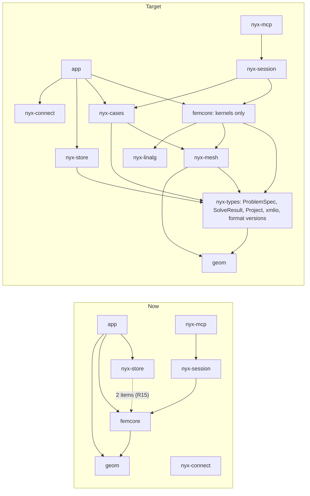
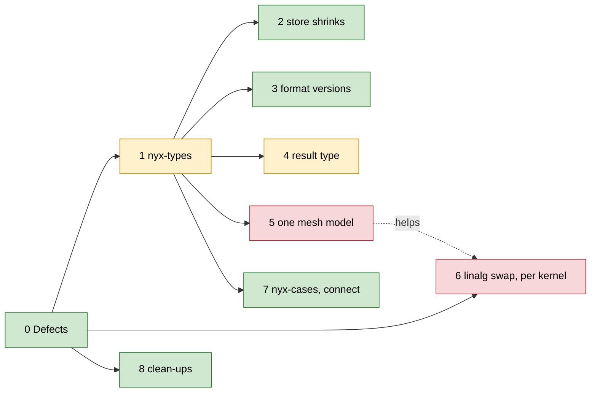

# Proposed structure: how to resolve the rough spots

Status: **superseded by `PROPOSED_STRUCTURE_2.md`** after paul's review on 2026-11-03; kept for the record. Original status: proposal for paul to accept, change or reject**, 2026-11-03. Nothing here is implemented. Every R-number refers to `ROUGH_SPOTS.md`. If accepted, each step becomes its own ADR (superseding or extending 4, 5, 8, 14, 15, 19, 22, 23) and its own branch.

## The idea in one paragraph

Today `femcore` is four things (kernels, meshing, application content, file formats) and the types that every other crate needs (`ProblemSpec`, `SolveResult`, `Project`) are buried in it or in the `app` binary. That is why `nyx-store` has to link the whole solver library to read an XML file, why the AI session cannot open a project, why a rename silently drops a setting, and why two ports could land beside the originals instead of replacing them. The fix is to **pull the shared types out into a small contract crate, make every other crate depend on that and not on each other, and then replace the duplicated pairs one at a time with the contract tests as the guard**.

## Current and target dependency graph

## The crates

| Crate | Holds | Comes from | Depends on |
|---|---|---|---|
| `geom` | unchanged | `crates/geom` | serde |
| **`nyx-types`** (new) | `ProblemSpec`, `Materials`, `Study`, `BrillouinSpec`, `Bc`, `Pml`; a serialisable result summary and `SolveResult`; `Project`, `GeometrySpec`; `xmlio`; `format` constants and migration functions; one error enum with `Cancelled` | `femcore::{problem, material, xmlio, expr}`, `app::state` | geom, serde |
| `nyx-mesh` (new) | the one mesh model, `geomdrive`, `meshing`, `meshing_pml`, `physics_size`, estimators, the adaptation, structured PML, `.fmsh` | `femcore::{mesh, cellmesh, view, geomdrive, mesher*, meshing*, physics_size, estimate*, pml3, refine3d}`, `femcore::meshers` | types, geom |
| `nyx-linalg` (new) | the ported solver library; the original sparse/AMG/eigen/LOBPCG are deleted at the end | `femcore::solvers` + `sparse, csparse, linalg, amg, eigen, lobpcg, fem` | faer |
| `femcore` | kernels `dfs sms ems sbs`, `section`, `solve`, `analysis`, `polarization`, `periodic`, `progress` | what is left | types, mesh, linalg |
| `nyx-cases` (new) | `usecases`, `chips`, the examples | `femcore::{usecases, chips}` | types, mesh, geom |
| `nyx-store` | unchanged apart from dependencies | | **types only** |
| `nyx-session`, `nyx-mcp` | unchanged | `ai/` | types, femcore, cases |
| `nyx-connect` | one copy, used by the app and by `nyx-mcp --connect` | `ai/nyx-connect` + `app/connect.rs` | serde_json |

`ai/` joins the root workspace once `nyx-connect` is shared (one lockfile, one `cargo test`); the `nyx-mcp` binary stays separate so hosts still get a small executable.

## Options

| Option | What | Fixes | Cost | Risk |
|---|---|---|---|---|
| A. Defects only | R25, R21, R26, R13, R17, R22 decision; no restructuring | the things that are wrong today | small | the duplicates stay; each new feature has to pick a side again |
| **B. Contract crate, then staged replacement (recommended)** | steps 1 to 8 below | R01 to R12, R15 to R20, R27, R28 | medium, spread over several branches | each step is guarded by the contract tests that already exist |
| C. Everything at once | B in one change plus renames | all | large | one failure blocks everything; no usable bisect |

## Migration plan (option B)

Each step is a branch, ends with the contract tests unchanged unless the step is about a contract, and can be stopped after without leaving the repository worse.

**Step 0. Defects, no structure** (small)
* R25: make `card::geometry` read `geometry.list` (feature names and parameters); remove `#[ignore]` from `store_card_reads_current_project`.
* R21: pass the real `femcore` version in; add `rustc` and the `portable-kernels` flag to the run record.
* R26: make the ten crate-private stage functions of `sms`, `sms_lrb` and `ems3d` `pub`; extend `kernel_stage_api_is_public`.
* R17: correct `CLAUDE.md` and `ai/README.md` (`nyx-session` depends on femcore only).
* R13: one mechanical rename commit (`emw_*`, `emw3d` labels, test file names).
* R22: **decide** the golden reference platform or tolerance. Proposal: keep one platform-tagged set of goldens plus a looser tolerance (2e-5) that is checked in CI on any machine; never regenerate silently (ADR 10).

**Step 1. Extract `nyx-types`** (medium)
Move `problem.rs`, `material.rs`, `expr.rs`, `xmlio.rs` from `femcore` and `Project`, `GeometrySpec`, `Source` from `app/state.rs`. `femcore` re-exports the old paths for one release so nothing else changes. *Guard:* `problem_spec.v1.json` must come out byte-identical; that is the proof that the move changed no field.
Resolves R15 (store no longer needs femcore after step 2), R16, and prepares R27.

**Step 2. Shrink `nyx-store`** (small)
Depend on `nyx-types` only; `metrics_of` takes the result summary. *Guard:* `store_*` contracts.

**Step 3. Give formats a version** (small, one decision)
Add `format: u32` to `Project` and `FeatureList` (absent means 0, read as version 1), a `migrate(Value) -> Value` function per major, and refuse newer. This changes every saved file by one key, so it is paul's call. Resolves R20. *Guard:* `VERSIONS.md` entry; new `.v2.` exemplars, `.v1.` kept for the reader of version 1.

**Step 4. One result type** (medium)
Give `SolveResult`/`Solution`/`Field` serde in `nyx-types`; `h5io`, `metrics_of` and the MCP digests read the same struct. Resolves R27. *Guard:* `solve_result_has_the_documented_structure` becomes an exemplar.

**Step 5. One mesh model** (large, the real decision)
Make the native per-cell-type mesh (today `meshers::cellmesh::CellMesh<D>`) the mesh type, with domains and boundaries numbered from 1 everywhere. `SimplexMesh` becomes a view built from it (`split` when the solver is simplex-only). Delete `meshers::interop`, the nyx `CellMesh`/`ElementType`, and the 0-based boundary convention. Resolves R01, R09, and unblocks ADR 5 and 18 (curved nodes become a field of the one type). *Guard:* the `mesh_*` contracts, `split.rs`, and the PML area/volume checks.

**Step 6. Replace the linear algebra behind the stages** (large, repeatable)
One kernel family per branch, in this order: `dfs` (simplest, real symmetric), `sms` static, `sms` eigen, `ems` real, `ems_pml` and `sms_pml` (complex), `ems3d`, `sbs`. Each swap keeps the old path selectable behind `spec.solver` until its goldens and contracts agree, then removes it. At the end delete `sparse, csparse, linalg, amg, eigen, lobpcg`, and point `meshers::par` at `par`. Resolves R02, R03. *Guard:* `stages.rs`, goldens within the tolerance of step 0, determinism tests.

**Step 7. Move application content out** (small, mechanical)
`usecases` and `chips` into `nyx-cases`; `nyx-session` depends on it. Share `nyx-connect`; join `ai/` to the root workspace. Resolves R15 (rest), R07, R17.

**Step 8. Clean-up** (small each, any order)
* R04: one PML generator (the `meshers` one), `pml3` and `meshing_pml` call it.
* R05: move `mesher3d`/`refine3d` into `tests/common` as a fixture generator, or promote them with a caller.
* R06: add a test that both expression grammars accept the same corpus.
* R10: name the EM study in `Study` (`Modes` vs `Cavity`) instead of dispatching on mesh dimension.
* R11: error enum with `Cancelled`; keep the string for display.
* R12: validate material property names per physics.
* R19: pass `&Progress` explicitly into stage functions.
* R28: rename the analysis axes to (lateral, normal, propagation) or wafer names.

## Ordering, and what can run in parallel

Steps 0 and 8 can start now. After step 1, steps 2, 3, 4, 5 and 7 touch different files and can be done in parallel by separate working sessions, each in its own jj workspace. Steps 5 and 6 are the two big ones; 6 does not need 5, but each kernel swap is easier once the mesh type is settled.

## What I recommend and what I need from paul

Recommend option B, starting with steps 0 and 1. Decisions needed:

1. **Golden platform or tolerance** (step 0, R22).
2. **Which mesh survives** (step 5): I propose the native per-cell-type mesh because ADR 5 already says so; the open question is only the solver side's wishes about node order.
3. **A `format` key on `Project` and `FeatureList`** (step 3): yes or no.
4. **Crate names and count**: `nyx-types`, `nyx-mesh`, `nyx-linalg`, `nyx-cases` are placeholders. Fewer crates (types only, then the rest later) is a valid smaller version of B.
5. **Whether `ai/` should join the root workspace** (step 7).
