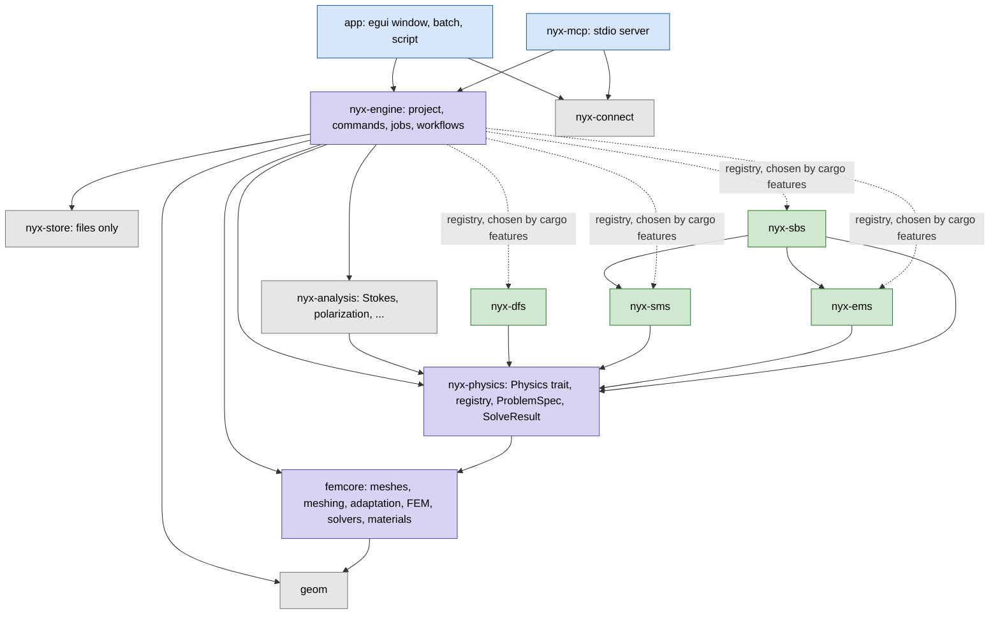

# Proposed structure, version 2

> **Merged into `RESTRUCTURE_PLAN.md`, which is authoritative.** This file is kept for the reasoning behind the decisions.

Status: **proposal only, nothing implemented**, 2026-11-03. Replaces `PROPOSED_STRUCTURE.md` after paul's review. R-numbers refer to `ROUGH_SPOTS.md`.

## What changed from version 1, and why

| Paul's point | What I take from it |
|---|---|
| A new physics must not mean updating the whole codebase | Physics becomes an **open interface** (a trait plus a registry). The mesher, the store, the engine, the window and the MCP server know no physics by name. This is the main change; version 1 only moved files. |
| MCP must have the same capabilities; bypassing nyx-store is not helpful | One **engine** crate owns every operation (project, mesh, solve, analyse, save, run history). The window and the MCP server are two thin front-ends over it, so parity is by construction. AI work becomes an ordinary workflow in the workspace (`origin: "ai"` already exists in the store). `nyx-session` goes away. |
| People build workflows by hand; no reusing of old stuff | The library has **no built-in devices**. MCP tools are generic (geometry features, materials, physics, studies), not `soi_strip`. |
| Optics, photonics, Brillouin use cases are optional extras and are just `.nyx` files | `usecases/` and `chips.rs` are **deleted from the code** and shipped as example `.nyx` files outside the program. Their tests become small generic fixtures. |
| femcore = the solvers; take a proper decision on meshing | **femcore is the whole FEM core: meshes, meshing, adaptation, discretisation, linear algebra, solvers.** One decision, no half. |
| Analysis crate (Stokes and the like) | `nyx-analysis`, depending on result types only. |
| Materials: a spec in femcore, the materials as light human files | `femcore::material` defines what a material can say; the materials themselves are **TOML files**. |
| Not convinced by nyx-types | Dropped. Its contents go where they belong (see the map). |
| What is "chips" | `chips.rs` builds the four silicon-on-sapphire ring-chip rib waveguides (300TE, 300TM, 500TE, 500TM) as ready-made Brillouin problems for paul's own experiments; only examples and tests call it. It goes with the use cases. |

## Target crates



| Crate | Holds | Depends on |
|---|---|---|
| `geom` | unchanged | serde |
| **`femcore`** | `mesh` (one native per-cell-type mesh, `.fmsh`), `meshing` (geom to mesh, MeshPlan, structured PML, size fields), `adapt` (metric adaptation, estimators, the solve-estimate-adapt loop), `fem` (elements, quadrature, assembly, constraints, Floquet pairs), `linalg` (the ported solver library; the old stack is deleted), `frame` (the wafer frame, today `section`), `material` (spec types + TOML loader), `par`, `progress` | geom, faer, toml |
| **`nyx-physics`** | the `Physics` trait, the registry, the generic `ProblemSpec` envelope, study / boundary-condition / property / field *descriptors*, `SolveResult` and `Solution`, validation, the error type | femcore |
| `nyx-dfs`, `nyx-sms`, `nyx-ems`, `nyx-sbs` | one physics each, with its own spec, kernels (assemble, solve, fields) and descriptors. `nyx-sbs` uses the other two. | nyx-physics |
| **`nyx-analysis`** | polarization (Stokes, Poincare, mode classes, degenerate groups), and later any post-processing; a function of a `SolveResult`, not part of it | nyx-physics (result types) |
| `nyx-store` | workspace, workflow, experiment, run, version, search, `.nyx` archive. Files only; **no nyx dependencies** | serde, blake3, zip |
| **`nyx-engine`** | `Project`, the command set (new geometry, edit feature, assign material, set physics/study/BC, mesh, solve, analyse, save, open, run table), the job runner with progress and cancel, persistence through `nyx-store`, the registry composed from cargo features, the batch runner | everything above |
| `app` | egui window; every button calls an engine command | engine, nyx-connect |
| `nyx-mcp` | MCP server; every tool is one engine command with a JSON schema | engine, nyx-connect |
| `nyx-connect` | one copy, in the root workspace | serde_json |

`ai/` joins the root workspace (one lockfile, one test command). `nyx-session` is dissolved: handles become store ids, the journal becomes the workflow history and run log, assumptions become part of the run record.

## The physics interface (what makes "new physics" cheap)

```rust
pub trait Physics: Send + Sync {
    fn id(&self) -> &'static str;                         // "ems": the code that appears in files
    fn name(&self) -> &'static str;                       // "EM waves"
    fn studies(&self) -> Vec<StudyDesc>;                  // kind, parameter schema, which dimensions
    fn bc_kinds(&self) -> Vec<BcDesc>;                    // kind, parameter schema, on boundary or domain
    fn properties(&self) -> Vec<PropDesc>;                // name, unit, scalar or tensor, required for which study
    fn fields(&self, study: &str) -> Vec<FieldDesc>;      // name, unit, components named in wafer axes
    fn validate(&self, spec: &ProblemSpec, mesh: &Mesh) -> Result<(), Error>;
    fn sizing(&self, spec: &ProblemSpec) -> Sizing;       // what the mesher needs (wavelengths per domain, order)
    fn solve(&self, mesh: &Mesh, spec: &ProblemSpec, ctx: &mut Ctx) -> Result<SolveResult, Error>;
}
```

* `ProblemSpec` becomes an envelope: `{ physics: "ems", order, study: { kind, params }, materials: {region -> material}, bcs: [{ on: selector, kind, params }], params: { physics-specific } }`. The physics owns the typed form of `study.params` and `params` and validates them against its own descriptors. Brillouin's `BrillouinSpec`, `out_of_plane`, `thermal`, `plane`, `inactive` leave the shared struct (R12, R10, R27).
* Regions and boundaries are addressed by **geom names and selectors**, not integers (ADR 2); the engine compiles them to labels.
* Window, MCP, store and mesher work from the descriptors: forms, JSON Schemas, metric names and mesh sizing all come from the physics. Adding a physics is one crate plus one line in the registry; nothing else changes.
* The assemble / solve / fields stages (ADR 9) stay inside each physics crate; the *linear algebra* behind them is femcore's, so replacing the old stack is local to femcore.
* Physics are compiled in and chosen by cargo features (`dfs`, `sms`, `ems` by default; `sbs` optional). Downloadable extras are **data** (`.nyx` files, material files), not code. Loading compiled plug-ins at run time is out of scope unless you want it.

## Materials

* `femcore::material` defines what a material can say: named scalar properties with units, tensors (permittivity, conductivity, stiffness: cubic, hexagonal, trigonal, orthotropic), crystal orientation in the wafer frame, loss, dispersion later. Which properties a study needs is declared by the physics (`PropDesc`).
* The materials themselves are **TOML** (human-readable, comments allowed, simple serde): one file per material or a library file, shipped optionally and loadable per project. A `.nyx` file embeds the materials it uses, so it opens anywhere. (RON is the alternative; I chose TOML because people already know it. Say if you prefer RON or JSON.)

```toml
# materials/silicon.toml  (illustrative values, not checked against the code's material data)
name = "Si"
[optical]
eps_r = 12.08          # n = 3.4757 at 1550 nm
[elastic]
class = "cubic"
c11 = 165.7e9
c12 = 63.9e9
c44 = 79.6e9
rho = 2329.0
```

## Where today's code goes

| Today | Goes to |
|---|---|
| `mesh, cellmesh, view, meshers/{mesh,cellmesh,interop,io}` | `femcore::mesh` (one model, ADR 5; `interop` deleted) |
| `geomdrive, mesher, mesher3d, refine3d, meshing, meshing_pml, pml3, meshers/adapt, physics_size, estimate*` | `femcore::meshing` and `femcore::adapt` (`physics_size` asks the physics for `Sizing` instead of reading `ProblemSpec`) |
| `solvers/*` + `sparse, csparse, linalg, amg, eigen, lobpcg` | `femcore::linalg` (old stack removed per kernel, as in version 1 step 6) |
| `fem, periodic, par, progress, section, material, validate (generic part)` | `femcore::{fem, frame, material, par, progress}` and `nyx-physics` |
| `problem.rs` | split: envelope and results to `nyx-physics`; Brillouin/solid/thermal parts to their physics crates |
| `dfs` / `sms*` / `ems*` / `sbs*` | `nyx-dfs` / `nyx-sms` / `nyx-ems` / `nyx-sbs` |
| `analysis, polarization` | `nyx-analysis` |
| `usecases/*, chips.rs` | removed from code; example `.nyx` files outside the program |
| `xmlio, h5io` | HDF5 export becomes an engine export; XML read stays in `nyx-store` only while old projects exist (see decisions) |
| `app::state::Project`, `worker`, `batch`, `script` logic | `nyx-engine`; `app` keeps only drawing and input |
| `nyx-session/*` | dissolved into `nyx-engine` commands, `nyx-store` runs and history; `nyx-mcp` keeps protocol and schemas |
| `app/connect.rs`, `ai/nyx-connect` | `nyx-connect` |

## Rough spots this resolves

| Rough spot | How |
|---|---|
| R01, R09 | one mesh model, one label base (from 1) |
| R02, R03, R26 | one linear algebra in femcore; stage functions public by being the physics' own API; one thread pool |
| R04, R05 | one PML generator; `mesher3d` becomes a test fixture or is promoted |
| R10, R12, R27 | studies named by the physics; material property names validated against descriptors; one result type |
| R15, R16 | no catch-all crate; `Project` lives in the engine; the store has no nyx dependencies |
| R07, R17 | one `nyx-connect`, one workspace |
| R20 | `format` key mandatory in `ProblemSpec` envelope, `Project`, `FeatureList`, with migrations |
| R21, R25 | the engine writes run records (real versions); the card is generated from the engine's project, not re-parsed |
| R22 | unchanged: still needs paul's decision on the golden platform or tolerance |
| R28 | analysis uses wafer-frame names from `femcore::frame` |
| ADR 22 | superseded: no use cases or devices in code |

## Cost and risk, honestly

* This is a **breaking change to every saved file** (the `ProblemSpec` envelope). A `format` key and a one-way migration for existing projects are required, and the contract exemplars get `.v2.` files. Existing golden files must be regenerated *through the migration*, not by hand, so they keep proving the physics did not change.
* The window's physics tabs are hand-written today. Generating forms from descriptors is the end state; the first version of the engine can keep hand-written tabs for the built-in physics, selected through the registry.
* The MCP server loses its `soi_strip` template; AI workflows must build geometry from features. That is the intended direction, but it makes the first AI task longer until the geometry tools are richer.
* Crates and steps are many. Order that keeps the code working at every step: (1) femcore consolidation of meshes and linalg (behind the current API), (2) `nyx-physics` envelope with a translation layer from the old `ProblemSpec`, (3) move one physics out (`dfs`, simplest), then the others, (4) `nyx-analysis`, (5) `nyx-engine` and thin front-ends, (6) delete use cases and the old stack, (7) format key and migration. Each step is guarded by the contracts in `contracts/`, rewritten deliberately where the interface changes.

## Decisions I need

1. **Is the Brillouin physics (`sbs`) core or an optional extra?** I treated it as an optional physics crate behind a cargo feature, since you called SBS an optional extra; `ems` and `sms` stay default.
2. **One crate per physics, or all four in `nyx-physics`?** I chose one each (a new physics is a new crate); one crate is simpler to start and can be split later.
3. **Retire XML for project and spec files?** The store and project files could move to JSON or TOML. Keeping XML means keeping `xmlio` in the store.
4. **TOML for materials** (or RON, or JSON).
5. **Compile-time physics only**, or do you want run-time plug-ins later?
6. **Golden platform or tolerance** (R22), still open from before.
