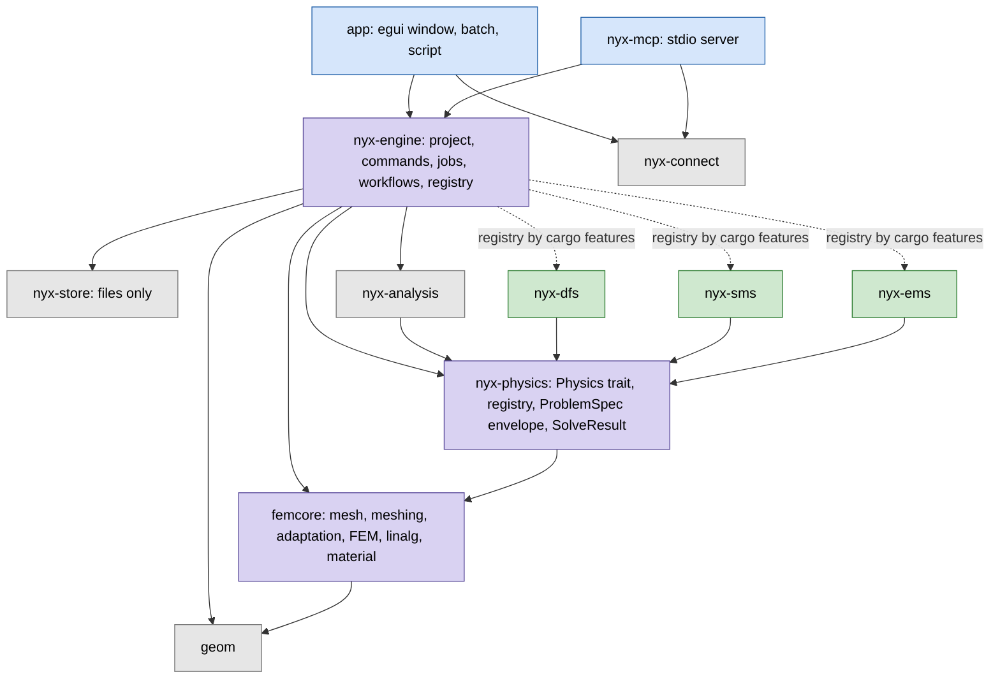
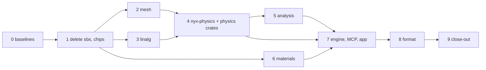

# nyx restructure plan (authoritative)

Written 2026-11-03 for a working session that has **not** seen the conversation that produced it. It merges `PROPOSED_STRUCTURE.md`, `PROPOSED_STRUCTURE_2.md`, `DECISIONS_ROUND_2.md` and `DECISIONS_ROUND_3.md`; where they disagree, **this file wins**. Those files stay as the record of *why* (read them only when a reason here looks odd). Nothing in this plan is implemented. paul (the owner) decides at the gates in section 8; do not skip a gate.

Read first: `README.md` (this folder), `ROUGH_SPOTS.md` (what is wrong today, R-numbers), `adr/` (decisions found in the history), `CODE_TO_ADR.md`, `contracts/README.md`, then `docs/RESTRUCTURE_STATUS.md` (where the work stands).

## 1. Goals and constraints (paul's words, condensed)

1. Adding a **new physics must not mean touching the rest of the codebase.**
2. The **MCP server has the same capabilities as the window**, and works through `nyx-store` like the window does.
3. People **build workflows by hand**. The library contains **no built-in devices or use cases**; devices are `.nyx` files outside the program.
4. **femcore is the FEM core**: meshes, **all** meshing including adaptation, discretisation, linear algebra and solvers, and the material specification.
5. Analysis (Stokes parameters, polarization, later others) is its **own crate**.
6. Materials are **human-writable files** (TOML), complete when needed: a full elastic matrix in reduced (Voigt) form; optical properties as dispersion models (Sellmeier and others) evaluated at the study wavelength.
7. A project loads **a few physics** (one to three), not many.
8. **Smaller scope**: Brillouin (sbs) is removed altogether.
9. **No migration of old projects.** The new file format starts clean once everything is integrated.
10. Physics are **compiled in** (cargo features); run-time plug-ins are out of scope for now.
11. The project/spec format moves from XML to JSON.

Invariants that must survive every step (they are what the tests protect):
* Same input, same machine, same build gives the same bits for any thread count (ADR 11).
* The wafer frame: x lateral, y propagation, z normal; waves along +y (ADR 1). Axis numbers live in one place.
* SI units everywhere. Three-letter physics codes (`dfs`, `sms`, `ems`). Every library source file starts with a short comment saying what it does.
* `*.py` is not shipped; GDS layouts are made with gdsfactory.
* Version control (ADR 20): a jj workspace per working session, a bookmark per step, never commit to `main`, do not push.

## 2. Target structure



| Crate | Holds | Depends on |
|---|---|---|
| `geom` | unchanged | serde |
| `femcore` | `mesh` (one native per-cell-type mesh; `.fmsh`), `meshing` (geom to mesh, `MeshPlan`, structured PML, size fields, mesh cache), `adapt` (metric adaptation 2D/3D, estimators, solve-estimate-adapt loop), `fem` (elements, quadrature, assembly, constraints, Floquet pairs), `linalg` (the ported solver library; old stack removed), `frame` (today `section`), `material` (spec + TOML loader + dispersion models), `par`, `progress` | geom, faer, toml, serde |
| `nyx-physics` | `Physics` trait, registry type, `ProblemSpec` envelope, descriptors (study, boundary condition, property, field), `SolveResult`/`Solution`/`Field`, validation, error type | femcore |
| `nyx-dfs`, `nyx-sms`, `nyx-ems` | one physics each: its own spec types, kernels (assemble, solve, fields), descriptors, sizing hint | nyx-physics |
| `nyx-analysis` | polarization (Stokes, Poincare, classes, degenerate groups), group index later; functions of a `SolveResult`, which no longer carries an `analysis` | nyx-physics |
| `nyx-store` | workspace, workflow, experiment, run, version, search, `.nyx` archive; **no nyx dependencies** | serde, blake3, zip |
| `nyx-engine` | `Project`, commands, job runner (progress, cancel), persistence through `nyx-store`, registry built from cargo features, batch runner, HDF5/other export | all of the above |
| `app` | drawing and input only; every action calls an engine command | engine, nyx-connect |
| `nyx-mcp` | MCP protocol and JSON Schemas; every tool is one engine command | engine, nyx-connect |
| `nyx-connect` | one copy, root workspace | serde_json |

`ai/` joins the root workspace. `nyx-session` is dissolved (handles become store ids, journal becomes workflow history and the run log). Retired: `usecases/`, `chips.rs`, `sbs*`, `xmlio` (after phase 8), the old linear-algebra stack, `meshers::interop`, the second `CellMesh`/`SimplexMesh`.

### The `Physics` interface

```rust
pub trait Physics: Send + Sync {
    fn id(&self) -> &'static str;                         // "ems"
    fn name(&self) -> &'static str;
    fn studies(&self) -> Vec<StudyDesc>;                  // kind, parameter schema, dimensions
    fn bc_kinds(&self) -> Vec<BcDesc>;                    // kind, parameter schema, boundary or domain
    fn properties(&self) -> Vec<PropDesc>;                // name, unit, scalar/tensor/dispersive, needed by which study
    fn fields(&self, study: &str) -> Vec<FieldDesc>;      // name, unit, components in wafer axes
    fn exports(&self) -> Vec<FieldLink>;                  // fields other physics may import
    fn imports(&self) -> Vec<FieldLink>;                  // e.g. ("dfs.T" -> "sms.thermal_load")
    fn validate(&self, spec: &ProblemSpec, mesh: &Mesh) -> Result<(), Error>;
    fn sizing(&self, spec: &ProblemSpec) -> Sizing;       // what the mesher needs (wavelengths per region, order)
    fn solve(&self, mesh: &Mesh, spec: &ProblemSpec, ctx: &mut Ctx) -> Result<SolveResult, Error>;
}
```

* `ProblemSpec` is an envelope: `{ physics, order, study: { kind, params }, materials: { region -> material }, bcs: [{ on: selector, kind, params }], params }`. Each physics owns the typed form of `study.params`/`params` and validates it against its descriptors. Everything Brillouin-, thermal-, plane-, out-of-plane- or inactive-specific leaves the shared struct.
* Regions and boundaries are addressed by **geom names and selectors**; the engine compiles them to labels (ADR 2).
* Window, MCP, store and mesher work from descriptors, so forms, JSON Schemas, metric names and mesh sizing come from the physics.
* Couplings are **explicit field links** between an export and an import. Version 1 supports **one-way chains** (heat then solid, Joule heating, thermo-optic, electro-optic). Two-way coupling is later.
* Only plain data crosses the trait (descriptors and specs as serde values, meshes and fields as flat arrays), so a separate-process plug-in route stays possible later.
* Assemble/solve/fields stay inside each physics crate (ADR 9) and are public API of that crate.

### Materials

Files, one per material or a library file; a `.nyx` file embeds those it uses.
* Units always written. Voigt order is the textbook one (1=xx, 2=yy, 3=zz, 4=yz, 5=xz, 6=xy, engineering shear) in the crystal frame; Euler angles (Bunge) place the crystal in the wafer frame; `material.rs` already uses this internally.
* Stiffness: by class and constants (isotropic, cubic, hexagonal, trigonal, tetragonal, orthotropic, monoclinic, triclinic), or the reduced matrix (upper triangle or full 6x6), or compliance. Checks: symmetric, positive definite, class consistent, unknown keys reported.
* Other tensors (permittivity, conductivity, thermal expansion): one value, three, or six entries.
* Optical properties are **models evaluated at the study wavelength**: constant, Sellmeier, Cauchy/Schott/Herzberger, Lorentz/Drude, tabulated `lambda, n, k` (monotone cubic interpolation, never silent extrapolation), thermo-optic `dn/dT`; per principal axis for anisotropic crystals; time convention `e^{j omega t}` so loss is `n - j k`; wavelength unit declared in the file; `dn/dlambda` analytic or from the spline; optional import of the refractiveindex.info file format. Wavelength sweeps loop over wavelengths in the engine. A cavity with dispersive materials is a nonlinear eigenproblem: later, first as a fixed-point iteration, with `solvers::nep`/`nleigs` as the follow-up.
* Examples with illustrative numbers are in `DECISIONS_ROUND_2.md` section 4 and `DECISIONS_ROUND_3.md` section 4. Check any numbers against sources before using them.

## 3. Phases, in order

Each phase is its own jj bookmark `restructure-<n>-<name>` in its own workspace cut from the previous accepted state. Steps within a phase may be split further. **Definition of done for every phase** is in section 5.

### Phase 0. Baselines (no code change)
* Tag the current state `pre-restructure`; tag `sbs-last` (the last commit with Brillouin, which also holds the wg800 study).
* Record timings of `examples/{bench,profile3d,mem_profile,cavity_bench,solve_scaling}` and the test counts, in `docs/RESTRUCTURE_STATUS.md`. These are the performance and behaviour baselines every later phase is compared against.
* Run `cargo test --release --workspace --no-fail-fast` and record which tests fail (expected today: 7 golden failures).

### Phase 1. Delete what is out of scope (smallest, shrinks everything)
* Remove sbs: `sbs.rs`, `sbs_ring.rs`, `Physics::Brillouin`, `BrillouinSpec`, photoelastic/moving-boundary/viscosity/`ring_radius`/`mirror_axis`, the Brillouin and ring-Brillouin goldens (5 of the 7 failing), `tests/brillouin.rs`, Brillouin parts of `ring_frame.rs`, app Brillouin tab content, MCP references.
* Remove `chips.rs` and chip examples (`chip_report`, `chip_digits`, `rib_*`, `wg800`).
* **Keep for now**: `usecases/{soi,bragg}.rs` (the MCP session and several tests call them). They go in phase 7.
* Keep `sms_kz`, `ems_axisym`, `sms_axisym` (ordinary studies) unless paul says otherwise at gate G1.
* Update ADRs 21, 22 (superseded in part), `workspace.dsl`, contracts (`problem_spec.v1.json` loses the Brillouin spec: a deliberate exemplar rewrite with a `VERSIONS.md` line).
* Done when the remaining tests pass except the two `ems` goldens, and the workspace builds with no `sbs` reference (`grep -ri brillouin` is empty outside docs/history).

### Phase 2. femcore: one mesh model, all meshing
* Make the native per-cell-type mesh the only mesh (today `meshers::cellmesh::CellMesh<D>`); `SimplexMesh` becomes a view produced by the split. Domains and boundaries numbered **from 1** everywhere. Delete `meshers::interop` and the nyx `CellMesh`/`ElementType`.
* Move `mesh, view, geomdrive, mesher, mesher3d, refine3d, meshing, meshing_pml, pml3, physics_size, estimate, estimate3` and `meshers/**` under `femcore::{mesh, meshing, adapt}`. One PML generator. `mesher3d`/`refine3d`: keep only as test fixtures unless a production caller appears (R05).
* `physics_size` stops reading `ProblemSpec`: it takes a neutral `Sizing` (wavelength per region, order, headroom). Until phase 4 the old kernels provide it through a small adapter.
* `meshers::par` uses `femcore::par`.
* Done when contracts `mesh_*` pass (rewritten deliberately where the convention changes), `tests/{meshers,adapt3d,meshing,physics_meshing,split}.rs` pass, benchmark times are within 10% of baseline.

### Phase 3. femcore: one linear algebra, kernel by kernel
* Order: `dfs`, `sms` static, `sms` eigen, `ems` real, `ems_pml` and `sms_pml` (complex), `ems3d`, then the kz/axisym/Floquet/low-reflecting variants.
* Per kernel: replace the solve stage with `femcore::linalg`, keep the old path selectable (`spec.solver`) until the kernel's goldens/closed-form checks agree, then delete the old path.
* End: delete `sparse, csparse, linalg, amg, eigen, lobpcg`; one `Csr` type; `portable-kernels` feature retained.
* Make the ten crate-private stage functions of `sms`, `sms_lrb`, `ems3d` public (R26).
* Done when old modules are gone, `stages.rs` and determinism tests pass, results agree with the old path to the agreed tolerance (gate G2), benchmarks within 10%.

### Phase 4. `nyx-physics` and the physics crates
* Create `nyx-physics` with the trait, envelope, descriptors, result types, error enum (with `Cancelled`), registry type.
* Move `dfs` into `nyx-dfs` first (simplest), then `sms*` into `nyx-sms`, then `ems*` into `nyx-ems`. Each crate owns its spec types and descriptors; `Materials` property names are validated against descriptors (R12). The EM study is named in the study (waveguide `Modes` vs `Cavity`), no dispatch on mesh dimension (R10).
* **Remove `mesh::SimplexMesh` (ADR 32).** Each physics crate reads the native `femcore::mesh::cells::CellMesh` and numbers its own unknowns (nodes, edges, faces of its element family); `SimplexMesh`, `SimplexMesh::from_cells_split` and `SplitReport` are deleted. Quadrilaterals, prisms and hexahedra are then solved natively (no cut in PML layers). Until a physics has moved, it keeps reading the `SimplexMesh` view of the cells.
* Rewrite the tests against the new problem API. **The golden tests must give the same numbers as before** (this proves no physics changed); only the way the problem is built changes.
* Done when `solve()` is replaced by `registry.get(id).solve(...)`, no crate outside the physics crates names a physics, and the `kernel_stages` and `problem_spec` contracts are rewritten for the envelope with `.v2.` exemplars.

### Phase 5. `nyx-analysis`
* Move `analysis.rs`, `polarization.rs`; results no longer carry `analysis`; analysis is a function of a `SolveResult`; axis names use the wafer-frame names from `femcore::frame` (R28).
* Done when the Analysis tab and `tests/photonics.rs` behaviour are unchanged.

### Phase 6. Materials
* `femcore::material`: spec types, TOML loader, validation, the dispersion models, evaluation at (wavelength, temperature) and derivative. Ship a small optional library of files (silicon, silica, sapphire, air) outside the code; remove `sapphire()`, `silicon()` from code.
* Done when a material round-trips file to matrix and back, the checks give plain messages, and Sellmeier results match published values to the quoted precision (use two or three well-known materials as closed-form tests).

### Phase 7. `nyx-engine`, thin front-ends, MCP parity
* Create `nyx-engine`: `Project` (moved from `app/state.rs`), the command set (geometry edit, material assignment, physics/study/BC, mesh, solve, analyse, save/open, run table), the job runner, persistence through `nyx-store`, the registry from cargo features, batch runner.
* `app` calls commands only; `worker`, `batch`, `script` logic moves to the engine.
* `nyx-mcp` tools become engine commands with generated JSON Schemas; **generic geometry tools** (feature list editing) replace the `soi_strip` template; AI work is a workflow with `origin: "ai"` in the workspace. Dissolve `nyx-session`.
* `nyx-store` loses its `femcore` dependency: `metrics_of` and the concept card are produced by the engine from the project (this also removes R25 and R21; do not fix them in the old structure).
* Delete `usecases/`. Rewrite the tests that used them (`usecases.rs`, `photonics.rs`, `bragg_stack.rs`) as small generic fixtures built from geom and the physics crates.
* Merge `app/connect.rs` and `ai/nyx-connect` into one `nyx-connect`; move `ai/` into the root workspace.
* Done when every window action has an engine command, every MCP tool is one engine command, a workflow made through MCP shows in the dashboard, and `grep -r usecases` is empty.

### Phase 8. File format, final
* Introduce the `format` key once (`ProblemSpec` envelope, `Project`, `FeatureList`): first value 1. Projects and specs are JSON. Delete `xmlio` and every XML code path. No migration code.
* Rewrite contract exemplars once (`.v2.` files, `VERSIONS.md`), including `store_workflow` if it changes. Tag the last old-format commit `last-old-format`.
* HDF5 export stays an optional engine export.

### Phase 9. Close-out
* Remaining R-items (section 6), new ADRs for each decision implemented (superseding 4, 5, 8, 14, 15, 22, 23), regenerate `workspace.dsl`, `diagrams.md`, `CODE_TO_ADR.md`, validate the DSL with Structurizr (see section 7), update `CLAUDE.md`.

## 4. What can run in parallel



After phase 1, phases 2, 3 and 6 touch different files and can be done by separate sessions in separate jj workspaces. Phase 4 waits for 2 and 3 so the kernels are moved only once. Phases 5 and 6 can overlap with 4 if the result types are agreed first.

## 5. Definition of done (every phase)

1. `cargo test --release --workspace` and the `ai`/engine tests: no new failures against the phase-0 record; the expected failures are listed in the status file.
2. The four contract suites pass, or were rewritten **on purpose** with a `VERSIONS.md` entry (ADR 19). `check_code_to_adr.sh` passes.
3. Numerical agreement with the previous phase: stored goldens or closed-form checks within the tolerance agreed at gate G2. **Never regenerate a golden to hide a difference** (ADR 10).
4. Benchmarks within 10% of the baseline, or the reason is written down.
5. Determinism: results equal for `NYX_THREADS=1` and the default.
6. Docs: new/superseded ADR, `workspace.dsl` and `diagrams.md` updated where the picture changed, `CODE_TO_ADR.md` rows, `docs/RESTRUCTURE_STATUS.md` updated (what was done, what failed, what is next).
7. Committed on the phase bookmark; not on `main`; not pushed.

## 6. Rough spots and where they are resolved

| R | Resolved in |
|---|---|
| R01, R09 | phase 2 |
| R02, R03, R26 | phase 3 |
| R04, R05 | phase 2 (R05 may stay as test fixtures) |
| R06 | phase 9 (corpus test), or accepted |
| R07, R17 | phase 7 |
| R08 | phase 9 (identity rule written down in an ADR) |
| R10, R11, R12, R27 | phase 4 |
| R13 | phase 1 (mechanical rename in the same pass as deletions) |
| R14 | phase 9 |
| R15, R16 | phases 4 and 7 (no catch-all crate; `Project` in the engine; store without nyx dependencies) |
| R18 | phase 9 (`cargo tree` test kept) |
| R19 | phase 4 (explicit `Ctx` instead of a thread-local) |
| R20 | phase 8 |
| R21, R25 | phase 7 |
| R22 | gate G2 |
| R23 | phase 9 (clippy clean; decide on `rustfmt`) |
| R24 | phase 0 (commit or move the two untracked docs on the main checkout) |
| R28 | phase 5 |

## 7. Recommendations parked until the end (paul: "we'll see at the very end")

* **Numerical reproducibility across machines (R22, G2).** Do the read-only experiment first: run the failing `ems` goldens with the `portable-kernels` feature and with a tighter eigensolver tolerance (residual about 1e-10) to learn which closes the gap. Then adopt the rule: same machine and build, any thread count: identical bits; different machine: agreement to the solver tolerance, with the solver tolerance at least 100 times tighter than the mesh error it resolves. Tests compare at a tolerance justified by that, and every physics with a closed form (slab index, cavity frequencies, analytic plate modes) is tested against it. Fallback: a named reference platform for the strict tests (option C in `DECISIONS_ROUND_2.md`).
* **Validate `workspace.dsl` with Structurizr.** Not yet done: the CLI download exists in the earlier session's scratchpad but running it was blocked by the permission system; Docker Desktop was started but not used. Do it with a permission rule or a running Docker, then export Mermaid from the DSL.
* **Crate cost.** If a benchmark regresses after a split: `#[inline]` on the helper or `lto = "thin"` in the release profile.
* **Run-time plug-ins** (separate-process route) only when someone outside the core developers needs to add a physics.
* **Two-way coupling** (piezoelectric, opto-mechanics) after one-way chains work.
* **Brillouin as an optional physics crate** can return later through the same trait; the tag `sbs-last` has the code.
* **Licence check** of the BSD-2-Clause ports against nyx's own licence before anything is published (never done).
* **Optional neutral tests**: a corpus test that `geom::expr` and the femcore expression grammar accept the same inputs (R06).

## 8. Gates (ask paul; do not decide alone)

| Gate | Question | Default if not answered |
|---|---|---|
| G1, before phase 1 | Keep `sms_kz`, `ems_axisym`, `sms_axisym`? | keep |
| G2, before phase 3 ends | The agreed numerical tolerance and the reference-platform question | run the experiment in section 7 first |
| G3, before phase 4 | Crate names (`nyx-physics`, `nyx-dfs/sms/ems`, `nyx-analysis`, `nyx-engine`) | as written here |
| G4, before phase 6 | TOML confirmed (RON/JSON are the alternatives) | TOML |
| G5, before phase 7 | Which MCP geometry tools are first (a minimal set that can rebuild a strip, a rib and a ring) | strip, rib, ring |
| G6, before phase 8 | Exact JSON layout of the project file | derived from the envelope |

## 9. Working rules for the executing session

* Create your own jj workspace (`jj workspace add ../nyx-<phase>`), bookmark `restructure-<n>-<name>`; never use `nyx-jj` directly; never commit to `main`; do not push.
* Build with `--release`; long builds in the background; the machine is Windows (git-bash and PowerShell), Rust 1.99.1 pinned.
* Read `docs/RESTRUCTURE_STATUS.md` before starting and update it before finishing (CLAUDE.md convention).
* Small commits, one subject line saying what and why. When a rule here conflicts with what you find in the code, stop and write the conflict into the status file, then ask paul.
* Do not fix a rough spot in the old structure if this plan resolves it later (R21, R25 especially).

## 10. Amendments (2026-11-04, foundation session; details in `docs/RESTRUCTURE_STATUS.md`)

* The work runs in the repository **`nyx2`** (full history of `nyx`, no remote), one jj workspace per session, bookmarks `restructure-<n>-<name>` (ADR 27). Replace "`jj workspace add ../nyx-<phase>`" in section 9 by `../nyx2-<name>`.
* Phases 0 and 1 are done; the **foundation** (workspace layout, the crate skeletons `nyx-physics`, `nyx-dfs`, `nyx-sms`, `nyx-ems`, `nyx-analysis`, `nyx-engine`, the `Physics` trait, conventions, layering test) is done and tagged by the bookmark `restructure-foundation` (ADR 25, 26). Phase 4 therefore *fills* existing crates instead of creating them.
* `ai/` joined the root workspace already in the foundation (section 2 said phase 7); the `nyx-connect` merge and the dissolution of `nyx-session` stay in phase 7.
* The `Physics` trait has a tenth method, `params()`; `ProblemSpec::order` is range-checked 1 to 9 by the envelope and the physics decides its own limit.
* Section 5 item 4 (benchmarks within 10 %) is measured as the best of three runs on an idle machine (`BENCH_ONLY=1 bash tools/baseline.sh <dir>`); single runs vary by up to 40 % on the 3D eigensolve.
* Section 5 item 1: counts are taken for the whole root workspace; JSON key order is never compared (ADR 26).
* Phase 2 should land a pure file-move commit first (no logic change) so the mesher feature work can branch from it (status file, "Mesher features").
* Gate answers (paul, 2026-11-03): G1 keep `ems_axisym`/`sms_axisym` but check their implementation (phase 3 and 4 owners); `sms_kz` out-of-plane model removed by paul's instruction on 2026-11-04 (bookmark `restructure-1b-remove-sms-kz`); G3 crate names as written; G4 TOML.
* Phase 2 (paul, 2026-11-04): domains and boundaries are numbered from 1 everywhere; `mesher3d`/`refine3d` are kept as a test fixture (`crates/femcore/tests/common/solid3d`) until the 3D geom adapter decides; the adaptation keeps a private simplex working mesh (`adapt::work`, ADR 32 amendment); removal of `SimplexMesh` is a phase 4 deliverable.
