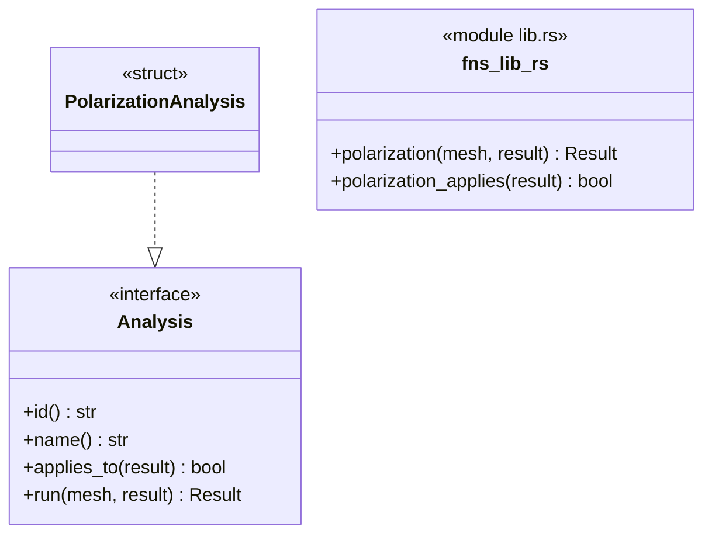

# Analysis API: code

C4 level 4 (code) of the component **Analysis API** (`analysis.api`) in the container **nyx-analysis** (crate `nyx_analysis`). [Component view of the container](../../3-components/analysis.md) · [All code pages](../README.md)

> The entry points an engine calls: an analysis is a function of a SolveResult and its mesh.

**Decisions:** [ADR 56](../../../adr/0056-polarization-analysis-is-a-function-of-a-result.md)  
**Size:** 1 file, 91 lines.

## Files

| File | Lines | What it says about itself |
|---|---:|---|
| `crates/nyx-analysis/src/lib.rs` | 91 | nyx-analysis: analyses of results. An analysis is a function of a `SolveResult` (and the mesh it was solved on); results do not carry an `analysis` of their own (restructure phase 5, ADR 56). |

## What it uses

| Target | Modules | Items |
|---|---|---|
| [container `physics` (nyx-physics)](../../3-components/physics.md) | crate root, error, result | Error, Mesh, SolveResult |
| [Mode report](./modes.md) | modes | AnalysisOptions, GroupReport, ModeAnalysis, ModeInput, ModeRow, ResolveAxis, Resolved, analyze_modes |
| [Field samples](./samples.md) | samples | PolarizationInput, polarization_input |

## Used by

| Component | Modules | Items |
|---|---|---|
| [engine: Analyses](../engine/analyse.md) | crate root | Analysis, PolarizationAnalysis, polarization_applies |
| [engine: Registry and facade](../engine/registry.md) | crate root |  |

## Class diagram

Public types with their public fields (or variants) and methods, free functions per file as a `module` box; arrows are field types and `impl Trait`. Capped at 36 types and a few members each; the table below is complete.

## Public items

| Kind | Item | File:line | Signature or summary |
|---|---|---|---|
| trait | `Analysis` | `lib.rs:23` | methods: `id`, `name`, `applies_to`, `run` —  One analysis: a name, a test of whether it applies to a result, and the run, which returns plain JSON data. |
| fn | `polarization` | `lib.rs:33` | `pub fn polarization(mesh: &Mesh, result: &SolveResult) -> Result<ModeAnalysis, Error>` —  The polarization of the modes of `result`, solved on `mesh`. |
| fn | `polarization_applies` | `lib.rs:39` | `pub fn polarization_applies(result: &SolveResult) -> bool` —  Whether `polarization` can analyse `result`. |
| struct | `PolarizationAnalysis` | `lib.rs:44` |  The polarization analysis behind the `Analysis` trait. |

Trait implementations in this component: `PolarizationAnalysis: Analysis`
