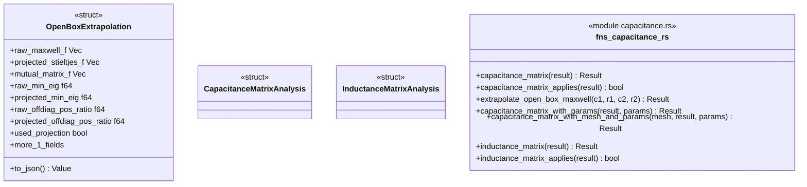

# Capacitance and inductance matrices: code

C4 level 4 (code) of the component **Capacitance and inductance matrices** (`analysis.capacitance`) in the container **nyx-analysis** (crate `nyx_analysis`). [Component view of the container](../../3-components/analysis.md) · [All code pages](../README.md)

> Maxwell/mutual capacitance and magnetostatic inductance matrix extraction from multi-RHS dfs results.

**Decisions:** [ADR 103](../../../adr/0103-multi-rhs-capacitance-and-gauge-stabilized-magnetostatics.md)  
**Size:** 1 file, 1584 lines.

## Files

| File | Lines | What it says about itself |
|---|---:|---|
| `crates/nyx-analysis/src/capacitance.rs` | 1584 |  |

## What it uses

| Target | Modules | Items |
|---|---|---|
| [container `femcore` (femcore)](../../3-components/femcore.md) | fem, linalg::driver | dense_eigh, geometry, quad_rule, shape |
| [container `physics` (nyx-physics)](../../3-components/physics.md) | cqed, crate root, error, result | CapacitanceMatrixData, Error, InductanceMatrixData, Mesh, SolveResult, TlsMeta, discretise |
| [Analysis API](./api.md) | crate root | Analysis |
| [cQED quantization and TLS participation](./cqed.md) | tls | EFieldAccessor, detect_sheet_perimeter_3d, pt3, subdivided_tet_quad |

## Used by

| Component | Modules | Items |
|---|---|---|
| [Analysis API](./api.md) | capacitance | CapacitanceMatrixAnalysis, InductanceMatrixAnalysis, OpenBoxExtrapolation, capacitance_matrix, capacitance_matrix_applies, capacitance_matrix_with_mesh_and_params, capacitance_matrix_with_params, extrapolate_open_box_maxwell +2 |
| [engine: Analyses](../engine/analyse.md) | capacitance | CapacitanceMatrixAnalysis, InductanceMatrixAnalysis |

## Class diagram

Public types with their public fields (or variants) and methods, free functions per file as a `module` box; arrows are field types and `impl Trait`. Capped at 36 types and a few members each; the table below is complete.

## Public items

| Kind | Item | File:line | Signature or summary |
|---|---|---|---|
| fn | `capacitance_matrix` | `capacitance.rs:47` | `pub fn capacitance_matrix(result: &SolveResult) -> Result<CapacitanceMatrixData, Error>` —  Extracts the typed [`CapacitanceMatrixData`] payload from `result`. |
| fn | `capacitance_matrix_applies` | `capacitance.rs:56` | `pub fn capacitance_matrix_applies(result: &SolveResult) -> bool` —  True when `result` carries a multi-terminal capacitance matrix payload. |
| struct | `OpenBoxExtrapolation` | `capacitance.rs:116` | fields: `raw_maxwell_f`, `projected_stieltjes_f`, `mutual_matrix_f`, `raw_min_eig`, `projected_min_eig`, `raw_offdiag_pos_ratio`, `projected_offdiag_pos_ratio`, `used_projection`, `note` —  Result of dual-box `1/R` open-boundary Maxwell capacitance matrix extrapolation (`Mode G2`, `FR-31`), |
| fn | `extrapolate_open_box_maxwell` | `capacitance.rs:298` | `pub fn extrapolate_open_box_maxwell( c1: &[Vec<f64>], r1: f64, c2: &[Vec<f64>], r2: f64, ) -> Result<OpenBoxExtrapolation, String>` —  Computes dual-box `1/R` open-boundary Maxwell capacitance extrapolation (`Mode G2`, `FR-31`): |
| fn | `capacitance_matrix_with_params` | `capacitance.rs:1393` | `pub fn capacitance_matrix_with_params(result: &SolveResult, params: &Value) -> Result<Value, Error>` —  Runs the multi-terminal capacitance analysis without a mesh (`params` for ground elimination, qubit |
| fn | `capacitance_matrix_with_mesh_and_params` | `capacitance.rs:1399` | `pub fn capacitance_matrix_with_mesh_and_params( mesh: &Mesh, result: &SolveResult, params: &Value, ) -> Result<Value, Error>` —  Runs the multi-terminal capacitance analysis with the 3D [`Mesh`] (enabling `metal_thickness_m` |
| struct | `CapacitanceMatrixAnalysis` | `capacitance.rs:1408` |  Multi-terminal Maxwell, mutual, and charging-energy capacitance matrix analysis behind the [`Analysis`] trait. |
| fn | `inductance_matrix` | `capacitance.rs:1433` | `pub fn inductance_matrix(result: &SolveResult) -> Result<InductanceMatrixData, Error>` —  Extracts the typed [`InductanceMatrixData`] payload from `result`. |
| fn | `inductance_matrix_applies` | `capacitance.rs:1439` | `pub fn inductance_matrix_applies(result: &SolveResult) -> bool` —  True when `result` carries a magnetostatic inductance matrix payload. |
| struct | `InductanceMatrixAnalysis` | `capacitance.rs:1444` |  Multi-terminal magnetostatic inductance matrix analysis behind the [`Analysis`] trait. |
| fn | `OpenBoxExtrapolation::to_json` | `capacitance.rs:129` | `pub fn to_json(&self) -> Value` |

Trait implementations in this component: `CapacitanceMatrixAnalysis: Analysis`, `InductanceMatrixAnalysis: Analysis`
