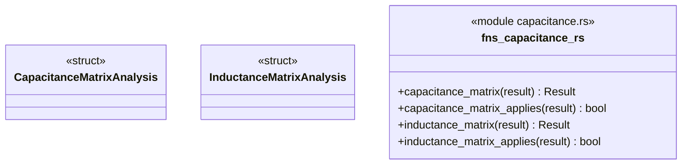

# Capacitance and inductance matrices: code

C4 level 4 (code) of the component **Capacitance and inductance matrices** (`analysis.capacitance`) in the container **nyx-analysis** (crate `nyx_analysis`). [Component view of the container](../../3-components/analysis.md) · [All code pages](../README.md)

> Maxwell/mutual capacitance and magnetostatic inductance matrix extraction from multi-RHS dfs results.

**Decisions:** [ADR 103](../../../adr/0103-multi-rhs-capacitance-and-gauge-stabilized-magnetostatics.md)  
**Size:** 1 file, 143 lines.

## Files

| File | Lines | What it says about itself |
|---|---:|---|
| `crates/nyx-analysis/src/capacitance.rs` | 143 |  |

## What it uses

| Target | Modules | Items |
|---|---|---|
| [container `physics` (nyx-physics)](../../3-components/physics.md) | cqed, crate root, error, result | CapacitanceMatrixData, Error, InductanceMatrixData, Mesh, SolveResult |
| [Analysis API](./api.md) | crate root | Analysis |

## Used by

| Component | Modules | Items |
|---|---|---|
| [Analysis API](./api.md) | capacitance | CapacitanceMatrixAnalysis, InductanceMatrixAnalysis, capacitance_matrix, capacitance_matrix_applies, inductance_matrix, inductance_matrix_applies |
| [engine: Analyses](../engine/analyse.md) | capacitance | CapacitanceMatrixAnalysis, InductanceMatrixAnalysis |

## Class diagram

Public types with their public fields (or variants) and methods, free functions per file as a `module` box; arrows are field types and `impl Trait`. Capped at 36 types and a few members each; the table below is complete.

## Public items

| Kind | Item | File:line | Signature or summary |
|---|---|---|---|
| fn | `capacitance_matrix` | `capacitance.rs:18` | `pub fn capacitance_matrix(result: &SolveResult) -> Result<CapacitanceMatrixData, Error>` —  Extracts the typed [`CapacitanceMatrixData`] payload from `result`. |
| fn | `capacitance_matrix_applies` | `capacitance.rs:27` | `pub fn capacitance_matrix_applies(result: &SolveResult) -> bool` —  True when `result` carries a multi-terminal capacitance matrix payload. |
| struct | `CapacitanceMatrixAnalysis` | `capacitance.rs:32` |  Multi-terminal Maxwell, mutual, and charging-energy capacitance matrix analysis behind the [`Analysis`] trait. |
| fn | `inductance_matrix` | `capacitance.rs:59` | `pub fn inductance_matrix(result: &SolveResult) -> Result<InductanceMatrixData, Error>` —  Extracts the typed [`InductanceMatrixData`] payload from `result`. |
| fn | `inductance_matrix_applies` | `capacitance.rs:65` | `pub fn inductance_matrix_applies(result: &SolveResult) -> bool` —  True when `result` carries a magnetostatic inductance matrix payload. |
| struct | `InductanceMatrixAnalysis` | `capacitance.rs:70` |  Multi-terminal magnetostatic inductance matrix analysis behind the [`Analysis`] trait. |

Trait implementations in this component: `CapacitanceMatrixAnalysis: Analysis`, `InductanceMatrixAnalysis: Analysis`
