# cQED quantization and TLS participation: code

C4 level 4 (code) of the component **cQED quantization and TLS participation** (`analysis.cqed`) in the container **nyx-analysis** (crate `nyx_analysis`). [Component view of the container](../../3-components/analysis.md) · [All code pages](../README.md)

> KICQ energy participation ratios, normal-Fock and hierarchical Craig-Bampton Josephson quantization, `NetworkAnalysis`, edge-regularized 3D TLS participation ratios, and zero-solve `uq_cqed` interval/aleatoric UQ.

**Decisions:** [ADR 105](../../../adr/0105-kicq-epr-craig-bampton-quantization-and-tls-participation.md), [ADR 118](../../../adr/0118-cqed-cavity-driven-open-robin-network-bbq-and-squid.md), [ADR 133](../../../adr/0133-vvuq-error-budgets-gci-provenance-and-uq.md)  
**Size:** 5 files, 10641 lines.

## Files

| File | Lines | What it says about itself |
|---|---:|---|
| `crates/nyx-analysis/src/epr.rs` | 956 |  |
| `crates/nyx-analysis/src/hamiltonian.rs` | 2994 |  |
| `crates/nyx-analysis/src/network.rs` | 2460 |  |
| `crates/nyx-analysis/src/tls.rs` | 2155 |  |
| `crates/nyx-analysis/src/uq.rs` | 2076 |  |

## What it uses

| Target | Modules | Items |
|---|---|---|
| [container `femcore` (femcore)](../../3-components/femcore.md) | crate root, fem, linalg::dense, linalg::driver, linalg::expm, linalg::rng, linalg::scalar, par | C64, Dense, Scalar, SplitMix64, dense_eigh, dense_gen_eigh, expm, facet_rule, geometry, hermitian_eig +5 |
| [container `physics` (nyx-physics)](../../3-components/physics.md) | cqed, crate root, error, result | CapacitanceMatrixData, CellField, CircuitRom, Discretisation, DrivenPortData, Error, Mesh, ModeEnergyRow, RomPort, Solution +3 |
| [Analysis API](./api.md) | crate root | Analysis |
| [Capacitance and inductance matrices](./capacitance.md) | capacitance | PreparedThicknessGram, apply_3d_thickness_gram, capacitance_matrix, capacitance_matrix_applies, prepare_3d_thickness_gram, run_capacitance_matrix_from_thickness |

## Used by

| Component | Modules | Items |
|---|---|---|
| [Analysis API](./api.md) | tls, uq | AleatoricEstimate, EpistemicInterval, PBoxEnvelope, QuasiElectrostaticTlsMode, R0PlateauCheck, TlsParticipationAnalysis, TlsReport, UqCqedAnalysis +13 |
| [Capacitance and inductance matrices](./capacitance.md) | tls | EFieldAccessor, detect_sheet_perimeter_3d, pt3, subdivided_tet_quad |
| [engine: Analyses](../engine/analyse.md) | tls, uq | TlsParticipationAnalysis, UqCqedAnalysis, tls_participation_quasi_electrostatic, uq_cqed_with_companion_and_params |

## Class diagram

Public types with their public fields (or variants) and methods, free functions per file as a `module` box; arrows are field types and `impl Trait`. Capped at 36 types and a few members each; the table below is complete.

```mermaid
classDiagram
  namespace epr_rs {
    class EprReport {
        <<struct>>
        +modes_hz Vec~f64~
        +q_factors Vec
        +ports Vec~String~
        +l_j_h Vec~f64~
        +e_j_hz Vec~f64~
        +e_l_hz Vec~f64~
        +p_matrix Vec
        +s_matrix Vec
        +more_9_fields
        +to_json() Value
    }
    class EprAnalysis {
        <<struct>>
    }
    class fns_epr_rs {
        <<module epr.rs>>
        +jj_flux_scale() f64
        +resolve_jj_l_and_ej(l_j, e_j_hz) tuple
        +jj_inv_l_tot(l_j, e_l_hz) f64
        +squid_effective_ej(e_j_sum_hz, flux_phi0, asymmetry) f64
        +is_nonlinear_port(port) bool
        ~assemble_rom_damping(rom, ports, terminations_override) tuple
        +epr_applies(result) bool
        +resolve_ports_with_overrides(ports, params) Result
        +project_rom_modes(rom, ports) Result
        +epr(result) Result
        +more_1_functions()
        +C0 const
        +MU0 const
        +EPS0 const
        +PHI0 const
        +more_2_items
    }
  }
  namespace hamiltonian_rs {
    class FluxSweepPoint {
        <<struct>>
        +phi_ext_rad f64
        +flux_phi0 f64
        +e_j_hz Option~f64~
        +f01_hz Vec~f64~
        +f12_hz Vec~f64~
        +f02_hz Vec~f64~
        +alpha_hz Vec~f64~
        +chi_matrix_hz Vec
        +more_5_fields
        +to_json() Value
    }
    class HamiltonianReport {
        <<struct>>
        +basis String
        +hilbert_dim usize
        +subsystems Vec~String~
        +dims Vec~usize~
        +f01_hz Vec~f64~
        +f12_hz Vec~f64~
        +f02_hz Vec~f64~
        +alpha_hz Vec~f64~
        +more_13_fields
        +to_json() Value
    }
    class HamiltonianAnalysis {
        <<struct>>
    }
    class fns_hamiltonian_rs {
        <<module hamiltonian.rs>>
        +hamiltonian_applies(result) bool
        +resolve_sweep_port(ports, params) Result
        +hamiltonian(result) Result
        +hamiltonian_with_params(result, params) Result
        +FOCK_BOUNDARY_WARN_THRESHOLD const
    }
  }
  namespace network_rs {
    class QepMode {
        <<struct>>
        +f_re_hz f64
        +f_im_hz f64
        +q_c f64
        +kappa_hz f64
        +to_json() Value
    }
    class BbqMode {
        <<struct>>
        +port String
        +f_m_hz f64
        +c_sigma_f f64
        +l_eff_h f64
        +kappa_hz f64
        +q_m f64
        +t1_purcell_s f64
        +foster_zero_residual_s f64
        +more_1_fields
        +to_json() Value
    }
    class S21CircleFit {
        <<struct>>
        +ports slice
        +resonator_branch String
        +f_r_hz f64
        +q_l f64
        +q_c f64
        +q_i f64
        +kappa_hz f64
        +phi_0_rad f64
        +more_8_fields
        +to_json() Value
    }
    class NetworkReport {
        <<struct>>
        +ports Vec~String~
        +freqs_hz Vec~f64~
        +z0_ohm Vec
        +s_matrix Vec
        +z_matrix Vec
        +y_matrix Vec
        +qep_modes Vec~QepMode~
        +bbq_modes Vec~BbqMode~
        +more_4_fields
        +to_json() Value
    }
    class NetworkAnalysis {
        <<struct>>
    }
    class Dual {
        <<impl block>>
    }
    class fns_network_rs {
        <<module network.rs>>
        +network_applies(result) bool
        ~schur_reduced_admittance(y_full, z_full, y_is_exact, active_idx, term_idx, z_load_ohm) Dense~C64~
        +network(result) Result
        +network_with_params(result, params) Result
    }
  }
  namespace tls_rs {
    class R0PlateauCheck {
        <<struct>>
        +applicable bool
        +r0_values_m Vec~f64~
        +p_total_values Vec~f64~
        +q_tls_values Vec~f64~
        +max_rel_spread f64
        +is_plateau_stable bool
        +to_json() Value
    }
    class TlsReport {
        <<struct>>
        +solution usize
        +u_elec_j f64
        +p_ma f64
        +p_ms f64
        +p_sa f64
        +p_total f64
        +loss_tan_total f64
        +q_tls f64
        +more_12_fields
        +to_json() Value
    }
    class QuasiElectrostaticTlsMode {
        <<struct>>
        +mode usize
        +freq_hz f64
        +terminal_voltages_v Vec~f64~
        +report TlsReport
        +t1_tls_s f64
        +to_json() Value
    }
    class TlsParams {
        <<struct>>
        +solution usize
        +t_ma f64
        +t_ms f64
        +t_sa f64
        +eps_ma f64
        +eps_ms f64
        +eps_sa f64
        +tan_delta_ma f64
        +more_6_fields
        ~from_json(params, meta) Result
    }
    class EFieldAccessor {
        <<struct>>
        +order usize
        ~new(sol, dim, n_cells) Result
        ~eval_with_shapes(ci, sh) slice
        ~eval_real_with_shapes(ci, sh) slice
    }
    class PreparedTls2d {
        <<struct>>
        +u_elec_j f64
        +c_e f64
        +ma_eps2_en2 f64
        +ma_epar2 f64
        +ms_eps2_en2 f64
        +ms_epar2 f64
        +sa_eps2_en2 f64
        +sa_epar2 f64
        +more_2_fields
        ~eval(p) TlsReport
    }
    class Segment3 {
        <<struct>>
        +a slice
        +b slice
        +inv_len_sq f64
    }
    class SegmentBvh3 {
        <<struct>>
        ~build(segs) Self
        ~is_empty() bool
        ~len() usize
        ~min_dist_sq(x) f64
        ~min_dist(x) f64
    }
    class SheetPerimeter3D {
        <<struct>>
        +face_to_cells FaceToCells3D
        +sheet_tris BTreeMap
        +sa_tris Vec
        +bvh SegmentBvh3
        +total_perim_len f64
        +h_edge_mean f64
        +has_resolved_3d_step bool
        +inferred_cavity_thickness Option~f64~
    }
    class PreparedTls3d {
        <<struct>>
        +solution usize
        +u_elec_j f64
        +c_e f64
        +eps_sub f64
        +d_film_default f64
        +r0 f64
        +has_resolved_3d_step bool
        +has_perimeter bool
        +more_18_fields
        ~eval(p, d_override, r0_plateau_check) TlsReport
    }
    class PreparedTls {
        <<enumeration>>
        Dim2
        Dim3
        ~eval(p, d_override) TlsReport
        ~default_d_film() Option~f64~
    }
    class PreparedQuasiMode {
        <<struct>>
        +mode usize
        +freq_hz f64
        +terminal_voltages_v Vec~f64~
        +prepared PreparedTls
        +params TlsParams
    }
    class TlsParticipationAnalysis {
        <<struct>>
    }
    class fns_tls_rs {
        <<module tls.rs>>
        +tls_participation_applies(result) bool
        ~sorted3(a, b, c) slice
        ~pt3(disc, v) slice
        ~point_segment_dist_sq(x, a, b, inv_len_sq) f64
        ~detect_sheet_perimeter_3d(disc, meta, cell_eps) SheetPerimeter3D
        ~subdivided_tet_quad(n_sub) Vecf64
        ~prepare_quasi_electrostatic_tls(electro_mesh, electro_result, modal_voltages, modal_freqs_hz, params) Result
        ~prepare_tls(mesh, result, params) Result
        +tls_participation_quasi_electrostatic(electro_mesh, electro_result, modal_voltages, modal_freqs_hz, params) Result
        +tls_participation(mesh, result) Result
        +more_2_functions()
        ~FaceToCells3D type
    }
  }
  namespace uq_rs {
    class EpistemicInterval {
        <<struct>>
        +low f64
        +up f64
        +half_width f64
        +midpoint f64
        +rel_half_width f64
        +source String
        +is_strict_bound bool
        +from_bounds(low, up, nominal, source, is_strict_bound) Self
        +from_rel_bound(nominal, rel_bound, non_negative, source, is_strict_bound) Self
        +to_json() Value
    }
    class AleatoricEstimate {
        <<struct>>
        +linear_sigma f64
        +rel_linear_sigma f64
        +mc_mean f64
        +mc_sigma f64
        +rel_mc_sigma f64
        +ci_68 slice
        +ci_95 slice
        +variance_contributions BTreeMap
        +more_1_fields
        +to_json() Value
    }
    class PBoxEnvelope {
        <<struct>>
        +bracket_95 slice
        +bracket_68 slice
        +to_json() Value
    }
    class UqParameterSpec {
        <<struct>>
        +name String
        +domain String
        +nominal f64
        +sigma f64
        +rel_tol f64
        +min_bound f64
        +max_bound f64
        +to_json() Value
    }
    class UqQuantity {
        <<struct>>
        +name String
        +unit String
        +nominal f64
        +aleatoric Option~AleatoricEstimate~
        +epistemic Option~EpistemicInterval~
        +outer_envelope Option~PBoxEnvelope~
        +to_json() Value
    }
    class UqCqedReport {
        <<struct>>
        +seed u64
        +n_samples usize
        +zero_fem_solves bool
        +epistemic_aleatoric_separated bool
        +domains_evaluated Vec~String~
        +uncertain_parameters Vec~UqParameterSpec~
        +quantities Vec~UqQuantity~
        +diagnostics Vec~String~
        +more_1_fields
        +quantity(name) Option
        +to_json() Value
    }
    class UqCqedAnalysis {
        <<struct>>
    }
    class fns_uq_rs {
        <<module uq.rs>>
        +uq_cqed_applies(result) bool
        +uq_cqed(mesh, result) Result
        +uq_cqed_with_params(result, params) Result
        +uq_cqed_with_mesh_and_params(mesh, result, params) Result
        +uq_cqed_with_companion_and_params(primary_mesh, primary_result, companion, params) Result
    }
  }
  NetworkReport --> QepMode
  NetworkReport --> BbqMode
  QuasiElectrostaticTlsMode --> TlsReport
  SheetPerimeter3D --> SegmentBvh3
  PreparedTls --> PreparedTls2d
  PreparedTls --> PreparedTls3d
  PreparedQuasiMode --> PreparedTls
  PreparedQuasiMode --> TlsParams
  UqQuantity --> AleatoricEstimate
  UqQuantity --> EpistemicInterval
  UqQuantity --> PBoxEnvelope
  UqCqedReport --> UqParameterSpec
  UqCqedReport --> UqQuantity
```

## Public items

| Kind | Item | File:line | Signature or summary |
|---|---|---|---|
| const | `C0` | `epr.rs:32` | `f64` —  Speed of light in vacuum `c_0` (m/s). |
| const | `MU0` | `epr.rs:34` | `f64` —  Vacuum magnetic permeability `mu_0` (H/m). |
| const | `EPS0` | `epr.rs:36` | `f64` —  Vacuum electric permittivity `eps_0 = 1 / (mu_0 c_0^2)` (F/m). |
| const | `PHI0` | `epr.rs:38` | `f64` —  Superconducting magnetic flux quantum `Phi_0 = h / (2e)` (Wb). |
| const | `PLANCK_H` | `epr.rs:40` | `f64` —  Planck constant `h` (J*s). |
| const | `E_CHARGE` | `epr.rs:42` | `f64` —  Elementary charge `e` (C). |
| fn | `jj_flux_scale` | `epr.rs:46` | `pub fn jj_flux_scale() -> f64` —  Scale `(Phi_0 / (2 pi))^2 / h` (H * Hz) relating `L_J` (H) and `E_J / h` (Hz): `L_J * E_J_Hz = jj_flux_scale()`. |
| fn | `resolve_jj_l_and_ej` | `epr.rs:53` | `pub fn resolve_jj_l_and_ej(l_j: f64, e_j_hz: f64) -> (f64, f64)` —  Resolves `(L_J, E_J_Hz)` for a port when one is specified and the other is `<= 0`. |
| fn | `jj_inv_l_tot` | `epr.rs:68` | `pub fn jj_inv_l_tot(l_j: f64, e_l_hz: f64) -> f64` —  Total inverse linear inductance `1 / L_tot = 1 / L_J + 1 / L_p` (1/H) of a port. |
| fn | `squid_effective_ej` | `epr.rs:78` | `pub fn squid_effective_ej(e_j_sum_hz: f64, flux_phi0: f64, asymmetry: f64) -> f64` —  Effective Josephson energy `E_{J,eff}(Phi_ext)` (Hz) of an asymmetric DC-SQUID with total |
| fn | `is_nonlinear_port` | `epr.rs:91` | `pub fn is_nonlinear_port(port: &RomPort) -> bool` —  True when `port` is a nonlinear Josephson / inductive port (`lumped_jj`), as opposed to a passive |
| fn | `assemble_rom_damping` | `epr.rs:99` | `pub(crate) fn assemble_rom_damping( rom: &CircuitRom, ports: &[RomPort], terminations_override: Option<&BTreeMap<String, f64>>, ) -> (Vec<Vec<f64>>, Vec<Vec<f64>>, bool)` —  Decomposes the reduced damping of `rom` into `(c_internal_r, c_tot_r)` (`r x r` each), separating |
| struct | `EprReport` | `epr.rs:198` | fields: `modes_hz`, `q_factors`, `ports`, `l_j_h`, `e_j_hz`, `e_l_hz`, `p_matrix`, `s_matrix`, `phi_zpf_matrix`, `alpha_hz`, `chi_matrix_hz`, `f_dressed_pert_hz`, ... —  Typed output of [`epr`] and [`epr_with_params`]. |
| fn | `epr_applies` | `epr.rs:244` | `pub fn epr_applies(result: &SolveResult) -> bool` —  True when `result` carries a [`CircuitRom`] payload that [`EprAnalysis`] can process. |
| fn | `resolve_ports_with_overrides` | `epr.rs:257` | `pub fn resolve_ports_with_overrides(ports: &[RomPort], params: &Value) -> Result<(Vec<RomPort>, bool), Error>` —  Parses optional `lj_override` (H), `ej_hz_override` (Hz), `squid_asymmetry`, and `squid_flux_phi0` |
| fn | `project_rom_modes` | `epr.rs:411` | `pub fn project_rom_modes(rom: &CircuitRom, ports: &[RomPort]) -> Result<Vec<ModeEnergyRow>, Error>` —  Solves the `r x r` projected generalized eigenproblem on `rom` for the given `ports` (`< 20 us`), |
| fn | `epr` | `epr.rs:601` | `pub fn epr(result: &SolveResult) -> Result<EprReport, Error>` —  Computes the [`EprReport`] of `result` with default parameters. |
| fn | `epr_with_params` | `epr.rs:607` | `pub fn epr_with_params(result: &SolveResult, params: &Value) -> Result<EprReport, Error>` —  Computes the [`EprReport`] of `result` with optional JSON parameters (`lj_override`, `ej_hz_override`, |
| struct | `EprAnalysis` | `epr.rs:807` |  Energy Participation Ratio (EPR) analysis behind the [`Analysis`] trait (`id: "epr"`). |
| fn | `EprReport::to_json` | `epr.rs:220` | `pub fn to_json(&self) -> Value` —  Converts this report to the canonical JSON structure returned by [`EprAnalysis`]. |
| const | `FOCK_BOUNDARY_WARN_THRESHOLD` | `hamiltonian.rs:41` | `f64` —  Maximum allowed Fock/basis boundary occupation `max_k \|<N_max \| psi_k>\|^2` before emitting a truncation warning. |
| struct | `FluxSweepPoint` | `hamiltonian.rs:65` | fields: `phi_ext_rad`, `flux_phi0`, `e_j_hz`, `f01_hz`, `f12_hz`, `f02_hz`, `alpha_hz`, `chi_matrix_hz`, `eigenvalues_hz`, `min_overlap`, `max_fock_boundary_occupation`, `fock_boundary_occupation_by_subsystem`, ... —  One point of a flux, DC-SQUID flux, or `E_J` sweep (`phi_ext_sweep`, `flux_sweep`, `squid_flux_sweep`, `ej_hz_sweep`). |
| struct | `HamiltonianReport` | `hamiltonian.rs:109` | fields: `basis`, `hilbert_dim`, `subsystems`, `dims`, `f01_hz`, `f12_hz`, `f02_hz`, `alpha_hz`, `chi_matrix_hz`, `eigenvalues_hz`, `min_overlap`, `max_fock_boundary_occupation`, ... —  Typed output of [`hamiltonian`] and [`hamiltonian_with_params`]. |
| fn | `hamiltonian_applies` | `hamiltonian.rs:171` | `pub fn hamiltonian_applies(result: &SolveResult) -> bool` —  True when `result` carries a [`CircuitRom`] with at least one nonlinear port (`lumped_jj`). |
| fn | `resolve_sweep_port` | `hamiltonian.rs:177` | `pub fn resolve_sweep_port(ports: &[RomPort], params: &Value) -> Result<usize, Error>` —  Resolves `"sweep_port"` in `params` (0-based integer index or port `name` string) against `ports` |
| fn | `hamiltonian` | `hamiltonian.rs:2591` | `pub fn hamiltonian(result: &SolveResult) -> Result<HamiltonianReport, Error>` —  Runs circuit quantization with default parameters (`basis = "normal_fock"`). |
| fn | `hamiltonian_with_params` | `hamiltonian.rs:2596` | `pub fn hamiltonian_with_params(result: &SolveResult, params: &Value) -> Result<HamiltonianReport, Error>` —  Runs circuit quantization with optional JSON `params`. |
| struct | `HamiltonianAnalysis` | `hamiltonian.rs:2608` |  Full cosine-potential circuit quantization analysis behind the [`Analysis`] trait (`id: "hamiltonian"`). |
| fn | `FluxSweepPoint::to_json` | `hamiltonian.rs:82` | `pub fn to_json(&self) -> Value` |
| fn | `HamiltonianReport::to_json` | `hamiltonian.rs:134` | `pub fn to_json(&self) -> Value` |
| struct | `QepMode` | `network.rs:36` | fields: `f_re_hz`, `f_im_hz`, `q_c`, `kappa_hz` —  Complex eigenmode extracted from the `2r x 2r` damped `CircuitRom` quadratic eigenvalue problem. |
| struct | `BbqMode` | `network.rs:56` | fields: `port`, `f_m_hz`, `c_sigma_f`, `l_eff_h`, `kappa_hz`, `q_m`, `t1_purcell_s`, `foster_zero_residual_s`, `foster_zero_rel_residual` —  Foster zero-crossing mode extracted by Schur-reduced Black-Box Quantization (Nigg et al. 2012). |
| struct | `S21CircleFit` | `network.rs:86` | fields: `ports`, `resonator_branch`, `f_r_hz`, `q_l`, `q_c`, `q_i`, `kappa_hz`, `phi_0_rad`, `circle_center`, `circle_radius`, `circle_fit_rmse`, `phase_fit_rmse_rad`, ... —  Algebraic Taubin circle + phase-vs-frequency resonator fit (Probst et al. 2015). |
| struct | `NetworkReport` | `network.rs:139` | fields: `ports`, `freqs_hz`, `z0_ohm`, `s_matrix`, `z_matrix`, `y_matrix`, `qep_modes`, `bbq_modes`, `max_foster_zero_residual_s`, `s21_fit`, `touchstone_snp`, `elapsed_s` —  Typed output of [`network`] and [`network_with_params`]. |
| fn | `network_applies` | `network.rs:181` | `pub fn network_applies(result: &SolveResult) -> bool` —  True when `result` carries a [`CircuitRom`] or [`DrivenPortData`] payload. |
| fn | `schur_reduced_admittance` | `network.rs:640` | `pub(crate) fn schur_reduced_admittance( y_full: &Dense<C64>, z_full: &Dense<C64>, y_is_exact: bool, active_idx: &[usize], term_idx: &[usize], z_load_ohm: &[f64], ) -> Dense<C64>` —  Computes `Y_red = Y_AA - Y_AT (Y_TT + Y_load)^-1 Y_TA`, using the algebraically identical dual |
| fn | `network` | `network.rs:1641` | `pub fn network(result: &SolveResult) -> Result<NetworkReport, Error>` —  Runs [`NetworkAnalysis`] with default parameters. |
| fn | `network_with_params` | `network.rs:1646` | `pub fn network_with_params(result: &SolveResult, params: &Value) -> Result<NetworkReport, Error>` —  Runs [`NetworkAnalysis`] with optional JSON parameters. |
| struct | `NetworkAnalysis` | `network.rs:1990` |  Unified multi-port microwave network, QEP, BBQ, `S_21` fit, and Touchstone analysis (`id: "network"`). |
| fn | `QepMode::to_json` | `network.rs:44` | `pub fn to_json(&self) -> Value` |
| fn | `BbqMode::to_json` | `network.rs:69` | `pub fn to_json(&self) -> Value` |
| fn | `S21CircleFit::to_json` | `network.rs:106` | `pub fn to_json(&self) -> Value` |
| fn | `NetworkReport::to_json` | `network.rs:155` | `pub fn to_json(&self) -> Value` |
| struct | `R0PlateauCheck` | `tls.rs:32` | fields: `applicable`, `r0_values_m`, `p_total_values`, `q_tls_values`, `max_rel_spread`, `is_plateau_stable` —  Result of an opt-in edge-tube cutoff `R_0` plateau check over `{0.75 R_0, R_0, 1.25 R_0}` (reusing the solved field). |
| struct | `TlsReport` | `tls.rs:56` | fields: `solution`, `u_elec_j`, `p_ma`, `p_ms`, `p_sa`, `p_total`, `loss_tan_total`, `q_tls`, `edge_cutoff_m`, `r0_m`, `h_edge_mean_m`, `i_edge`, ... —  Typed output of [`tls_participation`] and [`tls_participation_with_params`]. |
| struct | `QuasiElectrostaticTlsMode` | `tls.rs:118` | fields: `mode`, `freq_hz`, `terminal_voltages_v`, `report`, `t1_tls_s` —  Per-mode dielectric TLS surface participation and lifetime evaluated via quasi-electrostatic modal field |
| struct | `TlsParams` | `tls.rs:142` | fields: `solution`, `t_ma`, `t_ms`, `t_sa`, `eps_ma`, `eps_ms`, `eps_sa`, `tan_delta_ma`, `tan_delta_ms`, `tan_delta_sa`, `d`, `edge_cutoff`, ... —  Parameters for [`tls_participation_with_params`]. |
| fn | `tls_participation_applies` | `tls.rs:238` | `pub fn tls_participation_applies(result: &SolveResult) -> bool` —  True when `result` has electric field cell fields (`Ex`) suitable for [`TlsParticipationAnalysis`]. |
| struct | `EFieldAccessor` | `tls.rs:246` | fields: `order` |
| struct | `PreparedTls2d` | `tls.rs:343` | fields: `u_elec_j`, `c_e`, `ma_eps2_en2`, `ma_epar2`, `ms_eps2_en2`, `ms_epar2`, `sa_eps2_en2`, `sa_epar2`, `h_edge_mean_m`, `n_cells` |
| fn | `sorted3` | `tls.rs:604` | `pub(crate) fn sorted3(a: u32, b: u32, c: u32) -> [u32` |
| fn | `pt3` | `tls.rs:611` | `pub(crate) fn pt3(disc: &Discretisation, v: u32) -> [f64` |
| fn | `point_segment_dist_sq` | `tls.rs:638` | `pub(crate) fn point_segment_dist_sq(x: [f64; 3], a: [f64; 3], b: [f64; 3], inv_len_sq: f64) -> f64` —  Squared distance from point `x` to 3D line segment `(a, b)`. |
| struct | `Segment3` | `tls.rs:650` | fields: `a`, `b`, `inv_len_sq` —  One 3D singular sheet-perimeter line segment. |
| struct | `SegmentBvh3` | `tls.rs:695` |  Deterministic flat `Vec`-backed 3D AABB bounding-volume hierarchy over 3D line segments (`Segment3`). |
| type | `FaceToCells3D` | `tls.rs:848` |  |
| struct | `SheetPerimeter3D` | `tls.rs:850` | fields: `face_to_cells`, `sheet_tris`, `sa_tris`, `bvh`, `total_perim_len`, `h_edge_mean`, `has_resolved_3d_step`, `inferred_cavity_thickness` |
| fn | `detect_sheet_perimeter_3d` | `tls.rs:864` | `pub(crate) fn detect_sheet_perimeter_3d(disc: &Discretisation, meta: &TlsMeta, cell_eps: &[f64]) -> SheetPerimeter3D` —  Detects interior zero-thickness superconducting sheet triangles (plus conformal 3D thick-sheet |
| fn | `subdivided_tet_quad` | `tls.rs:1119` | `pub(crate) fn subdivided_tet_quad(n_sub: usize) -> Vec<([f64` —  Generates `(2 * n_sub)^3` quadrature points on the 3D reference tetrahedron by collapsing the subdivided cube, |
| struct | `PreparedTls3d` | `tls.rs:1149` | fields: `solution`, `u_elec_j`, `c_e`, `eps_sub`, `d_film_default`, `r0`, `has_resolved_3d_step`, `has_perimeter`, `perimeter_segments`, `perimeter_len_m`, `h_edge_mean_m`, `is_p1_field`, ... |
| enum | `PreparedTls` | `tls.rs:1300` | variants: `Dim2`, `Dim3` |
| struct | `PreparedQuasiMode` | `tls.rs:1679` | fields: `mode`, `freq_hz`, `terminal_voltages_v`, `prepared`, `params` —  Evaluates per-mode dielectric TLS participation (`p_MA`, `p_MS`, `p_SA`, `Q_TLS`) and TLS-limited relaxation |
| fn | `prepare_quasi_electrostatic_tls` | `tls.rs:1687` | `pub(crate) fn prepare_quasi_electrostatic_tls( electro_mesh: &Mesh, electro_result: &SolveResult, modal_voltages: &[Vec<f64>], modal_freqs_hz: &[f64], params: &Value, ) -> Result<Vec<PreparedQuasiMode>, Error>` |
| fn | `prepare_tls` | `tls.rs:1750` | `pub(crate) fn prepare_tls( mesh: &Mesh, result: &SolveResult, params: &Value, ) -> Result<(PreparedTls, TlsParams), Error>` |
| fn | `tls_participation_quasi_electrostatic` | `tls.rs:1780` | `pub fn tls_participation_quasi_electrostatic( electro_mesh: &Mesh, electro_result: &SolveResult, modal_voltages: &[Vec<f64>], modal_freqs_hz: &[f64], params: &Value, ) -> Result<Vec<QuasiElectrostaticTlsMode>, Error>` |
| fn | `tls_participation` | `tls.rs:1827` | `pub fn tls_participation(mesh: &Mesh, result: &SolveResult) -> Result<TlsReport, Error>` —  Computes dielectric TLS surface participation with default parameters. |
| fn | `tls_participation_with_params` | `tls.rs:1832` | `pub fn tls_participation_with_params(mesh: &Mesh, result: &SolveResult, params: &Value) -> Result<TlsReport, Error>` —  Computes dielectric TLS surface participation with optional JSON parameters. |
| fn | `tls_r0_plateau_check` | `tls.rs:1860` | `pub fn tls_r0_plateau_check(mesh: &Mesh, result: &SolveResult, params: &Value) -> Result<R0PlateauCheck, Error>` —  Opt-in edge-tube cutoff `R_0` plateau check over `{0.75 R_0, R_0, 1.25 R_0}` on an already-solved [`SolveResult`] |
| struct | `TlsParticipationAnalysis` | `tls.rs:1875` |  Dielectric TLS surface participation analysis behind the [`Analysis`] trait (`id: "tls_participation"`). |
| fn | `R0PlateauCheck::to_json` | `tls.rs:42` | `pub fn to_json(&self) -> Value` |
| fn | `TlsReport::to_json` | `tls.rs:80` | `pub fn to_json(&self) -> Value` |
| fn | `QuasiElectrostaticTlsMode::to_json` | `tls.rs:127` | `pub fn to_json(&self) -> Value` |
| fn | `TlsParams::from_json` | `tls.rs:160` | `pub(crate) fn from_json(params: &Value, meta: &TlsMeta) -> Result<Self, Error>` |
| fn | `EFieldAccessor::new` | `tls.rs:255` | `pub(crate) fn new(sol: &'a Solution, dim: usize, n_cells: usize) -> Result<Self, Error>` |
| fn | `EFieldAccessor::eval_with_shapes` | `tls.rs:295` | `pub(crate) fn eval_with_shapes(&self, ci: usize, sh: &[f64]) -> [C64` |
| fn | `EFieldAccessor::eval_real_with_shapes` | `tls.rs:319` | `pub(crate) fn eval_real_with_shapes(&self, ci: usize, sh: &[f64]) -> [f64` |
| fn | `PreparedTls2d::eval` | `tls.rs:357` | `pub(crate) fn eval(&self, p: &TlsParams) -> TlsReport` |
| fn | `SegmentBvh3::build` | `tls.rs:701` | `pub(crate) fn build(segs: Vec<Segment3>) -> Self` |
| fn | `SegmentBvh3::is_empty` | `tls.rs:777` | `pub(crate) fn is_empty(&self) -> bool` |
| fn | `SegmentBvh3::len` | `tls.rs:782` | `pub(crate) fn len(&self) -> usize` |
| fn | `SegmentBvh3::min_dist_sq` | `tls.rs:788` | `pub(crate) fn min_dist_sq(&self, x: [f64; 3]) -> f64` —  Exact minimum squared Euclidean distance from `x` to all segments in `O(log N_seg)` with zero heap allocations. |
| fn | `SegmentBvh3::min_dist` | `tls.rs:843` | `pub(crate) fn min_dist(&self, x: [f64; 3]) -> f64` |
| fn | `PreparedTls3d::eval` | `tls.rs:1232` | `pub(crate) fn eval( &self, p: &TlsParams, d_override: Option<f64>, r0_plateau_check: Option<R0PlateauCheck>, ) -> TlsReport` |
| fn | `PreparedTls::eval` | `tls.rs:1306` | `pub(crate) fn eval(&self, p: &TlsParams, d_override: Option<f64>) -> TlsReport` |
| fn | `PreparedTls::default_d_film` | `tls.rs:1313` | `pub(crate) fn default_d_film(&self) -> Option<f64>` |
| struct | `EpistemicInterval` | `uq.rs:79` | fields: `low`, `up`, `half_width`, `midpoint`, `rel_half_width`, `source`, `is_strict_bound` —  Epistemic interval bracket `[low, up]` (from Prager–Synge, Roache GCI, or solver residuals). |
| struct | `AleatoricEstimate` | `uq.rs:134` | fields: `linear_sigma`, `rel_linear_sigma`, `mc_mean`, `mc_sigma`, `rel_mc_sigma`, `ci_68`, `ci_95`, `variance_contributions`, `sensitivities` —  Aleatoric statistical uncertainty summary (`1 sigma` linearized + Monte Carlo quantiles). |
| struct | `PBoxEnvelope` | `uq.rs:164` | fields: `bracket_95`, `bracket_68` —  Outer p-box envelope `[lower, upper]` combining separate aleatoric MC intervals with epistemic brackets. |
| struct | `UqParameterSpec` | `uq.rs:180` | fields: `name`, `domain`, `nominal`, `sigma`, `rel_tol`, `min_bound`, `max_bound` —  Metadata describing an active uncertain input parameter. |
| struct | `UqQuantity` | `uq.rs:206` | fields: `name`, `unit`, `nominal`, `aleatoric`, `epistemic`, `outer_envelope` —  Uncertainty-quantified Quantity of Interest (QoI) under strict ASME V&V 20 separation. |
| struct | `UqCqedReport` | `uq.rs:238` | fields: `seed`, `n_samples`, `zero_fem_solves`, `epistemic_aleatoric_separated`, `domains_evaluated`, `uncertain_parameters`, `quantities`, `diagnostics`, `elapsed_s` —  Typed output of [`uq_cqed`] and [`uq_cqed_with_params`]. |
| fn | `uq_cqed_applies` | `uq.rs:276` | `pub fn uq_cqed_applies(result: &SolveResult) -> bool` —  True when `result` carries at least one cQED payload (`CircuitRom`, `CapacitanceMatrixData`, or `TlsMeta`/E-field). |
| fn | `uq_cqed` | `uq.rs:1942` | `pub fn uq_cqed(mesh: &Mesh, result: &SolveResult) -> Result<UqCqedReport, Error>` —  Runs zero-solve cQED post-processing UQ with default parameters (nominal + any epistemic bounds). |
| fn | `uq_cqed_with_params` | `uq.rs:1947` | `pub fn uq_cqed_with_params(result: &SolveResult, params: &Value) -> Result<UqCqedReport, Error>` —  Runs zero-solve cQED post-processing UQ without a mesh (ROM and CapacitanceMatrix without 3D thickness). |
| fn | `uq_cqed_with_mesh_and_params` | `uq.rs:1952` | `pub fn uq_cqed_with_mesh_and_params(mesh: &Mesh, result: &SolveResult, params: &Value) -> Result<UqCqedReport, Error>` —  Runs zero-solve cQED post-processing UQ with a mesh (enabling TLS and 3D thickness UQ). |
| fn | `uq_cqed_with_companion_and_params` | `uq.rs:1959` | `pub fn uq_cqed_with_companion_and_params( primary_mesh: Option<&Mesh>, primary_result: &SolveResult, companion: Option<(&Mesh, &SolveResult)>, params: &Value, ) -> Result<UqCqedReport, Error>` —  Runs joint zero-solve cQED UQ across a primary `SolveResult` (e.g., `ems` `CircuitRom`) paired with a |
| struct | `UqCqedAnalysis` | `uq.rs:2053` |  Zero-solve cQED post-processing uncertainty quantification behind the [`Analysis`] trait (`id: "uq_cqed"`). |
| fn | `EpistemicInterval::from_bounds` | `uq.rs:90` | `pub fn from_bounds(low: f64, up: f64, nominal: f64, source: impl Into<String>, is_strict_bound: bool) -> Self` |
| fn | `EpistemicInterval::from_rel_bound` | `uq.rs:106` | `pub fn from_rel_bound( nominal: f64, rel_bound: f64, non_negative: bool, source: String, is_strict_bound: bool, ) -> Self` |
| fn | `EpistemicInterval::to_json` | `uq.rs:119` | `pub fn to_json(&self) -> Value` |
| fn | `AleatoricEstimate::to_json` | `uq.rs:147` | `pub fn to_json(&self) -> Value` |
| fn | `PBoxEnvelope::to_json` | `uq.rs:170` | `pub fn to_json(&self) -> Value` |
| fn | `UqParameterSpec::to_json` | `uq.rs:191` | `pub fn to_json(&self) -> Value` |
| fn | `UqQuantity::to_json` | `uq.rs:216` | `pub fn to_json(&self) -> Value` |
| fn | `UqCqedReport::quantity` | `uq.rs:252` | `pub fn quantity(&self, name: &str) -> Option<&UqQuantity>` —  Looks up a quantified observable by exact name (e.g. `"f01_Hz"`, `"Q_TLS"`, `"C_Sigma_F"`). |
| fn | `UqCqedReport::to_json` | `uq.rs:256` | `pub fn to_json(&self) -> Value` |

Trait implementations in this component: `EprAnalysis: Analysis`, `HamiltonianAnalysis: Analysis`, `Dual: Add`, `Dual: Sub`, `Dual: Mul`, `Dual: Div`, `NetworkAnalysis: Analysis`, `TlsParticipationAnalysis: Analysis`, `UqCqedAnalysis: Analysis`
