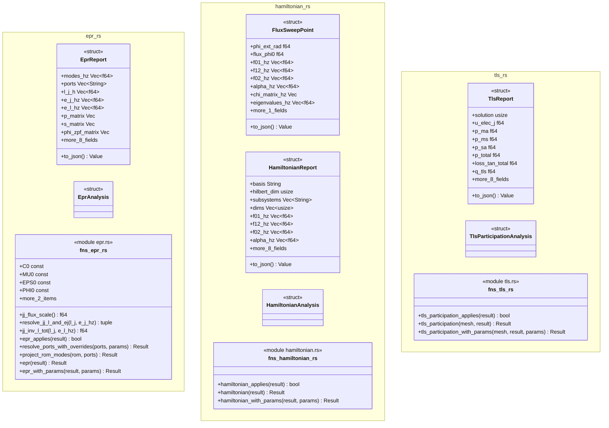

# cQED quantization and TLS participation: code

C4 level 4 (code) of the component **cQED quantization and TLS participation** (`analysis.cqed`) in the container **nyx-analysis** (crate `nyx_analysis`). [Component view of the container](../../3-components/analysis.md) · [All code pages](../README.md)

> KICQ energy participation ratios, normal-Fock and hierarchical Craig-Bampton Josephson quantization, and edge-regularized 3D TLS participation ratios.

**Decisions:** [ADR 105](../../../adr/0105-kicq-epr-craig-bampton-quantization-and-tls-participation.md)  
**Size:** 3 files, 3360 lines.

## Files

| File | Lines | What it says about itself |
|---|---:|---|
| `crates/nyx-analysis/src/epr.rs` | 660 |  |
| `crates/nyx-analysis/src/hamiltonian.rs` | 1749 |  |
| `crates/nyx-analysis/src/tls.rs` | 951 |  |

## What it uses

| Target | Modules | Items |
|---|---|---|
| [container `femcore` (femcore)](../../3-components/femcore.md) | fem, linalg::dense, linalg::driver, linalg::expm, linalg::scalar, par | C64, Dense, Scalar, dense_eigh, dense_gen_eigh, expm, facet_rule, geometry, hermitian_eig, map_chunks +4 |
| [container `physics` (nyx-physics)](../../3-components/physics.md) | cqed, crate root, error, result | CellField, CircuitRom, Discretisation, Error, Mesh, ModeEnergyRow, RomPort, Solution, SolveResult, TlsMeta +1 |
| [Analysis API](./api.md) | crate root | Analysis |

## Used by

| Component | Modules | Items |
|---|---|---|
| [Analysis API](./api.md) | tls | TlsParticipationAnalysis, TlsReport, tls_participation, tls_participation_applies, tls_participation_with_params |
| [engine: Analyses](../engine/analyse.md) | tls | TlsParticipationAnalysis |

## Class diagram

Public types with their public fields (or variants) and methods, free functions per file as a `module` box; arrows are field types and `impl Trait`. Capped at 36 types and a few members each; the table below is complete.

## Public items

| Kind | Item | File:line | Signature or summary |
|---|---|---|---|
| const | `C0` | `epr.rs:29` | `f64` —  Speed of light in vacuum `c_0` (m/s). |
| const | `MU0` | `epr.rs:31` | `f64` —  Vacuum magnetic permeability `mu_0` (H/m). |
| const | `EPS0` | `epr.rs:33` | `f64` —  Vacuum electric permittivity `eps_0 = 1 / (mu_0 c_0^2)` (F/m). |
| const | `PHI0` | `epr.rs:35` | `f64` —  Superconducting magnetic flux quantum `Phi_0 = h / (2e)` (Wb). |
| const | `PLANCK_H` | `epr.rs:37` | `f64` —  Planck constant `h` (J*s). |
| const | `E_CHARGE` | `epr.rs:39` | `f64` —  Elementary charge `e` (C). |
| fn | `jj_flux_scale` | `epr.rs:43` | `pub fn jj_flux_scale() -> f64` —  Scale `(Phi_0 / (2 pi))^2 / h` (H * Hz) relating `L_J` (H) and `E_J / h` (Hz): `L_J * E_J_Hz = jj_flux_scale()`. |
| fn | `resolve_jj_l_and_ej` | `epr.rs:50` | `pub fn resolve_jj_l_and_ej(l_j: f64, e_j_hz: f64) -> (f64, f64)` —  Resolves `(L_J, E_J_Hz)` for a port when one is specified and the other is `<= 0`. |
| fn | `jj_inv_l_tot` | `epr.rs:65` | `pub fn jj_inv_l_tot(l_j: f64, e_l_hz: f64) -> f64` —  Total inverse linear inductance `1 / L_tot = 1 / L_J + 1 / L_p` (1/H) of a port. |
| struct | `EprReport` | `epr.rs:73` | fields: `modes_hz`, `ports`, `l_j_h`, `e_j_hz`, `e_l_hz`, `p_matrix`, `s_matrix`, `phi_zpf_matrix`, `alpha_hz`, `chi_matrix_hz`, `f_dressed_pert_hz`, `kinetic_inductance_fraction`, ... —  Typed output of [`epr`] and [`epr_with_params`]. |
| fn | `epr_applies` | `epr.rs:114` | `pub fn epr_applies(result: &SolveResult) -> bool` —  True when `result` carries a [`CircuitRom`] payload that [`EprAnalysis`] can process. |
| fn | `resolve_ports_with_overrides` | `epr.rs:120` | `pub fn resolve_ports_with_overrides(ports: &[RomPort], params: &Value) -> Result<(Vec<RomPort>, bool), Error>` —  Parses optional `lj_override` (H) and `ej_hz_override` (Hz) maps from `params` and returns |
| fn | `project_rom_modes` | `epr.rs:186` | `pub fn project_rom_modes(rom: &CircuitRom, ports: &[RomPort]) -> Result<Vec<ModeEnergyRow>, Error>` —  Solves the `r x r` projected generalized eigenproblem on `rom` for the given `ports` (`< 20 us`), |
| fn | `epr` | `epr.rs:366` | `pub fn epr(result: &SolveResult) -> Result<EprReport, Error>` —  Computes the [`EprReport`] of `result` with default parameters. |
| fn | `epr_with_params` | `epr.rs:371` | `pub fn epr_with_params(result: &SolveResult, params: &Value) -> Result<EprReport, Error>` —  Computes the [`EprReport`] of `result` with optional JSON parameters (`lj_override`, `ej_hz_override`). |
| struct | `EprAnalysis` | `epr.rs:540` |  Energy Participation Ratio (EPR) analysis behind the [`Analysis`] trait (`id: "epr"`). |
| fn | `EprReport::to_json` | `epr.rs:94` | `pub fn to_json(&self) -> Value` —  Converts this report to the canonical JSON structure returned by [`EprAnalysis`]. |
| struct | `FluxSweepPoint` | `hamiltonian.rs:38` | fields: `phi_ext_rad`, `flux_phi0`, `f01_hz`, `f12_hz`, `f02_hz`, `alpha_hz`, `chi_matrix_hz`, `eigenvalues_hz`, `min_overlap` —  One point of a flux sweep (`phi_ext_sweep` or `flux_sweep`). |
| struct | `HamiltonianReport` | `hamiltonian.rs:68` | fields: `basis`, `hilbert_dim`, `subsystems`, `dims`, `f01_hz`, `f12_hz`, `f02_hz`, `alpha_hz`, `chi_matrix_hz`, `eigenvalues_hz`, `min_overlap`, `elapsed_s`, ... —  Typed output of [`hamiltonian`] and [`hamiltonian_with_params`]. |
| fn | `hamiltonian_applies` | `hamiltonian.rs:114` | `pub fn hamiltonian_applies(result: &SolveResult) -> bool` —  True when `result` carries a [`CircuitRom`] with at least one nonlinear port. |
| fn | `hamiltonian` | `hamiltonian.rs:1584` | `pub fn hamiltonian(result: &SolveResult) -> Result<HamiltonianReport, Error>` —  Runs circuit quantization with default parameters (`basis = "normal_fock"`). |
| fn | `hamiltonian_with_params` | `hamiltonian.rs:1589` | `pub fn hamiltonian_with_params(result: &SolveResult, params: &Value) -> Result<HamiltonianReport, Error>` —  Runs circuit quantization with optional JSON `params`. |
| struct | `HamiltonianAnalysis` | `hamiltonian.rs:1601` |  Full cosine-potential circuit quantization analysis behind the [`Analysis`] trait (`id: "hamiltonian"`). |
| fn | `FluxSweepPoint::to_json` | `hamiltonian.rs:51` | `pub fn to_json(&self) -> Value` |
| fn | `HamiltonianReport::to_json` | `hamiltonian.rs:88` | `pub fn to_json(&self) -> Value` |
| struct | `TlsReport` | `tls.rs:31` | fields: `solution`, `u_elec_j`, `p_ma`, `p_ms`, `p_sa`, `p_total`, `loss_tan_total`, `q_tls`, `edge_cutoff_m`, `p_ma_interior`, `p_ms_interior`, `p_sa_interior`, ... —  Typed output of [`tls_participation`] and [`tls_participation_with_params`]. |
| fn | `tls_participation_applies` | `tls.rs:142` | `pub fn tls_participation_applies(result: &SolveResult) -> bool` —  True when `result` has electric field cell fields (`Ex`) suitable for [`TlsParticipationAnalysis`]. |
| fn | `tls_participation` | `tls.rs:897` | `pub fn tls_participation(mesh: &Mesh, result: &SolveResult) -> Result<TlsReport, Error>` —  Computes dielectric TLS surface participation with default parameters. |
| fn | `tls_participation_with_params` | `tls.rs:902` | `pub fn tls_participation_with_params(mesh: &Mesh, result: &SolveResult, params: &Value) -> Result<TlsReport, Error>` —  Computes dielectric TLS surface participation with optional JSON parameters. |
| struct | `TlsParticipationAnalysis` | `tls.rs:928` |  Dielectric TLS surface participation analysis behind the [`Analysis`] trait (`id: "tls_participation"`). |
| fn | `TlsReport::to_json` | `tls.rs:51` | `pub fn to_json(&self) -> Value` |

Trait implementations in this component: `EprAnalysis: Analysis`, `HamiltonianAnalysis: Analysis`, `TlsParticipationAnalysis: Analysis`
