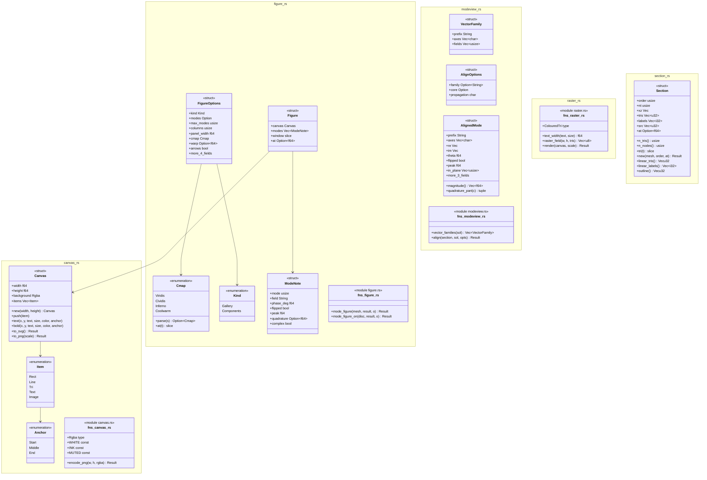

# Mode figures: code

C4 level 4 (code) of the component **Mode figures** (`analysis.figures`) in the container **nyx-analysis** (crate `nyx_analysis`). [Component view of the container](../../3-components/analysis.md) · [All code pages](../README.md)

> The cross-section of a result, the phase, sign and scale of a mode, and the figure of its modes (items drawn as SVG or by a small software rasteriser as PNG); no physics is named.

**Decisions:** [ADR 99](../../../adr/0099-figures-of-modes-and-one-node-order-in-the-results-file.md), [ADR 56](../../../adr/0056-polarization-analysis-is-a-function-of-a-result.md)  
**Size:** 5 files, 1756 lines.

## Files

| File | Lines | What it says about itself |
|---|---:|---|
| `crates/nyx-analysis/src/canvas.rs` | 142 |  |
| `crates/nyx-analysis/src/figure.rs` | 801 |  |
| `crates/nyx-analysis/src/modeview.rs` | 321 |  |
| `crates/nyx-analysis/src/raster.rs` | 282 |  |
| `crates/nyx-analysis/src/section.rs` | 210 |  |

## What it uses

| Target | Modules | Items |
|---|---|---|
| [container `femcore` (femcore)](../../3-components/femcore.md) | mesh | SimplexMesh |
| [container `physics` (nyx-physics)](../../3-components/physics.md) | crate root, error, result | Discretisation, Error, Mesh, Scalar, Solution, SolveResult, discretise |

## Used by

| Component | Modules | Items |
|---|---|---|
| [engine: Analyses](../engine/analyse.md) | figure | Cmap, FigureOptions, Kind, mode_figure |

## Class diagram

Public types with their public fields (or variants) and methods, free functions per file as a `module` box; arrows are field types and `impl Trait`. Capped at 36 types and a few members each; the table below is complete.

## Public items

| Kind | Item | File:line | Signature or summary |
|---|---|---|---|
| type | `Rgba` | `canvas.rs:12` |  |
| enum | `Anchor` | `canvas.rs:15` | variants: `Start`, `Middle`, `End` |
| enum | `Item` | `canvas.rs:22` | variants: `Rect`, `Line`, `Tri`, `Text`, `Image` |
| struct | `Canvas` | `canvas.rs:36` | fields: `width`, `height`, `background`, `items` |
| const | `WHITE` | `canvas.rs:43` | `Rgba` |
| const | `INK` | `canvas.rs:44` | `Rgba` |
| const | `MUTED` | `canvas.rs:45` | `Rgba` |
| fn | `encode_png` | `canvas.rs:131` | `pub fn encode_png(w: u32, h: u32, rgba: &[u8]) -> Result<Vec<u8>, String>` —  A PNG of RGBA pixels. |
| fn | `Canvas::new` | `canvas.rs:48` | `pub fn new(width: f64, height: f64) -> Canvas` |
| fn | `Canvas::push` | `canvas.rs:52` | `pub fn push(&mut self, item: Item)` |
| fn | `Canvas::text` | `canvas.rs:56` | `pub fn text(&mut self, x: f64, y: f64, text: &str, size: f64, color: Rgba, anchor: Anchor)` |
| fn | `Canvas::bold` | `canvas.rs:60` | `pub fn bold(&mut self, x: f64, y: f64, text: &str, size: f64, color: Rgba, anchor: Anchor)` |
| fn | `Canvas::to_svg` | `canvas.rs:65` | `pub fn to_svg(&self) -> Result<String, String>` —  The figure as SVG text. Fields are embedded as PNG images. |
| fn | `Canvas::to_png` | `canvas.rs:124` | `pub fn to_png(&self, scale: f64) -> Result<Vec<u8>, String>` —  The figure as PNG bytes, `scale` pixels per unit of the canvas (2 gives a sharp figure on a screen). |
| enum | `Cmap` | `figure.rs:16` | variants: `Viridis`, `Cividis`, `Inferno`, `Coolwarm` —  Colour maps of the figures. The tables are those of the window (`crates/app/src/colormap.rs`). |
| enum | `Kind` | `figure.rs:94` | variants: `Gallery`, `Components` |
| struct | `FigureOptions` | `figure.rs:102` | fields: `kind`, `modes`, `max_modes`, `columns`, `panel_width`, `cmap`, `warp`, `arrows`, `window`, `at`, `core`, `family` |
| struct | `ModeNote` | `figure.rs:259` | fields: `mode`, `field`, `phase_deg`, `flipped`, `peak`, `quadrature`, `complex` —  What was done to one mode to draw it: the numbers that make the picture reproducible. |
| struct | `Figure` | `figure.rs:276` | fields: `canvas`, `modes`, `window`, `at` |
| fn | `mode_figure` | `figure.rs:286` | `pub fn mode_figure(mesh: &Mesh, result: &SolveResult, o: &FigureOptions) -> Result<Figure, Error>` —  The figure of the modes of `result`, solved on `mesh`. |
| fn | `mode_figure_on` | `figure.rs:292` | `pub fn mode_figure_on(disc: &Discretisation, result: &SolveResult, o: &FigureOptions) -> Result<Figure, Error>` —  The same on the solver mesh. |
| fn | `Cmap::parse` | `figure.rs:24` | `pub fn parse(s: &str) -> Option<Cmap>` |
| fn | `Cmap::at` | `figure.rs:34` | `pub fn at(self, t: f64) -> [f32` |
| struct | `VectorFamily` | `modeview.rs:32` | fields: `prefix`, `axes`, `fields` —  A vector field kept as cell fields `<prefix>x`, `<prefix>y`, `<prefix>z` (`ux uy uz`, `Ex Ey Ez`): the cell fields of one prefix whose last |
| fn | `vector_families` | `modeview.rs:41` | `pub fn vector_families(sol: &Solution) -> Vec<VectorFamily>` —  The vector families of a solution, in the order of their first component. |
| struct | `AlignOptions` | `modeview.rs:62` | fields: `family`, `core`, `propagation` |
| struct | `AlignedMode` | `modeview.rs:79` | fields: `prefix`, `axes`, `re`, `im`, `theta`, `flipped`, `peak`, `in_plane`, `along`, `quadrature`, `complex` |
| fn | `align` | `modeview.rs:125` | `pub fn align(section: &Section, sol: &Solution, opts: &AlignOptions) -> Result<AlignedMode, Error>` —  Puts solution `sol` on `section` in the phase, sign and scale described above. |
| fn | `AlignedMode::magnitude` | `modeview.rs:101` | `pub fn magnitude(&self) -> Vec<f64>` —  `\|u\|` at every node. |
| fn | `AlignedMode::quadrature_part` | `modeview.rs:115` | `pub fn quadrature_part(&self, c: usize) -> (&[f64], &'static str)` —  The part of component `c` to draw as its second view: `Im` when it holds the larger share of the energy (the propagation component of a |
| fn | `text_width` | `raster.rs:18` | `pub fn text_width(text: &str, size: f64) -> f64` —  The width of `text` at font size `size` (canvas units), as the PNG draws it. The SVG uses the same number to place centred text. |
| type | `ColouredTri` | `raster.rs:133` |  Rasterises triangles with a colour per corner into `w` by `h` RGBA pixels; pixels no triangle covers stay transparent. Used for the field of |
| fn | `raster_field` | `raster.rs:135` | `pub fn raster_field(w: u32, h: u32, tris: &[ColouredTri]) -> Vec<u8>` |
| fn | `render` | `raster.rs:153` | `pub fn render(canvas: &Canvas, scale: f64) -> Result<(u32, u32, Vec<u8>), String>` —  Draws the canvas at `scale` pixels per unit; returns width, height and RGBA bytes. |
| struct | `Section` | `section.rs:20` | fields: `order`, `nt`, `xz`, `tris`, `labels`, `src`, `at` |
| fn | `Section::n_tris` | `section.rs:38` | `pub fn n_tris(&self) -> usize` |
| fn | `Section::n_nodes` | `section.rs:42` | `pub fn n_nodes(&self) -> usize` |
| fn | `Section::tri` | `section.rs:47` | `pub fn tri(&self, t: usize) -> &[u32]` —  The nodes of triangle `t`. |
| fn | `Section::new` | `section.rs:53` | `pub fn new(mesh: &SimplexMesh, order: usize, at: Option<f64>) -> Result<Section, String>` —  The section of `mesh` for a result of `order`. A 3D mesh is cut on the plane y = `at` (default: its smallest y); the cells that have a |
| fn | `Section::linear_tris` | `section.rs:112` | `pub fn linear_tris(&self) -> Vec<[u32` —  The triangles to draw: every P2 triangle split in four linear ones (`v0 e01 e02`, `e01 v1 e12`, `e02 e12 v2`, `e01 e12 e02`), which |
| fn | `Section::linear_labels` | `section.rs:129` | `pub fn linear_labels(&self) -> Vec<i32>` —  The label of every linear triangle of `linear_tris`. |
| fn | `Section::outline` | `section.rs:136` | `pub fn outline(&self) -> Vec<[u32` —  The outline of the regions: the edges (as segments of two nodes, through the edge midpoint of a P2 triangle) that lie on the border of the |

Trait implementations in this component: `FigureOptions: Default`, `AlignOptions: Default`
