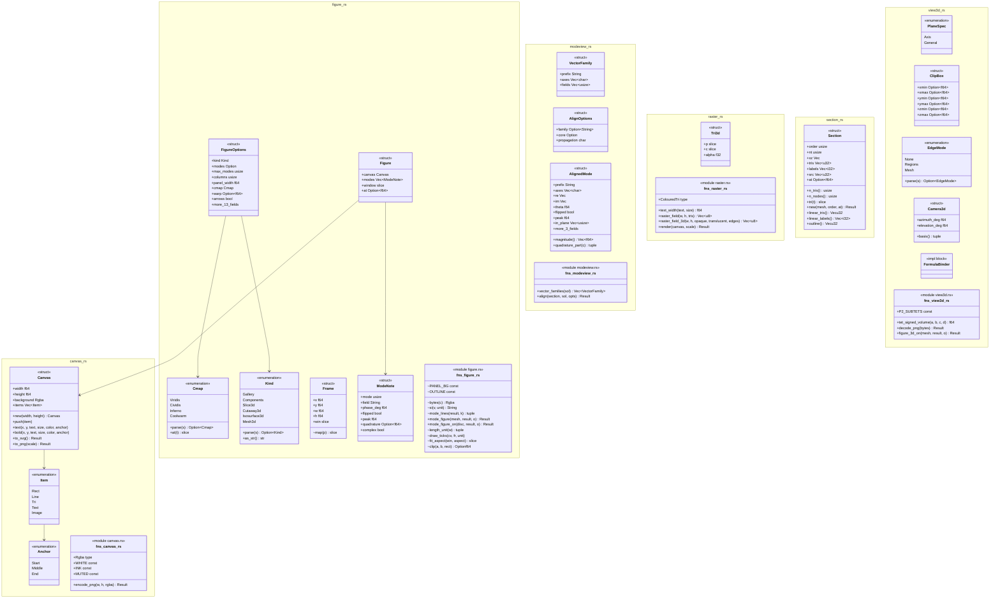

# Mode figures: code

C4 level 4 (code) of the component **Mode figures** (`analysis.figures`) in the container **nyx-analysis** (crate `nyx_analysis`). [Component view of the container](../../3-components/analysis.md) · [All code pages](../README.md)

> The cross-section of a result, the phase, sign and scale of a mode, and the figure of its modes (items drawn as SVG or by a small software rasteriser as PNG); no physics is named.

**Decisions:** [ADR 99](../../../adr/0099-figures-of-modes-and-one-node-order-in-the-results-file.md), [ADR 56](../../../adr/0056-polarization-analysis-is-a-function-of-a-result.md)  
**Size:** 6 files, 5000 lines.

## Files

| File | Lines | What it says about itself |
|---|---:|---|
| `crates/nyx-analysis/src/canvas.rs` | 142 |  |
| `crates/nyx-analysis/src/figure.rs` | 868 |  |
| `crates/nyx-analysis/src/modeview.rs` | 321 |  |
| `crates/nyx-analysis/src/raster.rs` | 821 |  |
| `crates/nyx-analysis/src/section.rs` | 210 |  |
| `crates/nyx-analysis/src/view3d.rs` | 2638 |  |

## What it uses

| Target | Modules | Items |
|---|---|---|
| [container `femcore` (femcore)](../../3-components/femcore.md) | fieldexpr, formula, linalg::csr::assembly, mesh, par | C, Fun, Named, Names, Op, SimplexMesh, Tree, map_chunks |
| [container `physics` (nyx-physics)](../../3-components/physics.md) | crate root, error, frame, result | Discretisation, Error, FieldFrame, Mesh, Scalar, Solution, SolveResult, discretise |

## Used by

| Component | Modules | Items |
|---|---|---|
| [engine: Analyses](../engine/analyse.md) | figure, view3d | Camera3d, ClipBox, Cmap, EdgeMode, FigureOptions, Kind, PlaneSpec, mode_figure_on |

## Class diagram

Public types with their public fields (or variants) and methods, free functions per file as a `module` box; arrows are field types and `impl Trait`. Capped at 36 types and a few members each; the table below is complete.

## Public items

| Kind | Item | File:line | Signature or summary |
|---|---|---|---|
| type | `Rgba` | `canvas.rs:12` |  |
| enum | `Anchor` | `canvas.rs:15` | variants: `Start`, `Middle`, `End` |
| enum | `Item` | `canvas.rs:22` | variants: `Rect`, `Line`, `Tri`, `Text`, `Image` |
| struct | `Canvas` | `canvas.rs:36` | fields: `width`, `height`, `background`, `items` |
| const | `WHITE` | `canvas.rs:43` | `Rgba` |
| const | `INK` | `canvas.rs:44` | `Rgba` |
| const | `MUTED` | `canvas.rs:45` | `Rgba` |
| fn | `encode_png` | `canvas.rs:131` | `pub fn encode_png(w: u32, h: u32, rgba: &[u8]) -> Result<Vec<u8>, String>` —  A PNG of RGBA pixels. |
| fn | `Canvas::new` | `canvas.rs:48` | `pub fn new(width: f64, height: f64) -> Canvas` |
| fn | `Canvas::push` | `canvas.rs:52` | `pub fn push(&mut self, item: Item)` |
| fn | `Canvas::text` | `canvas.rs:56` | `pub fn text(&mut self, x: f64, y: f64, text: &str, size: f64, color: Rgba, anchor: Anchor)` |
| fn | `Canvas::bold` | `canvas.rs:60` | `pub fn bold(&mut self, x: f64, y: f64, text: &str, size: f64, color: Rgba, anchor: Anchor)` |
| fn | `Canvas::to_svg` | `canvas.rs:65` | `pub fn to_svg(&self) -> Result<String, String>` —  The figure as SVG text. Fields are embedded as PNG images. |
| fn | `Canvas::to_png` | `canvas.rs:124` | `pub fn to_png(&self, scale: f64) -> Result<Vec<u8>, String>` —  The figure as PNG bytes, `scale` pixels per unit of the canvas (2 gives a sharp figure on a screen). |
| enum | `Cmap` | `figure.rs:17` | variants: `Viridis`, `Cividis`, `Inferno`, `Coolwarm` —  Colour maps of the figures. The tables are those of the window (`crates/app/src/colormap.rs`). |
| enum | `Kind` | `figure.rs:95` | variants: `Gallery`, `Components`, `Slice3d`, `Cutaway3d`, `Isosurface3d`, `Mesh3d` |
| struct | `FigureOptions` | `figure.rs:136` | fields: `kind`, `modes`, `max_modes`, `columns`, `panel_width`, `cmap`, `warp`, `arrows`, `window`, `at`, `core`, `family`, ... |
| const | `PANEL_BG` | `figure.rs:204` | `Rgba` |
| const | `OUTLINE` | `figure.rs:205` | `Rgba` |
| fn | `bytes` | `figure.rs:208` | `pub(crate) fn bytes(c: [f32; 3]) -> Rgba` |
| fn | `si` | `figure.rs:213` | `pub(crate) fn si(v: f64, unit: &str) -> String` —  `17.944 GHz` for 1.7944e10 with the unit Hz. |
| fn | `mode_lines` | `figure.rs:238` | `pub(crate) fn mode_lines(result: &SolveResult, k: usize) -> (String, String)` —  The two lines under a mode's number: what the study wrote for it (its label, the frequency, Q, the shares of its energy). |
| struct | `Frame` | `figure.rs:301` | fields: `x`, `y`, `w`, `h`, `win` |
| struct | `ModeNote` | `figure.rs:320` | fields: `mode`, `field`, `phase_deg`, `flipped`, `peak`, `quadrature`, `complex` —  What was done to one mode to draw it: the numbers that make the picture reproducible. |
| struct | `Figure` | `figure.rs:337` | fields: `canvas`, `modes`, `window`, `at` |
| fn | `mode_figure` | `figure.rs:347` | `pub fn mode_figure(mesh: &Mesh, result: &SolveResult, o: &FigureOptions) -> Result<Figure, Error>` —  The figure of the modes of `result`, solved on `mesh`. |
| fn | `mode_figure_on` | `figure.rs:353` | `pub fn mode_figure_on(disc: &Discretisation, result: &SolveResult, o: &FigureOptions) -> Result<Figure, Error>` —  The same on the solver mesh. |
| fn | `length_unit` | `figure.rs:655` | `pub(crate) fn length_unit(w: f64) -> (f64, &'static str)` —  A unit of length for a window `w` metres wide: the factor to metres and its name. |
| fn | `draw_ticks` | `figure.rs:692` | `pub(crate) fn draw_ticks(cv: &mut Canvas, fr: &Frame, unit: f64)` —  Tick marks and numbers on the left and bottom edge of a panel, in `unit` metres. |
| fn | `fit_aspect` | `figure.rs:756` | `pub(crate) fn fit_aspect(win: [f64; 4], aspect: f64) -> [f64` —  `win` grown around its centre to the shape `aspect` (height over width) of a panel, so that the scale is the same in x and z. |
| fn | `clip` | `figure.rs:769` | `pub(crate) fn clip(a: [f64; 2], b: [f64; 2], rect: [f64; 4]) -> Option<[[f64` —  The part of the segment `a b` inside `rect` (x0, y0, x1, y1), or `None` when it lies outside (Liang-Barsky). |
| fn | `Cmap::parse` | `figure.rs:25` | `pub fn parse(s: &str) -> Option<Cmap>` |
| fn | `Cmap::at` | `figure.rs:35` | `pub fn at(self, t: f64) -> [f32` |
| fn | `Kind::parse` | `figure.rs:111` | `pub fn parse(s: &str) -> Option<Kind>` |
| fn | `Kind::as_str` | `figure.rs:123` | `pub fn as_str(self) -> &'static str` |
| fn | `Frame::map` | `figure.rs:310` | `pub(crate) fn map(&self, p: [f64; 2]) -> [f64` |
| struct | `VectorFamily` | `modeview.rs:32` | fields: `prefix`, `axes`, `fields` —  A vector field kept as cell fields `<prefix>x`, `<prefix>y`, `<prefix>z` (`ux uy uz`, `Ex Ey Ez`): the cell fields of one prefix whose last |
| fn | `vector_families` | `modeview.rs:41` | `pub fn vector_families(sol: &Solution) -> Vec<VectorFamily>` —  The vector families of a solution, in the order of their first component. |
| struct | `AlignOptions` | `modeview.rs:62` | fields: `family`, `core`, `propagation` |
| struct | `AlignedMode` | `modeview.rs:79` | fields: `prefix`, `axes`, `re`, `im`, `theta`, `flipped`, `peak`, `in_plane`, `along`, `quadrature`, `complex` |
| fn | `align` | `modeview.rs:125` | `pub fn align(section: &Section, sol: &Solution, opts: &AlignOptions) -> Result<AlignedMode, Error>` —  Puts solution `sol` on `section` in the phase, sign and scale described above. |
| fn | `AlignedMode::magnitude` | `modeview.rs:101` | `pub fn magnitude(&self) -> Vec<f64>` —  `\|u\|` at every node. |
| fn | `AlignedMode::quadrature_part` | `modeview.rs:115` | `pub fn quadrature_part(&self, c: usize) -> (&[f64], &'static str)` —  The part of component `c` to draw as its second view: `Im` when it holds the larger share of the energy (the propagation component of a |
| fn | `text_width` | `raster.rs:21` | `pub fn text_width(text: &str, size: f64) -> f64` —  The width of `text` at font size `size` (canvas units), as the PNG draws it. The SVG uses the same number to place centred text. |
| type | `ColouredTri` | `raster.rs:167` |  A triangle in pixel coordinates with an RGB colour per corner. |
| fn | `raster_field` | `raster.rs:171` | `pub fn raster_field(w: u32, h: u32, tris: &[ColouredTri]) -> Vec<u8>` —  Rasterises triangles with a colour per corner into `w` by `h` RGBA pixels; pixels no triangle covers stay transparent. Used for the field of |
| struct | `Tri3d` | `raster.rs:220` | fields: `p`, `c`, `alpha` —  A 3D triangle in pixel coordinates `(x, y)` and depth `z` (smaller `z` is nearer the camera), with an RGB colour per corner and opacity `alpha`. |
| fn | `raster_field_3d` | `raster.rs:330` | `pub fn raster_field_3d( w: u32, h: u32, opaque: &[Tri3d], translucent: &[Tri3d], edges: &[([f64; 3], [f64; 3], Rgba, f64)], ) -> Vec<u8>` —  Z-buffered 3D software rasteriser: |
| fn | `render` | `raster.rs:571` | `pub fn render(canvas: &Canvas, scale: f64) -> Result<(u32, u32, Vec<u8>), String>` —  Draws the canvas at `scale` pixels per unit; returns width, height and RGBA bytes. |
| struct | `Section` | `section.rs:20` | fields: `order`, `nt`, `xz`, `tris`, `labels`, `src`, `at` |
| fn | `Section::n_tris` | `section.rs:38` | `pub fn n_tris(&self) -> usize` |
| fn | `Section::n_nodes` | `section.rs:42` | `pub fn n_nodes(&self) -> usize` |
| fn | `Section::tri` | `section.rs:47` | `pub fn tri(&self, t: usize) -> &[u32]` —  The nodes of triangle `t`. |
| fn | `Section::new` | `section.rs:53` | `pub fn new(mesh: &SimplexMesh, order: usize, at: Option<f64>) -> Result<Section, String>` —  The section of `mesh` for a result of `order`. A 3D mesh is cut on the plane y = `at` (default: its smallest y); the cells that have a |
| fn | `Section::linear_tris` | `section.rs:112` | `pub fn linear_tris(&self) -> Vec<[u32` —  The triangles to draw: every P2 triangle split in four linear ones (`v0 e01 e02`, `e01 v1 e12`, `e02 e12 v2`, `e01 e12 e02`), which |
| fn | `Section::linear_labels` | `section.rs:129` | `pub fn linear_labels(&self) -> Vec<i32>` —  The label of every linear triangle of `linear_tris`. |
| fn | `Section::outline` | `section.rs:136` | `pub fn outline(&self) -> Vec<[u32` —  The outline of the regions: the edges (as segments of two nodes, through the edge midpoint of a P2 triangle) that lie on the border of the |
| const | `P2_SUBTETS` | `view3d.rs:25` | `[[usize` —  Exact 8-subtet P2 split in nyx local node order (`v0..v3, e01, e02, e03, e12, e13, e23`). |
| enum | `PlaneSpec` | `view3d.rs:39` | variants: `Axis`, `General` —  Slice plane specification for `Kind::Slice3d`. |
| struct | `ClipBox` | `view3d.rs:46` | fields: `xmin`, `xmax`, `ymin`, `ymax`, `zmin`, `zmax` —  Optional axis-aligned cutaway bounds in metres; unset bounds stay open. |
| enum | `EdgeMode` | `view3d.rs:57` | variants: `None`, `Regions`, `Mesh` —  Edge overlay mode for 3D figures. |
| struct | `Camera3d` | `view3d.rs:77` | fields: `azimuth_deg`, `elevation_deg` —  Orthographic 3D turntable camera in the wafer frame (`z` up). |
| fn | `tet_signed_volume` | `view3d.rs:148` | `pub fn tet_signed_volume(a: [f64; 3], b: [f64; 3], c: [f64; 3], d: [f64; 3]) -> f64` —  Signed volume `det([b - a, c - a, d - a]) / 6` of a linear tetrahedron `[a, b, c, d]`. |
| fn | `decode_png` | `view3d.rs:153` | `pub fn decode_png(bytes: &[u8]) -> Result<(u32, u32, Vec<u8>), String>` —  Decodes a PNG byte slice into `(width, height, rgba_bytes)` for verification and pixel inspection. |
| fn | `figure_3d_on` | `view3d.rs:1237` | `pub fn figure_3d_on(mesh: &SimplexMesh, result: &SolveResult, o: &FigureOptions) -> Result<Figure, Error>` —  Renders `Slice3d`, `Cutaway3d`, `Isosurface3d`, or `Mesh3d` on a 3D `SimplexMesh`. |
| fn | `EdgeMode::parse` | `view3d.rs:65` | `pub fn parse(s: &str) -> Option<EdgeMode>` |
| fn | `Camera3d::basis` | `view3d.rs:90` | `pub fn basis(&self) -> ([f64` —  Orthonormal `(right, up, view_dir)` basis where `view_dir` points from the camera into the scene (larger `dot(p, view_dir)` is farther). |

Trait implementations in this component: `FigureOptions: Default`, `AlignOptions: Default`, `Camera3d: Default`, `FormulaBinder: Names`
