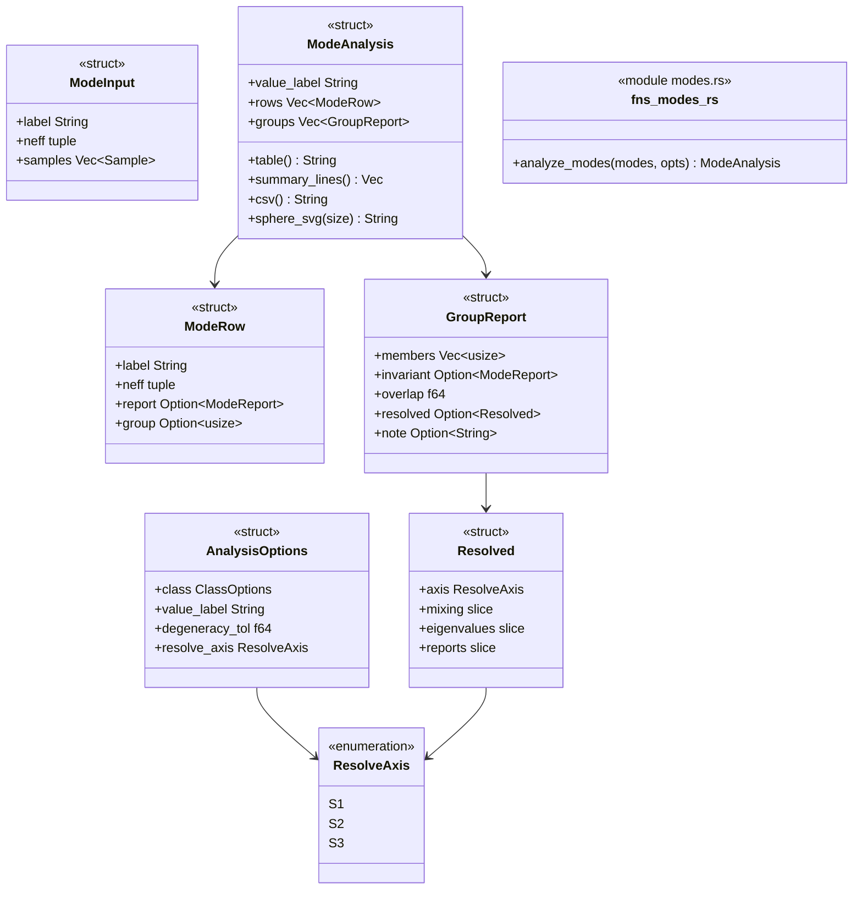

# Mode report: code

C4 level 4 (code) of the component **Mode report** (`analysis.modes`) in the container **nyx-analysis** (crate `nyx_analysis`). [Component view of the container](../../3-components/analysis.md) · [All code pages](../README.md)

> One report per mode, a table, the Poincare picture and the degenerate groups.

**Decisions:** [ADR 56](../../../adr/0056-polarization-analysis-is-a-function-of-a-result.md)  
**Size:** 1 file, 620 lines.

## Files

| File | Lines | What it says about itself |
|---|---:|---|
| `crates/nyx-analysis/src/modes.rs` | 620 | The polarization of a set of modes: one report per mode, a table, the Poincaré-sphere picture and the degenerate groups. |

## What it uses

| Target | Modules | Items |
|---|---|---|
| [Polarization](./polarization.md) | polarization |  |

## Used by

| Component | Modules | Items |
|---|---|---|
| [Analysis API](./api.md) | modes | AnalysisOptions, GroupReport, ModeAnalysis, ModeInput, ModeRow, ResolveAxis, Resolved, analyze_modes |
| [Field samples](./samples.md) | modes | AnalysisOptions, ModeInput |
| [engine: Analyses](../engine/analyse.md) | modes | ModeAnalysis |

## Class diagram

Public types with their public fields (or variants) and methods, free functions per file as a `module` box; arrows are field types and `impl Trait`. Capped at 36 types and a few members each; the table below is complete.

## Public items

| Kind | Item | File:line | Signature or summary |
|---|---|---|---|
| struct | `ModeInput` | `modes.rs:39` | fields: `label`, `neff`, `samples` —  One mode as the analysis reads it: a label, its eigenvalue (effective index, or frequency) and the field at weighted sample points. |
| enum | `ResolveAxis` | `modes.rs:48` | variants: `S1`, `S2`, `S3` —  Which Stokes operator is diagonalized to resolve a degenerate pair. |
| struct | `AnalysisOptions` | `modes.rs:58` | fields: `class`, `value_label`, `degeneracy_tol`, `resolve_axis` |
| struct | `ModeRow` | `modes.rs:80` | fields: `label`, `neff`, `report`, `group` |
| struct | `Resolved` | `modes.rs:91` | fields: `axis`, `mixing`, `eigenvalues`, `reports` —  The pair of modes of definite polarization inside a degenerate pair. |
| struct | `GroupReport` | `modes.rs:101` | fields: `members`, `invariant`, `overlap`, `resolved`, `note` |
| struct | `ModeAnalysis` | `modes.rs:113` | fields: `value_label`, `rows`, `groups` |
| fn | `analyze_modes` | `modes.rs:202` | `pub fn analyze_modes(modes: &[ModeInput], opts: &AnalysisOptions) -> ModeAnalysis` —  Analyze all modes. Rows are in the order of `modes`. |
| fn | `ModeAnalysis::table` | `modes.rs:269` | `pub fn table(&self) -> String` —  Plain-text table, one line per mode, then one block per degenerate group. |
| fn | `ModeAnalysis::summary_lines` | `modes.rs:354` | `pub fn summary_lines(&self) -> Vec<(usize, String)>` —  One line per mode that has an intensity, in the form the mode studies used to put in their result scalars `polarization N` |
| fn | `ModeAnalysis::csv` | `modes.rs:374` | `pub fn csv(&self) -> String` |
| fn | `ModeAnalysis::sphere_svg` | `modes.rs:420` | `pub fn sphere_svg(&self, size: f64) -> String` —  Poincaré sphere with one numbered marker per mode on a line from the centre to its integrated state (a hybrid mode lies inside the |

Trait implementations in this component: `AnalysisOptions: Default`
