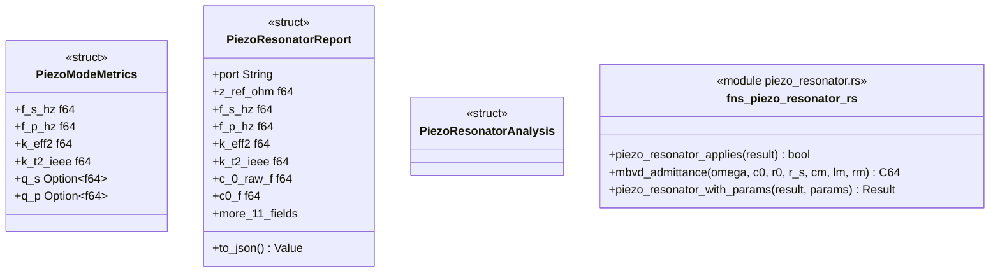

# Piezo resonator analysis: code

C4 level 4 (code) of the component **Piezo resonator analysis** (`analysis.piezo`) in the container **nyx-analysis** (crate `nyx_analysis`). [Component view of the container](../../3-components/analysis.md) · [All code pages](../README.md)

> Piezoelectric resonator mBVD 6-parameter fit (`C_0, R_0, R_s, C_m, L_m, R_m`), Schur-reduced multi-port admittance, phase-slope `Q_s`/`Q_p`, and IEEE `k_t^2`/`k_eff^2`.

**Decisions:** [ADR 129](../../../adr/0129-coupled-piezoelectric-fem-in-nyx-sms.md), [ADR 118](../../../adr/0118-cqed-cavity-driven-open-robin-network-bbq-and-squid.md)  
**Size:** 1 file, 796 lines.

## Files

| File | Lines | What it says about itself |
|---|---:|---|
| `crates/nyx-analysis/src/piezo_resonator.rs` | 796 |  |

## What it uses

| Target | Modules | Items |
|---|---|---|
| [container `femcore` (femcore)](../../3-components/femcore.md) | linalg::dense, linalg::scalar | C64, Dense |
| [container `physics` (nyx-physics)](../../3-components/physics.md) | cqed, crate root, error, result | DrivenPortData, Error, Mesh, SolveResult |
| [Analysis API](./api.md) | crate root | Analysis |

## Used by

| Component | Modules | Items |
|---|---|---|
| [Analysis API](./api.md) | piezo_resonator | PiezoModeMetrics, PiezoResonatorAnalysis, PiezoResonatorReport, mbvd_admittance, piezo_resonator_applies, piezo_resonator_with_params |
| [engine: Analyses](../engine/analyse.md) | piezo_resonator | PiezoResonatorAnalysis |

## Class diagram

Public types with their public fields (or variants) and methods, free functions per file as a `module` box; arrows are field types and `impl Trait`. Capped at 36 types and a few members each; the table below is complete.

## Public items

| Kind | Item | File:line | Signature or summary |
|---|---|---|---|
| struct | `PiezoModeMetrics` | `piezo_resonator.rs:27` | fields: `f_s_hz`, `f_p_hz`, `k_eff2`, `k_t2_ieee`, `q_s`, `q_p` —  Extracted resonant mode summary (primary or secondary spurious mode inside the window). |
| struct | `PiezoResonatorReport` | `piezo_resonator.rs:38` | fields: `port`, `z_ref_ohm`, `f_s_hz`, `f_p_hz`, `k_eff2`, `k_t2_ieee`, `c_0_raw_f`, `c0_f`, `r0_ohm`, `r_s_ohm`, `cm_f`, `lm_h`, ... —  Fitted 6-parameter Larson (2000) modified Butterworth–Van Dyke equivalent circuit and resonator FoMs. |
| fn | `piezo_resonator_applies` | `piezo_resonator.rs:101` | `pub fn piezo_resonator_applies(result: &SolveResult) -> bool` —  True when `result` is a `nyx-sms` driven solve carrying multi-port `DrivenPortData`. |
| fn | `mbvd_admittance` | `piezo_resonator.rs:107` | `pub fn mbvd_admittance(omega: f64, c0: f64, r0: f64, r_s: f64, cm: f64, lm: f64, rm: f64) -> C64` —  Evaluates the Larson (2000) 6-parameter mBVD admittance `Y(omega)` for `(C0, R0, Rs, Cm, Lm, Rm)`. |
| fn | `piezo_resonator_with_params` | `piezo_resonator.rs:447` | `pub fn piezo_resonator_with_params(result: &SolveResult, params: &Value) -> Result<PiezoResonatorReport, Error>` —  Runs piezoelectric resonator extraction & mBVD fitting with optional JSON parameters. |
| struct | `PiezoResonatorAnalysis` | `piezo_resonator.rs:647` |  Piezoelectric resonator mBVD extraction analysis behind the [`Analysis`] trait (`id: "piezo_resonator"`). |
| fn | `PiezoResonatorReport::to_json` | `piezo_resonator.rs:61` | `pub fn to_json(&self) -> Value` |

Trait implementations in this component: `PiezoResonatorAnalysis: Analysis`
