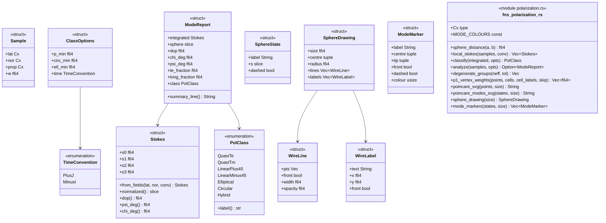

# Polarization: code

C4 level 4 (code) of the component **Polarization** (`analysis.polarization`) in the container **nyx-analysis** (crate `nyx_analysis`). [Component view of the container](../../3-components/analysis.md) · [All code pages](../README.md)

> Stokes parameters, Poincare sphere and the classification of an optical mode.

**Decisions:** [ADR 56](../../../adr/0056-polarization-analysis-is-a-function-of-a-result.md), [ADR 21](../../../adr/0021-polarization-analysis-from-complex-fields.md)  
**Size:** 1 file, 938 lines.

## Files

| File | Lines | What it says about itself |
|---|---:|---|
| `crates/nyx-analysis/src/polarization.rs` | 938 |  |

## What it uses

Nothing outside the component (the standard library and external crates are not listed).

## Used by

| Component | Modules | Items |
|---|---|---|
| [Mode report](./modes.md) | polarization |  |
| [Field samples](./samples.md) | polarization | Cx, Sample, TimeConvention |
| [engine: Analyses](../engine/analyse.md) | polarization |  |
| [engine: Meshing seam](../engine/meshing.md) | polarization |  |

## Class diagram

Public types with their public fields (or variants) and methods, free functions per file as a `module` box; arrows are field types and `impl Trait`. Capped at 36 types and a few members each; the table below is complete.

## Public items

| Kind | Item | File:line | Signature or summary |
|---|---|---|---|
| type | `Cx` | `polarization.rs:38` |  Complex number as [re, im]. |
| enum | `TimeConvention` | `polarization.rs:50` | variants: `PlusJ`, `MinusI` —  Time dependence of the complex field. |
| struct | `Stokes` | `polarization.rs:70` | fields: `s0`, `s1`, `s2`, `s3` |
| fn | `sphere_distance` | `polarization.rs:128` | `pub fn sphere_distance(a: [f64; 3], b: [f64; 3]) -> f64` —  Angle in radians between two points of the Poincaré sphere (pi for orthogonal polarizations). |
| struct | `Sample` | `polarization.rs:139` | fields: `lat`, `nor`, `prop`, `w` —  The field of a mode at one point of the cross-section and the area (or volume share) that point stands for. |
| enum | `PolClass` | `polarization.rs:148` | variants: `QuasiTe`, `QuasiTm`, `LinearPlus45`, `LinearMinus45`, `Elliptical`, `Circular`, `Hybrid` |
| struct | `ClassOptions` | `polarization.rs:185` | fields: `p_min`, `circ_min`, `ell_min`, `time` —  Limits of the classification, all on the integrated Stokes vector of the mode. |
| struct | `ModeReport` | `polarization.rs:202` | fields: `integrated`, `sphere`, `dop`, `chi_deg`, `psi_deg`, `te_fraction`, `long_fraction`, `class` |
| fn | `local_stokes` | `polarization.rs:235` | `pub fn local_stokes(samples: &[Sample], conv: TimeConvention) -> Vec<Stokes>` —  Stokes parameters of every sample, in the order of `samples` (for plots on the sphere and maps of the cross-section). |
| fn | `classify` | `polarization.rs:239` | `pub fn classify(integrated: &Stokes, opts: &ClassOptions) -> PolClass` |
| fn | `analyze` | `polarization.rs:266` | `pub fn analyze(samples: &[Sample], opts: &ClassOptions) -> Option<ModeReport>` —  The report of one mode; `None` if the weighted intensity is zero or not finite. |
| fn | `degenerate_groups` | `polarization.rs:294` | `pub fn degenerate_groups(neff: &[(f64, f64)], tol: f64) -> Vec<Vec<usize>>` —  Groups of modes whose effective indices differ by at most `tol` (consecutive in sorted order of the real part). The |
| fn | `p1_vertex_weights` | `polarization.rs:324` | `pub fn p1_vertex_weights(points: &[f64], cells: &[u32], cell_labels: &[i32], skip: &[i32]) -> Vec<f64>` —  Area weight of every vertex of a 2D triangle mesh (a third of each adjacent triangle), skipping triangles whose |
| fn | `poincare_svg` | `polarization.rs:485` | `pub fn poincare_svg(points: &[(f64, f64, f64, f64)], size: f64) -> String` —  A Poincar\u{e9} sphere picture in the style of a Bloch sphere (translucent ball, light grid, bold equator, axes with |
| struct | `SphereState` | `polarization.rs:530` | fields: `label`, `s`, `dashed` —  One mode on the sphere: a label, its (s1, s2, s3) and whether it belongs to a degenerate group (drawn dashed |
| fn | `poincare_modes_svg` | `polarization.rs:538` | `pub fn poincare_modes_svg(states: &[SphereState], size: f64) -> String` —  The same sphere with one numbered marker per mode on a line from the centre to its integrated state, like a Bloch vector: a fully |
| struct | `WireLine` | `polarization.rs:580` | fields: `pts`, `front`, `width`, `opacity` —  A polyline of the sphere picture in picture coordinates (x to the right, y down, the picture is a square of side `size`). |
| struct | `WireLabel` | `polarization.rs:590` | fields: `text`, `x`, `y`, `front` —  A label at a point of the picture. |
| struct | `SphereDrawing` | `polarization.rs:599` | fields: `size`, `centre`, `radius`, `lines`, `labels` —  The empty Poincare sphere as lines and labels, for programs that draw it themselves (the SVG functions draw the same picture). |
| struct | `ModeMarker` | `polarization.rs:609` | fields: `label`, `centre`, `tip`, `front`, `dashed`, `colour` —  One mode on the picture: its tip, the colour (index into `MODE_COLOURS`) and whether it ends on the surface (`len` = 1) or inside. |
| const | `MODE_COLOURS` | `polarization.rs:619` | `[&str` —  The colours of the mode markers, in the order of the numbers (as `#rrggbb`). |
| fn | `sphere_drawing` | `polarization.rs:647` | `pub fn sphere_drawing(size: f64) -> SphereDrawing` —  The picture of the empty sphere in a square of side `size`. |
| fn | `mode_markers` | `polarization.rs:685` | `pub fn mode_markers(states: &[SphereState], size: f64) -> Vec<ModeMarker>` —  The markers of `states` on the picture of `sphere_drawing(size)`; states with a non-finite coordinate are skipped. |
| fn | `Stokes::from_fields` | `polarization.rs:78` | `pub fn from_fields(lat: Cx, nor: Cx, conv: TimeConvention) -> Stokes` |
| fn | `Stokes::normalized` | `polarization.rs:96` | `pub fn normalized(&self) -> [f64` —  (s1, s2, s3) divided by S0; zeros when there is no intensity. A point of a single sample has unit length. |
| fn | `Stokes::dop` | `polarization.rs:105` | `pub fn dop(&self) -> f64` —  Degree of polarization in [0, 1]. |
| fn | `Stokes::psi_deg` | `polarization.rs:111` | `pub fn psi_deg(&self) -> f64` —  Orientation of the major axis in degrees, in (-90, 90], measured from x towards y. |
| fn | `Stokes::chi_deg` | `polarization.rs:117` | `pub fn chi_deg(&self) -> f64` —  Ellipticity angle in degrees, in [-45, 45]: 0 linear, +45 CCW circular, -45 CW circular. Uses the direction of |
| fn | `PolClass::label` | `polarization.rs:168` | `pub fn label(&self) -> &'static str` |
| fn | `ModeReport::summary_line` | `polarization.rs:218` | `pub fn summary_line(&self) -> String` |

Trait implementations in this component: `ClassOptions: Default`
