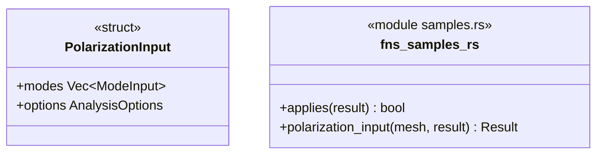

# Field samples: code

C4 level 4 (code) of the component **Field samples** (`analysis.samples`) in the container **nyx-analysis** (crate `nyx_analysis`). [Component view of the container](../../3-components/analysis.md) · [All code pages](../README.md)

> The modes of a SolveResult as weighted samples of the field, which is what the polarization analysis integrates.

**Decisions:** [ADR 56](../../../adr/0056-polarization-analysis-is-a-function-of-a-result.md)  
**Size:** 1 file, 161 lines.

## Files

| File | Lines | What it says about itself |
|---|---:|---|
| `crates/nyx-analysis/src/samples.rs` | 161 |  |

## What it uses

| Target | Modules | Items |
|---|---|---|
| [container `femcore` (femcore)](../../3-components/femcore.md) | fem, fields, optical | fine_rule, geometry, local_bary, quad_rule, shape |
| [container `physics` (nyx-physics)](../../3-components/physics.md) | crate root, error, frame, result | CellField, Error, FieldFrame, Mesh, Solution, SolveResult, discretise |
| [Mode report](./modes.md) | modes | AnalysisOptions, ModeInput |
| [Polarization](./polarization.md) | polarization | Cx, Sample, TimeConvention |

## Used by

| Component | Modules | Items |
|---|---|---|
| [Analysis API](./api.md) | samples | PolarizationInput, polarization_input |

## Class diagram

Public types with their public fields (or variants) and methods, free functions per file as a `module` box; arrows are field types and `impl Trait`. Capped at 36 types and a few members each; the table below is complete.

## Public items

| Kind | Item | File:line | Signature or summary |
|---|---|---|---|
| struct | `PolarizationInput` | `samples.rs:23` | fields: `modes`, `options` —  The modes of a result, ready for `analyze_modes`, and the options that go with them. |
| fn | `applies` | `samples.rs:30` | `pub fn applies(result: &SolveResult) -> bool` —  Whether a result has what the polarization analysis needs: a stated frame and, in every solution, the three complex field components as |
| fn | `polarization_input` | `samples.rs:42` | `pub fn polarization_input(mesh: &Mesh, result: &SolveResult) -> Result<PolarizationInput, Error>` —  Reads the modes of `result` (solved on `mesh`) as weighted samples. |
