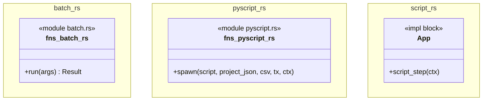

# Scripts and batch: code

C4 level 4 (code) of the component **Scripts and batch** (`app.headless`) in the container **app** (crate `nyx`). [Component view of the container](../../3-components/app.md) · [All code pages](../README.md)

> Runs without a person at the window: scripted runs with screenshots (--script), batch runs for clusters, and the optional user Python script.

**Decisions:** [ADR 23](../../../adr/0023-app-is-a-thin-shell-over-one-project.md)  
**Size:** 3 files, 306 lines.

## Files

| File | Lines | What it says about itself |
|---|---:|---|
| `crates/app/src/batch.rs` | 56 | Headless runs without a window, for workstations and clusters: |
| `crates/app/src/pyscript.rs` | 53 | Runs an optional user Python script: `python script.py project.json [result.csv]`. Python is never needed by the application itself. The script runs on its own thread; its output comes back to the window as a message. |
| `crates/app/src/script.rs` | 197 | Scripted runs for testing and screenshots: `nyx --script "example 1; compute; shot out.png; quit"`. |

## What it uses

| Target | Modules | Items |
|---|---|---|
| [container `engine` (nyx-engine)](../../3-components/engine.md) | crate root, engine | Engine, Scalar |
| [Shell and dashboard](./shell.md) | examples, shell | Page, Part, Sheet, Start, Sub, list |
| [Window](./window.md) | app, state | App, Msg |

## Used by

| Component | Modules | Items |
|---|---|---|
| [Window](./window.md) | pyscript | spawn |

## Class diagram

Public types with their public fields (or variants) and methods, free functions per file as a `module` box; arrows are field types and `impl Trait`. Capped at 36 types and a few members each; the table below is complete.

## Public items

| Kind | Item | File:line | Signature or summary |
|---|---|---|---|
| fn | `run` | `batch.rs:14` | `pub fn run(args: &[String]) -> Result<(), String>` |
| fn | `spawn` | `pyscript.rs:9` | `pub fn spawn(script: PathBuf, project_json: String, csv: Option<String>, tx: Sender<(u64, Msg)>, ctx: egui::Context)` |
| fn | `App::script_step` | `script.rs:16` | `pub fn script_step(&mut self, ctx: &egui::Context)` |
