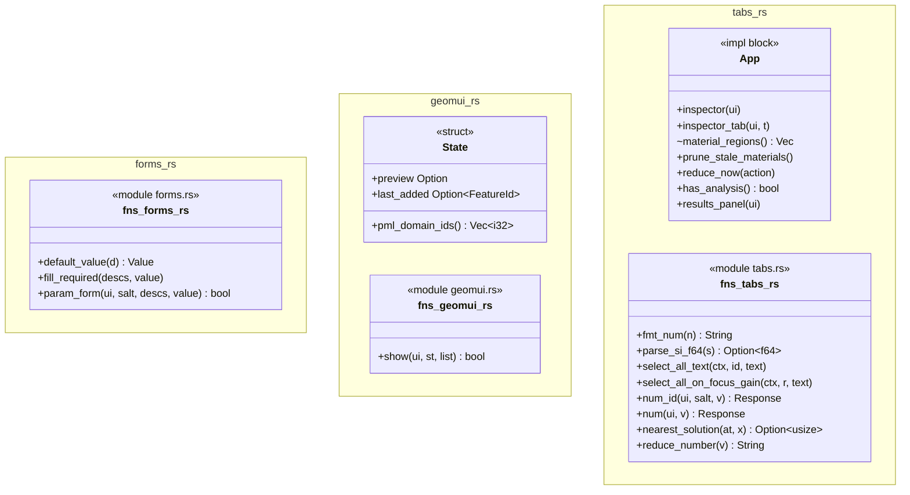

# Inspector tabs: code

C4 level 4 (code) of the component **Inspector tabs** (`app.inspector`) in the container **app** (crate `nyx`). [Component view of the container](../../3-components/app.md) · [All code pages](../README.md)

> The tabs beside the viewport: geometry editor, materials, physics, study, results, analysis. Forms are drawn from the physics descriptors; the geometry editor generates one form per feature kind.

**Decisions:** [ADR 23](../../../adr/0023-app-is-a-thin-shell-over-one-project.md), [ADR 57](../../../adr/0057-front-ends-are-thin-the-mcp-tools-are-engine-commands.md)  
**Size:** 3 files, 3180 lines.

## Files

| File | Lines | What it says about itself |
|---|---:|---|
| `crates/app/src/forms.rs` | 151 |  |
| `crates/app/src/geomui.rs` | 1189 |  |
| `crates/app/src/tabs.rs` | 1840 |  |

## What it uses

| Target | Modules | Items |
|---|---|---|
| [container `engine` (nyx-engine)](../../3-components/engine.md) | crate root, engine, material_fetch, project | Applies, Auto, BcSpec, Both, Engine, Env, Evaluated, Expr, FeatureList, Inline +32 |
| [Shell and dashboard](./shell.md) | examples | list, typical |
| [Look and widgets](./style.md) | fmt, theme | accent, activity_text, danger, on_accent, plural, raised, si, success, text |
| [Viewport](./viewport.md) | colormap | Colormap |
| [Window](./window.md) | app, spans, state | App, JobKind, MaterialBgMsg, span |

## Used by

| Component | Modules | Items |
|---|---|---|
| [Window](./window.md) | geomui | State |

## Class diagram

Public types with their public fields (or variants) and methods, free functions per file as a `module` box; arrows are field types and `impl Trait`. Capped at 36 types and a few members each; the table below is complete.

## Public items

| Kind | Item | File:line | Signature or summary |
|---|---|---|---|
| fn | `default_value` | `forms.rs:12` | `pub fn default_value(d: &ParamDesc) -> Value` —  The JSON value a descriptor gives a parameter that was not set. |
| fn | `fill_required` | `forms.rs:26` | `pub fn fill_required(descs: &[ParamDesc], value: &mut Value)` —  Makes `value` an object holding every required parameter (with its default): a study or condition that is created must be complete. |
| fn | `param_form` | `forms.rs:48` | `pub fn param_form(ui: &mut Ui, salt: &str, descs: &[ParamDesc], value: &mut Value) -> bool` —  Draws one row per parameter and writes what the person changes into `value` (an object; `Null` becomes one). A parameter that was not |
| struct | `State` | `geomui.rs:20` | fields: `preview`, `last_added` —  What the editor remembers between frames: the last list it evaluated and the outcome. |
| fn | `show` | `geomui.rs:852` | `pub fn show(ui: &mut Ui, st: &mut State, list: &mut FeatureList) -> bool` —  The model editor. `list` is edited in place; the return value says whether it changed. |
| fn | `State::pml_domain_ids` | `geomui.rs:80` | `pub fn pml_domain_ids(&self) -> Vec<i32>` —  Domain labels of absorbing-layer regions (`RegionKind::Pml`) in the current geometry preview. |
| fn | `fmt_num` | `tabs.rs:21` | `pub fn fmt_num(n: f64) -> String` |
| fn | `parse_si_f64` | `tabs.rs:34` | `pub fn parse_si_f64(s: &str) -> Option<f64>` —  Parses a float or scientific-notation number, with optional SI unit suffixes (`nm`, `um`, `µm`, `mm`, `THz`, `GPa`, ...). |
| fn | `select_all_text` | `tabs.rs:76` | `pub fn select_all_text(ctx: &egui::Context, id: egui::Id, text: &str)` |
| fn | `select_all_on_focus_gain` | `tabs.rs:85` | `pub fn select_all_on_focus_gain(ctx: &egui::Context, r: &egui::Response, text: &str)` |
| fn | `num_id` | `tabs.rs:131` | `pub fn num_id(ui: &mut Ui, salt: impl std::hash::Hash + std::fmt::Debug, v: &mut f64) -> egui::Response` —  A single-click-focusable number field with a persistent ID: accepts scientific notation and SI unit suffixes (`220 nm`, `193.414 THz`). |
| fn | `num` | `tabs.rs:138` | `pub fn num(ui: &mut Ui, v: &mut f64) -> egui::Response` —  A number field: single-click and type (scientific notation and SI suffixes accepted). |
| fn | `nearest_solution` | `tabs.rs:1731` | `pub fn nearest_solution(at: &[f64], x: f64) -> Option<usize>` —  The index of the solution drawn closest (along x) to `x`; `None` when there is none or `x` is not a number. |
| fn | `reduce_number` | `tabs.rs:1742` | `pub fn reduce_number(v: &Value) -> String` —  A number of a reduction answer as the form shows it: a real one, or `re + im i` for a pair. |
| fn | `App::inspector` | `tabs.rs:200` | `pub fn inspector(&mut self, ui: &mut Ui)` |
| fn | `App::inspector_tab` | `tabs.rs:236` | `pub fn inspector_tab(&mut self, ui: &mut Ui, t: Tab)` —  One inspector tab on its own: the workflow view lays the six tabs out in its three sections. |
| fn | `App::material_regions` | `tabs.rs:383` | `pub(crate) fn material_regions(&self) -> Vec<(String, String)>` —  The regions of the model by base name (the absorbing pieces `name.pml_*` belong to `name`), with the key a material is stored under. |
| fn | `App::prune_stale_materials` | `tabs.rs:408` | `pub fn prune_stale_materials(&mut self)` —  Removes material assignments for region names that no longer exist in `geom_edit`. |
| fn | `App::reduce_now` | `tabs.rs:1437` | `pub fn reduce_now(&mut self, action: &str)` —  Runs one reduction of the Reduce form (`integrate`, `max`, `min` or `fraction`) on the field, quantity and region it holds, through the engine |
| fn | `App::has_analysis` | `tabs.rs:1508` | `pub fn has_analysis(&self) -> bool` —  Whether the result on show carries a polarization analysis. |
| fn | `App::results_panel` | `tabs.rs:1656` | `pub fn results_panel(&mut self, ui: &mut Ui)` —  Bottom panel: how the shown field's extremes (or the mode frequencies) vary over the |
