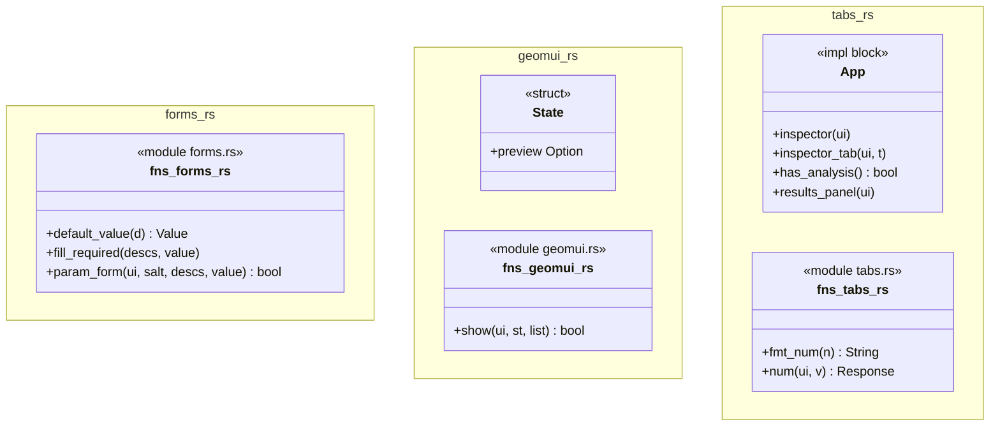

# Inspector tabs: code

C4 level 4 (code) of the component **Inspector tabs** (`app.inspector`) in the container **app** (crate `nyx`). [Component view of the container](../../3-components/app.md) · [All code pages](../README.md)

> The tabs beside the viewport: geometry editor, materials, physics, study, results, analysis. Forms are drawn from the physics descriptors; the geometry editor generates one form per feature kind.

**Decisions:** [ADR 23](../../../adr/0023-app-is-a-thin-shell-over-one-project.md), [ADR 57](../../../adr/0057-front-ends-are-thin-the-mcp-tools-are-engine-commands.md)  
**Size:** 3 files, 2030 lines.

## Files

| File | Lines | What it says about itself |
|---|---:|---|
| `crates/app/src/forms.rs` | 135 | Forms drawn from descriptors: a study, a condition or the options of a physics are a list of `ParamDesc`s (name, label, unit, type and range, default), and the form for them is made here, the same for every physics. A new physics needs n... |
| `crates/app/src/geomui.rs` | 917 | The Geometry tab's model editor: named parameters, the ordered feature list with one generated form per feature kind, the names the model gives its regions and boundaries, and the same model as builder code. It edits `geom::model::Featur... |
| `crates/app/src/tabs.rs` | 978 | Inspector tabs (geometry, materials, physics, study, results, analysis) and the results panel. The Materials, Physics and Study tabs are drawn from the descriptors of the physics (`forms`), so they are the same for every physics; every c... |

## What it uses

| Target | Modules | Items |
|---|---|---|
| [container `engine` (nyx-engine)](../../3-components/engine.md) | crate root, project | Applies, BcSpec, Both, Env, Evaluated, Expr, FeatureList, LabelMap, MODE_COLOURS, MaterialAssign +20 |
| [Shell and dashboard](./shell.md) | examples | list, typical |
| [Viewport](./viewport.md) | colormap | Colormap |
| [Window](./window.md) | app, state | App |

## Used by

| Component | Modules | Items |
|---|---|---|
| [Window](./window.md) | geomui | State |

## Class diagram

Public types with their public fields (or variants) and methods, free functions per file as a `module` box; arrows are field types and `impl Trait`. Capped at 36 types and a few members each; the table below is complete.

## Public items

| Kind | Item | File:line | Signature or summary |
|---|---|---|---|
| fn | `default_value` | `forms.rs:10` | `pub fn default_value(d: &ParamDesc) -> Value` —  The JSON value a descriptor gives a parameter that was not set. |
| fn | `fill_required` | `forms.rs:23` | `pub fn fill_required(descs: &[ParamDesc], value: &mut Value)` —  Makes `value` an object holding every required parameter (with its default): a study or condition that is created must be complete. |
| fn | `param_form` | `forms.rs:45` | `pub fn param_form(ui: &mut Ui, salt: &str, descs: &[ParamDesc], value: &mut Value) -> bool` —  Draws one row per parameter and writes what the person changes into `value` (an object; `Null` becomes one). A parameter that was not |
| struct | `State` | `geomui.rs:19` | fields: `preview` —  What the editor remembers between frames: the last list it evaluated and the outcome. |
| fn | `show` | `geomui.rs:628` | `pub fn show(ui: &mut Ui, st: &mut State, list: &mut FeatureList) -> bool` —  The model editor. `list` is edited in place; the return value says whether it changed. |
| fn | `fmt_num` | `tabs.rs:18` | `pub fn fmt_num(n: f64) -> String` |
| fn | `num` | `tabs.rs:31` | `pub fn num(ui: &mut Ui, v: &mut f64) -> egui::Response` —  A number field: drag to change, or double-click and type (scientific notation accepted). |
| fn | `App::inspector` | `tabs.rs:92` | `pub fn inspector(&mut self, ui: &mut Ui)` |
| fn | `App::inspector_tab` | `tabs.rs:121` | `pub fn inspector_tab(&mut self, ui: &mut Ui, t: Tab)` —  One inspector tab on its own: the workflow view lays the six tabs out in its three sections. |
| fn | `App::has_analysis` | `tabs.rs:782` | `pub fn has_analysis(&self) -> bool` —  Whether the result on show carries a polarization analysis. |
| fn | `App::results_panel` | `tabs.rs:930` | `pub fn results_panel(&mut self, ui: &mut Ui)` —  Bottom panel: how the shown field's extremes (or the mode frequencies) vary over the |
