# Shell and dashboard: code

C4 level 4 (code) of the component **Shell and dashboard** (`app.shell`) in the container **app** (crate `nyx`). [Component view of the container](../../3-components/app.md) · [All code pages](../README.md)

> The tab bar, the native menu and the table of actions it shares with the palette, the dashboard of workflows with live status, the busy chip and queue popover read from the engine queue, the workflow view (one bar, five tabs with the viewport always on, the runs page), the sheets (new, search, versions, share, settings) and the example starting points.

**Decisions:** [ADR 14](../../../adr/0014-workflow-store-json-manifests-and-nyx-archives.md), [ADR 23](../../../adr/0023-app-is-a-thin-shell-over-one-project.md), [ADR 87](../../../adr/0087-work-is-queued-in-lanes-and-stages-are-shared-by-content.md), [ADR 88](../../../adr/0088-colour-has-roles-and-the-window-follows-the-system.md), [ADR 123](../../../adr/0123-window-reset-gui-subsystem-absorbing-layers-as-a-role-and-quiet-chrome.md), [ADR 124](../../../adr/0124-one-bar-five-tabs-always-on-viewport-script-dock-and-physics-dropdown.md)  
**Size:** 8 files, 5053 lines.

## Files

| File | Lines | What it says about itself |
|---|---:|---|
| `crates/app/src/activity.rs` | 413 |  |
| `crates/app/src/dashboard.rs` | 381 |  |
| `crates/app/src/examples.rs` | 168 |  |
| `crates/app/src/menu.rs` | 353 |  |
| `crates/app/src/sheets.rs` | 1034 |  |
| `crates/app/src/shell.rs` | 1185 |  |
| `crates/app/src/sweepui.rs` | 472 |  |
| `crates/app/src/wfview.rs` | 1047 |  |

## What it uses

| Target | Modules | Items |
|---|---|---|
| [container `engine` (nyx-engine)](../../3-components/engine.md) | crate root, engine, store_link, validated | Active, Artifact, Done, Engine, Entry, ExportOptions, FeatureList, Filter, Inspection, Limits +38 |
| [Look and widgets](./style.md) | fmt, kit, theme | State, card, danger, ellipsize, key_label, modal, muted, plural, primary, tab +1 |
| [Window](./window.md) | app, spans, state | App, Doc, JobKind, Tab, span |

## Used by

| Component | Modules | Items |
|---|---|---|
| [Scripts and batch](./headless.md) | examples, shell | Page, Sheet, Start, Sub, list |
| [Inspector tabs](./inspector.md) | examples | list, typical |
| [Window](./window.md) | activity, examples, menu, sheets, shell, sweepui | Act, Active, Deferred, Page, RunCtx, ScriptSheet, Sheet, Shell +4 |

## Class diagram

Public types with their public fields (or variants) and methods, free functions per file as a `module` box; arrows are field types and `impl Trait`. Capped at 36 types and a few members each; the table below is complete.

```mermaid
classDiagram
  namespace activity_rs {
    class Row {
        <<struct>>
        +id u64
        +label String
        +running bool
        +stage String
        +seconds f64
        +position u64
        +priority u8
        +owner String
        +more_1_fields
    }
    class Activity {
        <<struct>>
        +rows Vec~Row~
        +paused bool
        +of(entries, paused) Activity
        +running() Option
        +waiting() usize
        +is_idle() bool
        +state() State
        +chip_text() String
    }
    class App {
        <<impl block>>
        +activity() Activity
        +busy_chip(ui, activity)
        +queue_panel(ctx)
        +stale_band(ui)
        +validated_of(physics) Validated
        +forget_validated()
        +validated_line(ui)
        ~edit_workflow(id, f)
        +more_34_methods()
    }
    class fns_activity_rs {
        <<module activity.rs>>
        +asked_by(owner) Option
        +priority_word(p) str
        +validation_state(v) State
    }
  }
  namespace dashboard_rs {
    class fns_dashboard_rs {
        <<module dashboard.rs>>
        +physics_label(p) str
    }
  }
  namespace examples_rs {
    class Example {
        <<struct>>
        +path PathBuf
        +title String
    }
    class fns_examples_rs {
        <<module examples.rs>>
        +dirs() Vec~PathBuf~
        +list() Vec~Example~
        +typical(name) f64
        +blank(engine, physics, three_d) Result
        +blank_json(physics, three_d) Result
    }
  }
  namespace menu_rs {
    class Act {
        <<enumeration>>
        Tab
        Sub
        LoadExp
        NewExp
        Fork
        Link
        Compute
        Sweep
        Cancel
        Star
        Title
        Tags
        more_8_variants
    }
    class Item {
        <<struct>>
        +menu str
        +label str
        +keys str
        +act Act
    }
    class Native {
        <<struct>>
        +install(cc) Option~Native~
        +take() Vec~Act~
    }
    class fns_menu_rs {
        <<module menu.rs>>
        +menus() Vec
        +ACTIONS const
    }
  }
  namespace sheets_rs {
    class ScriptSheet {
        <<struct>>
        +open bool
        +code String
        +path Option~PathBuf~
        +check_msg Option
        +output Option
        +running bool
    }
  }
  namespace shell_rs {
    class Page {
        <<enumeration>>
        Dashboard
        Workflow
        Settings
    }
    class Start {
        <<enumeration>>
        Example
        Results
        Blank
    }
    class Sub {
        <<enumeration>>
        Main
        Runs
        Compare
    }
    class Sheet {
        <<enumeration>>
        None
        New
        Palette
        Versions
        Share
        Open
        About
    }
    class OpenWf {
        <<struct>>
        +id String
        +dir Option~WorkflowDir~
        +draft_title String
        +spec0 String
        +draft_spec String
        +tags Vec~String~
        +tag_input String
        +exp String
        +more_22_fields
        +new(id) OpenWf
        +title() String
        +reload_runs()
    }
    class LiveRun {
        <<struct>>
        +wf_id String
        +exp String
        +run String
        +physics String
    }
    class Deferred {
        <<enumeration>>
        Record
        RefreshEntries
    }
    class RunCtx {
        <<struct>>
        +wf_id String
        +exp String
        +spec_json String
        +params BTreeMap
        +started Instant
    }
    class NewState {
        <<struct>>
        +title String
        +template usize
        +physics String
        +three_d bool
        +all_examples bool
    }
    class Shell {
        <<struct>>
        +ws Option~Workspace~
        +entries Vec~Entry~
        +spark HashMap
        +page Page
        +tabs Vec~String~
        +open HashMap
        +loaded Option
        +run Option~RunCtx~
        +more_27_fields
        +detached() Shell
        +active() bool
        +settings() Settings
        +current_mut() Option
    }
    class fns_shell_rs {
        <<module shell.rs>>
        +spec_key(spec) String
        +params_of(json) BTreeMap
    }
  }
  namespace sweepui_rs {
    class Plan {
        <<struct>>
        +points usize
        +meshes usize
        +solves usize
        +problems Vec~String~
        +words() String
    }
    class Form {
        <<struct>>
        +shown bool
        +param String
        +from String
        +to String
        +n usize
        +metric String
    }
    class Pt {
        <<struct>>
        +value f64
        +state String
        +stage String
        +seconds f64
        +metrics BTreeMap
        +error Option~String~
        +recorded bool
        +glyph() State
        +word() str
    }
    class Active {
        <<struct>>
        +wf_id String
        +exp String
        +id u64
        +param String
        +points Vec~Pt~
        +finished() usize
        +complete() bool
        +point_spec(value) String
        +record_of(i) Option
    }
    class fns_sweepui_rs {
        <<module sweepui.rs>>
        +values(from, to, n) Vec~f64~
        +parse_number(s) Option~f64~
        +numeric_params(list) Vec
        +MAX_POINTS const
    }
  }
  namespace wfview_rs {
    class fns_wfview_rs {
        <<module wfview.rs>>
        +fmt_value(key, v) String
    }
  }
  Activity --> Row
  Act --> Sub
  Act --> Form
  Item --> Act
  Deferred --> RunCtx
  Shell --> Page
  Shell --> OpenWf
  Shell --> RunCtx
  Active --> Pt
```

## Public items

| Kind | Item | File:line | Signature or summary |
|---|---|---|---|
| struct | `Row` | `activity.rs:17` | fields: `id`, `label`, `running`, `stage`, `seconds`, `position`, `priority`, `owner`, `cancel_requested` —  One job of the queue that has not finished. |
| struct | `Activity` | `activity.rs:33` | fields: `rows`, `paused` —  The running and waiting jobs, running first, waiting in the order they will start. |
| fn | `asked_by` | `activity.rs:125` | `pub fn asked_by(owner: &str) -> Option<&'static str>` —  Who asked, in words, for a row that is not the person's own (the window's engine only ever holds the person's jobs today; the queue entry |
| fn | `priority_word` | `activity.rs:134` | `pub fn priority_word(p: u8) -> &'static str` —  What the priority numbers mean to a person. |
| fn | `validation_state` | `activity.rs:351` | `pub fn validation_state(v: nyx_engine::validated::Validation) -> State` —  The glyph state of a validated state. |
| fn | `Activity::of` | `activity.rs:40` | `pub fn of(entries: &[Value], paused: bool) -> Activity` —  From the entries of `queue_list` (finished, failed and cancelled jobs are not activity). |
| fn | `Activity::running` | `activity.rs:66` | `pub fn running(&self) -> Option<&Row>` |
| fn | `Activity::waiting` | `activity.rs:70` | `pub fn waiting(&self) -> usize` |
| fn | `Activity::is_idle` | `activity.rs:75` | `pub fn is_idle(&self) -> bool` —  Nothing runs, nothing waits. |
| fn | `Activity::state` | `activity.rs:80` | `pub fn state(&self) -> State` —  The state the chip shows: running if anything runs, else queued. |
| fn | `Activity::chip_text` | `activity.rs:89` | `pub fn chip_text(&self) -> String` —  The words of the chip, only what the engine reports: what runs and its stage, then how many wait ("Solving · assembling · 3 waiting"). |
| fn | `App::activity` | `activity.rs:144` | `pub fn activity(&self) -> Activity` —  The engine's queue as it is now. |
| fn | `App::busy_chip` | `activity.rs:149` | `pub fn busy_chip(&mut self, ui: &mut egui::Ui, activity: &Activity)` —  The busy chip: glyph, words and the counts, in the activity tint; a click opens the queue popover. Drawn only while something runs or waits. |
| fn | `App::queue_panel` | `activity.rs:176` | `pub fn queue_panel(&mut self, ctx: &egui::Context)` —  The queue popover under the chip: one row per job (state, what it does, its stage or its place, priority, Cancel) and Pause / Resume. |
| fn | `App::stale_band` | `activity.rs:282` | `pub fn stale_band(&mut self, ui: &mut egui::Ui)` —  The stale band: one line in the activity tint with a glyph, the word and the reason, and a button to solve again when nothing else runs. |
| fn | `App::validated_of` | `activity.rs:304` | `pub fn validated_of(&self, physics: &str) -> nyx_engine::validated::Validated` —  The engine's validated state of `physics`, kept for a third of a second so a frame that asks twice (the plot and the Results tab) does |
| fn | `App::forget_validated` | `activity.rs:316` | `pub fn forget_validated(&self)` |
| fn | `App::validated_line` | `activity.rs:323` | `pub fn validated_line(&mut self, ui: &mut egui::Ui)` —  The validated state of the result on show (productivity plan P6, ADR 91): a glyph and a word (Exploratory, Checked, Check not affordable), |
| fn | `physics_label` | `dashboard.rs:14` | `pub fn physics_label(p: &str) -> &'static str` |
| fn | `App::edit_workflow` | `dashboard.rs:28` | `pub(crate) fn edit_workflow(&mut self, id: &str, f: impl FnOnce(&mut WorkflowDir) -> Result<(), String>)` —  Changes a workflow's pin or status on disk (open tabs are updated too). |
| fn | `App::reveal` | `dashboard.rs:42` | `pub fn reveal(&mut self, path: &std::path::Path)` |
| fn | `App::dashboard_ui` | `dashboard.rs:61` | `pub fn dashboard_ui(&mut self, ui: &mut egui::Ui)` |
| struct | `Example` | `examples.rs:13` | fields: `path`, `title` —  One example file with the title written in it. |
| fn | `dirs` | `examples.rs:20` | `pub fn dirs() -> Vec<PathBuf>` —  The folders searched for examples, first with files wins: `NYX_EXAMPLES`, split/bundle layouts near `current_exe()` |
| fn | `list` | `examples.rs:76` | `pub fn list() -> Vec<Example>` —  The examples of the first folder that has any, in file-name order. |
| fn | `typical` | `examples.rs:100` | `pub fn typical(name: &str) -> f64` —  A value for a property the descriptor gives no default for: a typical number, so that a new simulation runs before anything is edited. |
| fn | `blank` | `examples.rs:115` | `pub fn blank(engine: &mut Engine, physics: &str, three_d: bool) -> Result<(), String>` —  Starts a blank simulation in `engine`: a unit plate (one region `plate`, x-z) or, in 3D, the unit cube made by sweeping it along y, |
| fn | `blank_json` | `examples.rs:163` | `pub fn blank_json(physics: &str, three_d: bool) -> Result<String, String>` —  The JSON text of a blank simulation (`blank`) made on a scratch engine: the spec a new experiment starts from. |
| enum | `Act` | `menu.rs:13` | variants: `New`, `Open`, `ScriptEditor`, `ExportScript`, `CloseTab`, `Quit`, `Palette`, `Dashboard`, `ShowGeometry`, `ShowMaterials`, `ShowPhysics`, `ShowStudy`, ... |
| struct | `Item` | `menu.rs:44` | fields: `menu`, `label`, `keys`, `act` |
| const | `ACTIONS` | `menu.rs:54` | `[Item` —  Menus in order; the items of a menu in the order of this table. |
| fn | `menus` | `menu.rs:86` | `pub fn menus() -> Vec<&'static str>` —  The top-level menus in order. |
| struct | `Native` | `menu.rs:256` |  The native menu bar (Windows). Other platforms use the command palette until their `muda` integration is tried: GTK on Linux and the main |
| fn | `App::bar_ui` | `menu.rs:124` | `pub fn bar_ui(&mut self, ui: &mut egui::Ui)` —  In-window themed menu bar generated from `ACTIONS`, plus the Connect menu. |
| fn | `App::do_act` | `menu.rs:155` | `pub fn do_act(&mut self, ctx: &egui::Context, act: Act)` —  Does what a menu entry or a palette entry says. |
| fn | `Native::install` | `menu.rs:265` | `pub fn install(cc: &eframe::CreationContext<'_>) -> Option<Native>` —  Builds the menus from `ACTIONS` and attaches them to the window of `cc`. `None` when the window has no Win32 handle or muda refuses. |
| fn | `Native::take` | `menu.rs:294` | `pub fn take(&self) -> Vec<Act>` —  The actions clicked in the menu since the last call. |
| struct | `ScriptSheet` | `sheets.rs:18` | fields: `open`, `code`, `path`, `check_msg`, `output`, `running` —  State of the in-window `.nys` script editor and runner sheet. |
| fn | `App::sheets_ui` | `sheets.rs:39` | `pub fn sheets_ui(&mut self, ctx: &egui::Context)` |
| fn | `App::script_dock` | `sheets.rs:62` | `pub fn script_dock(&mut self, ui: &mut egui::Ui)` —  The script as a dock on the right of the window (ADR 124): the model stays in view, the editor takes the height, the check and the output sit under it. |
| fn | `App::settings_ui` | `sheets.rs:806` | `pub fn settings_ui(&mut self, ui: &mut egui::Ui)` |
| enum | `Page` | `shell.rs:23` | variants: `Dashboard`, `Workflow`, `Settings` |
| enum | `Start` | `shell.rs:30` | variants: `Example`, `Results`, `Blank` —  Where a new workflow starts from: an example (or any project file), or a blank simulation. |
| enum | `Sub` | `shell.rs:40` | variants: `Main`, `Runs`, `Compare` —  What fills the centre of the workflow view (ADR 124): the model with its viewport (the tab of the left panel names what is edited or read), the table |
| enum | `Sheet` | `shell.rs:47` | variants: `None`, `New`, `Palette`, `Versions`, `Share`, `Open`, `About` |
| struct | `OpenWf` | `shell.rs:58` | fields: `id`, `dir`, `draft_title`, `spec0`, `draft_spec`, `tags`, `tag_input`, `exp`, `tab`, `sub`, `runs`, `runs_bad`, ... |
| struct | `LiveRun` | `shell.rs:151` | fields: `wf_id`, `exp`, `run`, `physics` —  The run that is being solved, so its record can be written whatever the window shows when it ends. |
| enum | `Deferred` | `shell.rs:160` | variants: `Record`, `RefreshEntries` —  Work that follows a solve and is not needed to show its result, done one piece per frame so that no frame holds more than one piece (the |
| struct | `RunCtx` | `shell.rs:167` | fields: `wf_id`, `exp`, `spec_json`, `params`, `started` |
| struct | `NewState` | `shell.rs:175` | fields: `title`, `template`, `physics`, `three_d`, `all_examples` |
| struct | `Shell` | `shell.rs:189` | fields: `ws`, `entries`, `spark`, `page`, `tabs`, `open`, `loaded`, `run`, `live_run`, `sheet`, `new`, `palette_q`, ... |
| fn | `spec_key` | `shell.rs:998` | `pub fn spec_key(spec: &str) -> String` —  What decides that a spec changed (ADR 124): the hash of the spec without `active`. Which physics is on show is the window's state; choosing another one must not |
| fn | `params_of` | `shell.rs:1011` | `pub fn params_of(json: &str) -> BTreeMap<String, f64>` —  Parameters of a run: the dimensions of the geometry and the wavelength, in SI units, from the concept card of the spec. |
| fn | `OpenWf::new` | `shell.rs:94` | `pub fn new(id: String) -> OpenWf` |
| fn | `OpenWf::title` | `shell.rs:129` | `pub fn title(&self) -> String` |
| fn | `OpenWf::reload_runs` | `shell.rs:136` | `pub fn reload_runs(&mut self)` |
| fn | `Shell::detached` | `shell.rs:237` | `pub fn detached() -> Shell` —  No workspace: the shell is off (tests and `--batch`). |
| fn | `Shell::active` | `shell.rs:278` | `pub fn active(&self) -> bool` |
| fn | `Shell::settings` | `shell.rs:282` | `pub fn settings(&self) -> Settings` |
| fn | `Shell::current_mut` | `shell.rs:286` | `pub fn current_mut(&mut self) -> Option<&mut OpenWf>` |
| fn | `App::attach_workspace` | `shell.rs:299` | `pub fn attach_workspace(&mut self, root: PathBuf)` —  Switches the shell on with the workspace at `root` (the window passes the default one; `NYX_WORKSPACE` overrides it). |
| fn | `App::refresh_entries` | `shell.rs:321` | `pub fn refresh_entries(&mut self)` |
| fn | `App::spec_json` | `shell.rs:348` | `pub fn spec_json(&self) -> Result<String, String>` —  The project as it would be saved (the geometry being edited included). |
| fn | `App::flush` | `shell.rs:369` | `pub fn flush(&mut self)` —  Stores the live project in its workflow when it changed (called about once a second, and before anything that replaces it). |
| fn | `App::persist_draft` | `shell.rs:405` | `pub fn persist_draft(&mut self, wid: &str, spec: &str) -> Result<(), String>` |
| fn | `App::load_experiment` | `shell.rs:432` | `pub fn load_experiment(&mut self, wid: &str, eid: &str)` —  Loads experiment `eid` of workflow `wid` into the window (the current one is stored first). |
| fn | `App::open_tab` | `shell.rs:475` | `pub fn open_tab(&mut self, id: &str, show: bool)` —  Opens a tab for the workflow `id` of the workspace and (when `show`) switches to it. |
| fn | `App::show_workflow` | `shell.rs:506` | `pub fn show_workflow(&mut self, id: &str)` |
| fn | `App::new_draft` | `shell.rs:517` | `pub fn new_draft(&mut self, title: &str, start: Start)` —  A new draft workflow from a project (nothing is written until the first change). |
| fn | `App::finish_open` | `shell.rs:559` | `pub(crate) fn finish_open(&mut self, summary: &serde_json::Value)` —  The results file the window was opening on a job is in: its project is the engine's, so the draft workflow is made around it and the |
| fn | `App::close_tab` | `shell.rs:588` | `pub fn close_tab(&mut self, id: &str)` |
| fn | `App::shell_compute` | `shell.rs:617` | `pub fn shell_compute(&mut self)` —  Compute with a run record: stores the spec, remembers what is being solved and starts the solve. |
| fn | `App::record_ok` | `shell.rs:654` | `pub fn record_ok(&mut self, rc: RunCtx, res: &nyx_engine::facade::physics::SolveResult) -> Option<LiveRun>` —  A solve finished well: writes its run record (the context `rc` was taken when the solve was taken) and keeps the log with it. Returns the run. |
| fn | `App::note_check_in_run` | `shell.rs:662` | `pub fn note_check_in_run(&mut self)` —  A convergence check of the result on show has finished: when the engine says the result now rests on a check, the verdict goes into the |
| fn | `App::defer` | `shell.rs:679` | `pub fn defer(&mut self, d: Deferred)` —  Puts work after a solve in the queue of pieces (a refresh is not queued twice). |
| fn | `App::run_deferred` | `shell.rs:687` | `pub fn run_deferred(&mut self)` —  Does the next piece of work that followed a solve; one piece per call, and `poll` is called once per frame. |
| fn | `App::record_end` | `shell.rs:698` | `pub fn record_end(&mut self, status: RunStatus, error: Option<String>)` —  A solve failed or was cancelled. |
| fn | `App::shell_ui` | `shell.rs:752` | `pub fn shell_ui(&mut self, ui: &mut egui::Ui)` —  The whole window in the shell layout. |
| fn | `App::pick_nyx_file` | `shell.rs:962` | `pub fn pick_nyx_file(&mut self)` —  File dialog for a `.nyx` file; shows what is inside before anything is saved. |
| fn | `App::open_received` | `shell.rs:975` | `pub fn open_received(&mut self, p: PathBuf)` |
| fn | `App::sync_look` | `shell.rs:1074` | `pub fn sync_look(&mut self, ctx: &egui::Context)` —  Makes the window look the way Settings says: light, dark or the system's (followed live, also when the system changes while nyx runs), |
| struct | `Plan` | `sweepui.rs:24` | fields: `points`, `meshes`, `solves`, `problems` —  What the engine's dry run says a sweep will cost. |
| struct | `Form` | `sweepui.rs:41` | fields: `shown`, `param`, `from`, `to`, `n`, `metric` —  The form of the section, one per open workflow. |
| fn | `values` | `sweepui.rs:61` | `pub fn values(from: f64, to: f64, n: usize) -> Vec<f64>` —  `n` values from `from` to `to`, evenly spaced, ends included (one value when `n` is 1). |
| fn | `parse_number` | `sweepui.rs:70` | `pub fn parse_number(s: &str) -> Option<f64>` —  A number as typed: plain, with an exponent ("450e-9"), or with a length unit ("450 nm", "1.5 um"). |
| struct | `Pt` | `sweepui.rs:89` | fields: `value`, `state`, `stage`, `seconds`, `metrics`, `error`, `recorded` —  One point of a running or finished sweep. |
| struct | `Active` | `sweepui.rs:127` | fields: `wf_id`, `exp`, `id`, `param`, `points` —  A sweep that was started from the window: where its runs go and how its points stand. |
| fn | `numeric_params` | `sweepui.rs:174` | `pub fn numeric_params(list: &nyx_engine::facade::geom::model::FeatureList) -> Vec<(String, f64)>` —  The numeric parameters of the model: name and value (a parameter that is an expression over others is not swept). |
| const | `MAX_POINTS` | `sweepui.rs:432` | `usize` —  The most points one sweep may have (the engine's own limit). |
| fn | `Plan::words` | `sweepui.rs:34` | `pub fn words(&self) -> String` —  "5 points: 5 meshes, 5 solves" |
| fn | `Pt::glyph` | `sweepui.rs:105` | `pub fn glyph(&self) -> State` |
| fn | `Pt::word` | `sweepui.rs:115` | `pub fn word(&self) -> &'static str` |
| fn | `Active::finished` | `sweepui.rs:138` | `pub fn finished(&self) -> usize` |
| fn | `Active::complete` | `sweepui.rs:142` | `pub fn complete(&self) -> bool` |
| fn | `Active::point_spec` | `sweepui.rs:147` | `pub fn point_spec(&self, value: f64) -> String` —  The spec a point solved: the sweep's project with the parameter set to the point's value. |
| fn | `Active::record_of` | `sweepui.rs:160` | `pub fn record_of(&self, i: usize) -> Option<(RunRecord, String)>` —  The run record of a finished point (`None` for a point that was cancelled before it started: it never ran). |
| fn | `App::start_sweep` | `sweepui.rs:214` | `pub fn start_sweep(&mut self, wf_id: &str, f: &Form)` —  Starts the sweep of the form: the engine takes the points as jobs of its queue. |
| fn | `App::poll_sweep` | `sweepui.rs:241` | `pub fn poll_sweep(&mut self)` —  Reads the sweep's table from the engine (which applies the points that finished) and records each finished point as a run. |
| fn | `App::cancel_sweep` | `sweepui.rs:292` | `pub fn cancel_sweep(&mut self)` —  Cancels the points of the sweep that have not finished (queued ones never run; a running one stops at its next check). |
| fn | `App::sweep_section` | `sweepui.rs:298` | `pub fn sweep_section(&mut self, ui: &mut egui::Ui, w: &mut OpenWf, acts: &mut Vec<crate::wfview::Act>)` —  The section in the Build inspector. |
| enum | `Act` | `wfview.rs:19` | variants: `Tab`, `Sub`, `LoadExp`, `NewExp`, `Fork`, `Link`, `Compute`, `Sweep`, `Cancel`, `Star`, `Title`, `Tags`, ... |
| fn | `fmt_value` | `wfview.rs:43` | `pub fn fmt_value(key: &str, v: f64) -> String` —  A length shown in nm, other numbers with four significant digits. |
| fn | `App::workflow_ui` | `wfview.rs:52` | `pub fn workflow_ui(&mut self, ui: &mut egui::Ui, id: &str)` |
| fn | `App::ensure_dir` | `wfview.rs:87` | `pub(crate) fn ensure_dir(&mut self, id: &str) -> bool` —  Makes sure the workflow of the tab has a folder (a draft gets one on its first change). `false` when that failed. |

Trait implementations in this component: `NewState: Default`, `Form: Default`
