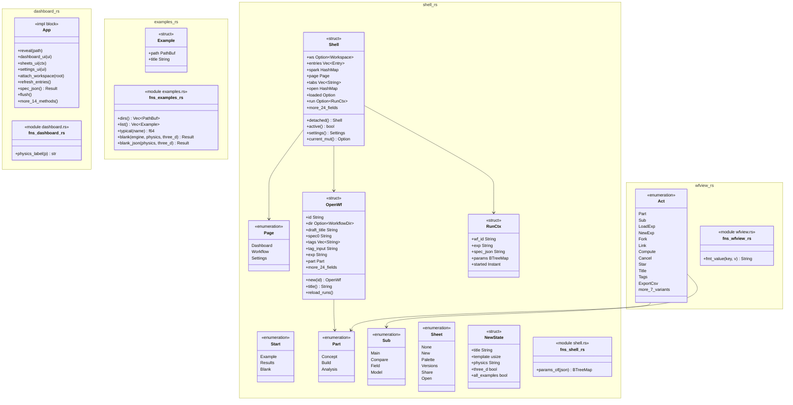

# Shell and dashboard: code

C4 level 4 (code) of the component **Shell and dashboard** (`app.shell`) in the container **app** (crate `nyx`). [Component view of the container](../../3-components/app.md) · [All code pages](../README.md)

> The tab bar, the dashboard of workflows with live status, the workflow view (concept, build, analysis), the sheets (new, search, versions, share, settings) and the example starting points.

**Decisions:** [ADR 14](../../../adr/0014-workflow-store-json-manifests-and-nyx-archives.md), [ADR 23](../../../adr/0023-app-is-a-thin-shell-over-one-project.md)  
**Size:** 5 files, 3265 lines.

## Files

| File | Lines | What it says about itself |
|---|---:|---|
| `crates/app/src/dashboard.rs` | 372 | The dashboard: running workflows with live status, pinned and recent ones as cards, everything older in a list, and search. The rules (three days, the card cap, "done", nothing deleted) are `nyx_engine::facade::store::Workspace::sections`. |
| `crates/app/src/examples.rs` | 138 | Starting points: the example projects (files in the `examples` folder, found next to the program or in a parent folder of it, or at `NYX_EXAMPLES`) and a blank simulation built from engine commands. An example is a project file like any ... |
| `crates/app/src/sheets.rs` | 724 | The sheets that open over the shell (new workflow, search palette, versions, share, open a received file) and the settings page. |
| `crates/app/src/shell.rs` | 888 | The shell around the simulation window: the tab bar (Dashboard, one tab per open workflow, +), the status chip, the search palette entry, and the glue between the window's single live project and the workspace on disk (`nyx-store`). |
| `crates/app/src/wfview.rs` | 1143 | The workflow view: header, experiments list, the three sections (1 Concept, 2 Build, 3 Analysis) and what hangs off them (the live run, the runs table and plot, compare, the field viewer and the model screen). |

## What it uses

| Target | Modules | Items |
|---|---|---|
| [container `engine` (nyx-engine)](../../3-components/engine.md) | crate root, engine, store_link | Active, Artifact, Done, Engine, Entry, ExportOptions, Filter, Inspection, Limits, Recipe +34 |
| [Look and widgets](./style.md) | kit, theme | card, danger, dot, modal, muted, primary |
| [Window](./window.md) | app, state | App, JobKind, Tab |

## Used by

| Component | Modules | Items |
|---|---|---|
| [Scripts and batch](./headless.md) | examples, shell | Page, Part, Sheet, Start, Sub, list |
| [Inspector tabs](./inspector.md) | examples | list, typical |
| [Window](./window.md) | examples, shell | Shell, Start |

## Class diagram

Public types with their public fields (or variants) and methods, free functions per file as a `module` box; arrows are field types and `impl Trait`. Capped at 36 types and a few members each; the table below is complete.

## Public items

| Kind | Item | File:line | Signature or summary |
|---|---|---|---|
| fn | `physics_label` | `dashboard.rs:12` | `pub fn physics_label(p: &str) -> &'static str` |
| fn | `App::reveal` | `dashboard.rs:40` | `pub fn reveal(&mut self, path: &std::path::Path)` |
| fn | `App::dashboard_ui` | `dashboard.rs:59` | `pub fn dashboard_ui(&mut self, ui: &mut egui::Ui)` |
| struct | `Example` | `examples.rs:11` | fields: `path`, `title` —  One example file with the title written in it. |
| fn | `dirs` | `examples.rs:17` | `pub fn dirs() -> Vec<PathBuf>` —  The folders searched for examples, first with files wins. |
| fn | `list` | `examples.rs:46` | `pub fn list() -> Vec<Example>` —  The examples of the first folder that has any, in file-name order. |
| fn | `typical` | `examples.rs:70` | `pub fn typical(name: &str) -> f64` —  A value for a property the descriptor gives no default for: a typical number, so that a new simulation runs before anything is edited. |
| fn | `blank` | `examples.rs:85` | `pub fn blank(engine: &mut Engine, physics: &str, three_d: bool) -> Result<(), String>` —  Starts a blank simulation in `engine`: a unit plate (one region `plate`, x-z) or, in 3D, the unit cube made by sweeping it along y, |
| fn | `blank_json` | `examples.rs:133` | `pub fn blank_json(physics: &str, three_d: bool) -> Result<String, String>` —  The JSON text of a blank simulation (`blank`) made on a scratch engine: the spec a new experiment starts from. |
| fn | `App::sheets_ui` | `sheets.rs:27` | `pub fn sheets_ui(&mut self, ctx: &egui::Context)` |
| fn | `App::settings_ui` | `sheets.rs:584` | `pub fn settings_ui(&mut self, ui: &mut egui::Ui)` |
| enum | `Page` | `shell.rs:21` | variants: `Dashboard`, `Workflow`, `Settings` |
| enum | `Start` | `shell.rs:28` | variants: `Example`, `Results`, `Blank` —  Where a new workflow starts from: an example (or any project file), or a blank simulation. |
| enum | `Part` | `shell.rs:37` | variants: `Concept`, `Build`, `Analysis` —  The three sections of an experiment. |
| enum | `Sub` | `shell.rs:45` | variants: `Main`, `Compare`, `Field`, `Model` —  What fills the workflow view's centre besides the section itself. |
| enum | `Sheet` | `shell.rs:53` | variants: `None`, `New`, `Palette`, `Versions`, `Share`, `Open` |
| struct | `OpenWf` | `shell.rs:62` | fields: `id`, `dir`, `draft_title`, `spec0`, `tags`, `tag_input`, `exp`, `part`, `sub`, `concept_tab`, `build_tab`, `runs`, ... |
| struct | `RunCtx` | `shell.rs:156` | fields: `wf_id`, `exp`, `spec_json`, `params`, `started` —  The run that is being solved, so its record can be written whatever the window shows when it ends. |
| struct | `NewState` | `shell.rs:164` | fields: `title`, `template`, `physics`, `three_d`, `all_examples` |
| struct | `Shell` | `shell.rs:178` | fields: `ws`, `entries`, `spark`, `page`, `tabs`, `open`, `loaded`, `run`, `live_run`, `sheet`, `new`, `palette_q`, ... |
| fn | `params_of` | `shell.rs:834` | `pub fn params_of(json: &str) -> BTreeMap<String, f64>` —  Parameters of a run: the dimensions of the geometry and the wavelength, in SI units, from the concept card of the spec. |
| fn | `OpenWf::new` | `shell.rs:99` | `pub fn new(id: String) -> OpenWf` |
| fn | `OpenWf::title` | `shell.rs:136` | `pub fn title(&self) -> String` |
| fn | `OpenWf::reload_runs` | `shell.rs:143` | `pub fn reload_runs(&mut self)` |
| fn | `Shell::detached` | `shell.rs:219` | `pub fn detached() -> Shell` —  No workspace: the shell is off (tests and `--batch`). |
| fn | `Shell::active` | `shell.rs:256` | `pub fn active(&self) -> bool` |
| fn | `Shell::settings` | `shell.rs:260` | `pub fn settings(&self) -> Settings` |
| fn | `Shell::current_mut` | `shell.rs:264` | `pub fn current_mut(&mut self) -> Option<&mut OpenWf>` |
| fn | `App::attach_workspace` | `shell.rs:277` | `pub fn attach_workspace(&mut self, root: PathBuf)` —  Switches the shell on with the workspace at `root` (the window passes the default one; `NYX_WORKSPACE` overrides it). |
| fn | `App::refresh_entries` | `shell.rs:297` | `pub fn refresh_entries(&mut self)` |
| fn | `App::spec_json` | `shell.rs:324` | `pub fn spec_json(&self) -> Result<String, String>` —  The project as it would be saved (the geometry being edited included). |
| fn | `App::flush` | `shell.rs:340` | `pub fn flush(&mut self)` —  Stores the live project in its workflow when it changed (called about once a second, and before anything that replaces it). |
| fn | `App::persist_draft` | `shell.rs:373` | `pub fn persist_draft(&mut self, wid: &str, spec: &str) -> Result<(), String>` |
| fn | `App::load_experiment` | `shell.rs:400` | `pub fn load_experiment(&mut self, wid: &str, eid: &str)` —  Loads experiment `eid` of workflow `wid` into the window (the current one is stored first). |
| fn | `App::open_tab` | `shell.rs:425` | `pub fn open_tab(&mut self, id: &str, show: bool)` —  Opens a tab for the workflow `id` of the workspace and (when `show`) switches to it. |
| fn | `App::show_workflow` | `shell.rs:456` | `pub fn show_workflow(&mut self, id: &str)` |
| fn | `App::new_draft` | `shell.rs:466` | `pub fn new_draft(&mut self, title: &str, start: Start)` —  A new draft workflow from a project (nothing is written until the first change). |
| fn | `App::finish_open` | `shell.rs:508` | `pub(crate) fn finish_open(&mut self, summary: &serde_json::Value)` —  The results file the window was opening on a job is in: its project is the engine's, so the draft workflow is made around it and the |
| fn | `App::close_tab` | `shell.rs:535` | `pub fn close_tab(&mut self, id: &str)` |
| fn | `App::shell_compute` | `shell.rs:557` | `pub fn shell_compute(&mut self)` —  Compute with a run record: stores the spec, remembers what is being solved and starts the solve. |
| fn | `App::record_ok` | `shell.rs:590` | `pub fn record_ok(&mut self, res: &nyx_engine::facade::physics::SolveResult) -> Option<String>` —  A solve finished well: writes its run record and keeps the log with it. Returns the run id. |
| fn | `App::record_end` | `shell.rs:597` | `pub fn record_end(&mut self, status: RunStatus, error: Option<String>)` —  A solve failed or was cancelled. |
| fn | `App::shell_ui` | `shell.rs:651` | `pub fn shell_ui(&mut self, ui: &mut egui::Ui)` —  The whole window in the shell layout. |
| fn | `App::pick_nyx_file` | `shell.rs:812` | `pub fn pick_nyx_file(&mut self)` —  File dialog for a `.nyx` file; shows what is inside before anything is saved. |
| fn | `App::open_received` | `shell.rs:817` | `pub fn open_received(&mut self, p: PathBuf)` |
| enum | `Act` | `wfview.rs:18` | variants: `Part`, `Sub`, `LoadExp`, `NewExp`, `Fork`, `Link`, `Compute`, `Cancel`, `Star`, `Title`, `Tags`, `ExportCsv`, ... |
| fn | `fmt_value` | `wfview.rs:41` | `pub fn fmt_value(key: &str, v: f64) -> String` —  A length shown in nm, other numbers with four significant digits. |
| fn | `App::workflow_ui` | `wfview.rs:62` | `pub fn workflow_ui(&mut self, ui: &mut egui::Ui, id: &str)` |

Trait implementations in this component: `NewState: Default`
