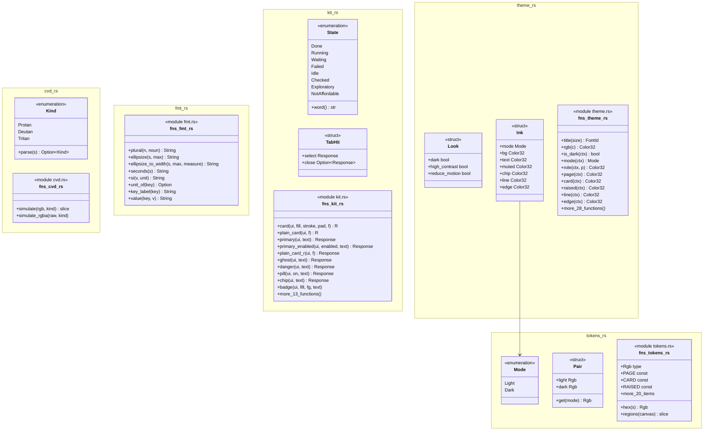

# Look and widgets: code

C4 level 4 (code) of the component **Look and widgets** (`app.style`) in the container **app** (crate `nyx`). [Component view of the container](../../3-components/app.md) · [All code pages](../README.md)

> The nyx look (the colour tokens as data, fonts, egui visuals, light and dark, contrast) and the small brand widgets (cards, chips, buttons, glyphs, sparklines, sheets), and how numbers and counts are written.

**Decisions:** [ADR 23](../../../adr/0023-app-is-a-thin-shell-over-one-project.md), [ADR 88](../../../adr/0088-colour-has-roles-and-the-window-follows-the-system.md), [ADR 123](../../../adr/0123-window-reset-gui-subsystem-absorbing-layers-as-a-role-and-quiet-chrome.md), [ADR 124](../../../adr/0124-one-bar-five-tabs-always-on-viewport-script-dock-and-physics-dropdown.md)  
**Size:** 5 files, 1389 lines.

## Files

| File | Lines | What it says about itself |
|---|---:|---|
| `crates/app/src/cvd.rs` | 90 |  |
| `crates/app/src/fmt.rs` | 255 |  |
| `crates/app/src/kit.rs` | 370 |  |
| `crates/app/src/theme.rs` | 346 |  |
| `crates/app/src/tokens.rs` | 328 |  |

## What it uses

Nothing outside the component (the standard library and external crates are not listed).

## Used by

| Component | Modules | Items |
|---|---|---|
| [Scripts and batch](./headless.md) | cvd | Kind, simulate_rgba |
| [Inspector tabs](./inspector.md) | fmt, theme | accent, activity_text, danger, on_accent, plural, raised, si, success +1 |
| [Shell and dashboard](./shell.md) | fmt, kit, theme | State, card, danger, ellipsize, ellipsize_to_width, key_label, modal, muted +6 |
| [Viewport](./viewport.md) | fmt, theme, tokens | Ink, Mode, axis_colour, ellipsize, rgb, with_alpha |
| [Window](./window.md) | cvd, fmt, kit, theme | Kind, State, accent, activity_text, apply, card, danger, edge +9 |

## Class diagram

Public types with their public fields (or variants) and methods, free functions per file as a `module` box; arrows are field types and `impl Trait`. Capped at 36 types and a few members each; the table below is complete.

## Public items

| Kind | Item | File:line | Signature or summary |
|---|---|---|---|
| enum | `Kind` | `cvd.rs:10` | variants: `Protan`, `Deutan`, `Tritan` —  Which cone type is missing. |
| fn | `simulate` | `cvd.rs:51` | `pub fn simulate(rgb: [u8; 3], kind: Kind) -> [u8` —  One colour as the simulated viewer sees it. |
| fn | `simulate_rgba` | `cvd.rs:59` | `pub fn simulate_rgba(raw: &mut [u8], kind: Kind)` —  A whole image, `rgba` bytes in place (alpha is kept). |
| fn | `Kind::parse` | `cvd.rs:17` | `pub fn parse(s: &str) -> Option<Kind>` |
| fn | `plural` | `fmt.rs:8` | `pub fn plural(n: usize, noun: &str) -> String` —  "1 run", "2 runs", "0 runs": the noun gets an "s" unless the count is one. |
| fn | `ellipsize` | `fmt.rs:13` | `pub fn ellipsize(s: &str, max: usize) -> String` —  The text cut to `max` characters with an ellipsis; text that fits is returned as it is. |
| fn | `ellipsize_to_width` | `fmt.rs:21` | `pub fn ellipsize_to_width(s: &str, max: f32, measure: impl Fn(&str) -> f32) -> String` —  The text cut with an ellipsis until `measure` (its width in points) says it fits in `max`; text that fits is returned as it is. |
| fn | `seconds` | `fmt.rs:41` | `pub fn seconds(s: f64) -> String` —  A time that has passed: "0.4 s", "12 s", "1:05", "1:02:09" (seconds below ten show a decimal; a minute and more show minutes and seconds). |
| fn | `si` | `fmt.rs:58` | `pub fn si(v: f64, unit: &str) -> String` —  A value with an SI prefix and four significant digits: `si(2.017e-4, "m")` is "201.7 µm", `si(6.175e6, "Pa")` is "6.175 MPa". |
| fn | `unit_of` | `fmt.rs:80` | `pub fn unit_of(key: &str) -> Option<&'static str>` —  The unit a metric key ends with ("max_u_m" is in metres), when the last word is a physical unit. |
| fn | `key_label` | `fmt.rs:109` | `pub fn key_label(key: &str) -> String` —  "max_von_mises_pa" as "Max von Mises [Pa]": first word capitalised, a few names spelled right, the unit in brackets. |
| fn | `value` | `fmt.rs:154` | `pub fn value(key: &str, v: f64) -> String` —  A number as the runs table shows it: SI prefixes when the key names a unit, whole numbers without decimals, lengths of a parameter in nm, |
| fn | `card` | `kit.rs:8` | `pub fn card<R>(ui: &mut Ui, fill: Color32, stroke: Color32, pad: i8, f: impl FnOnce(&mut Ui) -> R) -> R` |
| fn | `plain_card` | `kit.rs:13` | `pub fn plain_card<R>(ui: &mut Ui, f: impl FnOnce(&mut Ui) -> R) -> R` —  A white card with the line colour. |
| fn | `primary` | `kit.rs:19` | `pub fn primary(ui: &mut Ui, text: impl Into<String>) -> Response` —  The one filled accent button of a view, with the text colour that has contrast on it (`on_accent`). |
| fn | `primary_enabled` | `kit.rs:24` | `pub fn primary_enabled(ui: &mut Ui, enabled: bool, text: impl Into<String>) -> Response` |
| fn | `plain_card_r` | `kit.rs:29` | `pub fn plain_card_r(ui: &mut Ui, f: impl FnOnce(&mut Ui)) -> Response` —  A white card; returns the response of the whole card (for clicks). |
| fn | `ghost` | `kit.rs:37` | `pub fn ghost(ui: &mut Ui, text: impl Into<String>) -> Response` —  Outlined button. |
| fn | `danger` | `kit.rs:42` | `pub fn danger(ui: &mut Ui, text: impl Into<String>) -> Response` —  Outlined button in the danger colour (Cancel). |
| fn | `pill` | `kit.rs:48` | `pub fn pill(ui: &mut Ui, on: bool, text: impl Into<String>) -> Response` —  A selectable pill: plum when on. |
| fn | `chip` | `kit.rs:55` | `pub fn chip(ui: &mut Ui, text: impl Into<String>) -> Response` —  A small rounded label such as a tag. |
| fn | `badge` | `kit.rs:62` | `pub fn badge(ui: &mut Ui, fill: Color32, fg: Color32, text: impl Into<String>)` —  A chip with a colour (status chip in the top bar, badges on the open-file screen). |
| fn | `label_caps` | `kit.rs:67` | `pub fn label_caps(ui: &mut Ui, text: &str, hint: &str)` —  "RUNNING" style section label with an optional grey hint after it. |
| enum | `State` | `kit.rs:79` | variants: `Done`, `Running`, `Waiting`, `Failed`, `Idle`, `Checked`, `Exploratory`, `NotAffordable` —  What a workflow, a run or the solver is doing. Colour is never the only channel: every state has its own glyph (drawn, so it needs no font) |
| fn | `glyph` | `kit.rs:115` | `pub fn glyph(ui: &mut Ui, state: State) -> Response` —  The glyph of a state, 14 px square. |
| fn | `paint_glyph` | `kit.rs:122` | `pub fn paint_glyph(ui: &Ui, c: egui::Pos2, state: State)` |
| fn | `status` | `kit.rs:172` | `pub fn status(ui: &mut Ui, state: State, label: impl Into<String>)` —  A state with its word (or `label` instead of the word): glyph, then text in the colour that reads on the page. |
| fn | `tabs` | `kit.rs:189` | `pub fn tabs(ui: &mut Ui, labels: &[&str], on: usize) -> Option<usize>` —  A row of text tabs (ADR 124): the one on show in the text colour and bold, with a 2 px accent line under it; the others muted. Returns the index clicked. |
| struct | `TabHit` | `kit.rs:212` | fields: `select`, `close` —  What `tab` reports: a click on the tab and a click on its close target. |
| fn | `tab_width` | `kit.rs:226` | `pub fn tab_width(ui: &Ui, title: &str, has_state: bool, closable: bool) -> f32` —  How wide `tab` draws this title, so a bar can decide which tabs fit before it draws any. |
| fn | `tab` | `kit.rs:231` | `pub fn tab(ui: &mut Ui, id: impl std::hash::Hash + std::fmt::Debug, title: &str, selected: bool, state: Option<State>, closable: bool) -> TabHit` |
| fn | `mono` | `kit.rs:280` | `pub fn mono(text: impl Into<String>) -> RichText` |
| fn | `muted` | `kit.rs:284` | `pub fn muted(ui: &Ui, text: impl Into<String>) -> RichText` |
| fn | `title` | `kit.rs:288` | `pub fn title(text: impl Into<String>, size: f32) -> RichText` |
| fn | `sparkline` | `kit.rs:293` | `pub fn sparkline(ui: &mut Ui, values: &[f64], color: Color32, size: Vec2)` —  A line of values as a polyline in a box (dashboard cards). |
| fn | `bar` | `kit.rs:310` | `pub fn bar(ui: &mut Ui, fraction: Option<f32>, width: f32)` —  A determinate progress bar in plum on a pale track; `None` shows a sliding block (no percentage reported). |
| fn | `modal` | `kit.rs:340` | `pub fn modal(ctx: &egui::Context, id: &str, width: f32, f: impl FnOnce(&mut Ui)) -> bool` —  A modal sheet: dims the page, swallows clicks outside and shows `f` in a centred card. Returns `true` when it should close |
| fn | `State::word` | `kit.rs:100` | `pub fn word(self) -> &'static str` |
| fn | `title` | `theme.rs:12` | `pub fn title(size: f32) -> FontId` —  A heading: the plain interface face, smaller than the size asked for (the sizes were chosen for a display italic; ADR 123). |
| fn | `rgb` | `theme.rs:17` | `pub fn rgb(c: Rgb) -> Color32` —  A token colour as an egui colour. |
| fn | `is_dark` | `theme.rs:22` | `pub fn is_dark(ctx: &egui::Context) -> bool` —  True when the colours are the dark ones (`apply_mode`). |
| fn | `mode` | `theme.rs:26` | `pub fn mode(ctx: &egui::Context) -> Mode` |
| fn | `role` | `theme.rs:31` | `pub fn role(ctx: &egui::Context, p: Pair) -> Color32` —  The value of a token in the look that is active. |
| fn | `page` | `theme.rs:35` | `pub fn page(ctx: &egui::Context) -> Color32` |
| fn | `card` | `theme.rs:38` | `pub fn card(ctx: &egui::Context) -> Color32` |
| fn | `raised` | `theme.rs:42` | `pub fn raised(ctx: &egui::Context) -> Color32` —  hover and pressed neutral fills, popups, chips |
| fn | `line` | `theme.rs:46` | `pub fn line(ctx: &egui::Context) -> Color32` —  Dividers and card outlines. Never the edge of a control: that is `edge`. |
| fn | `edge` | `theme.rs:50` | `pub fn edge(ctx: &egui::Context) -> Color32` —  The edge of buttons, fields and checkboxes (3:1 against the page and the card). |
| fn | `text` | `theme.rs:53` | `pub fn text(ctx: &egui::Context) -> Color32` |
| fn | `muted` | `theme.rs:56` | `pub fn muted(ctx: &egui::Context) -> Color32` |
| fn | `accent` | `theme.rs:59` | `pub fn accent(ctx: &egui::Context) -> Color32` |
| fn | `on_accent` | `theme.rs:63` | `pub fn on_accent(ctx: &egui::Context) -> Color32` —  Text on an accent fill: white on the plum, ink on the dark pink. |
| fn | `tint` | `theme.rs:66` | `pub fn tint(ctx: &egui::Context) -> Color32` |
| fn | `activity` | `theme.rs:70` | `pub fn activity(ctx: &egui::Context) -> Color32` —  Amber: time and attention (running, queued, stale) and nothing else. |
| fn | `activity_text` | `theme.rs:74` | `pub fn activity_text(ctx: &egui::Context) -> Color32` —  The activity colour as text (on `warm`). |
| fn | `warm` | `theme.rs:78` | `pub fn warm(ctx: &egui::Context) -> Color32` —  Background of the busy chip and the stale band. |
| fn | `success` | `theme.rs:81` | `pub fn success(ctx: &egui::Context) -> Color32` |
| fn | `danger` | `theme.rs:84` | `pub fn danger(ctx: &egui::Context) -> Color32` |
| fn | `scrim` | `theme.rs:88` | `pub fn scrim(alpha: u8) -> Color32` —  The black scrim behind a sheet and under a shadow (a veil, not a palette colour). |
| fn | `sphere_ink` | `theme.rs:96` | `pub fn sphere_ink(dark: bool) -> Color32` —  The ink of the Poincaré sphere (its lines and outline): blue-grey, lighter in the dark look. |
| fn | `sphere_body` | `theme.rs:100` | `pub fn sphere_body() -> Color32` —  The translucent ball of the Poincaré sphere (the caller sets the opacity). |
| fn | `on_marker` | `theme.rs:104` | `pub fn on_marker() -> Color32` —  A mode marker's ring and number: white reads on every marker hue. |
| fn | `axis_colour` | `theme.rs:108` | `pub fn axis_colour(i: usize) -> Color32` —  The x, y and z axes of the 3D triad (red, green, blue, the convention of every 3D tool). |
| fn | `series` | `theme.rs:112` | `pub fn series(i: usize) -> Color32` —  The series of a small chart after the accent: blue, orange, green, red (readable on the card in both looks). |
| struct | `Look` | `theme.rs:118` | fields: `dark`, `high_contrast`, `reduce_motion` —  The settings of the look that are not the light or dark colours. |
| fn | `look` | `theme.rs:131` | `pub fn look(ctx: &egui::Context) -> Look` —  The look that was installed last (`apply_look`). |
| fn | `reduce_motion` | `theme.rs:135` | `pub fn reduce_motion(ctx: &egui::Context) -> bool` |
| fn | `canvas_mode` | `theme.rs:140` | `pub fn canvas_mode(ctx: &egui::Context, follow_theme: bool) -> Mode` —  The mode of the canvas that is drawn: dark by default also in a light window, the mode of the look when `follow_theme`. |
| struct | `Ink` | `theme.rs:147` | fields: `mode`, `bg`, `text`, `muted`, `chip`, `line`, `edge` —  Everything drawn on the canvas, in the colours of the canvas and not of the window (a light window can hold a dark canvas): the viewport and the |
| fn | `ink` | `theme.rs:160` | `pub fn ink(ctx: &egui::Context, follow_theme: bool) -> Ink` |
| fn | `ink_of` | `theme.rs:164` | `pub fn ink_of(m: Mode) -> Ink` |
| fn | `with_alpha` | `theme.rs:170` | `pub fn with_alpha(c: Color32, a: u8) -> Color32` —  A colour with the given opacity (0 to 255), not premultiplied. |
| fn | `system_high_contrast` | `theme.rs:175` | `pub fn system_high_contrast() -> bool` —  True when the system asks for High Contrast: read from Windows (`SPI_GETHIGHCONTRAST`); other platforms have no such flag we read yet. |
| fn | `resolve_contrast` | `theme.rs:207` | `pub fn resolve_contrast(setting: &str) -> bool` —  The High contrast setting ("auto", "standard", "high") as a yes or no. |
| fn | `apply` | `theme.rs:216` | `pub fn apply(ctx: &egui::Context)` —  Light visuals (what tests and the first frame use). |
| fn | `apply_mode` | `theme.rs:263` | `pub fn apply_mode(ctx: &egui::Context, dark: bool)` —  Light or dark with the other options of the look as they were last set (`apply_look`). |
| fn | `apply_look` | `theme.rs:270` | `pub fn apply_look(ctx: &egui::Context, look: Look)` —  Installs the light and the dark look and makes `look.dark` the active one. Both are installed every time (it is cheap) so nothing depends on |
| fn | `install_fonts` | `theme.rs:325` | `pub fn install_fonts(ctx: &egui::Context)` —  Installs the fonts that are available (see the module comment). Anything missing falls back to egui's own fonts. |
| type | `Rgb` | `tokens.rs:8` |  An sRGB colour, 8 bits per channel. |
| enum | `Mode` | `tokens.rs:12` | variants: `Light`, `Dark` —  Which set of colours: the window follows the system, the canvas has its own choice. |
| struct | `Pair` | `tokens.rs:19` | fields: `light`, `dark` —  A role with one value per mode. |
| fn | `hex` | `tokens.rs:43` | `pub const fn hex(s: &str) -> Rgb` —  `"#RRGGBB"` to bytes, at compile time, so the table below reads like the JSON. |
| const | `PAGE` | `tokens.rs:54` | `Pair` —  window background |
| const | `CARD` | `tokens.rs:56` | `Pair` —  cards, sheets, fields |
| const | `RAISED` | `tokens.rs:58` | `Pair` —  hover and pressed neutral fills, popups |
| const | `SEPARATOR` | `tokens.rs:60` | `Pair` —  dividers and card outlines only; never a control edge |
| const | `CONTROL_EDGE` | `tokens.rs:62` | `Pair` —  edge of buttons, fields, combo boxes, checkboxes (3:1 on page and card) |
| const | `CONTROL_EDGE_HIGH` | `tokens.rs:64` | `Pair` —  the control edge of the High contrast setting (4.5:1 on page, card and raised) |
| const | `TEXT` | `tokens.rs:66` | `Pair` —  primary text |
| const | `MUTED` | `tokens.rs:68` | `Pair` —  secondary text |
| const | `ACCENT` | `tokens.rs:70` | `Pair` —  the brand colour: primary action fill, links, focus ring, selected bar |
| const | `ON_ACCENT` | `tokens.rs:72` | `Pair` —  text on an accent fill (white on the dark pink fails, ink passes) |
| const | `TINT` | `tokens.rs:74` | `Pair` —  selected item background (with a 2 px accent bar) |
| const | `ACTIVITY` | `tokens.rs:76` | `Pair` —  running, queued, stale: fill |
| const | `ON_ACTIVITY` | `tokens.rs:79` | `Pair` —  text on an activity fill |
| const | `ACTIVITY_TEXT` | `tokens.rs:81` | `Pair` —  the activity colour used as text (on `ACTIVITY_TINT`) |
| const | `ACTIVITY_TINT` | `tokens.rs:83` | `Pair` —  background of the busy chip and the stale band |
| const | `SUCCESS` | `tokens.rs:85` | `Pair` —  saved, converged, passed (always with a glyph and a word) |
| const | `DANGER` | `tokens.rs:87` | `Pair` —  failed, destructive (always with a glyph and a word) |
| const | `CANVAS` | `tokens.rs:89` | `Pair` —  viewport and plot background (default dark in both themes) |
| const | `CHIP` | `tokens.rs:91` | `Pair` —  region number chip background: the canvas colour of the same mode, with `TEXT` on it |
| const | `REGION_GREY` | `tokens.rs:93` | `Pair` —  fill of regions beyond the sixteenth (slot 17 and up): neutral, told apart by the number chip only |
| const | `ROLES` | `tokens.rs:97` | `[(&str, Pair)` —  Every role by its name in `tokens.json`. |
| const | `REGIONS_ON_DARK_CANVAS` | `tokens.rs:121` | `[Rgb` —  Eight region colours for the dark canvas (the default canvas, also in a light window). Any two can touch: checked with all pairs. |
| const | `REGIONS_ON_LIGHT_CANVAS` | `tokens.rs:125` | `[Rgb` —  Eight region colours for the light canvas (only when Settings says the canvas follows a light theme). |
| fn | `regions` | `tokens.rs:129` | `pub fn regions(canvas: Mode) -> &'static [Rgb` —  The region palette for the canvas that is drawn. |
| fn | `Pair::get` | `tokens.rs:25` | `pub const fn get(&self, mode: Mode) -> Rgb` |
