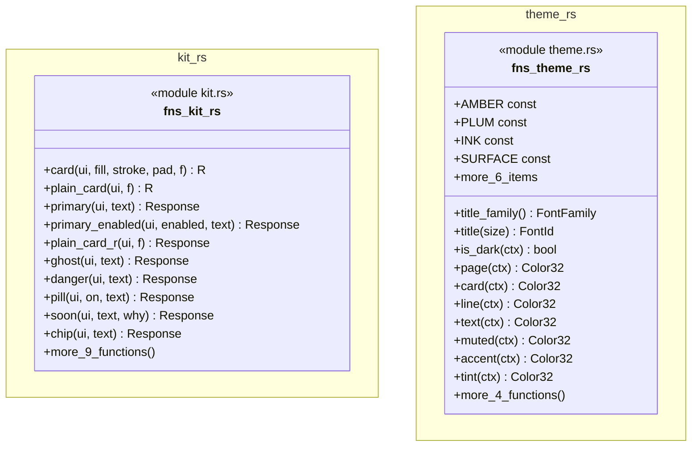

# Look and widgets: code

C4 level 4 (code) of the component **Look and widgets** (`app.style`) in the container **app** (crate `nyx`). [Component view of the container](../../3-components/app.md) · [All code pages](../README.md)

> The nyx look (palette, fonts, egui visuals, light and dark) and the small brand widgets (cards, chips, buttons, sparklines, sheets).

**Decisions:** [ADR 23](../../../adr/0023-app-is-a-thin-shell-over-one-project.md)  
**Size:** 2 files, 326 lines.

## Files

| File | Lines | What it says about itself |
|---|---:|---|
| `crates/app/src/kit.rs` | 158 | Small widgets of the shell: cards, chips, buttons in the brand style, sparklines and modal sheets. |
| `crates/app/src/theme.rs` | 168 | The nyx look: the brand palette, fonts and the egui visuals. Light by default, dark on request; every colour of the shell comes from here. |

## What it uses

Nothing outside the component (the standard library and external crates are not listed).

## Used by

| Component | Modules | Items |
|---|---|---|
| [Shell and dashboard](./shell.md) | kit, theme | card, danger, dot, modal, muted, primary |
| [Window](./window.md) | theme | apply, install_fonts |

## Class diagram

Public types with their public fields (or variants) and methods, free functions per file as a `module` box; arrows are field types and `impl Trait`. Capped at 36 types and a few members each; the table below is complete.

## Public items

| Kind | Item | File:line | Signature or summary |
|---|---|---|---|
| fn | `card` | `kit.rs:6` | `pub fn card<R>(ui: &mut Ui, fill: Color32, stroke: Color32, pad: i8, f: impl FnOnce(&mut Ui) -> R) -> R` |
| fn | `plain_card` | `kit.rs:11` | `pub fn plain_card<R>(ui: &mut Ui, f: impl FnOnce(&mut Ui) -> R) -> R` —  A white card with the line colour. |
| fn | `primary` | `kit.rs:17` | `pub fn primary(ui: &mut Ui, text: impl Into<String>) -> Response` —  Plum filled button with white text. |
| fn | `primary_enabled` | `kit.rs:22` | `pub fn primary_enabled(ui: &mut Ui, enabled: bool, text: impl Into<String>) -> Response` |
| fn | `plain_card_r` | `kit.rs:27` | `pub fn plain_card_r(ui: &mut Ui, f: impl FnOnce(&mut Ui)) -> Response` —  A white card; returns the response of the whole card (for clicks). |
| fn | `ghost` | `kit.rs:35` | `pub fn ghost(ui: &mut Ui, text: impl Into<String>) -> Response` —  Outlined button. |
| fn | `danger` | `kit.rs:40` | `pub fn danger(ui: &mut Ui, text: impl Into<String>) -> Response` —  Outlined button in the danger colour (Cancel). |
| fn | `pill` | `kit.rs:45` | `pub fn pill(ui: &mut Ui, on: bool, text: impl Into<String>) -> Response` —  A selectable pill: plum when on. |
| fn | `soon` | `kit.rs:52` | `pub fn soon(ui: &mut Ui, text: impl Into<String>, why: &str) -> Response` —  A pill that is not available yet: dimmed, with "soon" in the hover text. |
| fn | `chip` | `kit.rs:57` | `pub fn chip(ui: &mut Ui, text: impl Into<String>) -> Response` —  A small rounded label such as a tag. |
| fn | `badge` | `kit.rs:64` | `pub fn badge(ui: &mut Ui, fill: Color32, fg: Color32, text: impl Into<String>)` —  A chip with a colour (status chip in the top bar, badges on the open-file screen). |
| fn | `label_caps` | `kit.rs:69` | `pub fn label_caps(ui: &mut Ui, text: &str, hint: &str)` —  "RUNNING" style section label with an optional grey hint after it. |
| fn | `dot` | `kit.rs:78` | `pub fn dot(ui: &mut Ui, color: Color32)` |
| fn | `mono` | `kit.rs:83` | `pub fn mono(text: impl Into<String>) -> RichText` |
| fn | `muted` | `kit.rs:87` | `pub fn muted(ui: &Ui, text: impl Into<String>) -> RichText` |
| fn | `title` | `kit.rs:91` | `pub fn title(text: impl Into<String>, size: f32) -> RichText` |
| fn | `sparkline` | `kit.rs:96` | `pub fn sparkline(ui: &mut Ui, values: &[f64], color: Color32, size: Vec2)` —  A line of values as a polyline in a box (dashboard cards). |
| fn | `bar` | `kit.rs:113` | `pub fn bar(ui: &mut Ui, fraction: Option<f32>, width: f32)` —  A determinate progress bar in plum on a pale track; `None` shows a sliding block (no percentage reported). |
| fn | `modal` | `kit.rs:136` | `pub fn modal(ctx: &egui::Context, id: &str, width: f32, f: impl FnOnce(&mut Ui)) -> bool` —  A modal sheet: dims the page, swallows clicks outside and shows `f` in a centred card. Returns `true` when it should close |
| const | `AMBER` | `theme.rs:10` | `Color32` |
| const | `PLUM` | `theme.rs:11` | `Color32` |
| const | `INK` | `theme.rs:12` | `Color32` |
| const | `SURFACE` | `theme.rs:13` | `Color32` |
| const | `LINE` | `theme.rs:14` | `Color32` |
| const | `PLUM_TINT` | `theme.rs:16` | `Color32` —  derived tints |
| const | `AMBER_TINT` | `theme.rs:17` | `Color32` |
| const | `MUTED` | `theme.rs:18` | `Color32` |
| const | `GREEN` | `theme.rs:19` | `Color32` |
| const | `RED` | `theme.rs:20` | `Color32` |
| fn | `title_family` | `theme.rs:23` | `pub fn title_family() -> FontFamily` —  The serif italic family of page titles. |
| fn | `title` | `theme.rs:27` | `pub fn title(size: f32) -> FontId` |
| fn | `is_dark` | `theme.rs:32` | `pub fn is_dark(ctx: &egui::Context) -> bool` —  True when the colours are the dark ones (`apply_mode`). |
| fn | `page` | `theme.rs:37` | `pub fn page(ctx: &egui::Context) -> Color32` —  Colours that depend on the mode: (page, card, line, text, muted text). |
| fn | `card` | `theme.rs:40` | `pub fn card(ctx: &egui::Context) -> Color32` |
| fn | `line` | `theme.rs:43` | `pub fn line(ctx: &egui::Context) -> Color32` |
| fn | `text` | `theme.rs:46` | `pub fn text(ctx: &egui::Context) -> Color32` |
| fn | `muted` | `theme.rs:49` | `pub fn muted(ctx: &egui::Context) -> Color32` |
| fn | `accent` | `theme.rs:52` | `pub fn accent(ctx: &egui::Context) -> Color32` |
| fn | `tint` | `theme.rs:55` | `pub fn tint(ctx: &egui::Context) -> Color32` |
| fn | `warm` | `theme.rs:58` | `pub fn warm(ctx: &egui::Context) -> Color32` |
| fn | `apply` | `theme.rs:63` | `pub fn apply(ctx: &egui::Context)` —  Light visuals with the brand palette (what tests and the first frame use). |
| fn | `apply_mode` | `theme.rs:67` | `pub fn apply_mode(ctx: &egui::Context, dark: bool)` |
| fn | `install_fonts` | `theme.rs:133` | `pub fn install_fonts(ctx: &egui::Context)` —  Installs the fonts that are available (see the module comment). Anything missing falls back to egui's own fonts. |
