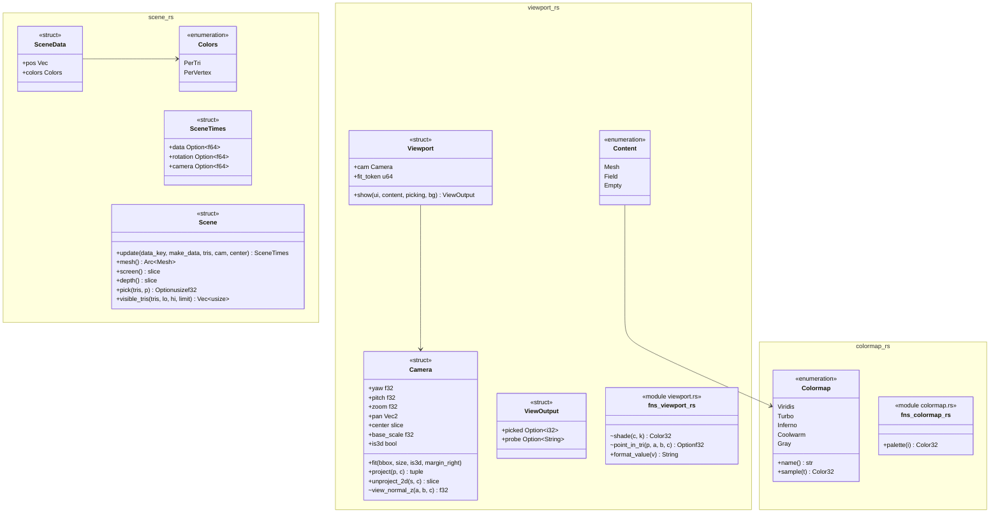

# Viewport: code

C4 level 4 (code) of the component **Viewport** (`app.viewport`) in the container **app** (crate `nyx`). [Component view of the container](../../3-components/app.md) · [All code pages](../README.md)

> The 2D/3D viewport: camera, drawing of meshes and result fields, picking, colour maps, and what is kept between frames.

**Decisions:** [ADR 23](../../../adr/0023-app-is-a-thin-shell-over-one-project.md)  
**Size:** 3 files, 991 lines.

## Files

| File | Lines | What it says about itself |
|---|---:|---|
| `crates/app/src/colormap.rs` | 118 | Colour maps for field plots (Viridis, Turbo, Inferno, cool-warm, gray) as functions of a value in [0, 1], and the palette used to tell domains and boundaries apart. |
| `crates/app/src/scene.rs` | 277 | What the viewport draws, kept between frames. |
| `crates/app/src/viewport.rs` | 596 | The 2D/3D viewport: camera, drawing of meshes and result fields, picking. |

## What it uses

| Target | Modules | Items |
|---|---|---|
| [container `engine` (nyx-engine)](../../3-components/engine.md) | crate root | Display, ViewMesh |

## Used by

| Component | Modules | Items |
|---|---|---|
| [Inspector tabs](./inspector.md) | colormap | Colormap |
| [Window](./window.md) | colormap, viewport | Colormap, Content, Viewport, palette |

## Class diagram

Public types with their public fields (or variants) and methods, free functions per file as a `module` box; arrows are field types and `impl Trait`. Capped at 36 types and a few members each; the table below is complete.

## Public items

| Kind | Item | File:line | Signature or summary |
|---|---|---|---|
| enum | `Colormap` | `colormap.rs:8` | variants: `Viridis`, `Turbo`, `Inferno`, `Coolwarm`, `Gray` |
| fn | `palette` | `colormap.rs:100` | `pub fn palette(i: usize) -> Color32` —  A categorical palette for domain and boundary numbers. |
| fn | `Colormap::name` | `colormap.rs:19` | `pub fn name(self) -> &'static str` |
| fn | `Colormap::sample` | `colormap.rs:31` | `pub fn sample(self, t: f32) -> Color32` —  Colour at `t` in [0, 1]. (The Turbo polynomial coefficients are the published ones, with all their digits.) |
| enum | `Colors` | `scene.rs:24` | variants: `PerTri`, `PerVertex` —  Base colours: one per triangle (mesh view) or one per vertex (result field). |
| struct | `SceneData` | `scene.rs:30` | fields: `pos`, `colors` —  What the data pass produces. |
| struct | `SceneTimes` | `scene.rs:38` | fields: `data`, `rotation`, `camera` —  Which passes ran in the last `update`, and how long they took (milliseconds), for the frame log. |
| struct | `Scene` | `scene.rs:44` |  |
| fn | `Scene::update` | `scene.rs:72` | `pub fn update(&mut self, data_key: u64, make_data: impl FnOnce() -> SceneData, tris: &[[u32; 3]], cam: &Camera, center: Pos2) -> SceneTimes` —  Brings the cache up to date. `make_data` is only called when `data_key` differs from the last call; `cam` and |
| fn | `Scene::mesh` | `scene.rs:167` | `pub fn mesh(&self) -> Arc<Mesh>` —  The mesh for egui (shares the allocation: cloning the `Arc` copies nothing). |
| fn | `Scene::screen` | `scene.rs:171` | `pub fn screen(&self) -> &[Pos2]` |
| fn | `Scene::depth` | `scene.rs:176` | `pub fn depth(&self) -> &[f32]` |
| fn | `Scene::pick` | `scene.rs:182` | `pub fn pick(&self, tris: &[[u32; 3]], p: Pos2) -> Option<(usize, [f32` —  The front-most triangle under `p` (index into `tris`), its barycentric coordinates and its depth; `None` when |
| fn | `Scene::visible_tris` | `scene.rs:201` | `pub fn visible_tris(&self, tris: &[[u32; 3]], lo: Pos2, hi: Pos2, limit: usize) -> Vec<usize>` —  Triangles that touch the rectangle `[lo, hi]` on the screen, at most `limit` of them (for drawing edges). |
| struct | `Camera` | `viewport.rs:13` | fields: `yaw`, `pitch`, `zoom`, `pan`, `center`, `base_scale`, `is3d` |
| enum | `Content` | `viewport.rs:92` | variants: `Mesh`, `Field`, `Empty` —  What to draw. |
| struct | `ViewOutput` | `viewport.rs:117` | fields: `picked`, `probe` |
| struct | `Viewport` | `viewport.rs:123` | fields: `cam`, `fit_token` |
| fn | `shade` | `viewport.rs:145` | `pub(crate) fn shade(c: Color32, k: f32) -> Color32` —  Shades a colour by the cosine `k` between the face normal and the view direction. |
| fn | `point_in_tri` | `viewport.rs:150` | `pub(crate) fn point_in_tri(p: Pos2, a: Pos2, b: Pos2, c: Pos2) -> Option<[f32` |
| fn | `format_value` | `viewport.rs:523` | `pub fn format_value(v: f32) -> String` |
| fn | `Camera::fit` | `viewport.rs:30` | `pub fn fit(&mut self, bbox: ([f32; 3], [f32; 3]), size: Vec2, is3d: bool, margin_right: f32)` |
| fn | `Camera::project` | `viewport.rs:59` | `pub fn project(&self, p: [f32; 3], c: Pos2) -> (Pos2, f32)` |
| fn | `Camera::unproject_2d` | `viewport.rs:72` | `pub fn unproject_2d(&self, s: Pos2, c: Pos2) -> [f32` —  World (x, y) under a screen position in 2D mode. |
| fn | `Camera::view_normal_z` | `viewport.rs:77` | `pub(crate) fn view_normal_z(&self, a: [f32; 3], b: [f32; 3], c: [f32; 3]) -> f32` |
| fn | `Viewport::show` | `viewport.rs:209` | `pub fn show(&mut self, ui: &mut Ui, content: Content<'_>, picking: bool, bg: Color32) -> ViewOutput` |

Trait implementations in this component: `Scene: Default`, `Camera: Default`, `Viewport: Default`
