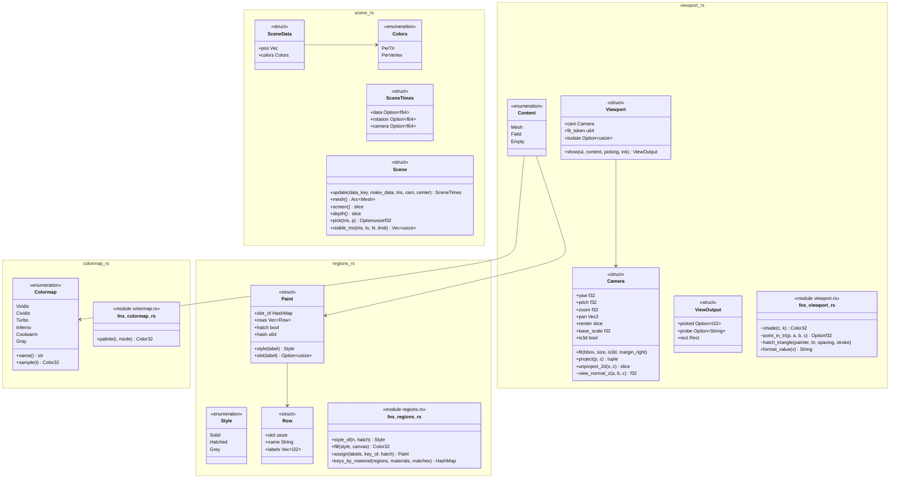

# Viewport: code

C4 level 4 (code) of the component **Viewport** (`app.viewport`) in the container **app** (crate `nyx`). [Component view of the container](../../3-components/app.md) · [All code pages](../README.md)

> The 2D/3D viewport: camera, drawing of meshes and result fields, picking, colour maps, the colour slots of regions (solid, hatched, grey) with their number chips and legend, and what is kept between frames.

**Decisions:** [ADR 23](../../../adr/0023-app-is-a-thin-shell-over-one-project.md), [ADR 88](../../../adr/0088-colour-has-roles-and-the-window-follows-the-system.md)  
**Size:** 4 files, 1598 lines.

## Files

| File | Lines | What it says about itself |
|---|---:|---|
| `crates/app/src/colormap.rs` | 158 |  |
| `crates/app/src/regions.rs` | 196 |  |
| `crates/app/src/scene.rs` | 279 |  |
| `crates/app/src/viewport.rs` | 965 |  |

## What it uses

| Target | Modules | Items |
|---|---|---|
| [container `engine` (nyx-engine)](../../3-components/engine.md) | crate root | Display, ViewMesh |
| [Look and widgets](./style.md) | fmt, theme, tokens | Ink, Mode, ellipsize, rgb, with_alpha |

## Used by

| Component | Modules | Items |
|---|---|---|
| [Inspector tabs](./inspector.md) | colormap | Colormap |
| [Window](./window.md) | colormap, regions, viewport | Colormap, Content, Paint, Viewport, assign, keys_by_material, palette |

## Class diagram

Public types with their public fields (or variants) and methods, free functions per file as a `module` box; arrows are field types and `impl Trait`. Capped at 36 types and a few members each; the table below is complete.

## Public items

| Kind | Item | File:line | Signature or summary |
|---|---|---|---|
| enum | `Colormap` | `colormap.rs:11` | variants: `Viridis`, `Cividis`, `Turbo`, `Inferno`, `Coolwarm`, `Gray` |
| fn | `palette` | `colormap.rs:124` | `pub fn palette(i: usize, mode: Mode) -> Color32` —  One of the eight validated categorical colours for the canvas of `mode` (any two are told apart under protan and deutan vision, see |
| fn | `Colormap::name` | `colormap.rs:25` | `pub fn name(self) -> &'static str` —  Turbo is a rainbow: its lightness goes up and down, so equal steps of the value do not look like equal steps. It says so in its name. |
| fn | `Colormap::sample` | `colormap.rs:38` | `pub fn sample(self, t: f32) -> Color32` —  Colour at `t` in [0, 1]. (The Turbo polynomial coefficients are the published ones, with all their digits.) |
| enum | `Style` | `regions.rs:15` | variants: `Solid`, `Hatched`, `Grey` —  How a slot is drawn. |
| fn | `style_of` | `regions.rs:25` | `pub fn style_of(n: usize, hatch: bool) -> Style` —  The style of slot `n` (0-based). Without a hatch pass (3D surfaces) slots 9 and up are grey, so a colour is never used twice without a cue. |
| fn | `fill` | `regions.rs:34` | `pub fn fill(style: Style, canvas: Mode) -> Color32` —  The fill of a style on the canvas of `canvas` (opaque). |
| struct | `Row` | `regions.rs:43` | fields: `slot`, `name`, `labels` —  One legend row: the regions that share a slot. |
| struct | `Paint` | `regions.rs:53` | fields: `slot_of`, `rows`, `hatch`, `hash` —  The colour plan of one model: a slot per region number. |
| fn | `assign` | `regions.rs:73` | `pub fn assign(labels: &[i32], key_of: impl Fn(i32) -> String, hatch: bool) -> Paint` —  Hands out the slots: `labels` in any order, `key_of` the colour key of a label (material name or the region's own name). |
| fn | `keys_by_material` | `regions.rs:101` | `pub fn keys_by_material(regions: &[(i32, String)], materials: &BTreeMap<String, Option<String>>, matches: impl Fn(&str) -> Vec<i32>) -> HashMap<i32, String>` —  The key of every region number by its material: `regions` are (number, name), `materials` the region patterns of the active problem with their |
| fn | `Paint::style` | `regions.rs:64` | `pub fn style(&self, label: i32) -> Style` |
| fn | `Paint::slot` | `regions.rs:67` | `pub fn slot(&self, label: i32) -> Option<usize>` |
| enum | `Colors` | `scene.rs:26` | variants: `PerTri`, `PerVertex` —  Base colours: one per triangle (mesh view) or one per vertex (result field). |
| struct | `SceneData` | `scene.rs:32` | fields: `pos`, `colors` —  What the data pass produces. |
| struct | `SceneTimes` | `scene.rs:40` | fields: `data`, `rotation`, `camera` —  Which passes ran in the last `update`, and how long they took (milliseconds), for the frame log. |
| struct | `Scene` | `scene.rs:46` |  |
| fn | `Scene::update` | `scene.rs:74` | `pub fn update(&mut self, data_key: u64, make_data: impl FnOnce() -> SceneData, tris: &[[u32; 3]], cam: &Camera, center: Pos2) -> SceneTimes` —  Brings the cache up to date. `make_data` is only called when `data_key` differs from the last call; `cam` and |
| fn | `Scene::mesh` | `scene.rs:169` | `pub fn mesh(&self) -> Arc<Mesh>` —  The mesh for egui (shares the allocation: cloning the `Arc` copies nothing). |
| fn | `Scene::screen` | `scene.rs:173` | `pub fn screen(&self) -> &[Pos2]` |
| fn | `Scene::depth` | `scene.rs:178` | `pub fn depth(&self) -> &[f32]` |
| fn | `Scene::pick` | `scene.rs:184` | `pub fn pick(&self, tris: &[[u32; 3]], p: Pos2) -> Option<(usize, [f32` —  The front-most triangle under `p` (index into `tris`), its barycentric coordinates and its depth; `None` when |
| fn | `Scene::visible_tris` | `scene.rs:203` | `pub fn visible_tris(&self, tris: &[[u32; 3]], lo: Pos2, hi: Pos2, limit: usize) -> Vec<usize>` —  Triangles that touch the rectangle `[lo, hi]` on the screen, at most `limit` of them (for drawing edges). |
| struct | `Camera` | `viewport.rs:17` | fields: `yaw`, `pitch`, `zoom`, `pan`, `center`, `base_scale`, `is3d` |
| enum | `Content` | `viewport.rs:96` | variants: `Mesh`, `Field`, `Empty` —  What to draw. |
| struct | `ViewOutput` | `viewport.rs:122` | fields: `picked`, `probe`, `rect` |
| struct | `Viewport` | `viewport.rs:130` | fields: `cam`, `fit_token`, `isolate` |
| fn | `shade` | `viewport.rs:176` | `pub(crate) fn shade(c: Color32, k: f32) -> Color32` —  Shades a colour by the cosine `k` between the face normal and the view direction. |
| fn | `point_in_tri` | `viewport.rs:181` | `pub(crate) fn point_in_tri(p: Pos2, a: Pos2, b: Pos2, c: Pos2) -> Option<[f32` |
| fn | `hatch_triangle` | `viewport.rs:625` | `pub(crate) fn hatch_triangle(painter: &egui::Painter, tri: [Pos2; 3], spacing: f32, stroke: Stroke)` —  1 px lines at 45 degrees, `spacing` apart on one grid for the whole canvas (so neighbouring triangles join their lines), clipped to the triangle. |
| fn | `format_value` | `viewport.rs:776` | `pub fn format_value(v: f32) -> String` |
| fn | `Camera::fit` | `viewport.rs:34` | `pub fn fit(&mut self, bbox: ([f32; 3], [f32; 3]), size: Vec2, is3d: bool, margin_right: f32)` |
| fn | `Camera::project` | `viewport.rs:63` | `pub fn project(&self, p: [f32; 3], c: Pos2) -> (Pos2, f32)` |
| fn | `Camera::unproject_2d` | `viewport.rs:76` | `pub fn unproject_2d(&self, s: Pos2, c: Pos2) -> [f32` —  World (x, y) under a screen position in 2D mode. |
| fn | `Camera::view_normal_z` | `viewport.rs:81` | `pub(crate) fn view_normal_z(&self, a: [f32; 3], b: [f32; 3], c: [f32; 3]) -> f32` |
| fn | `Viewport::show` | `viewport.rs:240` | `pub fn show(&mut self, ui: &mut Ui, content: Content<'_>, picking: bool, ink: &Ink) -> ViewOutput` |

Trait implementations in this component: `Scene: Default`, `Camera: Default`, `Viewport: Default`
