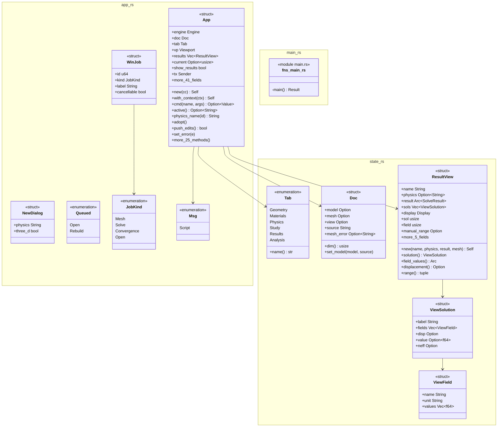

# Window: code

C4 level 4 (code) of the component **Window** (`app.window`) in the container **app** (crate `nyx`). [Component view of the container](../../3-components/app.md) · [All code pages](../README.md)

> The application object around one Engine: window layout, the run-time state (mesh on show, result on show, plot settings) and the frame update loop.

**Decisions:** [ADR 23](../../../adr/0023-app-is-a-thin-shell-over-one-project.md), [ADR 57](../../../adr/0057-front-ends-are-thin-the-mcp-tools-are-engine-commands.md)  
**Size:** 3 files, 2087 lines.

## Files

| File | Lines | What it says about itself |
|---|---:|---|
| `crates/app/src/app.rs` | 1782 | The application: the state of the window around one `nyx_engine::Engine`, and the window layout. |
| `crates/app/src/main.rs` | 83 | nyx: a desktop application for finite-element simulations (window with `eframe`/`egui`, solvers in the engine and the physics crates). |
| `crates/app/src/state.rs` | 222 | The run-time state of the window around the engine's project: the mesh on show (`Doc`) and a result on show with its plot settings (`ResultView`). The project itself, with its geometry, mesh settings and one problem per physics, is `nyx_... |

## What it uses

| Target | Modules | Items |
|---|---|---|
| [container `connect` (nyx-connect)](../../3-components/connect.md) | config, env, server | Env, HostInfo, Status, connect, disconnect, find_server, list, plain_path, snippet |
| [container `engine` (nyx-engine)](../../3-components/engine.md) | crate root, engine, meshing, process, project, queue | Cancelled, Display, Domain, Engine, Failed, FeatureList, LabelResolver, MeshSettings, MeshedModel, ModeAnalysis +10 |
| [Scripts and batch](./headless.md) | pyscript | spawn |
| [Inspector tabs](./inspector.md) | geomui | State |
| [Shell and dashboard](./shell.md) | examples, shell | Shell, Start |
| [Look and widgets](./style.md) | theme | apply, install_fonts |
| [Viewport](./viewport.md) | colormap, viewport | Colormap, Content, Viewport, palette |

## Used by

| Component | Modules | Items |
|---|---|---|
| [Scripts and batch](./headless.md) | app, state | App, Msg |
| [Inspector tabs](./inspector.md) | app, state | App, JobKind |
| [Shell and dashboard](./shell.md) | app, state | App, JobKind, Tab |

## Class diagram

Public types with their public fields (or variants) and methods, free functions per file as a `module` box; arrows are field types and `impl Trait`. Capped at 36 types and a few members each; the table below is complete.

## Public items

| Kind | Item | File:line | Signature or summary |
|---|---|---|---|
| struct | `NewDialog` | `app.rs:28` | fields: `physics`, `three_d` —  Choices of the File &gt; New dialog. |
| enum | `Queued` | `app.rs:34` | variants: `Open`, `Rebuild` —  Work waiting for the running job to finish (the latest request wins). |
| enum | `JobKind` | `app.rs:41` | variants: `Mesh`, `Solve`, `Convergence`, `Open` —  What a running engine job is. |
| struct | `WinJob` | `app.rs:51` | fields: `id`, `kind`, `label`, `cancellable` —  A job of this window that waits in the engine's queue behind the running one (ADR 87). |
| enum | `Msg` | `app.rs:59` | variants: `Script` —  A message from a helper thread (the optional Python script) to the window. |
| struct | `App` | `app.rs:63` | fields: `engine`, `doc`, `tab`, `vp`, `results`, `current`, `show_results`, `tx`, `rx`, `busy`, `job`, `job_kind`, ... |
| fn | `App::new` | `app.rs:136` | `pub fn new(cc: &eframe::CreationContext<'_>) -> Self` |
| fn | `App::with_context` | `app.rs:145` | `pub fn with_context(ctx: egui::Context) -> Self` —  The application state on an egui context; no window is needed (tests use a default context). It opens with the first example. |
| fn | `App::cmd` | `app.rs:217` | `pub fn cmd(&mut self, name: &str, args: Value) -> Option<Value>` —  Runs an engine command and reports its error in the status bar. `None` after an error. |
| fn | `App::active` | `app.rs:228` | `pub fn active(&self) -> Option<String>` —  The code of the active physics, if the project has one. |
| fn | `App::physics_name` | `app.rs:234` | `pub fn physics_name(&self, id: &str) -> String` —  The display name of a physics from its descriptor. |
| fn | `App::adopt` | `app.rs:239` | `pub fn adopt(&mut self)` —  The window's copies of what is edited (geometry, mesh settings) are taken from the engine's project: after a project was opened or made. |
| fn | `App::push_edits` | `app.rs:249` | `pub fn push_edits(&mut self) -> bool` —  Hands the geometry and mesh settings being edited to the engine. False (and an error shown) when the engine refuses them. |
| fn | `App::set_error` | `app.rs:283` | `pub fn set_error(&mut self, e: impl Into<String>)` |
| fn | `App::started` | `app.rs:290` | `pub(crate) fn started(&mut self, id: u64, kind: JobKind, label: String, cancellable: bool)` —  A job was submitted to the engine. With nothing running it is the running job; otherwise it waits in the queue behind it. |
| fn | `App::queue_panel` | `app.rs:324` | `pub fn queue_panel(&mut self, ctx: &egui::Context)` —  The Queue panel: what the engine runs and what waits (the same entries `queue_list` gives an agent), with cancel for each, hold and release for a |
| fn | `App::cancel_waiting` | `app.rs:410` | `pub fn cancel_waiting(&mut self, id: u64)` —  Cancels a job that waits in the queue (it never runs). |
| fn | `App::check_convergence` | `app.rs:420` | `pub fn check_convergence(&mut self)` —  Asks the running solve to stop (it does so at its next check; a factorisation in progress has to finish first). |
| fn | `App::can_queue_compute` | `app.rs:440` | `pub fn can_queue_compute(&self) -> bool` —  Whether a Compute can be asked for now: not while a results file is opened (it replaces the project), and in a workspace only when nothing |
| fn | `App::convergence_running` | `app.rs:455` | `pub fn convergence_running(&self) -> bool` —  True while a mesh convergence check runs. |
| fn | `App::stale_reason` | `app.rs:462` | `pub fn stale_reason(&self, i: usize) -> Option<&'static str>` —  Why the result at `i` is not up to date, in words, or `None` when it is current (productivity plan P1, ADR 84). It is stale when the engine |
| fn | `App::stale_band` | `app.rs:484` | `pub fn stale_band(&mut self, ui: &mut egui::Ui)` —  One line above the result on show when it is stale, with a button to solve again. |
| fn | `App::cancel_job` | `app.rs:538` | `pub fn cancel_job(&mut self)` |
| fn | `App::rebuild_mesh` | `app.rs:554` | `pub fn rebuild_mesh(&mut self)` |
| fn | `App::open_path` | `app.rs:568` | `pub fn open_path(&mut self, path: PathBuf)` |
| fn | `App::compute` | `app.rs:587` | `pub fn compute(&mut self)` —  Solves the active physics (with the physics it takes fields from), meshing first when the geometry or mesh settings changed. |
| fn | `App::take_solved` | `app.rs:711` | `pub(crate) fn take_solved(&mut self, summary: &Value)` —  A solve came back: the mesh it used, and one result view per physics it solved. |
| fn | `App::sync_rules` | `app.rs:788` | `pub fn sync_rules(&mut self)` —  Resolves the selectors of the conditions of the active physics to the boundary numbers of the mesh on show (to draw them and to |
| fn | `App::save_project` | `app.rs:812` | `pub fn save_project(&mut self, as_new: bool)` |
| fn | `App::load_project` | `app.rs:828` | `pub fn load_project(&mut self, path: &std::path::Path)` |
| fn | `App::load_example` | `app.rs:841` | `pub fn load_example(&mut self, i: usize)` |
| fn | `App::result_csv` | `app.rs:856` | `pub fn result_csv(&self) -> Option<String>` —  CSV of the current solution: coordinates of every dof and all fields. |
| fn | `App::export_csv` | `app.rs:884` | `pub fn export_csv(&mut self)` |
| fn | `App::export_analysis` | `app.rs:897` | `pub fn export_analysis(&mut self, kind: &str)` —  Writes the polarization analysis of the result on show: `csv` (one row per mode) or `svg` (the Poincare sphere). |
| fn | `App::run_python_script` | `app.rs:913` | `pub fn run_python_script(&mut self)` |
| fn | `App::new_project` | `app.rs:933` | `pub fn new_project(&mut self, physics: &str, three_d: bool, what: &str)` —  Replaces the project by a new blank one (nothing is kept of the old geometry, conditions or results). |
| fn | `App::viewport_ui` | `app.rs:1229` | `pub fn viewport_ui(&mut self, ui: &mut egui::Ui)` |
| fn | `App::set_condition_on` | `app.rs:1303` | `pub fn set_condition_on(&mut self, i: usize, on: &str)` —  Sets the selector of condition `i` of the active physics (an edit of the problem through `set_problem`). |
| fn | `App::set_problem` | `app.rs:1313` | `pub fn set_problem(&mut self, physics: &str, spec: &nyx_engine::facade::physics::ProblemSpec)` —  Replaces the problem of a physics by `spec` (the Physics and Study tabs edit a copy and hand it back here). |
| fn | `main` | `main.rs:28` | `fn main() -> eframe::Result` |
| enum | `Tab` | `state.rs:12` | variants: `Geometry`, `Materials`, `Physics`, `Study`, `Results`, `Analysis` |
| struct | `Doc` | `state.rs:38` | fields: `model`, `mesh`, `view`, `source`, `mesh_error` —  The mesh on show and what we know about its origin. |
| struct | `ViewField` | `state.rs:65` | fields: `name`, `unit`, `values` —  A field in the flat form the window reads: scalars keep their name, a vector `E` is `\|E\|`, `Ex`, `Ez`. |
| struct | `ViewSolution` | `state.rs:73` | fields: `label`, `fields`, `disp`, `value`, `neff` —  One solution of a result in the form the window reads. |
| struct | `ResultView` | `state.rs:113` | fields: `name`, `physics`, `result`, `sols`, `display`, `sol`, `field`, `manual_range`, `warp`, `auto_warp`, `values_cache`, `disp_cache`, ... —  One result on display, with the plot settings. |
| fn | `Tab::name` | `state.rs:24` | `pub fn name(self) -> &'static str` |
| fn | `Doc::dim` | `state.rs:49` | `pub fn dim(&self) -> usize` |
| fn | `Doc::set_model` | `state.rs:53` | `pub fn set_model(&mut self, model: Arc<MeshedModel>, source: &str)` |
| fn | `ResultView::new` | `state.rs:132` | `pub fn new(name: String, physics: Option<String>, result: Arc<SolveResult>, mesh: &SimplexMesh) -> Self` |
| fn | `ResultView::solution` | `state.rs:151` | `pub fn solution(&self) -> &ViewSolution` |
| fn | `ResultView::field_values` | `state.rs:155` | `pub fn field_values(&mut self) -> Arc<Vec<f32>>` |
| fn | `ResultView::displacement` | `state.rs:170` | `pub fn displacement(&mut self) -> Option<Arc<Vec<f32>>>` —  Displacement of each display point (3 values each) of the current solution. |
| fn | `ResultView::range` | `state.rs:190` | `pub fn range(&mut self) -> (f32, f32)` |

Trait implementations in this component: `App: App`
