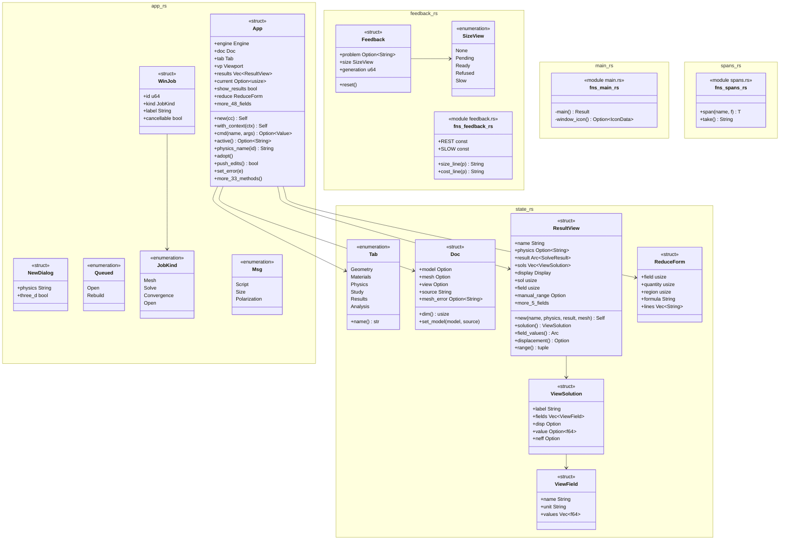

# Window: code

C4 level 4 (code) of the component **Window** (`app.window`) in the container **app** (crate `nyx`). [Component view of the container](../../3-components/app.md) · [All code pages](../README.md)

> The application object around one Engine: window layout, the run-time state (mesh on show, result on show, plot settings) and the frame update loop.

**Decisions:** [ADR 23](../../../adr/0023-app-is-a-thin-shell-over-one-project.md), [ADR 57](../../../adr/0057-front-ends-are-thin-the-mcp-tools-are-engine-commands.md), [ADR 92](../../../adr/0092-feedback-while-editing-is-a-value-never-a-job.md)  
**Size:** 5 files, 2800 lines.

## Files

| File | Lines | What it says about itself |
|---|---:|---|
| `crates/app/src/app.rs` | 2192 | The application: the state of the window around one `nyx_engine::Engine`, and the window layout. |
| `crates/app/src/feedback.rs` | 214 | Feedback while editing and while a result arrives (productivity plan P3, ADR 92): the project checked with the edits that are not applied yet, the size and cost of those edits from a trial mesh, and the polarization of a new result compu... |
| `crates/app/src/main.rs` | 120 | nyx: a desktop application for finite-element simulations (window with `eframe`/`egui`, solvers in the engine and the physics crates). |
| `crates/app/src/spans.rs` | 40 | Named timing spans for the frame log (productivity plan P3). `NYX_FRAME_LOG=<file>.csv` writes one row per frame; with spans, the row also says where the frame's time went (`poll=48.2;script=0.0;shell_ui=31.1`). A span is a name and the ... |
| `crates/app/src/state.rs` | 234 | The run-time state of the window around the engine's project: the mesh on show (`Doc`) and a result on show with its plot settings (`ResultView`). The project itself, with its geometry, mesh settings and one problem per physics, is `nyx_... |

## What it uses

| Target | Modules | Items |
|---|---|---|
| [container `connect` (nyx-connect)](../../3-components/connect.md) | config, env, server | Env, HostInfo, Status, connect, disconnect, find_server, list, plain_path, snippet |
| [container `engine` (nyx-engine)](../../3-components/engine.md) | crate root, engine, meshing, preview, process, project, queue, shared_queue +2 | Cancelled, Display, Domain, Engine, Failed, FeatureList, LabelResolver, MaterialAssign, MeshSettings, MeshedModel +16 |
| [container `script` (nyx-script)](../../3-components/script.md) | crate root | mcp_dir |
| [Scripts and batch](./headless.md) | pyscript | spawn |
| [Inspector tabs](./inspector.md) | geomui | State |
| [Shell and dashboard](./shell.md) | activity, examples, shell, sweepui | Active, Deferred, Shell, Start, band_colours, validation_state |
| [Look and widgets](./style.md) | cvd, fmt, kit, theme | Kind, State, accent, activity_text, apply, card, danger, edge, ink, install_fonts +7 |
| [Viewport](./viewport.md) | colormap, regions, viewport | Colormap, Content, Paint, Viewport, assign, keys_by_material, palette |

## Used by

| Component | Modules | Items |
|---|---|---|
| [Scripts and batch](./headless.md) | app, state | App, Msg |
| [Inspector tabs](./inspector.md) | app, spans, state | App, JobKind, span |
| [Shell and dashboard](./shell.md) | app, spans, state | App, JobKind, Tab, span |

## Class diagram

Public types with their public fields (or variants) and methods, free functions per file as a `module` box; arrows are field types and `impl Trait`. Capped at 36 types and a few members each; the table below is complete.

## Public items

| Kind | Item | File:line | Signature or summary |
|---|---|---|---|
| struct | `NewDialog` | `app.rs:28` | fields: `physics`, `three_d` —  Choices of the File &gt; New dialog. |
| enum | `Queued` | `app.rs:34` | variants: `Open`, `Rebuild` —  Work waiting for the running job to finish (the latest request wins). |
| enum | `JobKind` | `app.rs:41` | variants: `Mesh`, `Solve`, `Convergence`, `Open` —  What a running engine job is. |
| struct | `WinJob` | `app.rs:51` | fields: `id`, `kind`, `label`, `cancellable` —  A job of this window that waits in the engine's queue behind the running one (ADR 87). |
| enum | `Msg` | `app.rs:59` | variants: `Script`, `Size`, `Polarization` —  A message from a helper thread (the optional Python script) to the window. |
| struct | `App` | `app.rs:67` | fields: `engine`, `doc`, `tab`, `vp`, `results`, `current`, `show_results`, `reduce`, `tx`, `rx`, `busy`, `job`, ... |
| fn | `App::new` | `app.rs:154` | `pub fn new(cc: &eframe::CreationContext<'_>) -> Self` |
| fn | `App::with_context` | `app.rs:163` | `pub fn with_context(ctx: egui::Context) -> Self` —  The application state on an egui context; no window is needed (tests use a default context). It opens with the first example. |
| fn | `App::cmd` | `app.rs:242` | `pub fn cmd(&mut self, name: &str, args: Value) -> Option<Value>` —  Runs an engine command and reports its error in the status bar. `None` after an error. |
| fn | `App::active` | `app.rs:253` | `pub fn active(&self) -> Option<String>` —  The code of the active physics, if the project has one. |
| fn | `App::physics_name` | `app.rs:259` | `pub fn physics_name(&self, id: &str) -> String` —  The display name of a physics from its descriptor. |
| fn | `App::adopt` | `app.rs:264` | `pub fn adopt(&mut self)` —  The window's copies of what is edited (geometry, mesh settings) are taken from the engine's project: after a project was opened or made. |
| fn | `App::push_edits` | `app.rs:275` | `pub fn push_edits(&mut self) -> bool` —  Hands the geometry and mesh settings being edited to the engine. False (and an error shown) when the engine refuses them. |
| fn | `App::set_error` | `app.rs:309` | `pub fn set_error(&mut self, e: impl Into<String>)` |
| fn | `App::started` | `app.rs:316` | `pub(crate) fn started(&mut self, id: u64, kind: JobKind, label: String, cancellable: bool)` —  A job was submitted to the engine. With nothing running it is the running job; otherwise it waits in the queue behind it. |
| fn | `App::cancel_waiting` | `app.rs:349` | `pub fn cancel_waiting(&mut self, id: u64)` —  Cancels a job that waits in the queue (it never runs). |
| fn | `App::check_convergence` | `app.rs:359` | `pub fn check_convergence(&mut self)` —  Asks the running solve to stop (it does so at its next check; a factorisation in progress has to finish first). |
| fn | `App::can_queue_compute` | `app.rs:379` | `pub fn can_queue_compute(&self) -> bool` —  Whether a Compute can be asked for now: not while a results file is opened (it replaces the project), and in a workspace only when nothing |
| fn | `App::convergence_running` | `app.rs:394` | `pub fn convergence_running(&self) -> bool` —  True while a mesh convergence check runs. |
| fn | `App::stale_reason` | `app.rs:401` | `pub fn stale_reason(&self, i: usize) -> Option<&'static str>` —  Why the result at `i` is not up to date, in words, or `None` when it is current (productivity plan P1, ADR 84). It is stale when the engine |
| fn | `App::cancel_job` | `app.rs:467` | `pub fn cancel_job(&mut self)` |
| fn | `App::rebuild_mesh` | `app.rs:483` | `pub fn rebuild_mesh(&mut self)` |
| fn | `App::solve_in_child_processes` | `app.rs:500` | `pub fn solve_in_child_processes(&mut self)` —  Solves run in a child process (this program started with `--job`, see `nyx_engine::worker`), so a solve that runs out of memory or crashes |
| fn | `App::open_path` | `app.rs:509` | `pub fn open_path(&mut self, path: PathBuf)` |
| fn | `App::compute` | `app.rs:528` | `pub fn compute(&mut self)` —  Solves the active physics (with the physics it takes fields from), meshing first when the geometry or mesh settings changed. |
| fn | `App::take_solved` | `app.rs:662` | `pub(crate) fn take_solved(&mut self, summary: &Value)` —  A solve came back: the mesh it used, and one result view per physics it solved. |
| fn | `App::sync_rules` | `app.rs:743` | `pub fn sync_rules(&mut self)` —  Resolves the selectors of the conditions of the active physics to the boundary numbers of the mesh on show (to draw them and to |
| fn | `App::save_project` | `app.rs:767` | `pub fn save_project(&mut self, as_new: bool)` |
| fn | `App::export_script` | `app.rs:786` | `pub fn export_script(&mut self)` —  File &gt; Export as script: the project as a script that rebuilds it (`project_script`, ADR 94), written where an agent finds it by name, the |
| fn | `App::load_project` | `app.rs:807` | `pub fn load_project(&mut self, path: &std::path::Path)` |
| fn | `App::load_example` | `app.rs:820` | `pub fn load_example(&mut self, i: usize)` |
| fn | `App::result_csv` | `app.rs:835` | `pub fn result_csv(&self) -> Option<String>` —  CSV of the current solution: coordinates of every dof and all fields. |
| fn | `App::export_csv` | `app.rs:863` | `pub fn export_csv(&mut self)` |
| fn | `App::export_analysis` | `app.rs:876` | `pub fn export_analysis(&mut self, kind: &str)` —  Writes the polarization analysis of the result on show: `csv` (one row per mode) or `svg` (the Poincare sphere). |
| fn | `App::run_python_script` | `app.rs:892` | `pub fn run_python_script(&mut self)` |
| fn | `App::new_project` | `app.rs:912` | `pub fn new_project(&mut self, physics: &str, three_d: bool, what: &str)` —  Replaces the project by a new blank one (nothing is kept of the old geometry, conditions or results). |
| fn | `App::region_paint` | `app.rs:1215` | `pub fn region_paint(&self, view: &nyx_engine::facade::ViewMesh) -> crate::regions::Paint` —  The colour plan of the model on show (`regions.rs`): the regions of a 2D mesh keyed by material or by their own name (Settings: Colour regions |
| fn | `App::viewport_ui` | `app.rs:1245` | `pub fn viewport_ui(&mut self, ui: &mut egui::Ui)` |
| fn | `App::set_condition_on` | `app.rs:1337` | `pub fn set_condition_on(&mut self, i: usize, on: &str)` —  Sets the selector of condition `i` of the active physics (an edit of the problem through `set_problem`). |
| fn | `App::set_problem` | `app.rs:1347` | `pub fn set_problem(&mut self, physics: &str, spec: &nyx_engine::facade::physics::ProblemSpec)` —  Replaces the problem of a physics by `spec` (the Physics and Study tabs edit a copy and hand it back here). |
| const | `REST` | `feedback.rs:16` | `Duration` —  An edit rests this long before a trial mesh is made of it. |
| const | `SLOW` | `feedback.rs:18` | `f64` —  A trial mesh that takes longer than this (seconds) turns the automatic preview off: the rule of plan question 2 (about 100 ms). |
| enum | `SizeView` | `feedback.rs:22` | variants: `None`, `Pending`, `Ready`, `Refused`, `Slow` —  What the size line shows. |
| struct | `Feedback` | `feedback.rs:37` | fields: `problem`, `size`, `generation` —  The state of the feedback for the edits in the Geometry tab. |
| fn | `size_line` | `feedback.rs:180` | `pub fn size_line(p: &SizePreview) -> String` —  "About 2,442 cells, 2D". |
| fn | `cost_line` | `feedback.rs:185` | `pub fn cost_line(p: &SizePreview) -> String` —  What a solve of that size costs on this machine, from its own history, or why there is no number. |
| fn | `Feedback::reset` | `feedback.rs:53` | `pub fn reset(&mut self)` —  A project was adopted (loaded, new, an example): the edits are the project's own, ask again. |
| fn | `App::edits_changed` | `feedback.rs:60` | `pub fn edits_changed(&mut self, ctx: &egui::Context)` —  The edits of the Geometry tab changed (or were seen for the first time): check them at once, and ask for a trial mesh once they rest. |
| fn | `App::feedback_tick` | `feedback.rs:79` | `pub fn feedback_tick(&mut self, ctx: &egui::Context)` —  Called every frame the Geometry tab is drawn: the first look at a project's edits, and the trial mesh when an edit has rested. |
| fn | `App::start_size_preview` | `feedback.rs:93` | `pub fn start_size_preview(&mut self)` —  Starts the trial mesh of the edits on its own thread (also what the "Estimate size" button does after a slow one). |
| fn | `App::take_size` | `feedback.rs:112` | `pub fn take_size(&mut self, generation: u64, out: Result<SizePreview, String>)` —  An answer of a trial mesh came back. |
| fn | `App::start_polarization` | `feedback.rs:127` | `pub fn start_polarization(&mut self, physics: &str)` —  The polarization of the result that was just taken, computed beside the frame and handed back through the window's channel. |
| fn | `App::take_polarization` | `feedback.rs:138` | `pub fn take_polarization(&mut self, physics: &str, result: &std::sync::Arc<nyx_engine::facade::physics::SolveResult>, analysis: Result<nyx_engine::analysis::ModeAnalysis, String>)` —  The analysis arrived: it belongs to the result view that holds the very result it was made from, if that is still on screen. |
| fn | `App::feedback_lines` | `feedback.rs:147` | `pub fn feedback_lines(&mut self, ui: &mut Ui)` —  The problem line and the size line under the Build mesh button. |
| fn | `main` | `main.rs:38` | `fn main() -> eframe::Result` |
| fn | `window_icon` | `main.rs:115` | `fn window_icon() -> Option<eframe::egui::IconData>` —  The nyx mark as the icon of the window (title bar, taskbar, Alt+Tab): the same picture as the top bar, scaled once with a good filter. |
| fn | `span` | `spans.rs:19` | `pub fn span<T>(name: &'static str, f: impl FnOnce() -> T) -> T` —  Runs `f` and, when the frame log is on, adds `name` with the milliseconds it took to this frame's spans (the same name twice in a frame adds up). |
| fn | `take` | `spans.rs:37` | `pub fn take() -> String` —  The spans of this frame as `name=ms;name=ms`, and the list is emptied for the next frame. |
| enum | `Tab` | `state.rs:12` | variants: `Geometry`, `Materials`, `Physics`, `Study`, `Results`, `Analysis` |
| struct | `Doc` | `state.rs:38` | fields: `model`, `mesh`, `view`, `source`, `mesh_error` —  The mesh on show and what we know about its origin. |
| struct | `ViewField` | `state.rs:65` | fields: `name`, `unit`, `values` —  A field in the flat form the window reads: scalars keep their name, a vector `E` is `\|E\|`, `Ex`, `Ez`. |
| struct | `ViewSolution` | `state.rs:73` | fields: `label`, `fields`, `disp`, `value`, `neff` —  One solution of a result in the form the window reads. |
| struct | `ResultView` | `state.rs:113` | fields: `name`, `physics`, `result`, `sols`, `display`, `sol`, `field`, `manual_range`, `warp`, `auto_warp`, `values_cache`, `disp_cache`, ... —  One result on display, with the plot settings. |
| struct | `ReduceForm` | `state.rs:226` | fields: `field`, `quantity`, `region`, `formula`, `lines` —  What the Reduce form of the Results tab remembers: the field, the quantity (the value, its modulus or its squared modulus), the region |
| fn | `Tab::name` | `state.rs:24` | `pub fn name(self) -> &'static str` |
| fn | `Doc::dim` | `state.rs:49` | `pub fn dim(&self) -> usize` |
| fn | `Doc::set_model` | `state.rs:53` | `pub fn set_model(&mut self, model: Arc<MeshedModel>, source: &str)` |
| fn | `ResultView::new` | `state.rs:132` | `pub fn new(name: String, physics: Option<String>, result: Arc<SolveResult>, mesh: &SimplexMesh) -> Self` |
| fn | `ResultView::solution` | `state.rs:151` | `pub fn solution(&self) -> &ViewSolution` |
| fn | `ResultView::field_values` | `state.rs:155` | `pub fn field_values(&mut self) -> Arc<Vec<f32>>` |
| fn | `ResultView::displacement` | `state.rs:170` | `pub fn displacement(&mut self) -> Option<Arc<Vec<f32>>>` —  Displacement of each display point (3 values each) of the current solution. |
| fn | `ResultView::range` | `state.rs:190` | `pub fn range(&mut self) -> (f32, f32)` |

Trait implementations in this component: `App: App`
