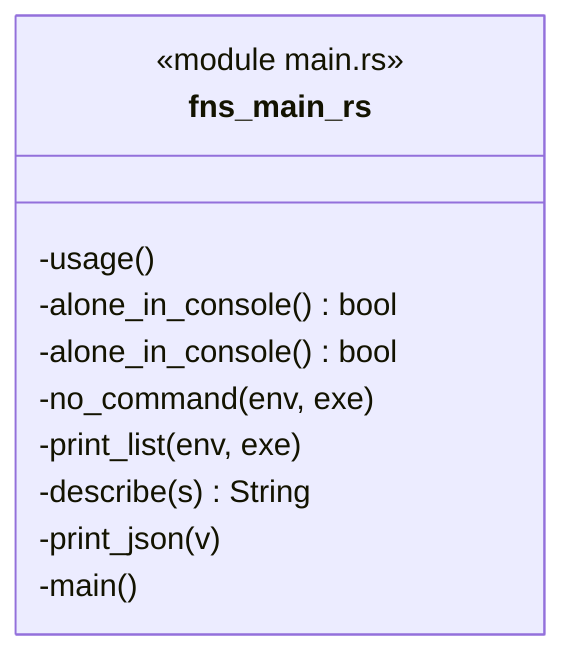

# Command line: code

C4 level 4 (code) of the component **Command line** (`connect.cli`) in the container **nyx-connect** (crate `nyx_connect`). [Component view of the container](../../3-components/connect.md) · [All code pages](../README.md)

> The command-line twin of the Connect menu: list, connect, disconnect, test, optionally as JSON.

**Decisions:** [ADR 28](../../../adr/0028-nyx-connect-is-one-crate-with-a-versioned-report.md)  
**Size:** 1 file, 170 lines.

## Files

| File | Lines | What it says about itself |
|---|---:|---|
| `crates/nyx-connect/src/main.rs` | 170 | `nyx-connect`: the command-line twin of the app's Connect menu. It writes nothing unless you say connect/disconnect. `--json` prints the versioned report of `nyx_connect::report` instead of text (contract `connect_report`). |

## What it uses

| Target | Modules | Items |
|---|---|---|
| [Host config](./config.md) | config | Status, connect, disconnect, list |
| [Host table](./hosts.md) | env | Env |
| [Report](./report.md) | report | change_report, change_row, list_report, test_report |
| [Server probe](./server.md) | server | agent_instructions, claude_code_command, server_exe, snippet, test_server |

## Used by

Nothing else in the workspace names this component (entry points are reached by the program or by tests).

## Class diagram

Public types with their public fields (or variants) and methods, free functions per file as a `module` box; arrows are field types and `impl Trait`. Capped at 36 types and a few members each; the table below is complete.

## Public items

| Kind | Item | File:line | Signature or summary |
|---|---|---|---|
| fn | `usage` | `main.rs:6` | `fn usage()` |
| fn | `alone_in_console` | `main.rs:15` | `fn alone_in_console() -> bool` —  True when this program is the only one attached to its console, which is what a double click in the file explorer does: the window would |
| fn | `alone_in_console` | `main.rs:25` | `fn alone_in_console() -> bool` |
| fn | `no_command` | `main.rs:30` | `fn no_command(env: &Env, exe: &std::path::Path)` —  What a double click shows: the commands and where nyx stands now, then the window stays until Enter. |
| fn | `print_list` | `main.rs:42` | `fn print_list(env: &Env, exe: &std::path::Path)` |
| fn | `describe` | `main.rs:49` | `fn describe(s: &Status) -> String` |
| fn | `print_json` | `main.rs:59` | `fn print_json(v: &serde_json::Value)` |
| fn | `main` | `main.rs:63` | `fn main()` |
