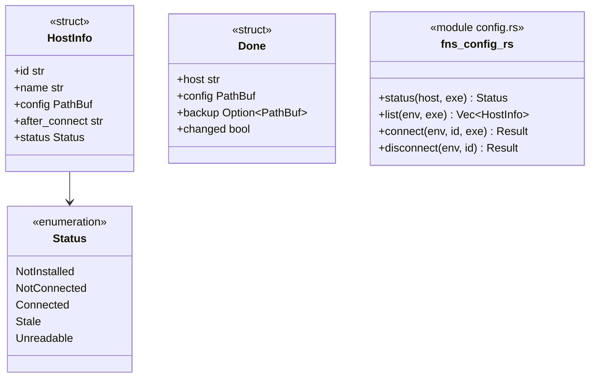

# Host config: code

C4 level 4 (code) of the component **Host config** (`connect.config`) in the container **nyx-connect** (crate `nyx_connect`). [Component view of the container](../../3-components/connect.md) · [All code pages](../README.md)

> Reads and rewrites a host's JSON config: status of the nyx entry, connect, disconnect, list.

**Decisions:** [ADR 28](../../../adr/0028-nyx-connect-is-one-crate-with-a-versioned-report.md)  
**Size:** 1 file, 174 lines.

## Files

| File | Lines | What it says about itself |
|---|---:|---|
| `crates/nyx-connect/src/config.rs` | 174 |  |

## What it uses

| Target | Modules | Items |
|---|---|---|
| [Host table](./hosts.md) | env | Env |
| [Report](./report.md) | crate root | ENTRY |

## Used by

| Component | Modules | Items |
|---|---|---|
| [app: Window](../app/window.md) | config | HostInfo, Status, connect, disconnect, list |
| [Command line](./cli.md) | config | Status, connect, disconnect, list |
| [Report](./report.md) | config | Done, HostInfo, Status, connect, disconnect, list, status |

## Class diagram

Public types with their public fields (or variants) and methods, free functions per file as a `module` box; arrows are field types and `impl Trait`. Capped at 36 types and a few members each; the table below is complete.

## Public items

| Kind | Item | File:line | Signature or summary |
|---|---|---|---|
| enum | `Status` | `config.rs:19` | variants: `NotInstalled`, `NotConnected`, `Connected`, `Stale`, `Unreadable` |
| struct | `HostInfo` | `config.rs:33` | fields: `id`, `name`, `config`, `after_connect`, `status` |
| struct | `Done` | `config.rs:43` | fields: `host`, `config`, `backup`, `changed` —  What a [`connect`] or [`disconnect`] did. |
| fn | `status` | `config.rs:51` | `pub fn status(host: &Host, exe: &Path) -> Status` |
| fn | `list` | `config.rs:72` | `pub fn list(env: &Env, exe: &Path) -> Vec<HostInfo>` —  Every host with its status, for a settings panel. |
| fn | `connect` | `config.rs:109` | `pub fn connect(env: &Env, id: &str, exe: &Path) -> Result<Done, String>` —  Adds or updates the `nyx` entry. Other servers and settings in the file are kept, in their order, and so are keys the user added to the |
| fn | `disconnect` | `config.rs:129` | `pub fn disconnect(env: &Env, id: &str) -> Result<Done, String>` —  Removes the `nyx` entry and leaves everything else. |
