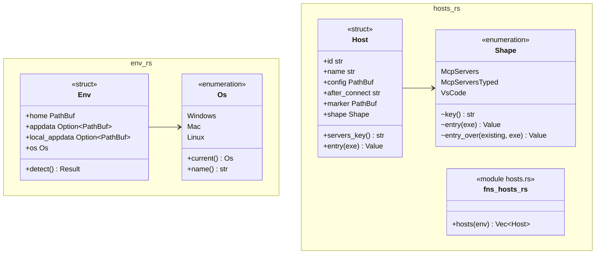

# Host table: code

C4 level 4 (code) of the component **Host table** (`connect.hosts`) in the container **nyx-connect** (crate `nyx_connect`). [Component view of the container](../../3-components/connect.md) · [All code pages](../README.md)

> Where each AI host (Claude Code, Claude Desktop, ...) keeps its MCP config and what an entry looks like; the home folder, application-data folders and the operating system.

**Decisions:** [ADR 28](../../../adr/0028-nyx-connect-is-one-crate-with-a-versioned-report.md)  
**Size:** 2 files, 219 lines.

## Files

| File | Lines | What it says about itself |
|---|---:|---|
| `crates/nyx-connect/src/env.rs` | 53 |  |
| `crates/nyx-connect/src/hosts.rs` | 166 |  |

## What it uses

Nothing outside the component (the standard library and external crates are not listed).

## Used by

| Component | Modules | Items |
|---|---|---|
| [app: Window](../app/window.md) | env | Env |
| [Command line](./cli.md) | env | Env |
| [Host config](./config.md) | env | Env |
| [Report](./report.md) | env | Env, Os |
| [Server probe](./server.md) | env | Env |

## Class diagram

Public types with their public fields (or variants) and methods, free functions per file as a `module` box; arrows are field types and `impl Trait`. Capped at 36 types and a few members each; the table below is complete.

## Public items

| Kind | Item | File:line | Signature or summary |
|---|---|---|---|
| struct | `Env` | `env.rs:8` | fields: `home`, `appdata`, `local_appdata`, `os` |
| enum | `Os` | `env.rs:18` | variants: `Windows`, `Mac`, `Linux` |
| fn | `Os::current` | `env.rs:26` | `pub fn current() -> Os` —  The operating system this program was built for. |
| fn | `Os::name` | `env.rs:37` | `pub fn name(self) -> &'static str` —  Lower-case name used in the reports and the contract exemplar. |
| fn | `Env::detect` | `env.rs:47` | `pub fn detect() -> Result<Env, String>` |
| enum | `Shape` | `hosts.rs:12` | variants: `McpServers`, `McpServersTyped`, `VsCode` —  How a host stores MCP servers in its JSON file. |
| struct | `Host` | `hosts.rs:53` | fields: `id`, `name`, `config`, `after_connect`, `marker`, `shape` —  A host nyx knows how to connect to. |
| fn | `hosts` | `hosts.rs:78` | `pub fn hosts(env: &Env) -> Vec<Host>` —  All hosts, with their paths for this machine, in a fixed order. |
| fn | `Shape::key` | `hosts.rs:23` | `pub(crate) fn key(self) -> &'static str` —  The key of the file's object that holds the servers. |
| fn | `Shape::entry` | `hosts.rs:31` | `pub(crate) fn entry(self, exe: &Path) -> Value` —  The entry for `exe` as a fresh file would get it. |
| fn | `Shape::entry_over` | `hosts.rs:37` | `pub(crate) fn entry_over(self, existing: Option<&Value>, exe: &Path) -> Value` —  The entry for `exe`, built on the one already in the file: the keys nyx owns (`type`, `command`, `args`) are set, every other key the |
| fn | `Host::servers_key` | `hosts.rs:67` | `pub fn servers_key(&self) -> &'static str` —  The key of the config file's top-level object under which the servers are kept (`mcpServers`, or `servers` for VS Code). |
| fn | `Host::entry` | `hosts.rs:72` | `pub fn entry(&self, exe: &Path) -> Value` —  The entry written for `exe` into an empty config. |
