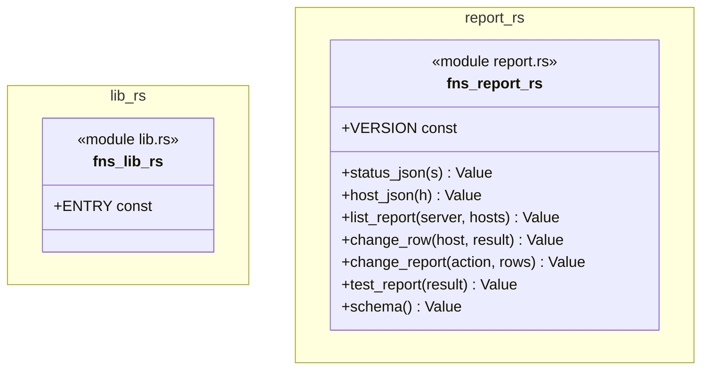

# Report: code

C4 level 4 (code) of the component **Report** (`connect.report`) in the container **nyx-connect** (crate `nyx_connect`). [Component view of the container](../../3-components/connect.md) · [All code pages](../README.md)

> The machine-readable form of what nyx-connect finds and does, with its JSON Schema.

**Decisions:** [ADR 28](../../../adr/0028-nyx-connect-is-one-crate-with-a-versioned-report.md), [ADR 19](../../../adr/0019-versioned-interface-contracts.md)  
**Size:** 2 files, 189 lines.

## Files

| File | Lines | What it says about itself |
|---|---:|---|
| `crates/nyx-connect/src/lib.rs` | 30 |  |
| `crates/nyx-connect/src/report.rs` | 159 |  |

## What it uses

| Target | Modules | Items |
|---|---|---|
| [Host config](./config.md) | config | Done, HostInfo, Status, connect, disconnect, disconnect_matching, list, status |
| [Host table](./hosts.md) | env | Env, Os |
| [Server probe](./server.md) | server | ServerInfo, agent_instructions, claude_code_command, find_server, find_server_with, is_cargo_build_tree, plain_path, server_exe, snippet, test_server +2 |

## Used by

| Component | Modules | Items |
|---|---|---|
| [Command line](./cli.md) | report | change_report, change_row, list_report, test_report |
| [Host config](./config.md) | crate root | ENTRY |
| [Server probe](./server.md) | crate root | ENTRY |

## Class diagram

Public types with their public fields (or variants) and methods, free functions per file as a `module` box; arrows are field types and `impl Trait`. Capped at 36 types and a few members each; the table below is complete.

## Public items

| Kind | Item | File:line | Signature or summary |
|---|---|---|---|
| const | `ENTRY` | `lib.rs:29` | `&str` —  The name of the entry written into every host's config. |
| const | `VERSION` | `report.rs:18` | `u64` —  The major version written into every report. |
| fn | `status_json` | `report.rs:28` | `pub fn status_json(s: &Status) -> Value` —  `{"state": ..., "found"?: ..., "why"?: ...}`; `state` is one of `not_installed`, `not_connected`, `connected`, `stale`, `unreadable`. |
| fn | `host_json` | `report.rs:38` | `pub fn host_json(h: &HostInfo) -> Value` |
| fn | `list_report` | `report.rs:43` | `pub fn list_report(server: &Path, hosts: &[HostInfo]) -> Value` —  The `list` report. `server_found` says whether `server` is a file. |
| fn | `change_row` | `report.rs:52` | `pub fn change_row(host: &str, result: &Result<Done, String>) -> Value` —  One row of a `change` report. |
| fn | `change_report` | `report.rs:60` | `pub fn change_report(action: &str, rows: Vec<Value>) -> Value` —  The `change` report; `action` is `connect` or `disconnect`. |
| fn | `test_report` | `report.rs:68` | `pub fn test_report(result: &Result<ServerInfo, String>) -> Value` —  The `test` report. |
| fn | `schema` | `report.rs:86` | `pub fn schema() -> Value` —  The JSON Schema (2020-12) of the three reports: a `oneOf` over `#/$defs/list`, `#/$defs/change` and `#/$defs/test`. |
