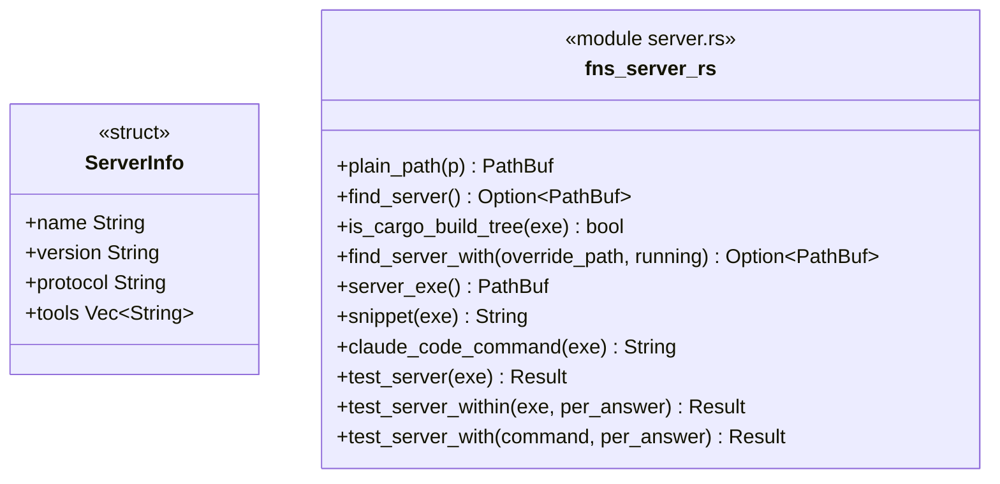

# Server probe: code

C4 level 4 (code) of the component **Server probe** (`connect.server`) in the container **nyx-connect** (crate `nyx_connect`). [Component view of the container](../../3-components/connect.md) · [All code pages](../README.md)

> Finds the nyx-mcp program, builds the snippet for a host that is not in the table, and does a real MCP handshake against it.

**Decisions:** [ADR 28](../../../adr/0028-nyx-connect-is-one-crate-with-a-versioned-report.md)  
**Size:** 1 file, 141 lines.

## Files

| File | Lines | What it says about itself |
|---|---:|---|
| `crates/nyx-connect/src/server.rs` | 141 | The `nyx-mcp` program: where it is, what to paste for a host that is not in the table, and a real MCP handshake against it. |

## What it uses

| Target | Modules | Items |
|---|---|---|
| [Report](./report.md) | crate root | ENTRY |

## Used by

| Component | Modules | Items |
|---|---|---|
| [app: Window](../app/window.md) | server | find_server, plain_path, snippet |
| [Command line](./cli.md) | server | claude_code_command, server_exe, snippet, test_server |
| [Report](./report.md) | server | ServerInfo, claude_code_command, find_server, find_server_with, is_cargo_build_tree, plain_path, server_exe, snippet +3 |

## Class diagram

Public types with their public fields (or variants) and methods, free functions per file as a `module` box; arrows are field types and `impl Trait`. Capped at 36 types and a few members each; the table below is complete.

## Public items

| Kind | Item | File:line | Signature or summary |
|---|---|---|---|
| fn | `plain_path` | `server.rs:21` | `pub fn plain_path(p: PathBuf) -> PathBuf` —  Drops the `\\?\` prefix `canonicalize` puts on Windows paths (the hosts start the program by this path). |
| fn | `find_server` | `server.rs:29` | `pub fn find_server() -> Option<PathBuf>` —  Looks for `nyx-mcp` in the path `NYX_MCP` and next to the running program; in a cargo build tree also around it (see [`find_server_with`]). |
| fn | `is_cargo_build_tree` | `server.rs:34` | `pub fn is_cargo_build_tree(exe: &Path) -> bool` —  True when `exe` was built by cargo in place: its folder holds cargo's `deps` and `.fingerprint` folders. A shipped program is never in one. |
| fn | `find_server_with` | `server.rs:43` | `pub fn find_server_with(override_path: Option<OsString>, running: Option<&Path>) -> Option<PathBuf>` —  [`find_server`] with its two inputs given: the value of `NYX_MCP` and the path of the running program. The first existing file wins: |
| fn | `server_exe` | `server.rs:64` | `pub fn server_exe() -> PathBuf` —  Where `nyx-mcp` should be, found or not: the path in `NYX_MCP` as given, else what [`find_server`] finds, else next to the running |
| fn | `snippet` | `server.rs:72` | `pub fn snippet(exe: &Path) -> String` —  The JSON a user can paste into any host that is not listed. |
| fn | `claude_code_command` | `server.rs:77` | `pub fn claude_code_command(exe: &Path) -> String` —  The `claude mcp add` line for Claude Code, for people who prefer the command. |
| struct | `ServerInfo` | `server.rs:82` | fields: `name`, `version`, `protocol`, `tools` |
| fn | `test_server` | `server.rs:90` | `pub fn test_server(exe: &Path) -> Result<ServerInfo, String>` —  Starts the server like a host would, asks `initialize` and `tools/list`, and stops it. Each answer may take 10 s. |
| fn | `test_server_within` | `server.rs:95` | `pub fn test_server_within(exe: &Path, per_answer: Duration) -> Result<ServerInfo, String>` —  [`test_server`] with the time one answer may take. |
| fn | `test_server_with` | `server.rs:100` | `pub fn test_server_with(mut command: Command, per_answer: Duration) -> Result<ServerInfo, String>` —  [`test_server_within`] for a command the caller prepared (arguments, environment). Its standard streams are replaced. |
