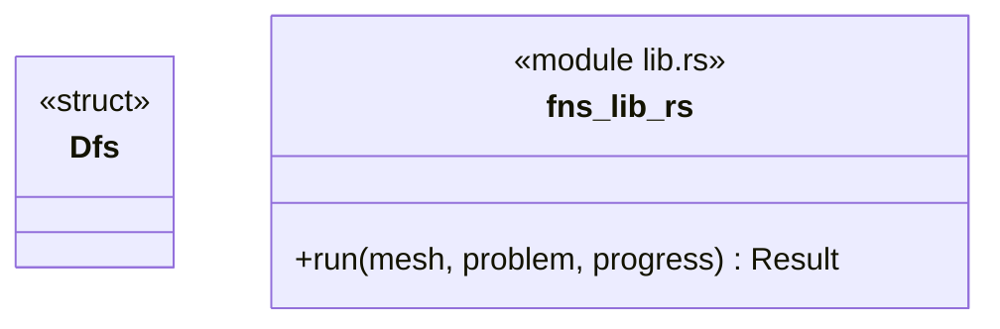

# Physics adapter: code

C4 level 4 (code) of the component **Physics adapter** (`dfs.adapter`) in the container **nyx-dfs** (crate `nyx_dfs`). [Component view of the container](../../3-components/dfs.md) · [All code pages](../README.md)

> The Physics implementation of dfs: descriptors, validation, solve entry.

**Decisions:** [ADR 41](../../../adr/0041-physics-crate-pattern-and-the-legacy-bridge.md), [ADR 25](../../../adr/0025-physics-trait-registry-and-problem-envelope.md)  
**Size:** 1 file, 219 lines.

## Files

| File | Lines | What it says about itself |
|---|---:|---|
| `crates/nyx-dfs/src/lib.rs` | 219 |  |

## What it uses

| Target | Modules | Items |
|---|---|---|
| [container `femcore` (femcore)](../../3-components/femcore.md) | material::spec, progress | Library, Progress |
| [container `physics` (nyx-physics)](../../3-components/physics.md) | crate root |  |
| [Electrostatics kernel](./electro.md) | electro | EPS0, ElectroAssembly, assemble_electrostatics, electrostatics_fields, solve_electrostatics, solve_potential |
| [Heat kernel](./heat.md) | heat | HeatStates, HeatSystem, assemble_heat, heat_fields, solve_heat, solve_heat_states |
| [Typed problem](./problem.md) | problem | Bc, BcKind, Problem, Study, decode |

## Used by

| Component | Modules | Items |
|---|---|---|
| [Typed problem](./problem.md) | crate root | Dfs |
| [engine: Registry and facade](../engine/registry.md) | crate root | Dfs |

## Class diagram

Public types with their public fields (or variants) and methods, free functions per file as a `module` box; arrows are field types and `impl Trait`. Capped at 36 types and a few members each; the table below is complete.

## Public items

| Kind | Item | File:line | Signature or summary |
|---|---|---|---|
| struct | `Dfs` | `lib.rs:27` |  |
| fn | `run` | `lib.rs:195` | `pub fn run(mesh: &Mesh, problem: &Problem, progress: &Arc<Progress>) -> Result<SolveResult, Error>` —  Solves a typed problem: checks the numbers, runs the kernel of the study under `progress` (stage log, cancellation) and appends the |

Trait implementations in this component: `Dfs: Physics`
