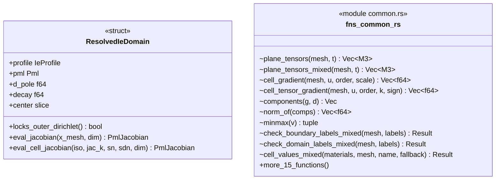

# Shared helpers: code

C4 level 4 (code) of the component **Shared helpers** (`dfs.common`) in the container **nyx-dfs** (crate `nyx_dfs`). [Component view of the container](../../3-components/dfs.md) · [All code pages](../README.md)

> Per-cell gradients and values shared by the heat and electrostatics kernels.

**Decisions:** [ADR 41](../../../adr/0041-physics-crate-pattern-and-the-legacy-bridge.md)  
**Size:** 1 file, 1596 lines.

## Files

| File | Lines | What it says about itself |
|---|---:|---|
| `crates/nyx-dfs/src/common.rs` | 1596 |  |

## What it uses

| Target | Modules | Items |
|---|---|---|
| [container `femcore` (femcore)](../../3-components/femcore.md) | farfield, fem, fem_mixed, fields, linalg::csr, linalg::csr::assembly, linalg::driver, material +4 | Anisotropy, C, Coo, DirectSolver, FacetType, FarFieldPermittivity, IsoparametricCell, JacobianEval, LagrangeSpace, LinearSolver +25 |
| [container `physics` (nyx-physics)](../../3-components/physics.md) | crate root, result | Discretisation, MixedToSimplexProjector |
| [Typed problem](./problem.md) | problem | BcKind, IeCoordKind, IeProfile, InfiniteElementSpec, Problem |

## Used by

| Component | Modules | Items |
|---|---|---|
| [Electrostatics kernel](./electro.md) | common | assemble_boundary_load_mixed, assemble_farfield_robin_mixed, assemble_ie_outer_robin_mixed, assemble_laplace_ie_mixed, assemble_source_mixed, cell_gradient, cell_tensor_mixed, cell_values_mixed +12 |
| [Heat kernel](./heat.md) | common | assemble_boundary_load_mixed, assemble_boundary_mass_mixed, assemble_farfield_robin_mixed, assemble_ie_outer_robin_mixed, assemble_laplace_ie_mixed, assemble_source_mixed, cell_tensor_gradient, cell_tensor_mixed +11 |
| [Magnetostatics kernel](./magneto.md) | common | ResolvedIeDomain, assemble_boundary_load_mixed, assemble_boundary_mass_mixed, assemble_farfield_robin_mixed, assemble_ie_outer_robin_mixed, assemble_laplace_ie_mixed, boundary_measure_mixed, build_facet_to_cell_mixed +10 |

## Class diagram

Public types with their public fields (or variants) and methods, free functions per file as a `module` box; arrows are field types and `impl Trait`. Capped at 36 types and a few members each; the table below is complete.

## Public items

| Kind | Item | File:line | Signature or summary |
|---|---|---|---|
| fn | `plane_tensors` | `common.rs:28` | `pub(crate) fn plane_tensors(mesh: &Discretisation, t: Vec<M3>) -> Vec<M3>` —  The wafer tensors of the cells in the axes of the mesh (on a cross-section the x-z block comes first, see `section::plane_tensor`). |
| fn | `plane_tensors_mixed` | `common.rs:33` | `pub(crate) fn plane_tensors_mixed(mesh: &MixedDiscretisation, t: Vec<M3>) -> Vec<M3>` —  The wafer tensors of the cells of a [`MixedDiscretisation`] in the axes of the mesh. |
| fn | `cell_gradient` | `common.rs:38` | `pub(crate) fn cell_gradient(mesh: &Discretisation, u: &[f64], order: usize, scale: &[f64]) -> Vec<f64>` —  `scale[c] * grad u` at the local dofs of every cell, not averaged: `g[(c*nloc + a)*dim + k]`. |
| fn | `cell_tensor_gradient` | `common.rs:53` | `pub(crate) fn cell_tensor_gradient(mesh: &Discretisation, u: &[f64], order: usize, k: &[M3], sign: f64) -> Vec<f64>` —  `sign * K grad(u)` at the local dofs of every cell, not averaged, `dim` values per local dof. |
| fn | `components` | `common.rs:69` | `pub(crate) fn components(g: &[f64], d: usize) -> Vec<Vec<f64>>` |
| fn | `norm_of` | `common.rs:73` | `pub(crate) fn norm_of(comps: &[Vec<f64>]) -> Vec<f64>` |
| fn | `minmax` | `common.rs:77` | `pub(crate) fn minmax(v: &[f64]) -> (f64, f64)` |
| fn | `check_boundary_labels_mixed` | `common.rs:83` | `pub(crate) fn check_boundary_labels_mixed( mesh: &MixedDiscretisation, labels: impl IntoIterator<Item = i32>, ) -> Result<(), String>` |
| fn | `check_domain_labels_mixed` | `common.rs:96` | `pub(crate) fn check_domain_labels_mixed( mesh: &MixedDiscretisation, labels: impl IntoIterator<Item = i32>, ) -> Result<(), String>` |
| fn | `cell_values_mixed` | `common.rs:109` | `pub(crate) fn cell_values_mixed( materials: &Materials, mesh: &MixedDiscretisation, name: &str, fallback: Option<f64>, ) -> Result<Vec<f64>, String>` |
| fn | `cell_tensor_mixed` | `common.rs:123` | `pub(crate) fn cell_tensor_mixed( materials: &Materials, mesh: &MixedDiscretisation, kind: TensorKind, fallback: Option<f64>, ) -> Result<Vec<M3>, String>` |
| struct | `ResolvedIeDomain` | `common.rs:189` | fields: `profile`, `pml`, `d_pole`, `decay`, `center` —  Resolved per-domain Infinite Element geometry and stretching parameters. |
| fn | `resolve_ie_domains_mixed` | `common.rs:491` | `pub(crate) fn resolve_ie_domains_mixed( mesh: &MixedDiscretisation, spec: &Problem, ) -> Result<BTreeMap<i32, ResolvedIeDomain>, String>` —  Resolves all domain-applied `BcKind::InfiniteElement` (and `spec.materials.pml`) entries against `mesh`. |
| fn | `build_facet_to_cell_mixed` | `common.rs:775` | `pub(crate) fn build_facet_to_cell_mixed(mesh: &MixedDiscretisation) -> Vec<Option<usize>>` —  Maps each exterior facet `f` of `mesh` to its owning cell index `c_f`. |
| fn | `classify_ie_outer_facets_mixed` | `common.rs:844` | `pub(crate) fn classify_ie_outer_facets_mixed( mesh: &MixedDiscretisation, ie_map: &BTreeMap<i32, ResolvedIeDomain>, ) -> (Vec<usize>, Vec<(usize, usize, f64)>)` —  Classifies outer exterior facets of Infinite Element domains into: |
| fn | `assemble_laplace_ie_mixed` | `common.rs:891` | `pub(crate) fn assemble_laplace_ie_mixed( mesh: &MixedDiscretisation, dof_map: &MixedLagrangeDofMap, coeff: &[f64], tensor: Option<&[M3]>, ie_map: &BTreeMap<i32, ResolvedIeDomain>, ) -> Csr` —  Assembles scalar Laplace stiffness `K_{ab} = \int (\mathbf{J}_{IE}^{-T}\nabla\phi_a)^T \mathbf{K}_c (\mathbf{J}_{IE}^{-T}\nabla\phi_b) \|\det\mathbf{J}_{IE}\| dV` |
| fn | `assemble_source_mixed` | `common.rs:984` | `pub(crate) fn assemble_source_mixed( mesh: &MixedDiscretisation, dof_map: &MixedLagrangeDofMap, source: &[f64], ) -> Vec<f64>` —  Assembles volumetric source vector `f_a = \int_\Omega source(c) \phi_a dV` over a [`MixedDiscretisation`]. |
| fn | `assemble_boundary_load_mixed` | `common.rs:1020` | `pub(crate) fn assemble_boundary_load_mixed( mesh: &MixedDiscretisation, dof_map: &MixedLagrangeDofMap, labels: &[i32], value: f64, ) -> Vec<f64>` —  Assembles boundary load `f_a = \int_{\Gamma(labels)} value * \phi_a dS` over facets of a [`MixedDiscretisation`]. |
| fn | `assemble_boundary_mass_mixed` | `common.rs:1052` | `pub(crate) fn assemble_boundary_mass_mixed( mesh: &MixedDiscretisation, dof_map: &MixedLagrangeDofMap, labels: &[i32], coeff: f64, ) -> Csr` —  Assembles boundary mass matrix `M_{ab} = \int_{\Gamma(labels)} coeff * \phi_a \phi_b dS` over facets of a [`MixedDiscretisation`]. |
| fn | `boundary_measure_mixed` | `common.rs:1092` | `pub(crate) fn boundary_measure_mixed(mesh: &MixedDiscretisation, labels: &[i32]) -> f64` —  Total boundary measure (length in 2D, area in 3D) of facets matching `labels`. |
| fn | `farfield_centroid_mixed` | `common.rs:1146` | `pub(crate) fn farfield_centroid_mixed(mesh: &MixedDiscretisation, labels: &[i32]) -> [f64` —  Deterministic area/length-weighted centroid of facets matching `labels` on a [`MixedDiscretisation`]. |
| fn | `farfield_positive_measure_mixed` | `common.rs:1174` | `pub(crate) fn farfield_positive_measure_mixed(mesh: &MixedDiscretisation, labels: &[i32], center: [f64; 3]) -> f64` —  Outward-facing positive measure of facets matching `labels` with respect to `center` on a [`MixedDiscretisation`]. |
| fn | `assemble_farfield_robin_mixed` | `common.rs:1289` | `pub(crate) fn assemble_farfield_robin_mixed( mesh: &MixedDiscretisation, dof_map: &MixedLagrangeDofMap, labels: &[i32], bc_order: usize, decay_power: f64, center: [f64; 3], scale0: f64, perm: FarFieldPermittivity<'_>, ) -> Csr` —  Assembles Order-1 or 3D Order-2 Laplace–Beltrami `far_field` Robin boundary stiffness on a [`MixedDiscretisation`] |
| fn | `assemble_ie_outer_robin_mixed` | `common.rs:1442` | `pub(crate) fn assemble_ie_outer_robin_mixed( mesh: &MixedDiscretisation, dof_map: &MixedLagrangeDofMap, exp_facets: &[(usize, usize, f64)], ie_map: &BTreeMap<i32, ResolvedIeDomain>, scale0: f64, perm: FarFieldPermittivity<'_>, ) -> Csr` —  Assembles automatic Order-1 `far_field` Robin on the outer facets of `Exponential` (or Cartesian) Infinite Element domains. |
| fn | `solve_spd_mixed` | `common.rs:1506` | `pub(crate) fn solve_spd_mixed( _solver_pref: LinearSolver, k: &Csr, f: &[f64], fixed: &[usize], vals: &[f64], ) -> Result<(Vec<f64>, Option<String>), String>` —  Solves a real SPD system `K u = f` with Dirichlet constraints `(fixed, vals)` on a [`MixedDiscretisation`]. |
| fn | `sample_mixed_gradients_on_simplex` | `common.rs:1541` | `pub(crate) fn sample_mixed_gradients_on_simplex( mesh: &MixedDiscretisation, dof_map: &MixedLagrangeDofMap, proj: &MixedToSimplexProjector, u_mixed: &[f64], tensor: Option<&[M3]>, scale: &[f64], target_order: usize, ) -> Vec<f64>` —  Evaluates `scale[mc] * (tensor[mc] * \nabla_x u)` on the native parent cells of `mesh` at every |
| fn | `ResolvedIeDomain::locks_outer_dirichlet` | `common.rs:200` | `pub fn locks_outer_dirichlet(&self) -> bool` —  Whether the outer boundary (`t = 1`, mapped to `\tilde{R} = \infty`) should be clamped to the |
| fn | `ResolvedIeDomain::eval_jacobian` | `common.rs:209` | `pub fn eval_jacobian(&self, x_mesh: [f64; 3], dim: usize) -> PmlJacobian` —  Evaluates the real coordinate-stretching Jacobian `J_IE(x_q)` at mesh point `x_mesh` (`[x, z, 0]` in 2D, `[x, y, z]` in 3D). |
| fn | `ResolvedIeDomain::eval_cell_jacobian` | `common.rs:229` | `pub fn eval_cell_jacobian( &self, iso: &IsoparametricCell, jac_k: &femcore::fem_mixed::JacobianEval, sn: &[f64], sdn: &[[f64; 3]], dim: usize, ) -> PmlJacobian` —  Evaluates the coordinate-stretching Jacobian `J_IE` at quadrature point `jac_k` of cell `iso`, |
