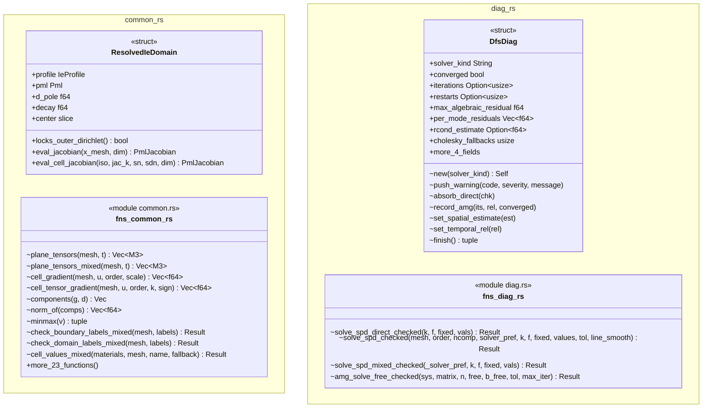

# Shared helpers: code

C4 level 4 (code) of the component **Shared helpers** (`dfs.common`) in the container **nyx-dfs** (crate `nyx_dfs`). [Component view of the container](../../3-components/dfs.md) · [All code pages](../README.md)

> Per-cell gradients, curved helpers, `SolverDiagnostics`/`NumericalErrorBudget` builder, and values shared by the heat, electrostatics, and magnetostatics kernels.

**Decisions:** [ADR 41](../../../adr/0041-physics-crate-pattern-and-the-legacy-bridge.md), [ADR 132](../../../adr/0132-vvuq-asme-six-pillar-code-verification.md), [ADR 133](../../../adr/0133-vvuq-error-budgets-gci-provenance-and-uq.md)  
**Size:** 2 files, 2430 lines.

## Files

| File | Lines | What it says about itself |
|---|---:|---|
| `crates/nyx-dfs/src/common.rs` | 2062 |  |
| `crates/nyx-dfs/src/diag.rs` | 368 |  |

## What it uses

| Target | Modules | Items |
|---|---|---|
| [container `femcore` (femcore)](../../3-components/femcore.md) | farfield, fem, fem_mixed, fields, linalg::amg_elastic, linalg::csr, linalg::csr::assembly, linalg::driver +7 | AmgOptions, AmgSystem, Anisotropy, C, Coo, CurvedTet, DirectSolveCheck, DirectSolver, FacetType, FarFieldPermittivity +38 |
| [container `physics` (nyx-physics)](../../3-components/physics.md) | crate root, result | DiagnosticSeverity, DiagnosticWarning, Discretisation, Mesh, MixedToSimplexProjector, NumericalErrorBudget, SolverDiagnostics, SpatialErrorEstimate |
| [Typed problem](./problem.md) | problem | BcKind, IeCoordKind, IeProfile, InfiniteElementSpec, Problem |

## Used by

| Component | Modules | Items |
|---|---|---|
| [Electrostatics kernel](./electro.md) | common, diag | DfsDiag, assemble_boundary_load_field, assemble_boundary_load_mixed, assemble_boundary_mass_curved_aware, assemble_farfield_robin_mixed, assemble_ie_outer_robin_mixed, assemble_laplace_ie_mixed, assemble_source_field +18 |
| [Heat kernel](./heat.md) | common, diag | DfsDiag, amg_solve_free_checked, assemble_boundary_load_field, assemble_boundary_load_mixed, assemble_boundary_mass_mixed, assemble_farfield_robin_mixed, assemble_ie_outer_robin_mixed, assemble_laplace_ie_mixed +18 |
| [Magnetostatics kernel](./magneto.md) | common, diag | DfsDiag, ResolvedIeDomain, assemble_boundary_load_mixed, assemble_boundary_mass_mixed, assemble_farfield_robin_mixed, assemble_ie_outer_robin_mixed, assemble_laplace_ie_mixed, boundary_measure_mixed +13 |

## Class diagram

Public types with their public fields (or variants) and methods, free functions per file as a `module` box; arrows are field types and `impl Trait`. Capped at 36 types and a few members each; the table below is complete.

## Public items

| Kind | Item | File:line | Signature or summary |
|---|---|---|---|
| fn | `plane_tensors` | `common.rs:29` | `pub(crate) fn plane_tensors(mesh: &Discretisation, t: Vec<M3>) -> Vec<M3>` —  The wafer tensors of the cells in the axes of the mesh (on a cross-section the x-z block comes first, see `section::plane_tensor`). |
| fn | `plane_tensors_mixed` | `common.rs:34` | `pub(crate) fn plane_tensors_mixed(mesh: &MixedDiscretisation, t: Vec<M3>) -> Vec<M3>` —  The wafer tensors of the cells of a [`MixedDiscretisation`] in the axes of the mesh. |
| fn | `cell_gradient` | `common.rs:39` | `pub(crate) fn cell_gradient(mesh: &Discretisation, u: &[f64], order: usize, scale: &[f64]) -> Vec<f64>` —  `scale[c] * grad u` at the local dofs of every cell, not averaged: `g[(c*nloc + a)*dim + k]`. |
| fn | `cell_tensor_gradient` | `common.rs:54` | `pub(crate) fn cell_tensor_gradient(mesh: &Discretisation, u: &[f64], order: usize, k: &[M3], sign: f64) -> Vec<f64>` —  `sign * K grad(u)` at the local dofs of every cell, not averaged, `dim` values per local dof. |
| fn | `components` | `common.rs:70` | `pub(crate) fn components(g: &[f64], d: usize) -> Vec<Vec<f64>>` |
| fn | `norm_of` | `common.rs:74` | `pub(crate) fn norm_of(comps: &[Vec<f64>]) -> Vec<f64>` |
| fn | `minmax` | `common.rs:78` | `pub(crate) fn minmax(v: &[f64]) -> (f64, f64)` |
| fn | `check_boundary_labels_mixed` | `common.rs:84` | `pub(crate) fn check_boundary_labels_mixed( mesh: &MixedDiscretisation, labels: impl IntoIterator<Item = i32>, ) -> Result<(), String>` |
| fn | `check_domain_labels_mixed` | `common.rs:97` | `pub(crate) fn check_domain_labels_mixed( mesh: &MixedDiscretisation, labels: impl IntoIterator<Item = i32>, ) -> Result<(), String>` |
| fn | `cell_values_mixed` | `common.rs:110` | `pub(crate) fn cell_values_mixed( materials: &Materials, mesh: &MixedDiscretisation, name: &str, fallback: Option<f64>, ) -> Result<Vec<f64>, String>` |
| fn | `cell_tensor_mixed` | `common.rs:124` | `pub(crate) fn cell_tensor_mixed( materials: &Materials, mesh: &MixedDiscretisation, kind: TensorKind, fallback: Option<f64>, ) -> Result<Vec<M3>, String>` |
| struct | `ResolvedIeDomain` | `common.rs:190` | fields: `profile`, `pml`, `d_pole`, `decay`, `center` —  Resolved per-domain Infinite Element geometry and stretching parameters. |
| fn | `resolve_ie_domains_mixed` | `common.rs:492` | `pub(crate) fn resolve_ie_domains_mixed( mesh: &MixedDiscretisation, spec: &Problem, ) -> Result<BTreeMap<i32, ResolvedIeDomain>, String>` —  Resolves all domain-applied `BcKind::InfiniteElement` (and `spec.materials.pml`) entries against `mesh`. |
| fn | `build_facet_to_cell_mixed` | `common.rs:776` | `pub(crate) fn build_facet_to_cell_mixed(mesh: &MixedDiscretisation) -> Vec<Option<usize>>` —  Maps each exterior facet `f` of `mesh` to its owning cell index `c_f`. |
| fn | `classify_ie_outer_facets_mixed` | `common.rs:845` | `pub(crate) fn classify_ie_outer_facets_mixed( mesh: &MixedDiscretisation, ie_map: &BTreeMap<i32, ResolvedIeDomain>, ) -> (Vec<usize>, Vec<(usize, usize, f64)>)` —  Classifies outer exterior facets of Infinite Element domains into: |
| fn | `assemble_laplace_ie_mixed` | `common.rs:892` | `pub(crate) fn assemble_laplace_ie_mixed( mesh: &MixedDiscretisation, dof_map: &MixedLagrangeDofMap, coeff: &[f64], tensor: Option<&[M3]>, ie_map: &BTreeMap<i32, ResolvedIeDomain>, ) -> Csr` —  Assembles scalar Laplace stiffness `K_{ab} = \int (\mathbf{J}_{IE}^{-T}\nabla\phi_a)^T \mathbf{K}_c (\mathbf{J}_{IE}^{-T}\nabla\phi_b) \|\det\mathbf{J}_{IE}\| dV` |
| fn | `assemble_source_mixed` | `common.rs:985` | `pub(crate) fn assemble_source_mixed( mesh: &MixedDiscretisation, dof_map: &MixedLagrangeDofMap, source: &[f64], ) -> Vec<f64>` —  Assembles volumetric source vector `f_a = \int_\Omega source(c) \phi_a dV` over a [`MixedDiscretisation`]. |
| fn | `assemble_boundary_load_mixed` | `common.rs:1021` | `pub(crate) fn assemble_boundary_load_mixed( mesh: &MixedDiscretisation, dof_map: &MixedLagrangeDofMap, labels: &[i32], value: f64, ) -> Vec<f64>` —  Assembles boundary load `f_a = \int_{\Gamma(labels)} value * \phi_a dS` over facets of a [`MixedDiscretisation`]. |
| fn | `assemble_boundary_mass_mixed` | `common.rs:1053` | `pub(crate) fn assemble_boundary_mass_mixed( mesh: &MixedDiscretisation, dof_map: &MixedLagrangeDofMap, labels: &[i32], coeff: f64, ) -> Csr` —  Assembles boundary mass matrix `M_{ab} = \int_{\Gamma(labels)} coeff * \phi_a \phi_b dS` over facets of a [`MixedDiscretisation`]. |
| fn | `boundary_measure_mixed` | `common.rs:1093` | `pub(crate) fn boundary_measure_mixed(mesh: &MixedDiscretisation, labels: &[i32]) -> f64` —  Total boundary measure (length in 2D, area in 3D) of facets matching `labels`. |
| fn | `farfield_centroid_mixed` | `common.rs:1147` | `pub(crate) fn farfield_centroid_mixed(mesh: &MixedDiscretisation, labels: &[i32]) -> [f64` —  Deterministic area/length-weighted centroid of facets matching `labels` on a [`MixedDiscretisation`]. |
| fn | `farfield_positive_measure_mixed` | `common.rs:1175` | `pub(crate) fn farfield_positive_measure_mixed(mesh: &MixedDiscretisation, labels: &[i32], center: [f64; 3]) -> f64` —  Outward-facing positive measure of facets matching `labels` with respect to `center` on a [`MixedDiscretisation`]. |
| fn | `assemble_farfield_robin_mixed` | `common.rs:1290` | `pub(crate) fn assemble_farfield_robin_mixed( mesh: &MixedDiscretisation, dof_map: &MixedLagrangeDofMap, labels: &[i32], bc_order: usize, decay_power: f64, center: [f64; 3], scale0: f64, perm: FarFieldPermittivity<'_>, ) -> Csr` —  Assembles Order-1 or 3D Order-2 Laplace–Beltrami `far_field` Robin boundary stiffness on a [`MixedDiscretisation`] |
| fn | `assemble_ie_outer_robin_mixed` | `common.rs:1443` | `pub(crate) fn assemble_ie_outer_robin_mixed( mesh: &MixedDiscretisation, dof_map: &MixedLagrangeDofMap, exp_facets: &[(usize, usize, f64)], ie_map: &BTreeMap<i32, ResolvedIeDomain>, scale0: f64, perm: FarFieldPermittivity<'_>, ) -> Csr` —  Assembles automatic Order-1 `far_field` Robin on the outer facets of `Exponential` (or Cartesian) Infinite Element domains. |
| fn | `solve_spd_mixed` | `common.rs:1508` | `pub(crate) fn solve_spd_mixed( _solver_pref: LinearSolver, k: &Csr, f: &[f64], fixed: &[usize], vals: &[f64], ) -> Result<(Vec<f64>, Option<String>), String>` —  Solves a real SPD system `K u = f` with Dirichlet constraints `(fixed, vals)` on a [`MixedDiscretisation`]. |
| fn | `sample_mixed_gradients_on_simplex` | `common.rs:1543` | `pub(crate) fn sample_mixed_gradients_on_simplex( mesh: &MixedDiscretisation, dof_map: &MixedLagrangeDofMap, proj: &MixedToSimplexProjector, u_mixed: &[f64], tensor: Option<&[M3]>, scale: &[f64], target_order: usize, ) -> Vec<f64>` —  Evaluates `scale[mc] * (tensor[mc] * \nabla_x u)` on the native parent cells of `mesh` at every |
| fn | `mesh_has_curved_edges` | `common.rs:1600` | `pub(crate) fn mesh_has_curved_edges(mesh: &Mesh) -> bool` —  Returns `true` if `mesh` carries any quadratic mid-edge node offsets (`edge_nodes` non-empty). |
| fn | `quad_seg_high` | `common.rs:1608` | `pub(crate) fn quad_seg_high() -> Quad` —  5-point Gauss-Legendre rule on the reference segment (exact degree 9; barycentric `[lam0, lam1]`). |
| fn | `quad_tri_high` | `common.rs:1629` | `pub(crate) fn quad_tri_high() -> Quad` —  4x4 collapsed Gauss-Legendre rule on the reference triangle (exact degree 7; weights sum to 1). |
| fn | `dof_physical_coord` | `common.rs:1653` | `pub(crate) fn dof_physical_coord<const D: usize>(mesh: &Discretisation, d: usize, order: usize) -> [f64` —  Physical coordinate of scalar DOF `d` (`0..n_points` vertices, then curved or straight edge midpoints). |
| fn | `assemble_source_field` | `common.rs:1678` | `pub(crate) fn assemble_source_field<const D: usize, S: SourceField<D>>( mesh: &Discretisation, order: usize, source: &S, t: f64, base_uniform: Option<&[f64]>, ) -> Result<Vec<f64>, String>` —  Assembles `int_Omega f(x, t, dom) * phi_i(x) dV` via monomorphized [`SourceField<D>`]. |
| fn | `dirichlet_constraints_field` | `common.rs:1774` | `pub(crate) fn dirichlet_constraints_field<const D: usize, S: SourceField<D>>( mesh: &Discretisation, labels: &BTreeSet<i32>, order: usize, source: &S, t: f64, ) -> (Vec<usize>, Vec<f64>)` —  Collects Dirichlet `(fixed_dofs, values)` from [`SourceField<D>`] on facets whose label is in `labels`. |
| fn | `assemble_boundary_load_field` | `common.rs:1847` | `pub(crate) fn assemble_boundary_load_field<const D: usize, S: SourceField<D>>( mesh: &Discretisation, labels: &[i32], order: usize, source: &S, t: f64, ) -> Result<Vec<f64>, String>` —  Assembles `int_{Gamma} g(x, n, t, bnd) phi_i dS` via monomorphized [`SourceField<D>`], supporting curved 3D facets. |
| fn | `assemble_boundary_mass_curved_aware` | `common.rs:2004` | `pub(crate) fn assemble_boundary_mass_curved_aware( mesh: &Discretisation, labels: &[i32], order: usize, alpha: f64, ) -> Csr` —  Assembles `int_{Gamma} alpha * phi_i * phi_j dS` including curved 3D quadratic boundary triangles. |
| fn | `ResolvedIeDomain::locks_outer_dirichlet` | `common.rs:201` | `pub fn locks_outer_dirichlet(&self) -> bool` —  Whether the outer boundary (`t = 1`, mapped to `\tilde{R} = \infty`) should be clamped to the |
| fn | `ResolvedIeDomain::eval_jacobian` | `common.rs:210` | `pub fn eval_jacobian(&self, x_mesh: [f64; 3], dim: usize) -> PmlJacobian` —  Evaluates the real coordinate-stretching Jacobian `J_IE(x_q)` at mesh point `x_mesh` (`[x, z, 0]` in 2D, `[x, y, z]` in 3D). |
| fn | `ResolvedIeDomain::eval_cell_jacobian` | `common.rs:230` | `pub fn eval_cell_jacobian( &self, iso: &IsoparametricCell, jac_k: &femcore::fem_mixed::JacobianEval, sn: &[f64], sdn: &[[f64; 3]], dim: usize, ) -> PmlJacobian` —  Evaluates the coordinate-stretching Jacobian `J_IE` at quadrature point `jac_k` of cell `iso`, |
| struct | `DfsDiag` | `diag.rs:17` | fields: `solver_kind`, `converged`, `iterations`, `restarts`, `max_algebraic_residual`, `per_mode_residuals`, `rcond_estimate`, `cholesky_fallbacks`, `warnings`, `spatial_discretization`, `temporal_rel`, `model_truncation_rel` —  Accumulator for solver telemetry and error-budget construction across `nyx-dfs` studies. |
| fn | `solve_spd_direct_checked` | `diag.rs:177` | `pub(crate) fn solve_spd_direct_checked( k: &Csr, f: &[f64], fixed: &[usize], vals: &[f64], ) -> Result<(Vec<f64>, DirectSolveCheck, usize), String>` —  Solves a Dirichlet-constrained SPD linear system via `DirectSolver::solve_many_checked`. |
| fn | `solve_spd_checked` | `diag.rs:224` | `pub(crate) fn solve_spd_checked( mesh: &Discretisation, order: usize, ncomp: usize, solver_pref: LinearSolver, k: &Csr, f: &[f64], fixed: &[usize], values: &[f64], tol: f64, line_smooth: bool, ) -> Result<(Vec<f64>, Option<String>, DfsDiag), String>` —  Solves `K u = f` with `u[fixed] = values` via AMG-CG or direct sparse Cholesky, enforcing |
| fn | `solve_spd_mixed_checked` | `diag.rs:331` | `pub(crate) fn solve_spd_mixed_checked( _solver_pref: LinearSolver, k: &Csr, f: &[f64], fixed: &[usize], vals: &[f64], ) -> Result<(Vec<f64>, Option<String>, DfsDiag), String>` —  Checked variant of `common::solve_spd_mixed`. |
| fn | `amg_solve_free_checked` | `diag.rs:351` | `pub(crate) fn amg_solve_free_checked( sys: &AmgSystem, matrix: Option<&Csr>, n: usize, free: &[usize], b_free: &[f64], tol: f64, max_iter: usize, ) -> Result<(Vec<f64>, usize, f64), String>` —  Checked replacement for `AmgSystem::solve_free` accepting `matrix: Option<&Csr>`, `n`, and `free`, |
| fn | `DfsDiag::new` | `diag.rs:33` | `pub(crate) fn new(solver_kind: impl Into<String>) -> Self` |
| fn | `DfsDiag::push_warning` | `diag.rs:50` | `pub(crate) fn push_warning(&mut self, code: &str, severity: DiagnosticSeverity, message: impl Into<String>)` |
| fn | `DfsDiag::absorb_direct` | `diag.rs:54` | `pub(crate) fn absorb_direct(&mut self, chk: &DirectSolveCheck)` |
| fn | `DfsDiag::record_amg` | `diag.rs:75` | `pub(crate) fn record_amg(&mut self, its: usize, rel: f64, converged: bool)` |
| fn | `DfsDiag::set_spatial_estimate` | `diag.rs:86` | `pub(crate) fn set_spatial_estimate(&mut self, est: SpatialErrorEstimate)` |
| fn | `DfsDiag::set_temporal_rel` | `diag.rs:90` | `pub(crate) fn set_temporal_rel(&mut self, rel: f64)` |
| fn | `DfsDiag::finish` | `diag.rs:94` | `pub(crate) fn finish(mut self) -> (SolverDiagnostics, NumericalErrorBudget)` |
