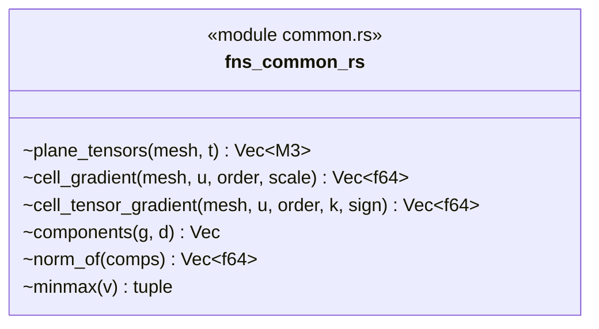

# Shared helpers: code

C4 level 4 (code) of the component **Shared helpers** (`dfs.common`) in the container **nyx-dfs** (crate `nyx_dfs`). [Component view of the container](../../3-components/dfs.md) · [All code pages](../README.md)

> Per-cell gradients and values shared by the heat and electrostatics kernels.

**Decisions:** [ADR 41](../../../adr/0041-physics-crate-pattern-and-the-legacy-bridge.md)  
**Size:** 1 file, 58 lines.

## Files

| File | Lines | What it says about itself |
|---|---:|---|
| `crates/nyx-dfs/src/common.rs` | 58 |  |

## What it uses

| Target | Modules | Items |
|---|---|---|
| [container `femcore` (femcore)](../../3-components/femcore.md) | fields, material, section | M3, gradients_at_nodes, plane_tensor |
| [container `physics` (nyx-physics)](../../3-components/physics.md) | crate root | Discretisation |

## Used by

| Component | Modules | Items |
|---|---|---|
| [Electrostatics kernel](./electro.md) | common | cell_gradient, components, minmax, norm_of, plane_tensors |
| [Heat kernel](./heat.md) | common | cell_tensor_gradient, components, minmax, plane_tensors |
| [Magnetostatics kernel](./magneto.md) | common | cell_gradient, components, minmax, norm_of |

## Class diagram

Public types with their public fields (or variants) and methods, free functions per file as a `module` box; arrows are field types and `impl Trait`. Capped at 36 types and a few members each; the table below is complete.

## Public items

| Kind | Item | File:line | Signature or summary |
|---|---|---|---|
| fn | `plane_tensors` | `common.rs:11` | `pub(crate) fn plane_tensors(mesh: &Discretisation, t: Vec<M3>) -> Vec<M3>` —  The wafer tensors of the cells in the axes of the mesh (on a cross-section the x-z block comes first, see `section::plane_tensor`). |
| fn | `cell_gradient` | `common.rs:16` | `pub(crate) fn cell_gradient(mesh: &Discretisation, u: &[f64], order: usize, scale: &[f64]) -> Vec<f64>` —  `scale[c] * grad u` at the local dofs of every cell, not averaged: `g[(c*nloc + a)*dim + k]`. |
| fn | `cell_tensor_gradient` | `common.rs:31` | `pub(crate) fn cell_tensor_gradient(mesh: &Discretisation, u: &[f64], order: usize, k: &[M3], sign: f64) -> Vec<f64>` —  `sign * K grad(u)` at the local dofs of every cell, not averaged, `dim` values per local dof. |
| fn | `components` | `common.rs:47` | `pub(crate) fn components(g: &[f64], d: usize) -> Vec<Vec<f64>>` |
| fn | `norm_of` | `common.rs:51` | `pub(crate) fn norm_of(comps: &[Vec<f64>]) -> Vec<f64>` |
| fn | `minmax` | `common.rs:55` | `pub(crate) fn minmax(v: &[f64]) -> (f64, f64)` |
