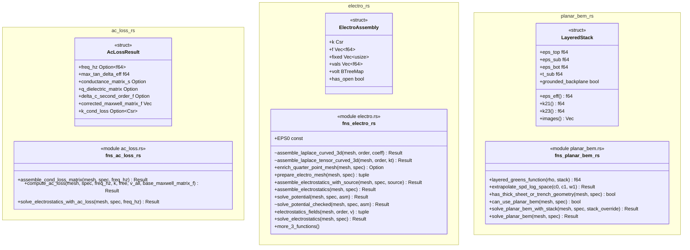

# Electrostatics kernel: code

C4 level 4 (code) of the component **Electrostatics kernel** (`dfs.electro`) in the container **nyx-dfs** (crate `nyx_dfs`). [Component view of the container](../../3-components/dfs.md) · [All code pages](../README.md)

> Electrostatics on P1/P2 simplices with fixed-potential, surface-charge, `SourceField` MMS, planar BEM Richardson bounds, tightened AMG convergence, and multi-RHS terminal conditions.

**Decisions:** [ADR 41](../../../adr/0041-physics-crate-pattern-and-the-legacy-bridge.md), [ADR 9](../../../adr/0009-kernels-are-three-stages.md), [ADR 103](../../../adr/0103-multi-rhs-capacitance-and-gauge-stabilized-magnetostatics.md), [ADR 132](../../../adr/0132-vvuq-asme-six-pillar-code-verification.md), [ADR 133](../../../adr/0133-vvuq-error-budgets-gci-provenance-and-uq.md)  
**Size:** 3 files, 4202 lines.

## Files

| File | Lines | What it says about itself |
|---|---:|---|
| `crates/nyx-dfs/src/ac_loss.rs` | 438 |  |
| `crates/nyx-dfs/src/electro.rs` | 2177 |  |
| `crates/nyx-dfs/src/planar_bem.rs` | 1587 |  |

## What it uses

| Target | Modules | Items |
|---|---|---|
| [container `femcore` (femcore)](../../3-components/femcore.md) | adapt::electro, adapt::estimate, adapt::estimate3, fem, fem_mixed, fields, linalg::amg_elastic, linalg::csr::assembly +11 | AmgOptions, CellFields, CellPermittivity, Coo, DEFAULT_EPS_FLOOR, DEFAULT_QUARTER_POINT_XI, DirectSolver, ElectroEstimatorOptions, EquilibratedFluxResult, LagrangeSpace +26 |
| [container `physics` (nyx-physics)](../../3-components/physics.md) | cqed, crate root, result | CapacitanceMatrixData, DiagnosticSeverity, Discretisation, ElectroAmrData, Field, Mesh, MixedToSimplexProjector, Scalar, Solution, SolveResult +5 |
| [Shared helpers](./common.md) | common, diag | DfsDiag, assemble_boundary_load_field, assemble_boundary_load_mixed, assemble_boundary_mass_curved_aware, assemble_farfield_robin_mixed, assemble_ie_outer_robin_mixed, assemble_laplace_ie_mixed, assemble_source_field, assemble_source_mixed, cell_gradient +16 |
| [Typed problem](./problem.md) | problem | BcKind, Problem |

## Used by

| Component | Modules | Items |
|---|---|---|
| [Physics adapter](./adapter.md) | electro, planar_bem | EPS0, ElectroAssembly, LayeredStack, assemble_electrostatics, electrostatics_fields, layered_greens_function, solve_electrostatics, solve_electrostatics_mixed +2 |

## Class diagram

Public types with their public fields (or variants) and methods, free functions per file as a `module` box; arrows are field types and `impl Trait`. Capped at 36 types and a few members each; the table below is complete.

## Public items

| Kind | Item | File:line | Signature or summary |
|---|---|---|---|
| struct | `AcLossResult` | `ac_loss.rs:25` | fields: `freq_hz`, `max_tan_delta_eff`, `conductance_matrix_s`, `q_dielectric_matrix`, `delta_c_second_order_f`, `corrected_maxwell_matrix_f`, `k_cond_loss` —  Output of AC quasi-static loss and complex-permittivity Schur complement evaluation. |
| fn | `assemble_cond_loss_matrix` | `ac_loss.rs:78` | `pub fn assemble_cond_loss_matrix( mesh: &Discretisation, spec: &Problem, freq_hz: Option<f64>, ) -> Result<(Option<Csr>, f64), String>` —  Evaluates the per-cell real permittivity tensor `eps_r(c)`, effective loss conductivity tensor |
| fn | `compute_ac_loss` | `ac_loss.rs:200` | `pub fn compute_ac_loss( mesh: &Discretisation, spec: &Problem, freq_hz: Option<f64>, k: &Csr, free: &[usize], v_all: &[Vec<f64>], base_maxwell_matrix_f: &[Vec<f64>], ) -> Result<AcLossResult, String>` —  Computes AC terminal conductance `G_ij(omega)`, positive 2nd-order capacitance shift `Delta C_ij^(2)`, |
| fn | `solve_electrostatics_with_ac_loss` | `ac_loss.rs:360` | `pub fn solve_electrostatics_with_ac_loss( mesh: &Discretisation, spec: &Problem, freq_hz: Option<f64>, ) -> Result<(SolveResult, AcLossResult), String>` —  Runs `solve_electrostatics` and evaluates the AC quasi-static conductance matrix `G_ij(omega)`, |
| const | `EPS0` | `electro.rs:32` | `f64` |
| struct | `ElectroAssembly` | `electro.rs:39` | fields: `k`, `f`, `fixed`, `vals`, `volt`, `has_open` —  Stage 1 of electrostatics: the stiffness matrix, the load and the Dirichlet dofs. |
| fn | `assemble_laplace_curved_3d` | `electro.rs:80` | `pub(crate) fn assemble_laplace_curved_3d(mesh: &Discretisation, order: usize, coeff: &[f64]) -> Result<Csr, String>` |
| fn | `assemble_laplace_tensor_curved_3d` | `electro.rs:142` | `pub(crate) fn assemble_laplace_tensor_curved_3d(mesh: &Discretisation, order: usize, kt: &[M3]) -> Result<Csr, String>` |
| fn | `enrich_quarter_point_mesh` | `electro.rs:216` | `pub fn enrich_quarter_point_mesh(mesh: &Discretisation, spec: &Problem) -> Option<(Discretisation, usize, usize)>` —  Enriches a 3D mesh for P2 Barsoum quarter-point singularity capture (`singular_edges = "quarter_point"`) |
| fn | `prepare_electro_mesh` | `electro.rs:260` | `pub fn prepare_electro_mesh(mesh: &Discretisation, spec: &Problem) -> (Option<(Discretisation, usize, usize)>, bool)` —  Prepares the working discretisation for electrostatics: |
| fn | `assemble_electrostatics_with_source` | `electro.rs:643` | `pub fn assemble_electrostatics_with_source<const D: usize, S: SourceField<D>>( mesh: &Discretisation, spec: &Problem, source: &S, ) -> Result<ElectroAssembly, String>` |
| fn | `assemble_electrostatics` | `electro.rs:653` | `pub fn assemble_electrostatics(mesh: &Discretisation, spec: &Problem) -> Result<ElectroAssembly, String>` |
| fn | `solve_potential` | `electro.rs:665` | `pub fn solve_potential( mesh: &Discretisation, spec: &Problem, asm: &ElectroAssembly, ) -> Result<(Vec<f64>, Option<String>), String>` —  Stage 2: the potential at every dof (and the note of the linear solver, if it has one). The backend is the one |
| fn | `solve_potential_checked` | `electro.rs:674` | `pub(crate) fn solve_potential_checked( mesh: &Discretisation, spec: &Problem, asm: &ElectroAssembly, ) -> Result<(Vec<f64>, Option<String>, DfsDiag), String>` |
| fn | `electrostatics_fields` | `electro.rs:696` | `pub fn electrostatics_fields(mesh: &Discretisation, order: usize, v: &[f64]) -> (Vec<Field>, CellFields)` —  Stage 3: the fields `V` and `E` (the flat names `\|E\|`, `Ex`, `Ez` come from `Solution::flat_fields`) and the same without averaging over |
| fn | `solve_electrostatics` | `electro.rs:1139` | `pub fn solve_electrostatics(mesh: &Discretisation, spec: &Problem) -> Result<SolveResult, String>` |
| fn | `solve_electrostatics_with_source` | `electro.rs:1147` | `pub fn solve_electrostatics_with_source<const D: usize, S: SourceField<D>>( mesh: &Discretisation, spec: &Problem, source: &S, ) -> Result<SolveResult, String>` |
| fn | `solve_electrostatics_with_source_and_robin` | `electro.rs:1155` | `pub fn solve_electrostatics_with_source_and_robin<const D: usize, S: SourceField<D>>( mesh: &Discretisation, spec: &Problem, source: &S, robin_bcs: &[(Vec<i32>, f64)], ) -> Result<SolveResult, String>` |
| fn | `solve_electrostatics_mixed` | `electro.rs:1740` | `pub fn solve_electrostatics_mixed(mesh: &Mesh, spec: &Problem) -> Result<SolveResult, String>` —  Solves electrostatics natively on a mixed mesh (`Tri`/`Quad` in 2D, `Tet`/`Prism`/`Hex` in 3D) |
| struct | `LayeredStack` | `planar_bem.rs:36` | fields: `eps_top`, `eps_sub`, `eps_bot`, `t_sub`, `grounded_backplane` —  Three-layer planar dielectric stack around a conductor sheet plane `z = z_sheet`. |
| fn | `layered_greens_function` | `planar_bem.rs:105` | `pub fn layered_greens_function(rho: f64, stack: &LayeredStack) -> f64` —  Evaluates the exact layered-dielectric reflection image Green's function `G(rho)` on `z = z' = z_sheet` |
| fn | `extrapolate_spd_log_space` | `planar_bem.rs:462` | `pub fn extrapolate_spd_log_space(c0: &[Vec<f64>], c1: &[Vec<f64>], w1: f64) -> Result<Vec<Vec<f64>>, String>` —  Applies log-space SPD Richardson extrapolation (`r = 2`, `w_1 = 2.0`) to coarse (`c0`) and |
| fn | `has_thick_sheet_or_trench_geometry` | `planar_bem.rs:569` | `pub fn has_thick_sheet_or_trench_geometry(mesh: &Discretisation, spec: &Problem) -> bool` —  Detects whether `mesh` or `spec` represents a 3D resolved finite-thickness conductor sheet |
| fn | `can_use_planar_bem` | `planar_bem.rs:636` | `pub fn can_use_planar_bem(mesh: &Discretisation, spec: &Problem) -> bool` —  Checks whether `mesh` and `spec` represent a planar sheet capacitance problem suitable for |
| fn | `solve_planar_bem_with_stack` | `planar_bem.rs:1359` | `pub fn solve_planar_bem_with_stack( mesh: &Discretisation, spec: &Problem, stack_override: Option<LayeredStack>, ) -> Result<SolveResult, String>` —  Solves a multi-terminal planar sheet capacitance problem with an explicit [`LayeredStack`]. |
| fn | `solve_planar_bem` | `planar_bem.rs:1584` | `pub fn solve_planar_bem(mesh: &Discretisation, spec: &Problem) -> Result<SolveResult, String>` —  Solves a multi-terminal planar sheet capacitance problem by auto-detecting the layered stack |
| fn | `LayeredStack::eps_eff` | `planar_bem.rs:51` | `pub fn eps_eff(&self) -> f64` —  Effective half-space relative permittivity `eps_eff = (eps_1 + eps_2) / 2`. |
| fn | `LayeredStack::k21` | `planar_bem.rs:56` | `pub fn k21(&self) -> f64` —  Reflection coefficient `k_21 = (eps_2 - eps_1) / (eps_2 + eps_1)`. |
| fn | `LayeredStack::k23` | `planar_bem.rs:61` | `pub fn k23(&self) -> f64` —  Reflection coefficient `k_23 = -1` for a grounded backplane, or `(eps_2 - eps_3) / (eps_2 + eps_3)`. |
| fn | `LayeredStack::images` | `planar_bem.rs:71` | `pub fn images(&self) -> Vec<(f64, f64)>` —  Precomputed image weights and vertical image depths `(w_n, d_n = 2*n*t_sub)` for `n = 1..=N`, |
