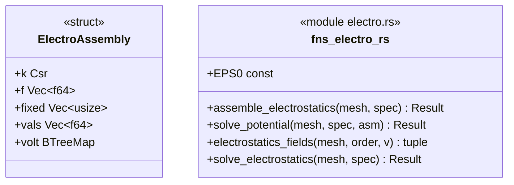

# Electrostatics kernel: code

C4 level 4 (code) of the component **Electrostatics kernel** (`dfs.electro`) in the container **nyx-dfs** (crate `nyx_dfs`). [Component view of the container](../../3-components/dfs.md) · [All code pages](../README.md)

> Electrostatics on P1/P2 simplices with fixed-potential and surface-charge conditions.

**Decisions:** [ADR 41](../../../adr/0041-physics-crate-pattern-and-the-legacy-bridge.md), [ADR 9](../../../adr/0009-kernels-are-three-stages.md)  
**Size:** 1 file, 136 lines.

## Files

| File | Lines | What it says about itself |
|---|---:|---|
| `crates/nyx-dfs/src/electro.rs` | 136 | Electrostatics on P1/P2 simplices: `-div(eps0 eps_r grad V) = rho_v`, `V = V0` on fixed-potential boundaries, `n.D = -rho_s` on charged ones. Three stages (ADR 9): `assemble_electrostatics`, `solve_potential`, `electrostatics_fields`; `s... |

## What it uses

| Target | Modules | Items |
|---|---|---|
| [container `femcore` (femcore)](../../3-components/femcore.md) | fem, fields, linalg::csr::assembly, props, section | CellFields, RCsr, TensorKind, component_names, node_average |
| [container `physics` (nyx-physics)](../../3-components/physics.md) | crate root, result | Discretisation, Field, Scalar, Solution, SolveResult, cell_fields_of |
| [Shared helpers](./common.md) | common | cell_gradient, components, minmax, norm_of, plane_tensors |
| [Typed problem](./problem.md) | problem | BcKind, Problem |

## Used by

| Component | Modules | Items |
|---|---|---|
| [Physics adapter](./adapter.md) | electro | EPS0, ElectroAssembly, assemble_electrostatics, electrostatics_fields, solve_electrostatics, solve_potential |

## Class diagram

Public types with their public fields (or variants) and methods, free functions per file as a `module` box; arrows are field types and `impl Trait`. Capped at 36 types and a few members each; the table below is complete.

## Public items

| Kind | Item | File:line | Signature or summary |
|---|---|---|---|
| const | `EPS0` | `electro.rs:14` | `f64` |
| struct | `ElectroAssembly` | `electro.rs:19` | fields: `k`, `f`, `fixed`, `vals`, `volt` —  Stage 1 of electrostatics: the stiffness matrix, the load and the Dirichlet dofs. |
| fn | `assemble_electrostatics` | `electro.rs:28` | `pub fn assemble_electrostatics(mesh: &Discretisation, spec: &Problem) -> Result<ElectroAssembly, String>` |
| fn | `solve_potential` | `electro.rs:71` | `pub fn solve_potential( mesh: &Discretisation, spec: &Problem, asm: &ElectroAssembly, ) -> Result<(Vec<f64>, Option<String>), String>` —  Stage 2: the potential at every dof (and the note of the linear solver, if it has one). The backend is the one |
| fn | `electrostatics_fields` | `electro.rs:81` | `pub fn electrostatics_fields(mesh: &Discretisation, order: usize, v: &[f64]) -> (Vec<Field>, CellFields)` —  Stage 3: the fields `V` and `E` (the flat names `\|E\|`, `Ex`, `Ez` come from `Solution::flat_fields`) and the same without averaging over |
| fn | `solve_electrostatics` | `electro.rs:94` | `pub fn solve_electrostatics(mesh: &Discretisation, spec: &Problem) -> Result<SolveResult, String>` |
