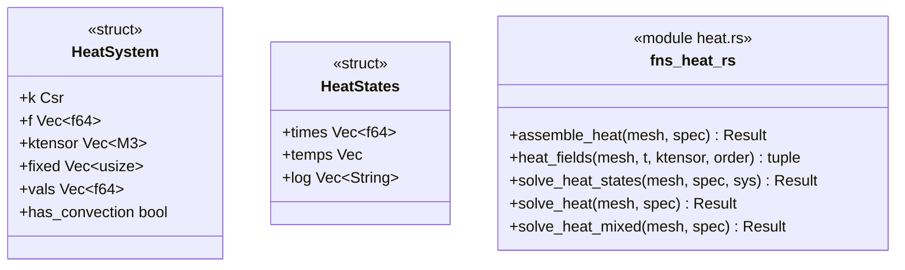

# Heat kernel: code

C4 level 4 (code) of the component **Heat kernel** (`dfs.heat`) in the container **nyx-dfs** (crate `nyx_dfs`). [Component view of the container](../../3-components/dfs.md) · [All code pages](../README.md)

> Heat transfer on P1/P2 simplices, stationary and transient.

**Decisions:** [ADR 41](../../../adr/0041-physics-crate-pattern-and-the-legacy-bridge.md), [ADR 9](../../../adr/0009-kernels-are-three-stages.md)  
**Size:** 1 file, 712 lines.

## Files

| File | Lines | What it says about itself |
|---|---:|---|
| `crates/nyx-dfs/src/heat.rs` | 712 |  |

## What it uses

| Target | Modules | Items |
|---|---|---|
| [container `femcore` (femcore)](../../3-components/femcore.md) | expr, fem, fem_mixed, fields, linalg::csr::assembly, linalg::driver, material, mesh::mixed +2 | AmgSystem, CellFields, DirectSolver, LagrangeSpace, LinearSolver, M3, MixedDiscretisation, MixedLagrangeDofMap, RCsr, TensorKind +6 |
| [container `physics` (nyx-physics)](../../3-components/physics.md) | crate root, result | Discretisation, Field, Mesh, MixedToSimplexProjector, Scalar, Solution, SolveResult, cell_fields_of, discretise, discretise_mixed |
| [Shared helpers](./common.md) | common | assemble_boundary_load_mixed, assemble_boundary_mass_mixed, assemble_farfield_robin_mixed, assemble_ie_outer_robin_mixed, assemble_laplace_ie_mixed, assemble_source_mixed, cell_tensor_gradient, cell_tensor_mixed, cell_values_mixed, check_boundary_labels_mixed +9 |
| [Typed problem](./problem.md) | problem | BcKind, Problem, Study |

## Used by

| Component | Modules | Items |
|---|---|---|
| [Physics adapter](./adapter.md) | heat | HeatStates, HeatSystem, assemble_heat, heat_fields, solve_heat, solve_heat_mixed, solve_heat_states |

## Class diagram

Public types with their public fields (or variants) and methods, free functions per file as a `module` box; arrows are field types and `impl Trait`. Capped at 36 types and a few members each; the table below is complete.

## Public items

| Kind | Item | File:line | Signature or summary |
|---|---|---|---|
| struct | `HeatSystem` | `heat.rs:51` | fields: `k`, `f`, `ktensor`, `fixed`, `vals`, `has_convection` —  Stage 1 of heat transfer: conductivity matrix, load, Dirichlet dofs and the conductivity tensors (for the flux). |
| fn | `assemble_heat` | `heat.rs:60` | `pub fn assemble_heat(mesh: &Discretisation, spec: &Problem) -> Result<HeatSystem, String>` |
| fn | `heat_fields` | `heat.rs:216` | `pub fn heat_fields(mesh: &Discretisation, t: &[f64], ktensor: &[M3], order: usize) -> (Vec<Field>, CellFields)` —  Stage 3 of heat transfer: `T` and `q` (flat names `\|q\|`, `qx`, `qz` come from `Solution::flat_fields`) and the same per cell without |
| struct | `HeatStates` | `heat.rs:230` | fields: `times`, `temps`, `log` —  Stage 2 of heat transfer: the temperature at every dof, for the stationary study (one state) or at each output |
| fn | `solve_heat_states` | `heat.rs:237` | `pub fn solve_heat_states(mesh: &Discretisation, spec: &Problem, sys: &HeatSystem) -> Result<HeatStates, String>` |
| fn | `solve_heat` | `heat.rs:386` | `pub fn solve_heat(mesh: &Discretisation, spec: &Problem) -> Result<SolveResult, String>` |
| fn | `solve_heat_mixed` | `heat.rs:448` | `pub fn solve_heat_mixed(mesh: &Mesh, spec: &Problem) -> Result<SolveResult, String>` —  Solves stationary or transient heat transfer natively on a mixed mesh (`Quad`, `Prism`, `Hex`) |
