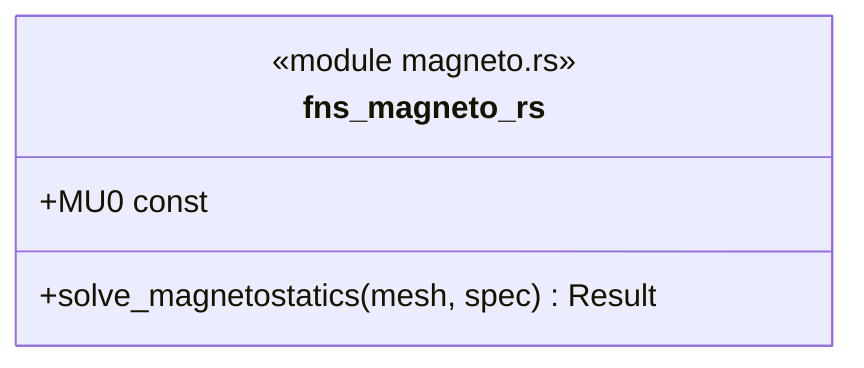

# Magnetostatics kernel: code

C4 level 4 (code) of the component **Magnetostatics kernel** (`dfs.magneto`) in the container **nyx-dfs** (crate `nyx_dfs`). [Component view of the container](../../3-components/dfs.md) · [All code pages](../README.md)

> Gauge-stabilized London magnetostatics (2D cross-section, planar stream function, mixed 3D A-phi) and inductance matrix extraction.

**Decisions:** [ADR 103](../../../adr/0103-multi-rhs-capacitance-and-gauge-stabilized-magnetostatics.md)  
**Size:** 1 file, 1129 lines.

## Files

| File | Lines | What it says about itself |
|---|---:|---|
| `crates/nyx-dfs/src/magneto.rs` | 1129 |  |

## What it uses

| Target | Modules | Items |
|---|---|---|
| [container `femcore` (femcore)](../../3-components/femcore.md) | fem, fields, linalg::csr::assembly, linalg::driver, props, section | CellFields, Coo, DirectSolver, LinearSolver, component_names, dense_eigh, local_bary, node_average |
| [container `physics` (nyx-physics)](../../3-components/physics.md) | cqed, crate root, result | Discretisation, Field, InductanceMatrixData, Scalar, Solution, SolveResult, cell_fields_of |
| [Shared helpers](./common.md) | common | cell_gradient, components, minmax, norm_of |
| [Typed problem](./problem.md) | problem | BcKind, Problem, Study |

## Used by

| Component | Modules | Items |
|---|---|---|
| [Physics adapter](./adapter.md) | magneto | MU0, solve_magnetostatics |

## Class diagram

Public types with their public fields (or variants) and methods, free functions per file as a `module` box; arrows are field types and `impl Trait`. Capped at 36 types and a few members each; the table below is complete.

## Public items

| Kind | Item | File:line | Signature or summary |
|---|---|---|---|
| const | `MU0` | `magneto.rs:29` | `f64` —  Vacuum magnetic permeability `mu_0` in H/m. |
| fn | `solve_magnetostatics` | `magneto.rs:1105` | `pub fn solve_magnetostatics(mesh: &Discretisation, spec: &Problem) -> Result<SolveResult, String>` —  Solves a magnetostatic problem using the requested or auto-selected formulation. |
