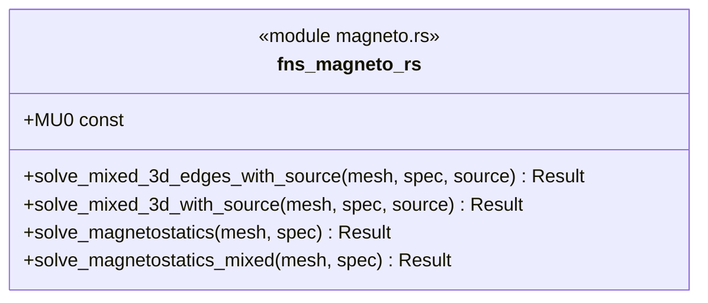

# Magnetostatics kernel: code

C4 level 4 (code) of the component **Magnetostatics kernel** (`dfs.magneto`) in the container **nyx-dfs** (crate `nyx_dfs`). [Component view of the container](../../3-components/dfs.md) · [All code pages](../README.md)

> Gauge-stabilized London magnetostatics (`cross_section`, `planar_stream`, `mixed_3d`), `SourceField` MMS, R32 guard, and inductance matrix extraction.

**Decisions:** [ADR 103](../../../adr/0103-multi-rhs-capacitance-and-gauge-stabilized-magnetostatics.md), [ADR 132](../../../adr/0132-vvuq-asme-six-pillar-code-verification.md)  
**Size:** 1 file, 2492 lines.

## Files

| File | Lines | What it says about itself |
|---|---:|---|
| `crates/nyx-dfs/src/magneto.rs` | 2492 |  |

## What it uses

| Target | Modules | Items |
|---|---|---|
| [container `femcore` (femcore)](../../3-components/femcore.md) | edge_mixed, fem, fem_mixed, fields, linalg::csr, linalg::csr::assembly, linalg::driver, mesh::mixed +3 | CellFields, Coo, DirectSolver, IsoparametricCell, LagrangeSpace, LinearSolver, MixedDiscretisation, MixedLagrangeDofMap, NedEvalScratch, NedMixed +13 |
| [container `physics` (nyx-physics)](../../3-components/physics.md) | cqed, crate root, result | Discretisation, Field, InductanceMatrixData, Mesh, MixedToSimplexProjector, Scalar, Solution, SolveResult, cell_fields_of, discretise +1 |
| [Shared helpers](./common.md) | common | ResolvedIeDomain, assemble_boundary_load_mixed, assemble_boundary_mass_mixed, assemble_farfield_robin_mixed, assemble_ie_outer_robin_mixed, assemble_laplace_ie_mixed, boundary_measure_mixed, build_facet_to_cell_mixed, cell_gradient, cell_values_mixed +10 |
| [Typed problem](./problem.md) | problem | BcKind, Problem, Study |

## Used by

| Component | Modules | Items |
|---|---|---|
| [Physics adapter](./adapter.md) | magneto | MU0, solve_magnetostatics, solve_magnetostatics_mixed |

## Class diagram

Public types with their public fields (or variants) and methods, free functions per file as a `module` box; arrows are field types and `impl Trait`. Capped at 36 types and a few members each; the table below is complete.

## Public items

| Kind | Item | File:line | Signature or summary |
|---|---|---|---|
| const | `MU0` | `magneto.rs:45` | `f64` —  Vacuum magnetic permeability `mu_0` in H/m. |
| fn | `solve_mixed_3d_edges_with_source` | `magneto.rs:1246` | `pub fn solve_mixed_3d_edges_with_source<S: SourceField<3>>( mesh: &Discretisation, spec: &Problem, source: &S, ) -> Result<(SolveResult, Vec<f64>), String>` —  Solves 3D Nedelec `mixed_3d` magnetostatics with a generic monomorphized [`SourceField<3>`], |
| fn | `solve_mixed_3d_with_source` | `magneto.rs:1261` | `pub fn solve_mixed_3d_with_source<S: SourceField<3>>( mesh: &Discretisation, spec: &Problem, source: &S, ) -> Result<SolveResult, String>` —  Solves 3D Nedelec `mixed_3d` magnetostatics with a generic monomorphized [`SourceField<3>`]. |
| fn | `solve_magnetostatics` | `magneto.rs:1670` | `pub fn solve_magnetostatics(mesh: &Discretisation, spec: &Problem) -> Result<SolveResult, String>` —  Solves a magnetostatic problem using the requested or auto-selected formulation. |
| fn | `solve_magnetostatics_mixed` | `magneto.rs:2455` | `pub fn solve_magnetostatics_mixed(mesh: &Mesh, spec: &Problem) -> Result<SolveResult, String>` —  Solves a magnetostatic problem natively on a mixed mesh (`Quad`, `Prism`, `Hex`) and/or with |
