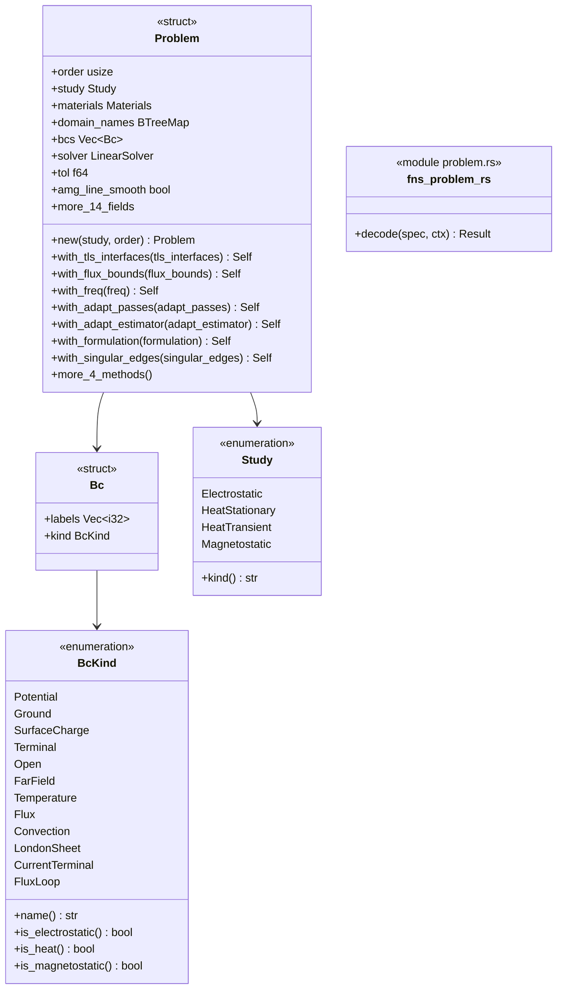

# Typed problem: code

C4 level 4 (code) of the component **Typed problem** (`dfs.problem`) in the container **nyx-dfs** (crate `nyx_dfs`). [Component view of the container](../../3-components/dfs.md) · [All code pages](../README.md)

> The typed dfs problem the kernels read, decoded from the ProblemSpec envelope.

**Decisions:** [ADR 41](../../../adr/0041-physics-crate-pattern-and-the-legacy-bridge.md), [ADR 103](../../../adr/0103-multi-rhs-capacitance-and-gauge-stabilized-magnetostatics.md)  
**Size:** 1 file, 606 lines.

## Files

| File | Lines | What it says about itself |
|---|---:|---|
| `crates/nyx-dfs/src/problem.rs` | 606 |  |

## What it uses

| Target | Modules | Items |
|---|---|---|
| [container `femcore` (femcore)](../../3-components/femcore.md) | material, material::bcs, props | FilmModel, LinearSolver, Materials, bcs_surface_impedance |
| [container `physics` (nyx-physics)](../../3-components/physics.md) | cqed, decode, error, physics, spec | Ctx, Error, Params, Physics, ProblemSpec, TlsInterfaces, domain_names_by_label, materials_by_label, resolve_conditions, tls_interfaces_from_spec |
| [Physics adapter](./adapter.md) | crate root | Dfs |

## Used by

| Component | Modules | Items |
|---|---|---|
| [Physics adapter](./adapter.md) | problem | Bc, BcKind, Problem, Study, decode |
| [Electrostatics kernel](./electro.md) | problem | BcKind, Problem |
| [Heat kernel](./heat.md) | problem | BcKind, Problem, Study |
| [Magnetostatics kernel](./magneto.md) | problem | BcKind, Problem, Study |

## Class diagram

Public types with their public fields (or variants) and methods, free functions per file as a `module` box; arrows are field types and `impl Trait`. Capped at 36 types and a few members each; the table below is complete.

## Public items

| Kind | Item | File:line | Signature or summary |
|---|---|---|---|
| enum | `BcKind` | `problem.rs:18` | variants: `Potential`, `Ground`, `SurfaceCharge`, `Terminal`, `Open`, `FarField`, `Temperature`, `Flux`, `Convection`, `LondonSheet`, `CurrentTerminal`, `FluxLoop` |
| struct | `Bc` | `problem.rs:103` | fields: `labels`, `kind` —  A condition on boundary numbers of the mesh. |
| enum | `Study` | `problem.rs:109` | variants: `Electrostatic`, `HeatStationary`, `HeatTransient`, `Magnetostatic` |
| struct | `Problem` | `problem.rs:137` | fields: `order`, `study`, `materials`, `domain_names`, `bcs`, `solver`, `tol`, `amg_line_smooth`, `formulation`, `singular_edges`, `richardson`, `tls_interfaces`, ... |
| fn | `decode` | `problem.rs:344` | `pub fn decode(spec: &ProblemSpec, ctx: &Ctx) -> Result<Problem, Error>` —  Reads the envelope. The structural checks against the descriptors (`validate_spec`) are the engine's job; this resolves names and |
| fn | `BcKind::name` | `problem.rs:60` | `pub fn name(&self) -> &'static str` |
| fn | `BcKind::is_electrostatic` | `problem.rs:77` | `pub fn is_electrostatic(&self) -> bool` |
| fn | `BcKind::is_heat` | `problem.rs:89` | `pub fn is_heat(&self) -> bool` |
| fn | `BcKind::is_magnetostatic` | `problem.rs:93` | `pub fn is_magnetostatic(&self) -> bool` |
| fn | `Study::kind` | `problem.rs:126` | `pub fn kind(&self) -> &'static str` —  The `study.kind` of the envelope. |
| fn | `Problem::new` | `problem.rs:180` | `pub fn new(study: Study, order: usize) -> Problem` |
| fn | `Problem::with_tls_interfaces` | `problem.rs:207` | `pub fn with_tls_interfaces(mut self, tls_interfaces: Option<TlsInterfaces>) -> Self` |
| fn | `Problem::with_flux_bounds` | `problem.rs:212` | `pub fn with_flux_bounds(mut self, flux_bounds: impl Into<String>) -> Self` |
| fn | `Problem::with_freq` | `problem.rs:217` | `pub fn with_freq(mut self, freq: f64) -> Self` |
| fn | `Problem::with_adapt_passes` | `problem.rs:222` | `pub fn with_adapt_passes(mut self, adapt_passes: usize) -> Self` |
| fn | `Problem::with_adapt_estimator` | `problem.rs:227` | `pub fn with_adapt_estimator(mut self, adapt_estimator: impl Into<String>) -> Self` |
| fn | `Problem::with_formulation` | `problem.rs:231` | `pub fn with_formulation(mut self, formulation: impl Into<String>) -> Self` |
| fn | `Problem::with_singular_edges` | `problem.rs:236` | `pub fn with_singular_edges(mut self, singular_edges: impl Into<String>) -> Self` |
| fn | `Problem::with_richardson` | `problem.rs:241` | `pub fn with_richardson(mut self, richardson: bool) -> Self` |
| fn | `Problem::with_amg_line_smooth` | `problem.rs:246` | `pub fn with_amg_line_smooth(mut self, amg_line_smooth: bool) -> Self` |
| fn | `Problem::with_tol` | `problem.rs:251` | `pub fn with_tol(mut self, tol: f64) -> Self` |
| fn | `Problem::check_finite` | `problem.rs:257` | `pub fn check_finite(&self) -> Result<(), String>` —  Every number the user can type must be finite: NaN or infinity does not stop a factorisation, it flows into every field. |
