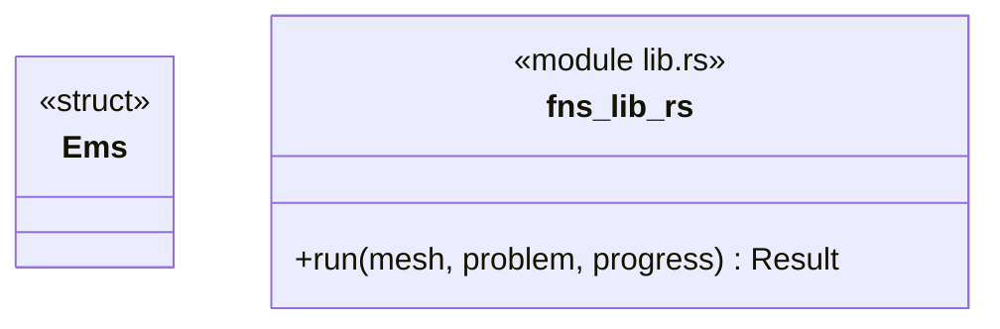

# Physics adapter: code

C4 level 4 (code) of the component **Physics adapter** (`ems.adapter`) in the container **nyx-ems** (crate `nyx_ems`). [Component view of the container](../../3-components/ems.md) · [All code pages](../README.md)

> The Physics implementation of ems: descriptors, validation, solve entry.

**Decisions:** [ADR 45](../../../adr/0045-ems-moves-into-nyx-ems.md), [ADR 25](../../../adr/0025-physics-trait-registry-and-problem-envelope.md)  
**Size:** 1 file, 295 lines.

## Files

| File | Lines | What it says about itself |
|---|---:|---|
| `crates/nyx-ems/src/lib.rs` | 295 |  |

## What it uses

| Target | Modules | Items |
|---|---|---|
| [container `femcore` (femcore)](../../3-components/femcore.md) | material, material::spec, meshing::physics_size, progress, props | Library, PmlDir, Progress, optical_wavelength, speed_of_light, tensor_global |
| [container `physics` (nyx-physics)](../../3-components/physics.md) | crate root, decode | Mesh, Params, materials_by_region |
| [Axisymmetric kernel](./axisym.md) | axisym | AxiAssembly, AxiMaterial, AxiModes, assemble_axisym, axisym_fields_cells, power_along_theta, solve_axisym_modes, solve_axisym_pairs, solve_axisymmetric |
| [3D cavity kernel](./cavity.md) | cavity | EmwAssembly, EmwSolve, assemble_emw_eigen, emw_eigen_fields, solve_cavity, solve_emw_modes |
| [Mode kernel](./modes.md) | crate root, modes | C0, EpsCell, ModeAssembly, Modes, assemble_modes, mode_fields, mode_fields_cells, n_unknowns, solve_mode_pairs, solve_modes +2 |
| [Complex-mode kernel](./modescx.md) | modes_complex | ModeAssemblyC, ModesC, assemble_modes_complex, mode_fields_complex, mode_fields_complex_cells, solve_mode_pairs_complex, solve_modes_complex, solve_waveguide_complex |
| [Optical mode sets](./optical.md) | optical | solve_optical, solve_optical_wafer |
| [Typed problem](./problem.md) | problem | Problem, Study, decode |

## Used by

| Component | Modules | Items |
|---|---|---|
| [Typed problem](./problem.md) | crate root | Ems |
| [engine: Registry and facade](../engine/registry.md) | crate root | Ems |

## Class diagram

Public types with their public fields (or variants) and methods, free functions per file as a `module` box; arrows are field types and `impl Trait`. Capped at 36 types and a few members each; the table below is complete.

## Public items

| Kind | Item | File:line | Signature or summary |
|---|---|---|---|
| struct | `Ems` | `lib.rs:46` |  |
| fn | `run` | `lib.rs:260` | `pub fn run(mesh: &Mesh, problem: &Problem, progress: &Arc<Progress>) -> Result<SolveResult, Error>` —  Solves a typed problem: checks the numbers, runs the kernel of the study under `progress` (stage log, cancellation) and appends the |

Trait implementations in this component: `Ems: Physics`
