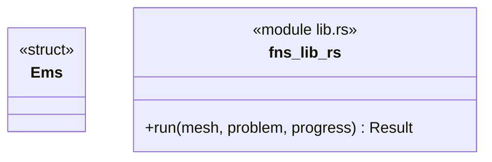

# Physics adapter: code

C4 level 4 (code) of the component **Physics adapter** (`ems.adapter`) in the container **nyx-ems** (crate `nyx_ems`). [Component view of the container](../../3-components/ems.md) · [All code pages](../README.md)

> The Physics implementation of ems: descriptors, validation, solve entry.

**Decisions:** [ADR 45](../../../adr/0045-ems-moves-into-nyx-ems.md), [ADR 25](../../../adr/0025-physics-trait-registry-and-problem-envelope.md), [ADR 104](../../../adr/0104-bcs-surface-impedance-and-lumped-josephson-ports.md), [ADR 106](../../../adr/0106-driven-frequency-domain-waveports-and-hermite-prom.md)  
**Size:** 1 file, 613 lines.

## Files

| File | Lines | What it says about itself |
|---|---:|---|
| `crates/nyx-ems/src/lib.rs` | 613 |  |

## What it uses

| Target | Modules | Items |
|---|---|---|
| [container `femcore` (femcore)](../../3-components/femcore.md) | material, material::spec, meshing::physics_size, progress, props | Library, PmlDir, Progress, optical_wavelength, speed_of_light, tensor_global |
| [container `physics` (nyx-physics)](../../3-components/physics.md) | crate root, decode | Mesh, Params, materials_by_region |
| [Axisymmetric kernel](./axisym.md) | axisym | AxiAssembly, AxiMaterial, AxiModes, assemble_axisym, assemble_axisym_mixed, assemble_axisym_with_bcs, axisym_fields_cells, power_along_theta, solve_axisym_modes, solve_axisym_pairs +2 |
| [3D cavity kernel](./cavity.md) | bloch, cavity | BlochAssembly, BlochSolve, EmwAssembly, EmwSolve, MixedCavityMasks, assemble_bloch, assemble_bloch_mixed, assemble_emw_eigen, assemble_emw_eigen_mixed, bloch_fields_cells +8 |
| [Driven frequency-domain and PROM](./driven.md) | driven, ports | AssembledLumpedPort, AssembledWavePort, DrivenAssembly, assemble_emw_driven, assemble_emw_driven_mixed, assemble_lumped_ports_3d, assemble_waveports_3d, solve_driven, solve_driven_mixed, validate_port_contacts_3d |
| [Thin-film IBC and Josephson ROM](./ibc.md) | rom | rom_complex_eigenfrequencies, rom_eigenfrequencies |
| [Native mixed-cell EM](./mixed.md) | mixed_ops | EmPmlTable, eigs_mixed_curl_curl_ams, solve_mixed_curl_curl_iterative |
| [Mode kernel](./modes.md) | crate root, modes | C0, EpsCell, ModeAssembly, Modes, assemble_modes, assemble_modes_mixed, assemble_modes_with_bcs, mode_fields, mode_fields_cells, n_unknowns +5 |
| [Complex-mode kernel](./modescx.md) | modes_complex | ModeAssemblyC, ModesC, assemble_modes_complex, assemble_modes_complex_mixed, assemble_modes_complex_with_bcs, mode_fields_complex, mode_fields_complex_cells, solve_mode_pairs_complex, solve_modes_complex, solve_waveguide_complex +1 |
| [Optical mode sets](./optical.md) | optical | solve_optical, solve_optical_wafer |
| [Typed problem](./problem.md) | problem | DRIVEN_SOLVER_CHOICES, IBC_MODE_CHOICES, LumpedJjBc, LumpedPortBc, Problem, SYMMETRY_CHOICES, Study, SurfaceImpedanceBc, Symmetry, WavePortBc +2 |

## Used by

| Component | Modules | Items |
|---|---|---|
| [Typed problem](./problem.md) | crate root | Ems |
| [engine: Registry and facade](../engine/registry.md) | crate root | Ems |

## Class diagram

Public types with their public fields (or variants) and methods, free functions per file as a `module` box; arrows are field types and `impl Trait`. Capped at 36 types and a few members each; the table below is complete.

## Public items

| Kind | Item | File:line | Signature or summary |
|---|---|---|---|
| struct | `Ems` | `lib.rs:71` |  |
| fn | `run` | `lib.rs:557` | `pub fn run(mesh: &Mesh, problem: &Problem, progress: &Arc<Progress>) -> Result<SolveResult, Error>` —  Solves a typed problem: checks the numbers, runs the kernel of the study under `progress` (stage log, cancellation) and appends the |

Trait implementations in this component: `Ems: Physics`
