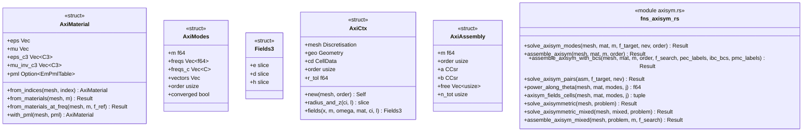

# Axisymmetric kernel: code

C4 level 4 (code) of the component **Axisymmetric kernel** (`ems.axisym`) in the container **nyx-ems** (crate `nyx_ems`). [Component view of the container](../../3-components/ems.md) · [All code pages](../README.md)

> Electromagnetic eigenmodes of a body of revolution (rings, disks, coaxial cavities, `R6d` quadrature `s_theta`).

**Decisions:** [ADR 46](../../../adr/0046-axisymmetric-ems-checked-and-given-a-study.md), [ADR 132](../../../adr/0132-vvuq-asme-six-pillar-code-verification.md)  
**Size:** 1 file, 958 lines.

## Files

| File | Lines | What it says about itself |
|---|---:|---|
| `crates/nyx-ems/src/axisym.rs` | 958 |  |

## What it uses

| Target | Modules | Items |
|---|---|---|
| [container `femcore` (femcore)](../../3-components/femcore.md) | edge, edge_mixed, fem, fem_mixed, fields, linalg::csr, linalg::csr::assembly, linalg::driver +4 | C, CCoo, CCsr, CellData, CellFields, EPS0, IsoparametricCell, LagrangeSpace, MU0, Materials +19 |
| [container `physics` (nyx-physics)](../../3-components/physics.md) | crate root, result | Discretisation, Field, Mesh, MixedToSimplexProjector, Scalar, Solution, SolveResult, cell_fields_of |
| [Thin-film IBC and Josephson ROM](./ibc.md) | ibc | add_ibc_2d_axisym, add_ibc_2d_axisym_mixed, pec_edges_and_nodes_2d |
| [Native mixed-cell EM](./mixed.md) | mixed_ops | C3, EmPmlTable, MixedCellMaterials, complex_eps_c3, iso_mu_inv_c3 |
| [Mode kernel](./modes.md) | crate root | C0 |
| [Typed problem](./problem.md) | problem | Problem, Study, SurfaceImpedanceBc |

## Used by

| Component | Modules | Items |
|---|---|---|
| [Physics adapter](./adapter.md) | axisym | AxiAssembly, AxiMaterial, AxiModes, assemble_axisym, assemble_axisym_mixed, assemble_axisym_with_bcs, axisym_fields_cells, power_along_theta +4 |

## Class diagram

Public types with their public fields (or variants) and methods, free functions per file as a `module` box; arrows are field types and `impl Trait`. Capped at 36 types and a few members each; the table below is complete.

## Public items

| Kind | Item | File:line | Signature or summary |
|---|---|---|---|
| struct | `AxiMaterial` | `axisym.rs:39` | fields: `eps`, `mu`, `eps_c3`, `mu_inv_c3`, `pml` —  Material data of every cell of an axisymmetric problem in `(0 = r, 1 = z, 2 = theta)` order. |
| struct | `AxiModes` | `axisym.rs:112` | fields: `m`, `freqs`, `freqs_c`, `vectors`, `order`, `converged` —  Modes of one azimuthal order. |
| struct | `Fields3` | `axisym.rs:126` | fields: `e`, `d`, `h` —  Fields of one mode at a point in `(0 = r, 1 = z, 2 = theta)` order. |
| struct | `AxiCtx` | `axisym.rs:132` | fields: `mesh`, `geo`, `cd`, `order`, `r_tol` |
| fn | `solve_axisym_modes` | `axisym.rs:227` | `pub fn solve_axisym_modes( mesh: &Discretisation, mat: &AxiMaterial, m: f64, f_target: f64, nev: usize, order: usize, ) -> Result<AxiModes, String>` —  Modes with frequency nearest `f_target` at azimuthal order `m` (`nev` of them). |
| struct | `AxiAssembly` | `axisym.rs:240` | fields: `m`, `order`, `a`, `b`, `free`, `n_tot` —  Stage 1: curl-curl matrix `A` and permittivity mass `B` of `A x = (omega/c)^2 B x` on free DOFs. |
| fn | `assemble_axisym` | `axisym.rs:249` | `pub fn assemble_axisym(mesh: &Discretisation, mat: &AxiMaterial, m: f64, order: usize) -> Result<AxiAssembly, String>` |
| fn | `assemble_axisym_with_bcs` | `axisym.rs:305` | `pub fn assemble_axisym_with_bcs( mesh: &Discretisation, mat: &AxiMaterial, m: f64, order: usize, f_search: f64, pec_labels: &[i32], ibc_bcs: &[SurfaceImpedanceBc], pmc_labels: &[i32], ) -> Result<AxiAssembly, String>` |
| fn | `solve_axisym_pairs` | `axisym.rs:484` | `pub fn solve_axisym_pairs(asm: &AxiAssembly, f_target: f64, nev: usize) -> Result<AxiModes, String>` —  Stage 2: the `nev` eigenpairs nearest `f_target` (Hz), sorted by closeness to it. |
| fn | `power_along_theta` | `axisym.rs:518` | `pub fn power_along_theta(mesh: &Discretisation, mat: &AxiMaterial, modes: &AxiModes, j: usize) -> f64` —  Power `P = 2 Int Re(conj(E_z) H_r - conj(E_r) H_z) dA` of mode `j` along `+theta`. |
| fn | `axisym_fields_cells` | `axisym.rs:533` | `pub fn axisym_fields_cells( mesh: &Discretisation, mat: &AxiMaterial, modes: &AxiModes, j: usize, ) -> (Vec<Field>, CellFields)` —  Stage 3 on `SimplexMesh`: plot fields (`\|E\|`, `Re Ex`, `Re Ey`, `Re Ez`) and complex cell fields (`Ex`, `Ey`, `Ez`). |
| fn | `solve_axisymmetric` | `axisym.rs:571` | `pub fn solve_axisymmetric(mesh: &Discretisation, problem: &Problem) -> Result<SolveResult, String>` —  Solves an `AxisymmetricModes` study on a `SimplexMesh` (`Discretisation`). |
| fn | `solve_axisymmetric_mixed` | `axisym.rs:645` | `pub fn solve_axisymmetric_mixed( mesh: &Mesh, mixed: &MixedDiscretisation, problem: &Problem, ) -> Result<SolveResult, String>` —  Solves a 2D `AxisymmetricModes` study natively on `Tri + Quad` (including curved 2D shells and `r = 0` Spherical PMLs). |
| fn | `assemble_axisym_mixed` | `axisym.rs:709` | `pub fn assemble_axisym_mixed( mesh: &MixedDiscretisation, problem: &Problem, m: f64, f_search: f64, ) -> Result<(AxiAssembly, NedMixed, MixedLagrangeDofMap), String>` |
| fn | `AxiMaterial::from_indices` | `axisym.rs:60` | `pub fn from_indices(mesh: &Discretisation, index: &std::collections::BTreeMap<i32, f64>) -> AxiMaterial` —  Isotropic `eps_r = n^2` and `mu_r = 1` per domain (`index`: refractive index per domain label, default 1). |
| fn | `AxiMaterial::from_materials` | `axisym.rs:74` | `pub fn from_materials(mesh: &Discretisation, m: &Materials) -> Result<AxiMaterial, String>` —  `eps_r` and `mu_r` per domain from the problem's materials (default 1), absorbing layers (`Materials::pml`) included. |
| fn | `AxiMaterial::from_materials_at_freq` | `axisym.rs:79` | `pub fn from_materials_at_freq(mesh: &Discretisation, m: &Materials, f_ref: f64) -> Result<AxiMaterial, String>` —  Like [`Self::from_materials`], passing `f_ref` for `auto_scale` PML calibration. |
| fn | `AxiMaterial::with_pml` | `axisym.rs:103` | `pub fn with_pml(mut self, mesh: &Discretisation, pml: &std::collections::BTreeMap<i32, Pml>) -> AxiMaterial` —  Attaches a curvilinear/Cartesian PML table (`EmPmlTable`) so assembly and field evaluation |
| fn | `AxiCtx::new` | `axisym.rs:141` | `pub fn new(mesh: &'a Discretisation, order: usize) -> Self` |
| fn | `AxiCtx::radius_and_z` | `axisym.rs:147` | `pub fn radius_and_z(&self, ci: usize, l: &[f64; 3]) -> [f64` |
| fn | `AxiCtx::fields` | `axisym.rs:155` | `pub fn fields(&self, x: &[C], m: f64, omega: f64, mat: &AxiMaterial, ci: usize, l: &[f64; 3]) -> Fields3` —  Evaluates `E`, `D`, and `H` in `(r, z, theta)` order from `(E_rz, \Psi = i r E_theta)` at barycentric point `l`. |
