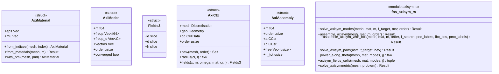

# Axisymmetric kernel: code

C4 level 4 (code) of the component **Axisymmetric kernel** (`ems.axisym`) in the container **nyx-ems** (crate `nyx_ems`). [Component view of the container](../../3-components/ems.md) · [All code pages](../README.md)

> Electromagnetic eigenmodes of a body of revolution (rings, disks, coaxial cavities).

**Decisions:** [ADR 46](../../../adr/0046-axisymmetric-ems-checked-and-given-a-study.md)  
**Size:** 1 file, 502 lines.

## Files

| File | Lines | What it says about itself |
|---|---:|---|
| `crates/nyx-ems/src/axisym.rs` | 502 |  |

## What it uses

| Target | Modules | Items |
|---|---|---|
| [container `femcore` (femcore)](../../3-components/femcore.md) | edge, fem, fields, linalg::csr, linalg::csr::assembly, linalg::driver, optical, pml +1 | C, CCoo, CCsr, CellData, CellFields, EPS0, MU0, Materials, Pml, PmlDir +10 |
| [container `physics` (nyx-physics)](../../3-components/physics.md) | crate root, result | Discretisation, Field, Scalar, Solution, SolveResult, cell_fields_of |
| [Thin-film IBC and Josephson ROM](./ibc.md) | ibc | add_ibc_2d_axisym, pec_edges_and_nodes_2d |
| [Mode kernel](./modes.md) | crate root | C0 |
| [Typed problem](./problem.md) | problem | Problem, Study, SurfaceImpedanceBc |

## Used by

| Component | Modules | Items |
|---|---|---|
| [Physics adapter](./adapter.md) | axisym | AxiAssembly, AxiMaterial, AxiModes, assemble_axisym, assemble_axisym_with_bcs, axisym_fields_cells, power_along_theta, solve_axisym_modes +2 |

## Class diagram

Public types with their public fields (or variants) and methods, free functions per file as a `module` box; arrows are field types and `impl Trait`. Capped at 36 types and a few members each; the table below is complete.

## Public items

| Kind | Item | File:line | Signature or summary |
|---|---|---|---|
| struct | `AxiMaterial` | `axisym.rs:39` | fields: `eps`, `mu` —  Material data of every cell of an axisymmetric problem (diagonal tensors in the order r, z, theta; complex inside |
| struct | `AxiModes` | `axisym.rs:112` | fields: `m`, `freqs`, `freqs_c`, `vectors`, `order`, `converged` —  Modes of one azimuthal order. |
| struct | `Fields3` | `axisym.rs:126` | fields: `e`, `d`, `h` —  Fields of one mode at a point. |
| struct | `AxiCtx` | `axisym.rs:132` | fields: `mesh`, `geo`, `cd`, `order` |
| fn | `solve_axisym_modes` | `axisym.rs:198` | `pub fn solve_axisym_modes( mesh: &Discretisation, mat: &AxiMaterial, m: f64, f_target: f64, nev: usize, order: usize, ) -> Result<AxiModes, String>` —  Modes with frequency nearest `f_target` at azimuthal order `m` (`nev` of them). |
| struct | `AxiAssembly` | `axisym.rs:212` | fields: `m`, `order`, `a`, `b`, `free`, `n_tot` —  Stage 1: the curl-curl matrix `A` and the permittivity mass `B` of `A x = (omega/c)^2 B x` on the free dofs (edge |
| fn | `assemble_axisym` | `axisym.rs:221` | `pub fn assemble_axisym(mesh: &Discretisation, mat: &AxiMaterial, m: f64, order: usize) -> Result<AxiAssembly, String>` |
| fn | `assemble_axisym_with_bcs` | `axisym.rs:225` | `pub fn assemble_axisym_with_bcs( mesh: &Discretisation, mat: &AxiMaterial, m: f64, order: usize, f_search: f64, pec_labels: &[i32], ibc_bcs: &[SurfaceImpedanceBc], pmc_labels: &[i32], ) -> Result<AxiAssembly, String>` |
| fn | `solve_axisym_pairs` | `axisym.rs:343` | `pub fn solve_axisym_pairs(asm: &AxiAssembly, f_target: f64, nev: usize) -> Result<AxiModes, String>` —  Stage 2: the `nev` eigenpairs nearest `f_target` (Hz), as complex frequencies and field vectors over all dofs, |
| fn | `power_along_theta` | `axisym.rs:377` | `pub fn power_along_theta(mesh: &Discretisation, mat: &AxiMaterial, modes: &AxiModes, j: usize) -> f64` —  The power `P = 2 Int Re(conj(E_z) H_r - conj(E_r) H_z) dA` of mode `j` along `+theta` (W for the amplitudes of the mode), with the |
| fn | `axisym_fields_cells` | `axisym.rs:394` | `pub fn axisym_fields_cells( mesh: &Discretisation, mat: &AxiMaterial, modes: &AxiModes, j: usize, ) -> (Vec<Field>, CellFields)` —  Stage 3: the electric field of mode `j` at the local nodes of every cell, as plot fields (`\|E\|`, `Re Ex`, `Re Ey`, `Re Ez`, wafer names: x is |
| fn | `solve_axisymmetric` | `axisym.rs:434` | `pub fn solve_axisymmetric(mesh: &Discretisation, problem: &Problem) -> Result<SolveResult, String>` —  The modes of a body of revolution for an `AxisymmetricModes` study: the three stages, one solution per mode with its frequency (and Q when |
| fn | `AxiMaterial::from_indices` | `axisym.rs:46` | `pub fn from_indices(mesh: &Discretisation, index: &std::collections::BTreeMap<i32, f64>) -> AxiMaterial` —  Isotropic `eps_r` and `mu_r = 1` per domain (`index`: refractive index per domain label, default 1). |
| fn | `AxiMaterial::from_materials` | `axisym.rs:57` | `pub fn from_materials(mesh: &Discretisation, m: &Materials) -> Result<AxiMaterial, String>` —  `eps_r` and `mu_r` per domain from the problem's materials (default 1), absorbing layers (`Materials::pml`) included. |
| fn | `AxiMaterial::with_pml` | `axisym.rs:71` | `pub fn with_pml(mut self, mesh: &Discretisation, pml: &std::collections::BTreeMap<i32, Pml>) -> AxiMaterial` —  Absorbing layers by complex coordinate stretching of `r` and `z` (`Pml::x` is the r direction, `Pml::z` the z direction). |
| fn | `AxiCtx::new` | `axisym.rs:140` | `pub fn new(mesh: &'a Discretisation, order: usize) -> Self` |
| fn | `AxiCtx::radius` | `axisym.rs:144` | `pub fn radius(&self, ci: usize, l: &[f64; 3]) -> f64` |
| fn | `AxiCtx::fields` | `axisym.rs:151` | `pub fn fields(&self, x: &[C], m: f64, omega: f64, mat: &AxiMaterial, ci: usize, l: &[f64; 3]) -> Fields3` —  E (r, z, theta), D and H of a mode (coefficients `x`, azimuthal order `m`, angular frequency `omega`) |
