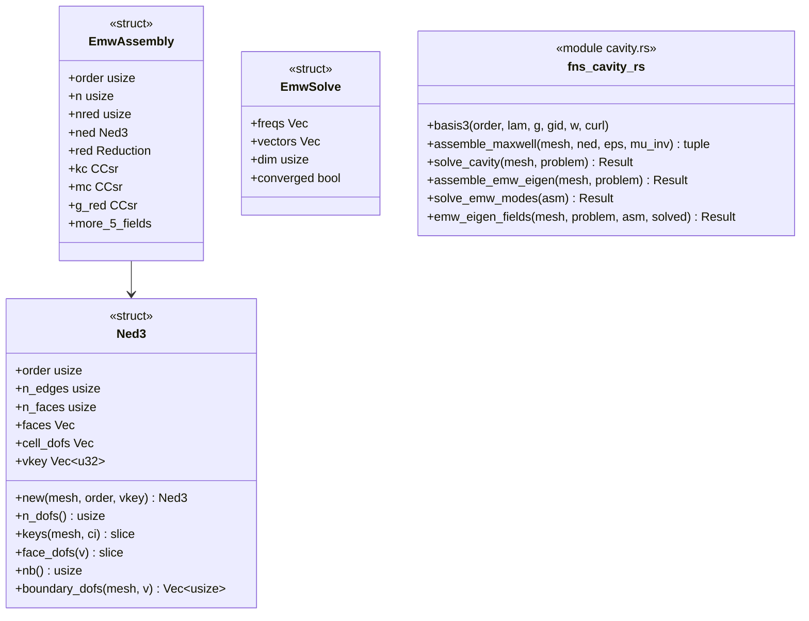

# 3D cavity kernel: code

C4 level 4 (code) of the component **3D cavity kernel** (`ems.cavity`) in the container **nyx-ems** (crate `nyx_ems`). [Component view of the container](../../3-components/ems.md) · [All code pages](../README.md)

> Electromagnetic eigenmodes of 3D cavities and resonators.

**Decisions:** [ADR 45](../../../adr/0045-ems-moves-into-nyx-ems.md)  
**Size:** 1 file, 746 lines.

## Files

| File | Lines | What it says about itself |
|---|---:|---|
| `crates/nyx-ems/src/cavity.rs` | 746 | Electromagnetic eigenmodes of 3D cavities and resonators (the `Eigenfrequency` study of EM waves on a tetrahedral mesh): `curl(1/mu curl E) = (2 pi f / c)^2 eps E` with perfect electric conductor on the exterior boundary and optional per... |

## What it uses

| Target | Modules | Items |
|---|---|---|
| [container `femcore` (femcore)](../../3-components/femcore.md) | fem, fields, linalg::amg_elastic, linalg::arnoldi_real, linalg::csr, linalg::csr::assembly, linalg::driver, par +5 | C, CCoo, CCsr, CellFields, Coo, DirectSolver, EigOpts, Match, RCsr, Reduction +17 |
| [container `physics` (nyx-physics)](../../3-components/physics.md) | crate root, frame, result | Discretisation, Field, FieldFrame, Scalar, Solution, SolveResult, cell_fields_of |
| [Mode kernel](./modes.md) | crate root | C0 |
| [Typed problem](./problem.md) | problem | Problem, Study |

## Used by

| Component | Modules | Items |
|---|---|---|
| [Physics adapter](./adapter.md) | cavity | EmwAssembly, EmwSolve, assemble_emw_eigen, emw_eigen_fields, solve_cavity, solve_emw_modes |

## Class diagram

Public types with their public fields (or variants) and methods, free functions per file as a `module` box; arrows are field types and `impl Trait`. Capped at 36 types and a few members each; the table below is complete.

## Public items

| Kind | Item | File:line | Signature or summary |
|---|---|---|---|
| struct | `Ned3` | `cavity.rs:38` | fields: `order`, `n_edges`, `n_faces`, `faces`, `cell_dofs`, `vkey` —  Global numbering of the degrees of freedom. |
| fn | `basis3` | `cavity.rs:166` | `pub fn basis3( order: usize, lam: &[f64; 4], g: &[[f64; 3]; 4], gid: &[u32; 4], w: &mut Vec<[f64; 3]>, curl: &mut Vec<[f64; 3]>, )` —  Basis functions and their curls at the barycentric point `lam` of a tetrahedron with vertex |
| fn | `assemble_maxwell` | `cavity.rs:232` | `pub fn assemble_maxwell(mesh: &Discretisation, ned: &Ned3, eps: &[C3], mu_inv: &[[C; 3]]) -> (CCsr, CCsr)` —  The curl-curl matrix `K` (weights `1/mu` per axis) and the mass matrix `M` (permittivity tensor) |
| fn | `solve_cavity` | `cavity.rs:388` | `pub fn solve_cavity(mesh: &Discretisation, problem: &Problem) -> Result<SolveResult, String>` —  Eigenfrequencies of the cavity for a `Cavity` study: the three stages in order. The result carries the complex field of every mode and |
| struct | `EmwAssembly` | `cavity.rs:399` | fields: `order`, `n`, `nred`, `ned`, `red`, `kc`, `mc`, `g_red`, `g_h`, `f0`, `sigma`, `n_modes`, ... —  Stage 1 of the 3D EM eigenfrequency kernel: Nedelec numbering, `K` and `M` (PML stretch, anisotropy) reduced by the PEC |
| struct | `EmwSolve` | `cavity.rs:416` | fields: `freqs`, `vectors`, `dim`, `converged` —  Stage 2 output: complex frequencies (Hz) with the index of their reduced vector, sorted by real part. |
| fn | `assemble_emw_eigen` | `cavity.rs:423` | `pub fn assemble_emw_eigen(mesh: &Discretisation, problem: &Problem) -> Result<EmwAssembly, String>` |
| fn | `solve_emw_modes` | `cavity.rs:548` | `pub fn solve_emw_modes(asm: &EmwAssembly) -> Result<EmwSolve, String>` —  Stage 2: the eigenpairs `K x = k0^2 M x` nearest the shift with the gradients projected out (real symmetric route with |
| fn | `emw_eigen_fields` | `cavity.rs:621` | `pub fn emw_eigen_fields( mesh: &Discretisation, problem: &Problem, asm: &EmwAssembly, solved: &EmwSolve, ) -> Result<SolveResult, String>` —  Stage 3: plot fields and per-cell complex E of every mode at the quadratic nodes, the frequencies and Q, and the frame of the |
| fn | `Ned3::new` | `cavity.rs:60` | `pub fn new(mesh: &Discretisation, order: usize, vkey: Vec<u32>) -> Ned3` |
| fn | `Ned3::n_dofs` | `cavity.rs:101` | `pub fn n_dofs(&self) -> usize` |
| fn | `Ned3::keys` | `cavity.rs:110` | `pub fn keys(&self, mesh: &Discretisation, ci: usize) -> [u32` —  Ordering keys of the vertices of cell `ci`. |
| fn | `Ned3::face_dofs` | `cavity.rs:116` | `pub fn face_dofs(&self, v: [u32; 3]) -> [usize` —  Dofs of the functions of face `v` (sorted triple of vertex numbers). |
| fn | `Ned3::nb` | `cavity.rs:121` | `pub fn nb(&self) -> usize` |
| fn | `Ned3::boundary_dofs` | `cavity.rs:131` | `pub fn boundary_dofs(&self, mesh: &Discretisation, v: [u32; 3]) -> Vec<usize>` —  Dofs of the tangential trace on a boundary face with vertices `v`: the face functions and the |
