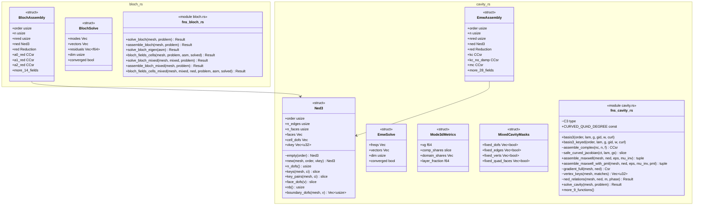

# 3D cavity kernel: code

C4 level 4 (code) of the component **3D cavity kernel** (`ems.cavity`) in the container **nyx-ems** (crate `nyx_ems`). [Component view of the container](../../3-components/ems.md) · [All code pages](../README.md)

> Electromagnetic eigenmodes of 3D cavities and resonators, with superconducting thin-film IBC, lumped Josephson junctions, and physical H/K export.

**Decisions:** [ADR 45](../../../adr/0045-ems-moves-into-nyx-ems.md), [ADR 104](../../../adr/0104-bcs-surface-impedance-and-lumped-josephson-ports.md)  
**Size:** 2 files, 3716 lines.

## Files

| File | Lines | What it says about itself |
|---|---:|---|
| `crates/nyx-ems/src/bloch.rs` | 951 |  |
| `crates/nyx-ems/src/cavity.rs` | 2765 |  |

## What it uses

| Target | Modules | Items |
|---|---|---|
| [container `femcore` (femcore)](../../3-components/femcore.md) | edge_mixed, fem, fem_mixed, fields, linalg::amg_elastic, linalg::arnoldi_real, linalg::csr, linalg::csr::assembly +7 | C, CCoo, CCsr, CellFields, Coo, CurvedTet, DirectSolver, EigOpts, FacetType, IsoparametricCell +34 |
| [container `physics` (nyx-physics)](../../3-components/physics.md) | crate root, frame, result | Discretisation, Field, FieldFrame, Mesh, MixedToSimplexProjector, Scalar, Solution, SolveResult, cell_fields_of |
| [Driven frequency-domain and PROM](./driven.md) | ports | AssembledLumpedPort, assemble_lumped_ports_3d, validate_port_contacts_3d |
| [Thin-film IBC and Josephson ROM](./ibc.md) | ibc, rom | AssembledJjPort, EPS0, MU0, PerturbativeIbcEvaluator, PerturbativeIbcTri, SheetCellKind, assemble_ibc_and_jj_3d, assemble_ibc_and_jj_3d_cavity, build_circuit_rom, build_circuit_rom_mixed +7 |
| [Native mixed-cell EM](./mixed.md) | mixed_ops | EmPmlTable, MixedCellMaterials, add_bloch_point_c3, add_maxwell_point_c3, assemble_bloch_matrices_mixed, assemble_ibc_and_jj_3d_mixed, assemble_ibc_and_jj_3d_mixed_cavity, assemble_lumped_ports_3d_mixed, assemble_maxwell_mixed, axes_of_3d_periodic_mixed +9 |
| [Mode kernel](./modes.md) | crate root | C0 |
| [Optical mode sets](./optical.md) | optical | absorbing_domains |
| [Typed problem](./problem.md) | problem | Problem, Study, symmetry_facet_flags, symmetry_facet_flags_mixed |

## Used by

| Component | Modules | Items |
|---|---|---|
| [Physics adapter](./adapter.md) | bloch, cavity | BlochAssembly, BlochSolve, EmwAssembly, EmwSolve, MixedCavityMasks, assemble_bloch, assemble_bloch_mixed, assemble_emw_eigen +10 |
| [Driven frequency-domain and PROM](./driven.md) | cavity | Ned3, assemble_maxwell_with_pml, basis3_keyed, gradient_full, safe_curved_jacobian |
| [Thin-film IBC and Josephson ROM](./ibc.md) | cavity | CURVED_QUAD_DEGREE, EmwAssembly, Ned3, basis3_keyed, gradient_full, safe_curved_jacobian |
| [Native mixed-cell EM](./mixed.md) | cavity | CURVED_QUAD_DEGREE, assemble_complex |

## Class diagram

Public types with their public fields (or variants) and methods, free functions per file as a `module` box; arrows are field types and `impl Trait`. Capped at 36 types and a few members each; the table below is complete.

## Public items

| Kind | Item | File:line | Signature or summary |
|---|---|---|---|
| struct | `BlochAssembly` | `bloch.rs:47` | fields: `order`, `n`, `nred`, `ned`, `red`, `a0_red`, `a1_red`, `a2_red`, `freq`, `k0`, `lambda0`, `period_y`, ... —  Stage 1 of the 3D fixed-frequency Bloch kernel: Nedelec numbering, reduced quadratic pencil `(A0, A1, A2)` in `nu = k_y / k_0`, |
| struct | `BlochSolve` | `bloch.rs:73` | fields: `modes`, `vectors`, `residuals`, `dim`, `converged` —  Stage 2 output: converged complex Bloch indices `(n_B, vec_index)` sorted by distance to `sigma`. |
| fn | `solve_bloch` | `bloch.rs:82` | `pub fn solve_bloch(mesh: &Discretisation, problem: &Problem) -> Result<SolveResult, String>` —  Solves a 3D `Study::Bloch` problem through its three stages (`assemble_bloch`, `solve_bloch_eigen`, `bloch_fields_cells`). |
| fn | `assemble_bloch` | `bloch.rs:184` | `pub fn assemble_bloch(mesh: &Discretisation, problem: &Problem) -> Result<BlochAssembly, String>` —  Stage 1: validates `y`-periodicity and transverse PMLs, assembles `(A0, A1, A2)` on `Ned3`, and reduces them via `P^H (.) P` |
| fn | `solve_bloch_eigen` | `bloch.rs:348` | `pub fn solve_bloch_eigen(asm: &BlochAssembly) -> Result<BlochSolve, String>` —  Stage 2: solves `(A0 + nu A1 + nu^2 A2) u = 0` near `sigma`, filters true QEP relative residuals `< 1e-5`, |
| fn | `bloch_fields_cells` | `bloch.rs:375` | `pub fn bloch_fields_cells( mesh: &Discretisation, problem: &Problem, asm: &BlochAssembly, solved: &BlochSolve, ) -> Result<SolveResult, String>` —  Stage 3: reconstructs physical `E = e_tilde exp(-j k_y (y - y_min))` and |
| fn | `solve_bloch_mixed` | `bloch.rs:586` | `pub fn solve_bloch_mixed(mesh: &Mesh, mixed: &MixedDiscretisation, problem: &Problem) -> Result<SolveResult, String>` —  Solves a 3D `Study::Bloch` problem natively on `Tet + Prism + Hex` (`MixedDiscretisation`). |
| fn | `assemble_bloch_mixed` | `bloch.rs:595` | `pub fn assemble_bloch_mixed( mesh: &MixedDiscretisation, problem: &Problem, ) -> Result<(BlochAssembly, NedMixed), String>` |
| fn | `bloch_fields_cells_mixed` | `bloch.rs:763` | `pub fn bloch_fields_cells_mixed( mesh: &Mesh, mixed: &MixedDiscretisation, ned: &NedMixed, problem: &Problem, asm: &BlochAssembly, solved: &BlochSolve, ) -> Result<SolveResult, String>` |
| struct | `Ned3` | `cavity.rs:59` | fields: `order`, `n_edges`, `n_faces`, `faces`, `cell_dofs`, `vkey` —  Global numbering of the degrees of freedom. |
| fn | `basis3` | `cavity.rs:210` | `pub fn basis3( order: usize, lam: &[f64; 4], g: &[[f64; 3]; 4], gid: &[u32; 4], w: &mut Vec<[f64; 3]>, curl: &mut Vec<[f64; 3]>, )` —  Basis functions and their curls at the barycentric point `lam` of a tetrahedron with vertex |
| fn | `basis3_keyed` | `cavity.rs:224` | `pub fn basis3_keyed( order: usize, lam: &[f64; 4], g: &[[f64; 3]; 4], gid: &[(u32, u32); 4], w: &mut Vec<[f64; 3]>, curl: &mut Vec<[f64; 3]>, )` —  Like [`basis3`], taking composite `(vkey, vertex_id)` keys so edges/faces touching periodic |
| type | `C3` | `cavity.rs:264` |  |
| fn | `assemble_complex` | `cavity.rs:296` | `pub(crate) fn assemble_complex<F>(nc: usize, n: usize, f: F) -> CCsr` |
| const | `CURVED_QUAD_DEGREE` | `cavity.rs:329` | `usize` —  Degree of the quadrature rule on cells with a curved edge (ADR 82): the integrand is rational in the barycentric coordinates there. |
| fn | `safe_curved_jacobian` | `cavity.rs:334` | `pub(crate) fn safe_curved_jacobian(ct: &CurvedTet, lam: &[f64; 4], gs: &[[f64; 3]; 4]) -> [[f64` —  Safe physical barycentric gradients on a curved tetrahedron: on Barsoum quarter-point (`xi_QP = 0.25`) |
| fn | `assemble_maxwell` | `cavity.rs:362` | `pub fn assemble_maxwell(mesh: &Discretisation, ned: &Ned3, eps: &[C3], mu_inv: &[C3]) -> (CCsr, CCsr)` —  The curl-curl matrix `K` (symmetric `3x3` `mu_inv` tensor) and the mass matrix `M` (`eps` tensor) over all dofs. |
| fn | `assemble_maxwell_with_pml` | `cavity.rs:367` | `pub fn assemble_maxwell_with_pml( mesh: &Discretisation, ned: &Ned3, eps: &[C3], mu_inv: &[C3], pml: Option<&EmPmlTable>, ) -> (CCsr, CCsr)` —  Like [`assemble_maxwell`], evaluating curvilinear PML `pml_jacobian` + `pullback_maxwell` at each Gauss point inside PML cells. |
| fn | `gradient_full` | `cavity.rs:460` | `pub(crate) fn gradient_full(mesh: &Discretisation, ned: &Ned3) -> Csr` —  The discrete gradient over all nodes: one column per vertex (the Whitney edge coefficients |
| fn | `vertex_keys` | `cavity.rs:490` | `pub(crate) fn vertex_keys(mesh: &Discretisation, matches: &[femcore::periodic::Match]) -> Vec<u32>` —  Equivalence classes of the vertices of periodic boundaries: the key of a vertex is the smallest |
| fn | `ned_relations` | `cavity.rs:514` | `pub(crate) fn ned_relations( mesh: &Discretisation, ned: &Ned3, m: &femcore::periodic::Match, phase: f64, ) -> Result<Vec<(usize, usize, C)>, String>` —  Relations between the dofs of the two sides of a periodic pair (all one to one because the basis |
| fn | `solve_cavity` | `cavity.rs:556` | `pub fn solve_cavity(mesh: &Discretisation, problem: &Problem) -> Result<SolveResult, String>` —  Eigenfrequencies of the cavity for a `Cavity` study: the three stages in order. The result carries the complex field of every mode and |
| struct | `EmwAssembly` | `cavity.rs:567` | fields: `order`, `n`, `nred`, `ned`, `red`, `kc`, `kc_no_damp`, `mc`, `g_red`, `g_h`, `f0`, `sigma`, ... —  Stage 1 of the 3D EM eigenfrequency kernel: Nedelec numbering, `K` and `M` (PML stretch, anisotropy, IBC, JJ) reduced by the PEC |
| struct | `EmwSolve` | `cavity.rs:607` | fields: `freqs`, `vectors`, `dim`, `converged` —  Stage 2 output: complex frequencies (Hz) with the index of their reduced vector, sorted by real part. |
| fn | `assemble_emw_eigen` | `cavity.rs:614` | `pub fn assemble_emw_eigen(mesh: &Discretisation, problem: &Problem) -> Result<EmwAssembly, String>` |
| fn | `solve_emw_modes` | `cavity.rs:1135` | `pub fn solve_emw_modes(asm: &EmwAssembly) -> Result<EmwSolve, String>` —  Stage 2: the eigenpairs `K x = k0^2 M x` nearest the shift with the gradients projected out (real symmetric route with |
| fn | `emw_eigen_fields` | `cavity.rs:1305` | `pub fn emw_eigen_fields( mesh: &Discretisation, problem: &Problem, asm: &EmwAssembly, solved: &EmwSolve, ) -> Result<SolveResult, String>` —  Stage 3: plot fields and per-cell complex E and H (plus sheet K when sheets are present) of every mode at the quadratic nodes, |
| struct | `Mode3dMetrics` | `cavity.rs:1600` | fields: `vg`, `comp_shares`, `domain_shares`, `layer_fraction` —  3D mode energy shares, PML layer fraction, and (when `compute_vg` is true) single-solve Poynting `v_g` |
| fn | `compute_3d_mode_metrics` | `cavity.rs:1608` | `pub(crate) fn compute_3d_mode_metrics( mesh: &Discretisation, ned: &Ned3, geo: &Geometry, x: &[C], ky_envelope: C, omega: f64, pml_cells: &[bool], eps_phys_re: &[[[f64; 3]; 3]], d_omega_eps: &[[[f64; 3]; 3]], mur_phys: &[f64], compute_vg: bool, ) -> Mode3dMetrics` |
| struct | `MixedCavityMasks` | `cavity.rs:1734` | fields: `fixed_dofs`, `fixed_edges`, `fixed_verts`, `fixed_quad_faces` —  Masks of constrained DOFs, edges, vertices, and quad faces on a 3D `MixedDiscretisation` for `Ams` / `AmsP2`. |
| fn | `solve_cavity_mixed` | `cavity.rs:1742` | `pub fn solve_cavity_mixed(mesh: &Mesh, mixed: &MixedDiscretisation, problem: &Problem) -> Result<SolveResult, String>` —  Solves a 3D `Cavity` study natively on `Tet + Prism + Hex` (`MixedDiscretisation`), projecting Stage-3 display fields onto `SimplexMesh`. |
| fn | `solve_cavity_mixed_ams` | `cavity.rs:1753` | `pub fn solve_cavity_mixed_ams( mesh: &Mesh, mixed: &MixedDiscretisation, problem: &Problem, ) -> Result<SolveResult, String>` —  Solves a 3D `Cavity` study natively on `Tet + Prism + Hex` via iterative Jacobi-Davidson preconditioned by `Ams` (`P1`) or `AmsP2` (`P2`), |
| fn | `assemble_emw_eigen_mixed` | `cavity.rs:1801` | `pub fn assemble_emw_eigen_mixed( mesh: &MixedDiscretisation, problem: &Problem, is_iterative: bool, ) -> Result<(EmwAssembly, NedMixed, MixedCavityMasks), String>` —  Stage 1 on a 3D `MixedDiscretisation` (`Tet + Prism + Hex`). |
| fn | `emw_eigen_fields_mixed` | `cavity.rs:2376` | `pub fn emw_eigen_fields_mixed( mesh: &Mesh, mixed: &MixedDiscretisation, ned: &NedMixed, problem: &Problem, asm: &EmwAssembly, solved: &EmwSolve, ) -> Result<SolveResult, String>` —  Stage 3 on a 3D `MixedDiscretisation`: evaluates native `NedMixed` fields and projects them onto `SimplexMesh` via `MixedToSimplexProjector`. |
| fn | `compute_3d_mode_metrics_mixed` | `cavity.rs:2660` | `pub(crate) fn compute_3d_mode_metrics_mixed( mesh: &MixedDiscretisation, ned: &NedMixed, isos: &[IsoparametricCell], x: &[C], ky_envelope: C, omega: f64, pml_cells: &[bool], eps_phys_re: &[[[f64; 3]; 3]], d_omega_eps: &[[[f64; 3]; 3]], mur_phys: &[f64], compute_vg: bool, ) -> Mode3dMetrics` |
| fn | `Ned3::empty` | `cavity.rs:81` | `pub(crate) fn empty(order: usize) -> Ned3` |
| fn | `Ned3::new` | `cavity.rs:93` | `pub fn new(mesh: &Discretisation, order: usize, vkey: Vec<u32>) -> Ned3` |
| fn | `Ned3::n_dofs` | `cavity.rs:134` | `pub fn n_dofs(&self) -> usize` |
| fn | `Ned3::keys` | `cavity.rs:143` | `pub fn keys(&self, mesh: &Discretisation, ci: usize) -> [u32` —  Ordering keys of the vertices of cell `ci`. |
| fn | `Ned3::key_pairs` | `cavity.rs:149` | `pub fn key_pairs(&self, mesh: &Discretisation, ci: usize) -> [(u32, u32)` —  Composite ordering keys `(vkey[v], v)` of cell `ci`, breaking periodic ties deterministically by vertex ID. |
| fn | `Ned3::face_dofs` | `cavity.rs:160` | `pub fn face_dofs(&self, v: [u32; 3]) -> [usize` —  Dofs of the functions of face `v` (sorted triple of vertex numbers). |
| fn | `Ned3::nb` | `cavity.rs:165` | `pub fn nb(&self) -> usize` |
| fn | `Ned3::boundary_dofs` | `cavity.rs:175` | `pub fn boundary_dofs(&self, mesh: &Discretisation, v: [u32; 3]) -> Vec<usize>` —  Dofs of the tangential trace on a boundary face with vertices `v`: the face functions and the |
