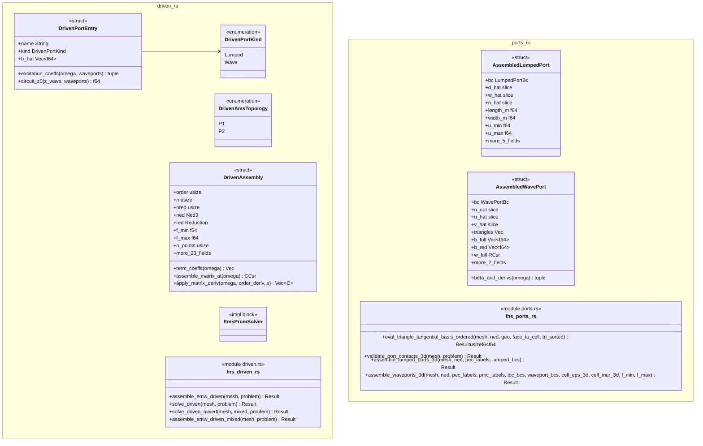

# Driven frequency-domain and PROM: code

C4 level 4 (code) of the component **Driven frequency-domain and PROM** (`ems.driven`) in the container **nyx-ems** (crate `nyx_ems`). [Component view of the container](../../3-components/ems.md) · [All code pages](../README.md)

> Driven 3D frequency-domain curl-curl solver with lumped/waveport excitations (curved 2D port integrals), curvilinear PML power `P_pml`, and Hermite Tangential Galerkin PROM sweep acceleration.

**Decisions:** [ADR 106](../../../adr/0106-driven-frequency-domain-waveports-and-hermite-prom.md), [ADR 132](../../../adr/0132-vvuq-asme-six-pillar-code-verification.md)  
**Size:** 2 files, 3005 lines.

## Files

| File | Lines | What it says about itself |
|---|---:|---|
| `crates/nyx-ems/src/driven.rs` | 1778 |  |
| `crates/nyx-ems/src/ports.rs` | 1227 |  |

## What it uses

| Target | Modules | Items |
|---|---|---|
| [container `femcore` (femcore)](../../3-components/femcore.md) | edge, edge_mixed, fem, fem_mixed, fields, linalg::amg_elastic, linalg::ams, linalg::csr +9 | AmsFgmresOptions, AmsFgmresSolver, AmsP2Topology, C, CCsr, CellFields, Coo, CurvedTet, DEFAULT_RUIZ_PASSES, FacetType +41 |
| [container `physics` (nyx-physics)](../../3-components/physics.md) | cqed, crate root, frame, result | Discretisation, DrivenPortData, Field, FieldFrame, Mesh, MixedToSimplexProjector, Scalar, Solution, SolveResult, cell_fields_of |
| [3D cavity kernel](./cavity.md) | cavity | Ned3, assemble_maxwell_with_pml, basis3_keyed, gradient_full, safe_curved_jacobian |
| [Thin-film IBC and Josephson ROM](./ibc.md) | crate root, ibc, rom | AssembledJjPort, MU0, SheetCellKind, assemble_ibc_and_jj_3d, build_face_to_cell_3d, build_tls_meta, reduce_real_csr, reduce_real_vec, sorted3 |
| [Native mixed-cell EM](./mixed.md) | mixed_ops | EmPmlTable, MixedCellMaterials, assemble_ibc_and_jj_3d_mixed, assemble_lumped_ports_3d_mixed, assemble_maxwell_mixed, assemble_waveports_3d_mixed, axes_of_3d_periodic_mixed, iso_mu_inv_c3, match_vertices_mixed, simplex_cell_materials_3d +2 |
| [Mode kernel](./modes.md) | crate root, modes | C0, EpsCell, assemble_modes_with_bcs, solve_mode_pairs |
| [Optical mode sets](./optical.md) | optical | absorbing_domains |
| [Typed problem](./problem.md) | problem | LumpedPortBc, Problem, Study, SurfaceImpedanceBc, WavePortBc, symmetry_facet_flags, symmetry_facet_flags_mixed |

## Used by

| Component | Modules | Items |
|---|---|---|
| [Physics adapter](./adapter.md) | driven, ports | AssembledLumpedPort, AssembledWavePort, DrivenAssembly, assemble_emw_driven, assemble_emw_driven_mixed, assemble_lumped_ports_3d, assemble_waveports_3d, solve_driven +2 |
| [3D cavity kernel](./cavity.md) | ports | AssembledLumpedPort, assemble_lumped_ports_3d, validate_port_contacts_3d |
| [Native mixed-cell EM](./mixed.md) | ports | AssembledLumpedPort, AssembledWavePort |

## Class diagram

Public types with their public fields (or variants) and methods, free functions per file as a `module` box; arrows are field types and `impl Trait`. Capped at 36 types and a few members each; the table below is complete.

## Public items

| Kind | Item | File:line | Signature or summary |
|---|---|---|---|
| enum | `DrivenPortKind` | `driven.rs:123` | variants: `Lumped`, `Wave` —  Kind of driven port in the unified port list `0..P`. |
| struct | `DrivenPortEntry` | `driven.rs:130` | fields: `name`, `kind`, `b_hat` —  Unified metadata for one driven port $p \in \{0..P-1\}$. |
| enum | `DrivenAmsTopology` | `driven.rs:173` | variants: `P1`, `P2` —  Auxiliary-space topology for `solver == "ams_fgmres"` on $P_1$ or $P_2$ Nedelec spaces (`FR-33`). |
| struct | `DrivenAssembly` | `driven.rs:233` | fields: `order`, `n`, `nred`, `ned`, `red`, `f_min`, `f_max`, `n_points`, `freqs_hz`, `prom_tol`, `max_hdm_solves`, `strict_prom_tol`, ... —  Stage 1 of the 3D driven frequency-domain solver: Nedelec numbering, PEC/periodic reduction, |
| fn | `assemble_emw_driven` | `driven.rs:354` | `pub fn assemble_emw_driven(mesh: &Discretisation, problem: &Problem) -> Result<DrivenAssembly, String>` —  Assembles Stage 1 (`DrivenAssembly`) for a 3D `Study::Driven` problem. |
| fn | `solve_driven` | `driven.rs:1259` | `pub fn solve_driven(mesh: &Discretisation, problem: &Problem) -> Result<SolveResult, String>` —  Solves a 3D `Study::Driven` frequency sweep via Hermite Tangential Galerkin PROM (`prom_tol = Some(tol)`) |
| fn | `solve_driven_mixed` | `driven.rs:1335` | `pub fn solve_driven_mixed(mesh: &Mesh, mixed: &MixedDiscretisation, problem: &Problem) -> Result<SolveResult, String>` —  Solves a 3D `Study::Driven` sweep natively on `Tet + Prism + Hex` (`MixedDiscretisation`). |
| fn | `assemble_emw_driven_mixed` | `driven.rs:1412` | `pub fn assemble_emw_driven_mixed( mesh: &MixedDiscretisation, problem: &Problem, ) -> Result<(DrivenAssembly, NedMixed), String>` |
| fn | `DrivenPortEntry::excitation_coeffs` | `driven.rs:141` | `pub fn excitation_coeffs(&self, omega: f64, waveports: &[AssembledWavePort]) -> (f64, C, C, C)` —  Returns `(z0_p(omega), gamma_p(omega), d(gamma_p)/d(omega), d^2(gamma_p)/d(omega)^2)` at angular frequency `omega` (rad/s), |
| fn | `DrivenPortEntry::circuit_z0` | `driven.rs:164` | `pub fn circuit_z0(&self, z_wave: f64, waveports: &[AssembledWavePort]) -> f64` —  Returns the circuit reference impedance `Z_0` used for `DrivenPortData::z0_ohm` and `S -> Z/Y` conversion. |
| fn | `DrivenAssembly::term_coeffs` | `driven.rs:272` | `pub fn term_coeffs(&self, omega: f64) -> Vec<(C, C, C)>` —  Evaluates the complex scalar coefficients $(\alpha_m(\omega), \alpha_m'(\omega), \alpha_m''(\omega))$ for each term $\hat{\mathbf{A}}_m$. |
| fn | `DrivenAssembly::assemble_matrix_at` | `driven.rs:293` | `pub fn assemble_matrix_at(&self, omega: f64) -> CCsr` —  Assembles the full equilibrated matrix $\hat{\mathbf{A}}(\omega) = \sum_m \alpha_m(\omega) \hat{\mathbf{A}}_m$ |
| fn | `DrivenAssembly::apply_matrix_deriv` | `driven.rs:305` | `pub fn apply_matrix_deriv(&self, omega: f64, order_deriv: usize, x: &[C]) -> Vec<C>` —  Computes $\mathbf{y} = \hat{\mathbf{A}}'(\omega) \mathbf{x}$ or $\hat{\mathbf{A}}''(\omega) \mathbf{x}$. |
| struct | `AssembledLumpedPort` | `ports.rs:55` | fields: `bc`, `d_hat`, `w_hat`, `n_hat`, `length_m`, `width_m`, `u_min`, `u_max`, `triangles`, `cpw_slots`, `b_full`, `b_red`, ... —  Assembled operators and geometric metadata for one `lumped_port` terminal port. |
| struct | `AssembledWavePort` | `ports.rs:77` | fields: `bc`, `n_out`, `u_hat`, `v_hat`, `triangles`, `b_full`, `b_red`, `w_full`, `w_red`, `beta2_poly` —  Assembled operators, 2D modal dispersion, and geometric metadata for one `waveport`. |
| fn | `eval_triangle_tangential_basis_ordered` | `ports.rs:122` | `pub fn eval_triangle_tangential_basis_ordered( mesh: &Discretisation, ned: &Ned3, geo: &femcore::fem::Geometry, face_to_cell: &HashMap<[u32; 3], (usize, [usize; 3])>, tri_sorted: [u32; 3], ) -> Result<(usize, f64, [f64` —  Evaluates the 3D tangential Nedelec basis vectors `psi_{s,\|\|} = w_s - (w_s . n) n` at the 6-point Dunavant |
| fn | `validate_port_contacts_3d` | `ports.rs:316` | `pub fn validate_port_contacts_3d(mesh: &Discretisation, problem: &Problem) -> Result<(), String>` —  Startup two-conductor contact validator for 3D `lumped_jj` and `lumped_port` sheets. |
| fn | `assemble_lumped_ports_3d` | `ports.rs:521` | `pub fn assemble_lumped_ports_3d( mesh: &Discretisation, ned: &Ned3, pec_labels: &[i32], lumped_bcs: &[LumpedPortBc], ) -> Result<Vec<AssembledLumpedPort>, String>` —  Assembles all 3D `lumped_port` boundary conditions following the single-facet rule. |
| fn | `assemble_waveports_3d` | `ports.rs:844` | `pub fn assemble_waveports_3d( mesh: &Discretisation, ned: &Ned3, pec_labels: &[i32], pmc_labels: &[i32], ibc_bcs: &[SurfaceImpedanceBc], waveport_bcs: &[WavePortBc], cell_eps_3d: &[[[f64; 3]; 3]], cell_mur_3d: &[f64], f_min: f64, f_max: f64, ) -> Result<Vec<AssembledWavePort>, String>` —  Assembles all 3D `waveport` boundary conditions by extracting the 2D boundary mesh on each waveport plane |
| fn | `AssembledWavePort::beta_and_derivs` | `ports.rs:98` | `pub fn beta_and_derivs(&self, omega: f64) -> (f64, f64, f64, f64)` —  Evaluates `(beta_p(omega), d(beta_p)/d(omega), d^2(beta_p)/d(omega)^2, z0_p(omega))` at angular frequency `omega` (rad/s). |

Trait implementations in this component: `DrivenAssembly: PromOperator`, `EmsPromSolver: PromLinearSolver`
