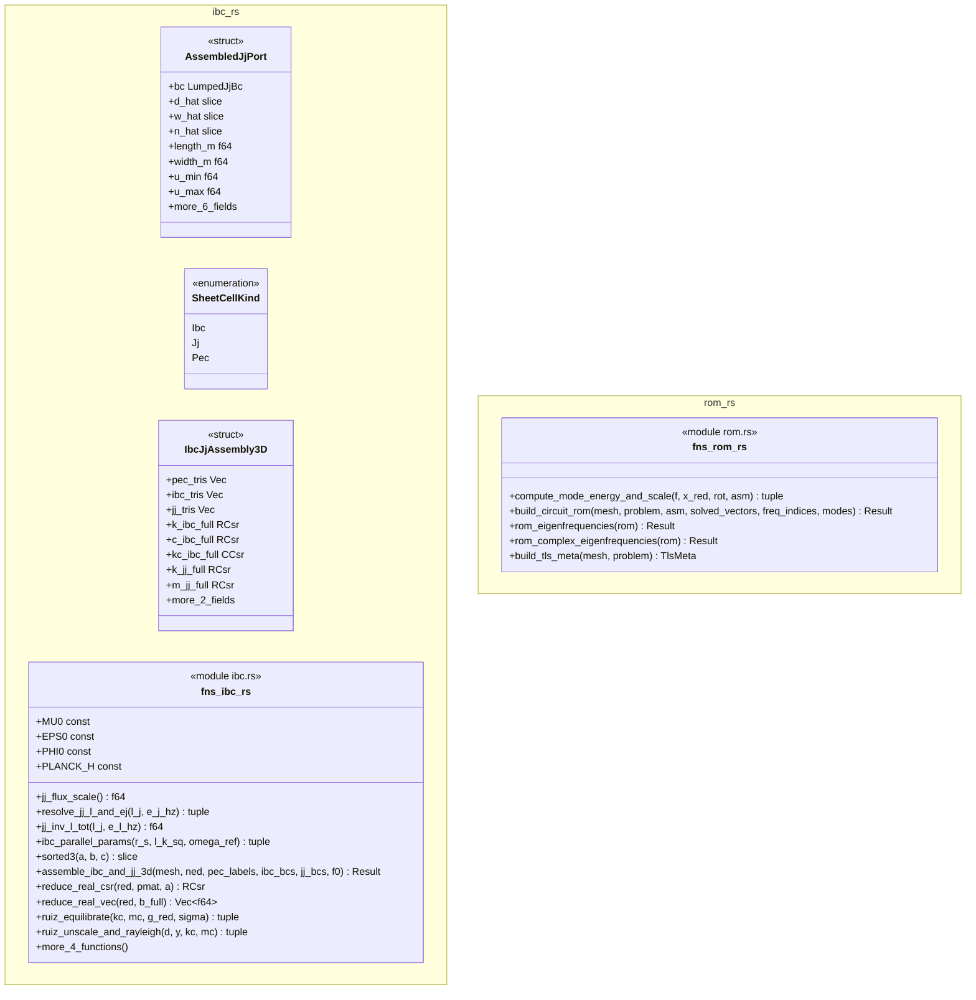

# Thin-film IBC and Josephson ROM: code

C4 level 4 (code) of the component **Thin-film IBC and Josephson ROM** (`ems.ibc`) in the container **nyx-ems** (crate `nyx_ems`). [Component view of the container](../../3-components/ems.md) · [All code pages](../README.md)

> Superconducting thin-film surface impedance boundary condition (Leontovich/two-fluid), rank-1 lumped Josephson port contribution, passive CircuitRom, and TLS metadata.

**Decisions:** [ADR 104](../../../adr/0104-bcs-surface-impedance-and-lumped-josephson-ports.md)  
**Size:** 2 files, 1791 lines.

## Files

| File | Lines | What it says about itself |
|---|---:|---|
| `crates/nyx-ems/src/ibc.rs` | 918 |  |
| `crates/nyx-ems/src/rom.rs` | 873 |  |

## What it uses

| Target | Modules | Items |
|---|---|---|
| [container `femcore` (femcore)](../../3-components/femcore.md) | edge, fem, linalg::amg_elastic, linalg::csr, linalg::csr::assembly, linalg::dense, linalg::driver, linalg::faer_glue +2 | C, CCoo, CCsr, Coo, CurvedTet, Dense, DirectSolver, Geometry, RCsr, Reduction +16 |
| [container `physics` (nyx-physics)](../../3-components/physics.md) | cqed, crate root | CircuitRom, Discretisation, ModeEnergyRow, RomPort, TlsMeta |
| [3D cavity kernel](./cavity.md) | cavity | EmwAssembly, Ned3, basis3, gradient_full |
| [Mode kernel](./modes.md) | crate root | C0 |
| [Typed problem](./problem.md) | problem | LumpedJjBc, Problem, SurfaceImpedanceBc |

## Used by

| Component | Modules | Items |
|---|---|---|
| [Physics adapter](./adapter.md) | rom | rom_complex_eigenfrequencies, rom_eigenfrequencies |
| [Axisymmetric kernel](./axisym.md) | ibc | add_ibc_2d_axisym, pec_edges_and_nodes_2d |
| [3D cavity kernel](./cavity.md) | ibc, rom | AssembledJjPort, EPS0, MU0, SheetCellKind, assemble_ibc_and_jj_3d, build_circuit_rom, build_tls_meta, compute_mode_energy_and_scale +5 |
| [Driven frequency-domain and PROM](./driven.md) | crate root, ibc, rom | AssembledJjPort, MU0, SheetCellKind, assemble_ibc_and_jj_3d, build_face_to_cell_3d, build_tls_meta, reduce_real_csr, reduce_real_vec +1 |
| [Mode kernel](./modes.md) | ibc | add_ibc_2d_waveguide, pec_edges_and_nodes_2d |
| [Complex-mode kernel](./modescx.md) | ibc | EPS0, MU0, add_ibc_2d_waveguide, pec_edges_and_nodes_2d |
| [Typed problem](./problem.md) | ibc | resolve_jj_l_and_ej |

## Class diagram

Public types with their public fields (or variants) and methods, free functions per file as a `module` box; arrows are field types and `impl Trait`. Capped at 36 types and a few members each; the table below is complete.

## Public items

| Kind | Item | File:line | Signature or summary |
|---|---|---|---|
| const | `MU0` | `ibc.rs:18` | `f64` —  Vacuum magnetic permeability `mu_0` in H/m. |
| const | `EPS0` | `ibc.rs:20` | `f64` —  Vacuum electric permittivity `eps_0 = 1 / (mu_0 c_0^2)` in F/m, consistent with `MU0` and `C0` to machine precision. |
| const | `PHI0` | `ibc.rs:22` | `f64` —  Superconducting magnetic flux quantum `Phi_0 = h / (2e)` in Wb. |
| const | `PLANCK_H` | `ibc.rs:24` | `f64` —  Planck constant `h` in J*s. |
| fn | `jj_flux_scale` | `ibc.rs:30` | `pub fn jj_flux_scale() -> f64` —  Conversion scale `(Phi_0 / (2 pi))^2 / h` relating `L_J` (H) and `E_J / h` (Hz): `L_J * E_J_Hz = jj_flux_scale()`. |
| fn | `resolve_jj_l_and_ej` | `ibc.rs:37` | `pub fn resolve_jj_l_and_ej(l_j: f64, e_j_hz: f64) -> (f64, f64)` —  Resolves `(L_j, E_j_Hz)` when one is given and the other is `<= 0.0`. |
| fn | `jj_inv_l_tot` | `ibc.rs:50` | `pub fn jj_inv_l_tot(l_j: f64, e_l_hz: f64) -> f64` —  Total inverse linear inductance `1 / L_tot = 1 / L_J + 1 / L_p` (1/H) of a lumped JJ port. |
| fn | `ibc_parallel_params` | `ibc.rs:60` | `pub fn ibc_parallel_params(r_s: f64, l_k_sq: f64, omega_ref: f64) -> (f64, f64)` —  Series-to-parallel conversion of `Z_s(omega_ref) = R_s + i omega_ref L_k_sq`: |
| fn | `sorted3` | `ibc.rs:75` | `pub fn sorted3(a: u32, b: u32, c: u32) -> [u32` |
| struct | `AssembledJjPort` | `ibc.rs:109` | fields: `bc`, `d_hat`, `w_hat`, `n_hat`, `length_m`, `width_m`, `u_min`, `u_max`, `inv_l_tot`, `triangles`, `b_full`, `b_red`, ... —  Assembled operators and geometric metadata for one `lumped_jj` terminal port. |
| enum | `SheetCellKind` | `ibc.rs:132` | variants: `Ibc`, `Jj`, `Pec` —  Sheet surface-current evaluator rule attached to a 3D cell face. |
| struct | `IbcJjAssembly3D` | `ibc.rs:139` | fields: `pec_tris`, `ibc_tris`, `jj_tris`, `k_ibc_full`, `c_ibc_full`, `kc_ibc_full`, `k_jj_full`, `m_jj_full`, `jj_ports`, `cell_sheet` —  Combined 3D assembly of `pec`, `surface_impedance`, and `lumped_jj` boundary conditions. |
| fn | `assemble_ibc_and_jj_3d` | `ibc.rs:241` | `pub fn assemble_ibc_and_jj_3d( mesh: &Discretisation, ned: &Ned3, pec_labels: &[i32], ibc_bcs: &[SurfaceImpedanceBc], jj_bcs: &[LumpedJjBc], f0: f64, ) -> Result<IbcJjAssembly3D, String>` —  Deduplicates and assembles all 3D `pec`, `surface_impedance`, and `lumped_jj` boundary conditions |
| fn | `reduce_real_csr` | `ibc.rs:528` | `pub fn reduce_real_csr(red: &femcore::periodic::Reduction, pmat: &CCsr, a: &RCsr) -> RCsr` —  Real congruence transform `P^H A P` for a real matrix `A` under a periodic/Dirichlet reduction `red`. |
| fn | `reduce_real_vec` | `ibc.rs:536` | `pub fn reduce_real_vec(red: &femcore::periodic::Reduction, b_full: &[f64]) -> Vec<f64>` —  Restricts a full real load vector `b_full` (`n`) to the reduced space `b_red = P^T b_full` (`nred`). |
| fn | `ruiz_equilibrate` | `ibc.rs:552` | `pub fn ruiz_equilibrate(kc: &CCsr, mc: &CCsr, g_red: &CCsr, sigma: f64) -> (Vec<f64>, CCsr, CCsr, CCsr, CCsr)` —  Computes iterative symmetric Ruiz diagonal scaling factors `d` on `\|K\| + sigma \|M\|`, |
| fn | `ruiz_unscale_and_rayleigh` | `ibc.rs:609` | `pub fn ruiz_unscale_and_rayleigh(d: &[f64], y: &[C], kc: &CCsr, mc: &CCsr) -> (Vec<C>, C)` —  Unscales a Ruiz-equilibrated eigenvector `x = D y` and computes its exact Rayleigh-quotient |
| fn | `ruiz_unscale_and_rayleigh_damped` | `ibc.rs:627` | `pub fn ruiz_unscale_and_rayleigh_damped( d: &[f64], y: &[C], kc_no_damp: &CCsr, c_damp: &RCsr, mc: &CCsr, ) -> (Vec<C>, C)` —  Unscales a Ruiz-equilibrated eigenvector `x = D y` and evaluates the mode-exact damped Rayleigh quotient |
| fn | `pec_edges_and_nodes_2d` | `ibc.rs:692` | `pub fn pec_edges_and_nodes_2d( mesh: &Discretisation, pec_labels: &[i32], ibc_bcs: &[SurfaceImpedanceBc], pmc_labels: &[i32], ) -> (Vec<usize>, Vec<usize>)` —  Collects PEC boundary edge indices `be` and vertex indices `bn` for a 2D mesh, honoring explicit `pec` |
| fn | `add_ibc_2d_waveguide` | `ibc.rs:723` | `pub fn add_ibc_2d_waveguide( mesh: &Discretisation, order: usize, freq: f64, pec_labels: &[i32], ibc_bcs: &[SurfaceImpedanceBc], a_coo: &mut CCoo, b_coo: &mut CCoo, ) -> Result<(), String>` —  Assembles 2D `surface_impedance` contributions into `(a_coo, b_coo)` for `modes` / `modes_complex`. |
| fn | `add_ibc_2d_axisym` | `ibc.rs:821` | `pub fn add_ibc_2d_axisym( mesh: &Discretisation, order: usize, f_search: f64, pec_labels: &[i32], ibc_bcs: &[SurfaceImpedanceBc], a_coo: &mut CCoo, ) -> Result<(), String>` —  Assembles 2D `surface_impedance` contributions into `a_coo` for `axisymmetric_modes` (`(r, z)` half-plane). |
| fn | `compute_mode_energy_and_scale` | `rom.rs:46` | `pub fn compute_mode_energy_and_scale(f: C, x_red: &[C], rot: C, asm: &EmwAssembly) -> (f64, ModeEnergyRow, f64)` —  Computes the physical scaling factor `s_E > 0` such that `U_elec,m = (1/4) eps_0 (s_E x_m)^H M_tot (s_E x_m) = 1 J`, |
| fn | `build_circuit_rom` | `rom.rs:528` | `pub fn build_circuit_rom( mesh: &Discretisation, problem: &Problem, asm: &EmwAssembly, solved_vectors: &[Vec<C>], freq_indices: &[(C, usize)], modes: Vec<ModeEnergyRow>, ) -> Result<CircuitRom, String>` —  Assembles the passive Craig-Bampton reduced-order model `CircuitRom` (`Q = orth_{M_0}([Q_static, Q_dyn])`). |
| fn | `rom_eigenfrequencies` | `rom.rs:684` | `pub fn rom_eigenfrequencies(rom: &CircuitRom) -> Result<Vec<f64>, String>` —  Evaluates the linearized resonant eigenfrequencies (Hz, ascending) of a `CircuitRom` by solving the |
| fn | `rom_complex_eigenfrequencies` | `rom.rs:722` | `pub fn rom_complex_eigenfrequencies(rom: &CircuitRom) -> Result<Vec<C>, String>` —  Evaluates the complex damped resonant eigenfrequencies (Hz, positive real part, ascending by `Re(f)`) |
| fn | `build_tls_meta` | `rom.rs:793` | `pub fn build_tls_meta(mesh: &Discretisation, problem: &Problem) -> TlsMeta` —  Builds `TlsMeta` for dielectric TLS surface participation analysis on a 3D `ems` result. |
