# Native mixed-cell EM: code

C4 level 4 (code) of the component **Native mixed-cell EM** (`ems.mixed`) in the container **nyx-ems** (crate `nyx_ems`). [Component view of the container](../../3-components/ems.md) · [All code pages](../README.md)

> Native mixed-cell Maxwell assemblers, Gauss-point curvilinear PML pullbacks, mixed ports/IBC/ROM, and Ams/AmsP2 curl-curl drivers.

**Decisions:** [ADR 128](../../../adr/0128-structured-curvilinear-pml-and-open-boundaries.md), [ADR 45](../../../adr/0045-ems-moves-into-nyx-ems.md), [ADR 132](../../../adr/0132-vvuq-asme-six-pillar-code-verification.md)  
**Size:** 1 file, 2182 lines.

## Files

| File | Lines | What it says about itself |
|---|---:|---|
| `crates/nyx-ems/src/mixed_ops.rs` | 2182 |  |

## What it uses

| Target | Modules | Items |
|---|---|---|
| [container `femcore` (femcore)](../../3-components/femcore.md) | edge, edge_mixed, fem, fem_mixed, linalg::ams, linalg::csr, linalg::csr::assembly, linalg::driver +12 | Ams, AmsOptions, C, CCsr, CEigPairs, CellData, CellType, Coo, FacetType, Geometry +56 |
| [container `physics` (nyx-physics)](../../3-components/physics.md) | crate root, result | DiagnosticSeverity, DiagnosticWarning, Discretisation |
| [3D cavity kernel](./cavity.md) | cavity | CURVED_QUAD_DEGREE, assemble_complex |
| [Driven frequency-domain and PROM](./driven.md) | ports | AssembledLumpedPort, AssembledWavePort |
| [Thin-film IBC and Josephson ROM](./ibc.md) | ibc | AssembledJjPort, ETA0, IbcJjAssembly3D, MU0, PerturbativeIbcTri, SheetCellKind, ibc_parallel_params, jj_inv_l_tot, sorted3 |
| [Mode kernel](./modes.md) | crate root, modes | C0, EpsCell, assemble_modes_with_bcs, solve_mode_pairs |
| [Typed problem](./problem.md) | problem | LumpedJjBc, LumpedPortBc, Problem, SurfaceImpedanceBc, symmetry_facet_flags_mixed |

## Used by

| Component | Modules | Items |
|---|---|---|
| [Physics adapter](./adapter.md) | mixed_ops | EmPmlTable, eigs_mixed_curl_curl_ams, solve_mixed_curl_curl_iterative |
| [Axisymmetric kernel](./axisym.md) | mixed_ops | C3, EmPmlTable, MixedCellMaterials, complex_eps_c3, iso_mu_inv_c3 |
| [3D cavity kernel](./cavity.md) | mixed_ops | EmPmlTable, MixedCellMaterials, add_bloch_point_c3, add_maxwell_point_c3, assemble_bloch_matrices_mixed, assemble_ibc_and_jj_3d_mixed, assemble_ibc_and_jj_3d_mixed_cavity, assemble_lumped_ports_3d_mixed +11 |
| [Driven frequency-domain and PROM](./driven.md) | mixed_ops | EmPmlTable, MixedCellMaterials, assemble_ibc_and_jj_3d_mixed, assemble_lumped_ports_3d_mixed, assemble_maxwell_mixed, assemble_waveports_3d_mixed, axes_of_3d_periodic_mixed, iso_mu_inv_c3 +4 |
| [Thin-film IBC and Josephson ROM](./ibc.md) | mixed_ops | gradient_mixed_full, scalar_nullspace_count_mixed |
| [Mode kernel](./modes.md) | mixed_ops | MixedCellMaterials |
| [Complex-mode kernel](./modescx.md) | mixed_ops | C3, EmPmlTable, MixedCellMaterials, complex_eps_c3, iso_mu_inv_c3 |

## Class diagram

Public types with their public fields (or variants) and methods, free functions per file as a `module` box; arrows are field types and `impl Trait`. Capped at 36 types and a few members each; the table below is complete.

```mermaid
classDiagram
  class ResolvedDomainPml {
      <<struct>>
      +spec Pml
      +fallback_bounds tuple
  }
  class EmPmlTable {
      <<struct>>
      +from_simplex(mesh, materials, f_ref, is_eigen, is_iterative) Self
      +from_mixed(mesh, materials, f_ref, is_eigen, is_iterative) Self
      +has_any() bool
      +is_pml(ci) bool
      +pml_cells_mask() Vec~bool~
      +eval_3d(ci, eps_0, mu_inv_0, x_wafer) tuple
      +eval_2d(ci, eps_local_0, mu_inv_local_0, x_2d, axisym) tuple
  }
  class MixedCellMaterials {
      <<struct>>
      +eps_0 Vec~C3~
      +mu_inv_0 Vec~C3~
      +eps_phys_re Vec~M3~
      +eps_phys_im Vec~M3~
      +d_omega_eps Vec~M3~
      +mur_phys Vec~f64~
      +from_problem(mesh, problem) Result
  }
  class MixedPeriodicMatch {
      <<struct>>
      +map HashMap
      +src_facets Vec~usize~
      +shift slice
  }
  class MixedFaceKey {
      <<enumeration>>
      Tri
      Quad
      +from_slice(fv) Self
      +vertices() Vec~u32~
  }
  class fns_mixed_ops_rs {
      <<module mixed_ops.rs>>
      +iso_mu_inv_c3(mur) C3
      +complex_eps_c3(re, im_loss) C3
      +c3_dot_rr(m, u, v) C
      +simplex_cell_materials_3d(mesh, problem) Result
      +add_maxwell_point_c3(which, nb, ke, w, cu, wq, eps, mu_inv)
      +assemble_maxwell_mixed(mesh, ned, eps_0, mu_inv_0, pml) tuple
      +add_bloch_point_c3(which, nb, ke, w, cu, wq, inv_k0, inv_k0_2, eps, mu_inv)
      +assemble_bloch_matrices_mixed(mesh, ned, k0, eps_0, mu_inv_0, pml) tuple
      +match_vertices_mixed(mesh, p) Result
      +vertex_keys_mixed(mesh, matches) Vec~u32~
      +more_13_functions()
      +C3 type
  }
```

## Public items

| Kind | Item | File:line | Signature or summary |
|---|---|---|---|
| type | `C3` | `mixed_ops.rs:49` |  Symmetric `3x3` complex material tensor (`eps` or `mu_inv`). |
| fn | `iso_mu_inv_c3` | `mixed_ops.rs:53` | `pub fn iso_mu_inv_c3(mur: f64) -> C3` —  Converts an isotropic scalar permeability `mu_r` into a diagonal `3x3` `C3` inverse permeability `diag(1/mu_r)`. |
| fn | `complex_eps_c3` | `mixed_ops.rs:61` | `pub fn complex_eps_c3(re: &M3, im_loss: &M3) -> C3` —  Converts a real+imaginary loss pair `(re, im_loss)` into complex `eps = re - i * im_loss`. |
| fn | `c3_dot_rr` | `mixed_ops.rs:73` | `pub fn c3_dot_rr(m: &C3, u: [f64; 3], v: [f64; 3]) -> C` —  Bilinear contraction `\sum_{a,b=0..3} m[a][b] * u[a] * v[b]` for real basis vectors `u, v`. |
| struct | `ResolvedDomainPml` | `mixed_ops.rs:85` | fields: `spec`, `fallback_bounds` —  Resolved per-domain PML specification with inferred geometric bounds and optional wavelength auto-scaling. |
| struct | `EmPmlTable` | `mixed_ops.rs:92` |  Per-cell lookup table for quadrature-point curvilinear PML Jacobian evaluation and Maxwell tensor pullback. |
| struct | `MixedCellMaterials` | `mixed_ops.rs:407` | fields: `eps_0`, `mu_inv_0`, `eps_phys_re`, `eps_phys_im`, `d_omega_eps`, `mur_phys` —  Unstretched per-cell electromagnetic tensors on a `MixedDiscretisation`. |
| fn | `simplex_cell_materials_3d` | `mixed_ops.rs:470` | `pub fn simplex_cell_materials_3d(mesh: &Discretisation, problem: &Problem) -> Result<(Vec<C3>, Vec<C3>), String>` —  Evaluates unstretched `(eps_0, mu_inv_0)` on a `SimplexMesh` (`Discretisation`) in 3D wafer axes. |
| fn | `add_maxwell_point_c3` | `mixed_ops.rs:485` | `pub fn add_maxwell_point_c3( which: usize, nb: usize, ke: &mut [C], w: &[[f64; 3]], cu: &[[f64; 3]], wq: f64, eps: &C3, mu_inv: &C3, )` |
| fn | `assemble_maxwell_mixed` | `mixed_ops.rs:513` | `pub fn assemble_maxwell_mixed( mesh: &MixedDiscretisation, ned: &NedMixed, eps_0: &[C3], mu_inv_0: &[C3], pml: Option<&EmPmlTable>, ) -> (CCsr, CCsr)` —  Assembles `(K, M)` on a 3D `MixedDiscretisation` (`Tet + Prism + Hex`) with quadrature-point PML pullback. |
| fn | `add_bloch_point_c3` | `mixed_ops.rs:555` | `pub fn add_bloch_point_c3( which: usize, nb: usize, ke: &mut [C], w: &[[f64; 3]], cu: &[[f64; 3]], wq: f64, inv_k0: f64, inv_k0_2: f64, eps: &C3, mu_inv: &C3, )` |
| fn | `assemble_bloch_matrices_mixed` | `mixed_ops.rs:606` | `pub fn assemble_bloch_matrices_mixed( mesh: &MixedDiscretisation, ned: &NedMixed, k0: f64, eps_0: &[C3], mu_inv_0: &[C3], pml: Option<&EmPmlTable>, ) -> (CCsr, CCsr, CCsr)` —  Assembles `(A0, A1, A2)` for 3D Floquet-Bloch modes on a `MixedDiscretisation`. |
| struct | `MixedPeriodicMatch` | `mixed_ops.rs:653` | fields: `map`, `src_facets`, `shift` —  Matched periodic boundary pair on a `MixedDiscretisation`. |
| fn | `match_vertices_mixed` | `mixed_ops.rs:659` | `pub fn match_vertices_mixed(mesh: &MixedDiscretisation, p: &Periodic) -> Result<MixedPeriodicMatch, String>` |
| fn | `vertex_keys_mixed` | `mixed_ops.rs:724` | `pub fn vertex_keys_mixed(mesh: &MixedDiscretisation, matches: &[MixedPeriodicMatch]) -> Vec<u32>` |
| fn | `nodal_relations_mixed_3d` | `mixed_ops.rs:747` | `pub fn nodal_relations_mixed_3d( mesh: &MixedDiscretisation, order: usize, m: &MixedPeriodicMatch, phase: f64, ) -> Result<Vec<(usize, usize, C)>, String>` —  Periodic scalar nullspace relations `(dest_col, src_col, exp(-i phase))` matching `gradient_p1_full` (`order == 1`) |
| fn | `axes_of_3d_periodic_mixed` | `mixed_ops.rs:798` | `pub fn axes_of_3d_periodic_mixed(periodic: &[Periodic], mesh: &MixedDiscretisation) -> ([usize` —  Infers `(lateral, normal, propagation)` polarization axes on a 3D `MixedDiscretisation`. |
| enum | `MixedFaceKey` | `mixed_ops.rs:835` | variants: `Tri`, `Quad` |
| fn | `build_face_to_cell_3d_mixed` | `mixed_ops.rs:860` | `pub fn build_face_to_cell_3d_mixed(mesh: &MixedDiscretisation) -> HashMap<MixedFaceKey, usize>` —  Maps every canonical 3D cell face (`Tri3` or `Quad4`) to the smallest-index adjacent cell `ci`. |
| fn | `eval_facet_tangential_basis_3d_mixed` | `mixed_ops.rs:891` | `pub fn eval_facet_tangential_basis_3d_mixed( mesh: &MixedDiscretisation, ned: &NedMixed, face_to_cell: &HashMap<MixedFaceKey, usize>, f: usize, ) -> Result<(usize, f64, [f64` —  Evaluates tangential Nedelec basis vectors `psi_{s,\|\|} = w_s - (w_s . n) n` at quadrature points on 3D facet `f` |
| fn | `validate_port_contacts_3d_mixed` | `mixed_ops.rs:1004` | `pub fn validate_port_contacts_3d_mixed(mesh: &MixedDiscretisation, problem: &Problem) -> Result<(), String>` —  Validates that every `lumped_jj` and `lumped_port` sheet on a 3D `MixedDiscretisation` contacts two conductors. |
| fn | `assemble_ibc_and_jj_3d_mixed` | `mixed_ops.rs:1081` | `pub fn assemble_ibc_and_jj_3d_mixed( mesh: &MixedDiscretisation, ned: &NedMixed, pec_labels: &[i32], ibc_bcs: &[SurfaceImpedanceBc], jj_bcs: &[LumpedJjBc], f_ref: f64, ) -> Result<(IbcJjAssembly3D, Vec<usize>, Vec<usize>, Vec<Vec<usize>>), String>` —  Assembles `pec`, `surface_impedance`, and `lumped_jj` boundary conditions on a 3D `MixedDiscretisation`, |
| fn | `assemble_ibc_and_jj_3d_mixed_cavity` | `mixed_ops.rs:1093` | `pub fn assemble_ibc_and_jj_3d_mixed_cavity( mesh: &MixedDiscretisation, ned: &NedMixed, pec_labels: &[i32], ibc_bcs: &[SurfaceImpedanceBc], jj_bcs: &[LumpedJjBc], f_ref: f64, ) -> Result<(IbcJjAssembly3D, Vec<usize>, Vec<usize>, Vec<Vec<usize>>), String>` —  Like [`assemble_ibc_and_jj_3d_mixed`], supporting `ibc_mode` (`"direct" \| "perturbative" \| "auto"`) for `cavity`. |
| fn | `assemble_lumped_ports_3d_mixed` | `mixed_ops.rs:1387` | `pub fn assemble_lumped_ports_3d_mixed( mesh: &MixedDiscretisation, ned: &NedMixed, pec_labels: &[i32], lumped_ports: &[LumpedPortBc], ) -> Result<(Vec<AssembledLumpedPort>, Vec<Vec<usize>>), String>` —  Assembles `lumped_port` conditions on a 3D `MixedDiscretisation`. |
| fn | `assemble_waveports_3d_mixed` | `mixed_ops.rs:1502` | `pub fn assemble_waveports_3d_mixed( mesh: &MixedDiscretisation, ned: &NedMixed, problem: &Problem, f_min: f64, f_max: f64, ) -> Result<(Vec<AssembledWavePort>, Vec<Vec<usize>>), String>` —  Assembles 2D boundary-mode `waveport` conditions on a 3D `MixedDiscretisation` (supporting both `Tri3` and `Quad4` port facets). |
| fn | `solve_mixed_curl_curl_iterative` | `mixed_ops.rs:2048` | `pub fn solve_mixed_curl_curl_iterative( mesh: &MixedDiscretisation, ned: &NedMixed, fixed_dofs: &[bool], fixed_edges: &[bool], fixed_verts: &[bool], fixed_quad_faces: &[bool], a: &CCsr, pc_matrix: Option<&CCsr>, rhs: &[C], opts: &IterativeCurlCurlOptions, ) -> Result<IterativeSolveReport<C>, String>` —  Solves a 3D mixed-cell curl-curl linear system `A x = rhs` on free DOFs (order 1 `Ams` or order 2 `AmsP2`) |
| fn | `eigs_mixed_curl_curl_ams` | `mixed_ops.rs:2101` | `pub fn eigs_mixed_curl_curl_ams( mesh: &MixedDiscretisation, ned: &NedMixed, fixed_dofs: &[bool], fixed_edges: &[bool], fixed_verts: &[bool], fixed_quad_faces: &[bool], k: &CCsr, m: &CCsr, target: C, nev: usize, tol: f64, max_it: usize, ) -> Result<CEigPairs, String>` —  Computes `nev` interior eigenpairs of a 3D mixed-cell `Tet + Prism + Hex` cavity `K x = lambda M x` near `target` |
| fn | `gradient_mixed_full` | `mixed_ops.rs:2150` | `pub fn gradient_mixed_full(mesh: &MixedDiscretisation, ned: &NedMixed) -> RCsr` —  Used by `MixedLagrange` scalar nullspace reduction on `MixedDiscretisation`. |
| fn | `scalar_nullspace_count_mixed` | `mixed_ops.rs:2158` | `pub fn scalar_nullspace_count_mixed(mesh: &MixedDiscretisation, order: usize) -> usize` |
| fn | `EmPmlTable::from_simplex` | `mixed_ops.rs:99` | `pub fn from_simplex( mesh: &Discretisation, materials: &Materials, f_ref: f64, is_eigen: bool, is_iterative: bool, ) -> Self` —  Builds a resolved PML table for a `SimplexMesh` (`Discretisation`). |
| fn | `EmPmlTable::from_mixed` | `mixed_ops.rs:129` | `pub fn from_mixed( mesh: &MixedDiscretisation, materials: &Materials, f_ref: f64, is_eigen: bool, is_iterative: bool, ) -> Self` —  Builds a resolved PML table for a `MixedDiscretisation`. |
| fn | `EmPmlTable::has_any` | `mixed_ops.rs:294` | `pub fn has_any(&self) -> bool` |
| fn | `EmPmlTable::is_pml` | `mixed_ops.rs:299` | `pub fn is_pml(&self, ci: usize) -> bool` |
| fn | `EmPmlTable::pml_cells_mask` | `mixed_ops.rs:303` | `pub fn pml_cells_mask(&self) -> Vec<bool>` |
| fn | `EmPmlTable::eval_3d` | `mixed_ops.rs:309` | `pub fn eval_3d(&self, ci: usize, eps_0: C3, mu_inv_0: C3, x_wafer: [f64; 3]) -> (C3, C3)` —  Evaluates pulled-back `(eps_tilde, mu_inv_tilde)` in 3D wafer axes `(x, y, z)` at `x_wafer`. |
| fn | `EmPmlTable::eval_2d` | `mixed_ops.rs:322` | `pub fn eval_2d( &self, ci: usize, eps_local_0: C3, mu_inv_local_0: C3, x_2d: [f64; 2], axisym: bool, ) -> (C3, C3, PmlJacobian)` —  Evaluates `(eps_tilde, mu_inv_tilde, jac)` in 2D cross-section/axisymmetric local axes `(x/r, z, y/theta)` |
| fn | `MixedCellMaterials::from_problem` | `mixed_ops.rs:417` | `pub fn from_problem(mesh: &MixedDiscretisation, problem: &Problem) -> Result<Self, String>` |
| fn | `MixedFaceKey::from_slice` | `mixed_ops.rs:841` | `pub fn from_slice(fv: &[u32]) -> Self` |
| fn | `MixedFaceKey::vertices` | `mixed_ops.rs:851` | `pub fn vertices(&self) -> Vec<u32>` |
